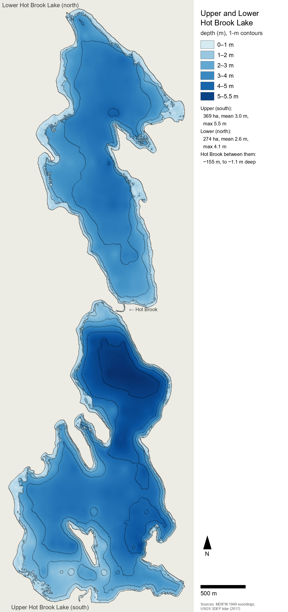

# The Hot Brook lakes of eastern Maine: a synthesis of a small-lake ecosystem, and what building a whole-lake simulation of it taught

**James Cupps**

Working paper, version 1.0 — 29 October 2026. Not peer reviewed. Prepared with AI assistance (see [Acknowledgements and the use of AI](#acknowledgements-and-the-use-of-ai)).

## Abstract

Upper and Lower Hot Brook Lake (369 and 274 ha by the 2017 lidar; maximum depths 5.5 and 4.0 m in the 1949 survey) are two shallow,
probably softwater lakes in the forested headwaters of the Penobscot basin in eastern Maine, joined by a brook about 150–200 m long. Like most small Maine lakes they are almost
unstudied: apart from species lists and a few specimen records, their scientific record is one fisheries survey in August 1949. This paper assembles what is known
of lakes like them — from 105 research notes on the physical limnology, nutrients, plankton, aquatic plants, fish, wildlife and forest
of Maine and comparable northern lakes, each value tagged by the strength of its evidence — and reports what building and testing a
whole-ecosystem simulation of the two lakes taught: a model whose fish, as individuals or schools, steer by innate habitat drives that their own neural
networks bend, and grow by Fish Bioenergetics 4.0, with the year's young followed as brainless schools. The literature's only whole-lake fish counts from Maine, in three small lakes deeper than these, give standing crops of 45–117 kg/ha
(the lowest a minimum); its only Maine diet data for adult chain pickerel and smallmouth bass (one 1940 survey) show white perch, not crayfish, as their main summer food; and it locates the
regulation of such lakes' fish communities largely in the first year of life. Building the model exposed errors that a parameter table hides:
rates that measured something else (a fertilisation rate read as field egg survival, the complement of a retention formula), corrective
adjustments that stacked until the pickerel killed prey at about a tenth of the rate expected from field data on pike, predation that shifted between two
representations of the same fish, a weather generator plausible on average but wrong in its sequence, and an inflow right in
total phosphorus but wrong in its chemical form. With its summer zooplankton, phosphorus retention and weed-bed depths near or inside
their field ranges, the model still loses fish biomass each year: its young white perch stall through their first summer and fail to
recruit while its predators eat down the founding stock. The measurements that would most reduce the uncertainty for these lakes and others like them are a season of water chemistry,
the inflow's phosphorus by form, and a survey of the fish and their young of the year.

**Keywords:** Maine lakes; small shallow lakes; warmwater fish; white perch; chain pickerel; smallmouth bass; recruitment; individual-based
model; bioenergetics; ecosystem model; data gaps

## Contents

- **Part 1: Introduction and study system** (§1–2)
  - [1. Introduction](#1-introduction)
  - [2. The study system — the Hot Brook lakes and their catchment](#2-the-study-system--the-hot-brook-lakes-and-their-catchment)
- **Part 2: Synthesis I: physics, nutrients, plankton and plants** (§3.0–3.4)
  - [3. Maine lake ecosystems: a synthesis](#3-maine-lake-ecosystems-a-synthesis)
  - [3.1 Climate, hydrology, ice and the physics of small shallow lakes](#31-climate-hydrology-ice-and-the-physics-of-small-shallow-lakes)
  - [3.2 Nutrients, shores and the land–lake link](#32-nutrients-shores-and-the-landlake-link)
  - [3.3 Plankton and the microbial loop](#33-plankton-and-the-microbial-loop)
  - [3.4 Aquatic plants and the littoral zone](#34-aquatic-plants-and-the-littoral-zone)
- **Part 3: Synthesis II: fish, early life, predation, wildlife and forest** (§3.5–3.8)
  - [3.5 The fish: community, life histories, energetics, seasonal habitat and movement](#35-the-fish-community-life-histories-energetics-seasonal-habitat-and-movement)
  - [3.6 Early life and recruitment](#36-early-life-and-recruitment)
  - [3.7 Predation and the food web](#37-predation-and-the-food-web)
  - [3.8 Wildlife, amphibians, reptiles, insects and the forest](#38-wildlife-amphibians-reptiles-insects-and-the-forest)
- **Part 4: The model and what building it taught** (§4–5)
  - [4. The model (Methods)](#4-the-model-methods)
  - [5. What building and testing the model taught](#5-what-building-and-testing-the-model-taught)
- **Part 5: Discussion, data availability and the use of AI** (§6 and back matter)
  - [6. Discussion: what is known, what is not, and what to measure](#6-discussion-what-is-known-what-is-not-and-what-to-measure)
  - [Data and code availability](#data-and-code-availability)
  - [Acknowledgements and the use of AI](#acknowledgements-and-the-use-of-ai)
- **[References](#references)**

## 1. Introduction

Maine has thousands of small lakes and ponds, and most of them have little or no scientific record. A typical one in the eastern forest
is a few hundred hectares of shallow, softwater, lightly to moderately coloured water, ringed by spruce–fir and northern hardwoods and a
scatter of camps. It holds a
warmwater fish community that is partly native and partly introduced, and it carries perhaps one fisheries survey from the mid-twentieth
century. Upper and Lower Hot Brook Lake, in the Penobscot headwaters on the Washington–Aroostook county line, are such a pair. Since a
single survey in August 1949 no measurement of their water has been found: no phosphorus, no chlorophyll, no plankton, no estimate of
any fish population (§2).

This paper arose from an attempt to simulate the two lakes and the brook between them as a whole ecosystem. The simulation follows the
water's temperature, ice, mixing, oxygen and nutrients, its algae, zooplankton, plants and bed animals, and its fish — individuals or schools, each steered
by habitat drives that its own neural network bends, and governed by published bioenergetics, with the year's young as brainless schools; around them it adds the birds, mammals, turtles and frogs, the anglers,
the camps and the weather. A model of that scope needs a value for every rate it uses, and each value has to come from somewhere. For
the Hot Brook lakes almost nothing comes from the lakes themselves. The work therefore became, first, a literature synthesis: 105
research notes (about 740,000 words, in `docs/research_notes/`) on the physical limnology, chemistry, plankton, plants, fish, wildlife and forest of Maine and comparable northern
lakes, every number tagged by how it was obtained (read in a primary source, taken from an abstract, cited second-hand, relayed by a search
summary, or inferred).
Building and testing the model then became a second kind of inquiry. Each time the simulated lakes failed to behave like real ones, the
failure had to be traced to a missing process, a mis-read parameter or an artifact of representation, and many of those traces taught
something general about small-lake ecology or about modelling it.

The paper reports both. Section 2 sets out what is actually recorded for the Hot Brook lakes and their catchment, keeping measurements
apart from estimates. Section 3 synthesises what is known of Maine lake ecosystems, from the physics of small shallow lakes through
nutrients, plankton, aquatic plants and the fish to the wildlife and forest around them, with the field values a reader would need to
build or test a model of such a lake. Section 4 describes the simulation. Section 5 reports what building and testing it taught: the
errors found and their causes, the mechanisms that turned out to matter, and where the model still fails. Section 6 draws the threads
together and lists the field measurements that would most reduce the uncertainty, for these lakes and for small Maine lakes generally.

Three conventions run throughout. Where the evidence for a value is weaker than a primary reading — an abstract, a second-hand citation,
the project's own arithmetic — the text says so. Values measured at Hot Brook are distinguished from values for comparable lakes and from
values elsewhere. And observations by an angler who fishes the lakes, which on several points are the only information there is, are
labelled as angler observations (project field notes).

## 2. The study system — the Hot Brook lakes and their catchment

Upper and Lower Hot Brook Lake are two shallow, unstratified lakes (soft-water, to judge by their measured neighbours) in the
forested headwaters of the Penobscot basin in eastern Maine, joined by a short rocky stretch of Hot Brook. They are typical of the region's warmwater lakes, and they are poorly
measured: one fisheries survey of August 1949, a handful of agency species lists and specimen records, and remote-sensing products are
nearly all that is on record. This section sets out that record and keeps it apart from three other kinds of evidence: values estimated
from nearby analogue lakes, the project's own calculations, and the observations of an angler who fishes the lakes. Section 3 gives the
regional synthesis behind the analogue values.
<!-- src: Hot Brook populations and water/hot_brook_lake_records.md; Maine lakes ponds and streams/maine_fish_community_hot_brook.md -->

### 2.1 Location, drainage, catchment and climate

Upper Hot Brook Lake (Maine MIDAS 1076; centroid about 45.62° N, 67.94° W) and Lower Hot Brook Lake (MIDAS 1072; about 45.65° N,
67.94° W) lie in the town of Danforth and the unorganised township T8 R4 NBPP, Washington County, at the Aroostook County line. The
survey sheets also name Bancroft (Aroostook County), and the fishing law lists the waters under Bancroft, Danforth, T8 R3 NBPP and
T8 R4 NBPP (MDIFW 1949; MDIFW 2026). They fall on the USGS Jimmey Mountain and Stetson Mountain quadrangles, in MDIFW fisheries Region F
(Penobscot), the South fishing zone and Wildlife Management District 11. The Maine DEP lake layer gives water-surface elevations of
424 ft (129.2 m) for Upper and 422 ft (128.6 m) for Lower; the 2017 lidar's hydro-flattened surfaces stand at 128.93 m and 128.23 m
(USGS 2019).
<!-- src: Hot Brook populations and water/hot_brook_lake_records.md; Hot Brook populations and water/gemini_hot_brook_checked.md (region and areas marked CONFIRMED); Hot Brook populations and water/lidar_and_shallows.md; Maine lakes ponds and streams/maine_fish_community_hot_brook.md; Hot Brook populations and water/birds_mammals_people_evidence.md -->

The lakes drain to the Penobscot. Hot Brook enters Upper's south shore, leaves Upper at its north end, runs roughly 150–200 m to Lower's
south end, leaves Lower at its north end, and flows about 3 km north to Baskahegan Stream. Baskahegan Stream joins the Mattawamkeag River
about 7.4 km farther on, and the Mattawamkeag meets the Penobscot about 54 km below that. The lakes form HUC-12 010200030403 ("Lower Hot
Brook Lake") within the Baskahegan Stream HUC-10 (0102000304) of the Mattawamkeag HUC-8 (01020003). Summed NHDPlus flowlines put the
end of the network, in the Penobscot estuary, about 203.5 km from the head of Lower, or about 200 km from its outlet (project
calculation); the Atlantic Salmon Federation places Danforth, about 7 km upstream of Hot Brook's mouth, about 130 mi (≈ 209 km)
above tidewater (ASF 2021). The lakes sit near a major divide: East Grand
Lake, also in Danforth, drains to the St. Croix, as do 14 of the 22 lakes listed for the surrounding towns (MDIFW 2007; project tally).
<!-- src: Hot Brook populations and water/drainage_species_and_eel.md; Hot Brook populations and water/hot_brook_lake_records.md; Maine lakes ponds and streams/maine_limnology_streams.md; Fish in streams connecting lakes/minnows_and_sunfish_in_connecting_streams.md -->

No published watershed area has been found: the DEP watershed layer holds no polygon for either lake, the Lakes of Maine pages
that usually list one could not be reached, and two earlier project notes recorded the area as unknown. Summing NHDPlus
catchments along the USGS NLDI network gives 65.8 km² (25.4 mi²) at Upper's outlet and 77.2 km² (29.8 mi²) at Lower's, catchment-to-lake ratios of about 18:1 and 28:1. Hot Brook drains about 36.2 km² where it enters Upper,
roughly 55 % of Upper's catchment, and Lower's own local catchment is about 11.4 km² (all project calculations). By EPA StreamCat
(NLCD 2019), Upper's catchment is 73.0 % forest (deciduous 30.0 %, mixed 32.3 %, evergreen 10.7 %), 14.4 % woody and 0.7 % herbaceous
wetland, 5.7 % open water and 2.8 % developed (mostly developed open space, 2.4 %), with 0.17 % hay, no cropland and a mean elevation of
165 m. Lower's catchment is similar: 70.4 % forest, 14.4 % woody wetland, 8.5 % open water and 2.5 % developed.
<!-- src: Hot Brook populations and water/hot_brook_lake_records.md; Maine lake shores and catchment/catchment_P_loads.md; Maine lake shores and catchment/weather_and_catchment_hydrology.md -->

The survey sheets describe both lakes as surrounded by "spruce fir forest" (Upper "mostly"), with wetlands to the south and west
of Upper and the north and east of Lower (MDIFW 1949); the satellite classes are mostly deciduous and mixed instead. Among the 105 USDA Forest Inventory
and Analysis plots within 40 km, the median stand is 55 years old, and maple–beech–birch types hold 48 % of the plots, spruce–fir 34 %
and aspen–birch 11 % (project analysis of FIA data). Much of the surrounding land is managed timberland, and the Stetson I and II wind farms
(about 2009–2010) stand on ridges off Route 169 between Danforth and Springfield. No bedrock or surficial geology for the catchment was
examined for this paper, and the groundwater share of inflow is unknown. The shores are described as rocky with some sand and mud (MDIFW
1949), and Maine DEP reports depleted calcium in "Down East" watersheds (Maine DEP 2024).
<!-- src: Maine forest structure/forest_layers_and_crowns.md; Hot Brook populations and water/full_biota_and_processes.md; Hot Brook populations and water/recent_maine_research.md; Maine lake shores and catchment/weather_and_catchment_hydrology.md -->

The Danforth cooperative station (USC00171833), a few kilometres east of the lakes, has 1991–2020 normals of 4.9 °C for the annual
mean, −10.3 °C for January and 18.8 °C for July, with about 198 days a year whose minimum falls below freezing. Precipitation averages 1,157 mm (45.56 in),
spread evenly at 84–118 mm a month, and snowfall 243 cm (95.7 in) (NOAA NCEI 2021). Houlton International Airport, about 55 km north-north-east of the lakes (project calculation from coordinates),
is slightly drier (4.8 °C; 998 mm); its hourly wind normals average 3.2 m/s, from 3.7 m/s in March to 2.6 m/s in August. For the Hot
Brook catchment itself, StreamCat gives 1,203–1,205 mm of precipitation, 5.4 °C and 646 mm/yr of runoff.
<!-- src: Hot Brook populations and water/gemini_hydrology_checked.md (NCEI normals read from the normals service); Hot Brook populations and water/hot_brook_lake_records.md; Maine lake shores and catchment/houlton_daily_precipitation.md (the notes say ~70 and ~50 km; ~55 km from the coordinates: lakes ~45.63° N 67.94° W, KHUL 46.12° N 67.79° W per shore_geometry_and_vegetation.md) -->

No ice dates have been recorded at Hot Brook. On East Grand Lake in Danforth, ice-out averaged 23 April over 2015–2026 (range 12 April
to 2 May, n = 11) and 17–18 April over 2021–2026 (Maine BPL ice-out records; project means); on West Grand Lake it averaged 24 April
over 1979–2008 (Hodgkins 2010). No ice-on record for a nearby lake was found.
<!-- src: Hot Brook populations and water/recent_maine_research.md; Hot Brook populations and water/full_biota_and_processes.md -->

### 2.2 Morphometry

The two lakes are broad, flat-bottomed basins. Their mapped areas differ by up to about 2.5 % (Upper) and 5 % (Lower) among modern
sources. MDIFW's 1949 planimetry for Lower (713 ac) is 4–5 % larger than the DEP, NWI and lidar outlines (NHDPlus, at 708 ac, comes
within 1 %) and is still the figure printed in the state fishing guides. Table 1 gives each value with its source; values from
different sources are not combined.

**Table 1.** Area and depth of the Hot Brook lakes by source. Values in parentheses are conversions or project calculations.

| Source (method, date) | Upper area | Upper mean depth | Upper max depth | Lower area | Lower mean depth | Lower max depth |
|---|---|---|---|---|---|---|
| MDIFW survey sheets (planimetry and soundings, Aug 1949; rev. 1965, 2004) | 912 ac (369 ha) | — (3.25 m)ᵃ | 18 ft (5.5 m) | 713 ac (289 ha) | — (2.71 m)ᵃ | 13 ft (4.0 m) |
| Lakes of Maine (DEP/LSM summary; via search summaries) | 890 ac (360 ha) | 11 ft (3.35 m) | 18 ft | 684 ac (277 ha) | 9 ft (2.74 m) | 13 ft |
| Maine DEP MIDAS polygons | 890.3 ac (3.60 km²) | — | — | 683.9 ac (2.77 km²) | — | — |
| MDIFW depth chart, Lower (2024; "Maine IFW – Historic") | — | — | — | 684 ac (277 ha) | 8 ft (2.44 m) | 13 ft (3.96 m) |
| NHDPlus V2 | 3.634 km² (898 ac) | — | — | 2.865 km² (708 ac) | — | — |
| USFWS National Wetlands Inventory (L1UBH) | 898.3 ac | — | — | 681.7 ac | — | — |
| USGS 3DEP lidar (2017; hydro-flattened water, 15-m grid) | 369 ha | — | — | 274 ha | — | — |
| The model's grid (1949 soundings fitted to the lidar shoreline; 0.25-m waterline) | 369 ha | 3.0 m | 5.5 m | 274 ha | 2.6 m | 4.1 m |

ᵃ Unweighted mean of the 83 (Upper) and 63 (Lower) transect soundings on the 1949 maps (project tally); not an area-weighted mean.
<!-- src: Hot Brook populations and water/hot_brook_lake_records.md; Hot Brook populations and water/gemini_hot_brook_checked.md (areas, Lower mean depth and maxima marked CONFIRMED); Hot Brook populations and water/lidar_and_shallows.md; Hot Brook populations and water/plant_species_hot_brook.md; Maine lakes ponds and streams/maine_fish_community_hot_brook.md; Maine lakes ponds and streams/maine_limnology_streams.md -->

Upper, about 3.4 km north–south by 1.9 km across, has its deepest water, 5.5 m (18 ft), in a north basin beside the outlet. A narrows
of 4–5 m (13–16 ft) leads south to a broad basin of 3.4–4.3 m (11–14 ft), edged along the south shore by a shelf 0.6–3 m (2–10 ft)
deep. Lower, about 3.3 by 1.7 km, is a saucer: most soundings read 2.7–3.7 m (9–12 ft), the deepest, 4.0 m (13 ft), lies south of
centre, a long central trough sits inside the 10-ft contour, and the large eastern bay is 1.2–3.4 m (4–11 ft) deep (MDIFW 1949; MDIFW
2024). The 1949 map draws two islands in Upper; modern outlines show one, of about 4.2 ha.
<!-- src: fetched_sources_digest.md §1 (sounding rows read from the sheets); Hot Brook populations and water/hot_brook_lake_records.md; Maine lakes ponds and streams/maine_fish_community_hot_brook.md -->

Shoreline length is about 14.6 km for Upper (13.3 km of mainland plus the island) and 10.8 km for Lower (project GIS; Lakes of Maine
gives 9 mi and 6.7 mi), for shoreline development factors of about 2.2 and 1.8. The Lakes of Maine mean depths are 0.61 (Upper)
and 0.69 (Lower) of the maximum depths, against a median of 0.35 in 29 Maine lakes of a 1980 USGS study (project tally of Cowing
& Scott 1980): the basins are unusually flat. Volumes come to about 12.1 × 10⁶ m³ and 7.6 × 10⁶ m³ from the Lakes of Maine mean depths, or
11.1 and 7.4 × 10⁶ m³ in a second project calculation. Both sheets state
that the lake "is shallow and does not stratify during summer months" (MDIFW 1949).
<!-- src: Hot Brook populations and water/hot_brook_lake_records.md; Maine lakes ponds and streams/maine_fish_community_hot_brook.md; Maine lake shores and catchment/shore_geometry_and_vegetation.md; Maine lake shores and catchment/catchment_P_loads.md; Maine lakes ponds and streams/maine_limnology_streams.md (mean/max ratios; USGS WRI 80-69 tally) -->

The bathymetry rests on the 1949 transects, which barely reach the shallows: only four of each lake's 63–83 soundings lie within 50 m
of shore, and the median sounding is about 150 m out. The model's bed (Figure 1) fits those soundings to the 2017 lidar shoreline and,
for water ≤ 1 m deep, uses depths estimated from NAIP aerial photographs, with the edge of the shelf set at 1.3 m from one angler
observation (the shallows stay "a foot or two deep" out to about chest depth before the water darkens). Tested leave-one-out against
the 21 soundings ≤ 3 m, the photo depths had no skill at 1–3 m (r = −0.01, RMS error 0.84 m, against r = 0.55 and 0.71 m for
interpolation between soundings), so the photographs inform only the 0–1.3 m fringe (project analysis). On this bed 12 % of Upper
and 16 % of Lower lie at ≤ 1 m, and 44 % and 55 % at ≤ 3 m.
<!-- src: Hot Brook populations and water/lidar_and_shallows.md; Hot Brook populations and water/plant_species_hot_brook.md -->

**Figure 1.** Depth of Upper Hot Brook Lake (south) and Lower Hot Brook Lake (north) on the model's grid (5-m cells; shading by depth,
1-m contours). The bed is the August 1949 MDIFW soundings fitted to the 2017 USGS 3DEP lidar shoreline, with photo-derived depths in
the fringe ≤ 1 m. Upper: 369 ha, mean 3.0 m, maximum 5.5 m (north basin, by the outlet). Lower: 274 ha, mean 2.6 m, maximum 4.1 m.
Hot Brook joins them over about 154 m, with pools to about 1.1 m. The nearshore shelf is poorly constrained: the median 1949 sounding
lies about 150 m from shore.
<!-- src: Hot Brook populations and water/lidar_and_shallows.md; docs/paper/figures/fig1_bathymetry.py -->

### 2.3 Hydrology: inflow, the connecting brook, outlet and flushing

Hot Brook is the main inflow; Upper also receives "several small tributaries", none with "any suitable habitat for coldwater fish"
(MDIFW 1949), and a Maine Forest Service map labels an East and a West Branch Hot Brook (search summary only). From the catchment area
and StreamCat runoff, mean inflow at Upper's inlet is about 0.74 m³/s (project calculation). Route 169 crosses Hot Brook about 2.5 km
above the lake on a metal pipe-arch culvert 17 ft wide, 10 ft high and 86 ft long (5.2 × 3.0 × 26 m), rated a "Potential Barrier" in a
2009 survey (Maine Stream Habitat Viewer); MaineDOT lists a 17.6-ft bridge of 1979 at the same point, probably the same structure.
Along Upper's south and east shores the road passes over 29 cross-culverts of 12–48 in and one of 60 in (MaineDOT).
<!-- src: Hot Brook populations and water/hot_brook_lake_records.md; Hot Brook populations and water/gemini_hot_brook_checked.md (crossing read directly from the Stream Habitat Viewer); Hot Brook populations and water/birds_mammals_people_evidence.md; Maine lakes ponds and streams/maine_fish_community_hot_brook.md -->

MDIFW describes the connecting brook as "a short (1/8 mile) non-navigable connecting stream", "rocky and hard bottomed" and without
coldwater habitat; a boater "must be prepared to paddle, pole, or walk a boat" through it, so Lower has no motorboat access (MDIFW 1949).
Its length is about 142 m on NHDPlus, about 200 m by MDIFW's eighth of a mile, and 154 m on the lidar used for the model. The 2017
lidar water surfaces fall 0.70 m from Upper to Lower, a gradient of about 0.45 %; DEP's rounded elevations give 2 ft (0.6 m). The
National Wetlands Inventory maps the stream as 0.4 ac (about 1,600 m²) of lower perennial riverine habitat; a project estimate of
about 8 m width gives roughly 1,200 m². No road crosses it. No width, depth, substrate, discharge, temperature or fish survey of the
brook has been found; its flow is Upper's outflow, a mean of about 1.3 m³/s (project calculation).
<!-- src: Hot Brook populations and water/hot_brook_lake_records.md; Hot Brook populations and water/lidar_and_shallows.md; Hot Brook populations and water/plant_species_hot_brook.md; Fish in streams connecting lakes/lake_outlet_stream_ecology.md -->

The angler's observations (project field notes) supply the stream's form: pools 3–4 ft (about 0.9–1.2 m) deep, the deepest where the
brook leaves Upper; cobble riffles, one of them running straight into a lake; and slow runs over orange-brown sand with sunken wood. On 24 August 2025, in
a dry summer, the brook was nearly dry, reduced to one thin channel, with riffles that could be walked across and bars grown with
sensitive fern and grasses.
<!-- src: Hot Brook populations and water/plant_species_hot_brook.md; Maine lake shores and catchment/littoral_substrate_and_wood.md; Hot Brook populations and water/full_biota_and_processes.md -->

Lower drains from its north end by Hot Brook, which runs about 2.95 km (NHDPlus) to Baskahegan Stream and joins it about 7.1 km of
flowline below the 1845 dam at Danforth (National Inventory of Dams ME00178; 16 ft, 4.9 m high) that impounds Crooked Brook Flowage.
Neither the state dam layer nor the NID holds a dam on either lake. A railroad crosses Hot Brook about 2.2 km below Lower, its
passability rated unknown (Maine Stream Habitat Viewer, 2009). In 1949 a legislative document proposed $750 for "a fish screen at
outlet of Lower Hot Brook", to be maintained by the Danforth Rod and Gun Club; whether it was enacted or built is unknown (Maine
Legislature 1949). Any present control of lake level is probably beaver-made (inference): the NWI codes several wetlands within 500 m
of both lakes as beaver-modified, though only from aerial photographs.
<!-- src: Hot Brook populations and water/drainage_species_and_eel.md; Hot Brook populations and water/gemini_hot_brook_checked.md (no dam: CONFIRMED; the Danforth-dam distance re-measured on NHD); Hot Brook populations and water/hot_brook_lake_records.md; Hot Brook populations and water/birds_mammals_people_evidence.md -->

No published flushing rate, lake-level record or outlet-sill elevation has been found (the Lakes of Maine pages, which usually
give a flushing rate, could not be reached). The project's water balance, from catchment runoff and the lake volumes, puts Upper's
mean outflow at about 1.28–1.35 m³/s, a flushing rate of 3.5–3.7 a year and a residence time near
100 days, and Lower's at about 1.55–1.58 m³/s, 6.6 a year and about 55 days; about 83–85 % of Lower's inflow arrives through the brook
from Upper (two project calculations).
<!-- src: Hot Brook populations and water/hot_brook_lake_records.md; Maine lake shores and catchment/catchment_P_loads.md -->

The seasonal pattern can be read from the Mattawamkeag River near Mattawamkeag (USGS 01030500; 1,418 mi², 3,670 km²), which integrates
the Hot Brook catchment. Over 1934–2001 its April mean flow was 3.4 times the annual mean and its August mean 0.29 times (Dudley 2004a),
and the flow exceeded 90 % of the time is 0.105 times the mean (Nielsen, Lippert & Caldwell 1997). The years 2025 and 2026 were exceptionally dry: the river
set record low flows in 2025, and on 7 October 2026 recorded its second-lowest flow since 1934, with a 2026 minimum of 23 cfs, about
0.009 times the long-term mean (NWS Caribou 2026; USGS NWIS provisional data).
<!-- src: Hot Brook populations and water/gemini_hydrology_checked.md (values re-read from USGS SIR 2004-5026, WDR ME-96-1 and NWIS); Maine lake shores and catchment/weather_and_catchment_hydrology.md -->

### 2.4 Water quality: one reading in 1949, analogues since

No water-quality measurement of either lake since the August 1949 survey has been found. Neither appears in DEP's annual-means
compilation of 1,072 lakes for 1940–2018 (Bacon & Vaux 2019), in the DEP/Volunteer Lake Monitoring Program data tables of 2025 (Maine DEP & VLMP 2025), in
DEP's lake sampling-station layer or in the Water Quality Portal; the 2025 combined LSM–DEP dataset could not be checked, and the Lakes
of Maine pages were blocked to scripted access. The 1949 sheets print a surface temperature of 74 °F (23.3 °C) for both lakes, and both
carry a second line, "75 feet – 71 °F" (21.7 °C). That depth is impossible in lakes of 18 and 13 ft, and the identical line on both
sheets is probably a garbled near-bottom reading or a template error (project reading of MDIFW 1949).
No Secchi depth, colour, total phosphorus (TP), chlorophyll a, pH, alkalinity, conductivity, dissolved
organic carbon, calcium or oxygen profile, summer or under ice, has been found for either lake.
<!-- src: Hot Brook populations and water/hot_brook_lake_records.md; Hot Brook populations and water/recent_maine_research.md; Hot Brook populations and water/maine_dep_lakes_data_2025.md; Maine lakes ponds and streams/maine_fish_community_hot_brook.md -->

In DEP's 2024 Integrated Report both lakes are in EPA Category 2 (assessment units 0102000304_1076L and 0102000304_1072L), which the
notes read as attainment presumed without data. Neither is on DEP's algal-bloom risk list; both are recorded as not infested by
invasive plants, with invasion-risk scores of 26 (Upper) and 24 (Lower) on an 11–87 scale (Maine DEP 2024). No fish from either lake
has been analysed for mercury; the statewide freshwater fish-consumption advisory applies.
<!-- src: Hot Brook populations and water/recent_maine_research.md; Hot Brook populations and water/plant_species_hot_brook.md; Hot Brook populations and water/hot_brook_lake_records.md; Hot Brook populations and water/full_biota_and_processes.md (statewide mercury advisory) -->

The nearest measured lakes are listed in Table 2. Baskahegan Lake, in the same drainage about 13 km away and 6.7 m deep, is the closest
analogue; it was fully mixed on 23 August 2004 (20.7 °C, 8.7 mg/L O₂ from the surface to 5 m), and shallow Faulkner Lake held 7.9–8.6
mg/L at the bottom in late summer 2004 and 2006 (Maine DEP & VLMP 2025). Calcium was 2.1–4.0 mg/L in National Lakes Assessment samples from
Skitacook and Pleasant lakes.
<!-- src: Hot Brook populations and water/maine_dep_lakes_data_2025.md; Hot Brook populations and water/recent_maine_research.md -->

**Table 2.** Water quality in the nearest measured lakes (annual or single-visit means; none at Hot Brook).

| Lake (MIDAS), relation to Hot Brook, max depth | Years | Secchi (m) | Colour (SPU/PCU) | TP (µg/L) | Chl a (µg/L) | pH | Alkalinity (mg/L CaCO₃) | Source |
|---|---|---|---|---|---|---|---|---|
| Baskahegan Lake (1078), same drainage, ~13 km; 6.7 m | 2001–2011 | 3.7–4.7 | 46 (2004) | 9–10 | 3.1–3.3 | 6.6 | 5.5 | Bacon & Vaux 2019; Maine DEP & VLMP 2025 |
| Faulkner Lake (1064), Weston; 3.7 m | 2003–2006 | 3.5–4.5 | 18 | 9–12 | 3.6–5.5 | 6.8–7.0 | 8.4 | Maine DEP & VLMP 2025 |
| North Lake (1063), Orient | 1992–2014 | 3.3–4.6 | — | — | — | — | — | Maine DEP & VLMP 2025 |
| Skitacook Lake (1730), ~47 km NNW; 5.2 m | 2012, 2017 (NLA) | 3.4–4.2 | 22–25 | 7.6–9 | 2.1–2.5 | 7.1–7.4 (2017) | — | USEPA NLA via WQP |
| Webster Pond (4678), ~27 km SW | 2012 (NLA) | 2.76 | 27 | 13 | 3.6–3.9 | — | — | USEPA NLA via WQP |

<!-- src: Hot Brook populations and water/maine_dep_lakes_data_2025.md; Hot Brook populations and water/hot_brook_lake_records.md; Hot Brook populations and water/recent_maine_research.md -->

From these analogues the project expects Secchi of about 3.5–4.5 m, colour about 20–50 SPU, TP about 8–12 µg/L, chlorophyll a 2.5–4
µg/L, pH 6.6–7.2, alkalinity 5–12 mg/L and conductivity 22–30 µS/cm at Hot Brook (project inference). The "TP 9–10 µg/L, alkalinity
~5 mg/L" in the project's fish census are estimates of this kind, not measurements. On Baskahegan's 2004 values the Carlson
trophic-state index is 37–42, the oligotrophic–mesotrophic boundary (project calculation), and an export-coefficient budget for the
catchment predicts in-lake TP of about 8 µg/L in Upper and 6 µg/L in Lower before any internal loading (project estimate). Earlier
project notes inferred a browner, richer lake (colour 30–60 SPU, TP 10–20 µg/L, chlorophyll 3–8 µg/L) from general Maine
coloured-lake patterns; they predate the DEP analogue data and are superseded. The angler judges the water "a bit clearer" than
the model's (project field notes). No under-ice oxygen profile has been found for any nearby lake; the notes read the persistence of
a principal white perch fishery with no recorded winterkill as indirect evidence that winter oxygen stays adequate (inference).
<!-- src: Hot Brook populations and water/hot_brook_lake_records.md; Hot Brook populations and water/plankton_microbes_plants_evidence.md; Hot Brook populations and water/species_numbers_northern_lakes.md; Maine lake shores and catchment/catchment_P_loads.md; Maine lakes ponds and streams/maine_limnology_streams.md; Hot Brook populations and water/maine_dep_lakes_data_2025.md; Hot Brook populations and water/invertebrates_plankton_plants.md §5 (the earlier 30–60 SPU inference); fetched_sources_digest.md (white perch plan) -->

### 2.5 Fish: records, regulation, stocking and the drainage

Three MDIFW records list the lakes' fish (Table 3). The 1949 survey sheets (revised 1965 and 2004; Federal Aid project F-28-P) name
smallmouth bass, white perch, yellow perch, chain pickerel, bullhead ("horn pout") and banded killifish, and, under the heading
"Minnows", blacknose dace, fallfish and white sucker; the principal fisheries are smallmouth, white perch and chain pickerel, and each
lake is called "a typical warm water lake" with "excellent spawning and adult habitat for bass, perch, and pickerel" (MDIFW 1949). The
*Lake Fish of Maine* database, compiled from MDIFW lake surveys, older surveys and informal records, lists ten species for Upper (the
1949 nine plus pumpkinseed) and nine for Lower, with no extirpations (MDIFW 2007). MDIFW's 2024 depth chart for Lower names chain
pickerel, smallmouth and white perch as principal species and banded killifish, blacknose dace, brown bullhead, fallfish, pumpkinseed,
sea-run alewife, white sucker and yellow perch as others (MDIFW 2024). It is the first record of alewife in the lakes, and it fills
pumpkinseed's gap in Lower's 2007 list.
<!-- src: Hot Brook populations and water/hot_brook_lake_records.md; Hot Brook populations and water/drainage_species_and_eel.md; Maine lakes ponds and streams/maine_fish_community_hot_brook.md -->

None of these records gives gear, effort, abundance or the year each species was recorded, so an absence from them is weak evidence for small fish, eels and seasonal migrants,
and the sheets do not say which species the 1965 and 2004 revisions added. No electrofishing, population-estimate netting, creel
survey or age-and-growth sample has been found for either lake, and the EPA's 1991–94 Northeast lake survey (EMAP) did not visit them.
<!-- src: Hot Brook populations and water/hot_brook_lake_records.md; Hot Brook populations and water/eastern_maine_relative_abundance.md; Fish in streams connecting lakes/minnows_and_sunfish_in_connecting_streams.md -->

**Table 3.** Fish recorded at the Hot Brook lakes, by source. "Angler" = angler observations (project field notes; §2.11).

| Species | MDIFW sheets 1949 (both lakes) | *Lake Fish of Maine* 2007: Upper / Lower | MDIFW chart 2024 (Lower) | Angler |
|---|---|---|---|---|
| Smallmouth bass (*Micropterus dolomieu*) | principal | yes / yes | principal | most logged catches |
| White perch (*Morone americana*) | principal | yes / yes | principal | "mostly white perch" |
| Chain pickerel (*Esox niger*) | principal | yes / yes | principal | a few |
| Yellow perch (*Perca flavescens*) | yes | yes / yes | yes | scarce, small |
| Brown bullhead (*Ameiurus nebulosus*) | yes ("horn pout") | yes / yes | yes | yes (Upper) |
| White sucker (*Catostomus commersonii*) | yes (under "Minnows") | yes / yes | yes | — |
| Fallfish (*Semotilus corporalis*) | yes (under "Minnows") | yes / yes | yes | "lots" |
| Blacknose dace (*Rhinichthys atratulus*) | yes (under "Minnows") | yes / yes | yes | not seen |
| Banded killifish (*Fundulus diaphanus*) | yes | yes / yes | yes | — |
| Pumpkinseed (*Lepomis gibbosus*) | — | yes / — | yes | yes (brook; Upper) |
| Redbreast sunfish (*Lepomis auritus*) | — | — / — | — | yes (photographs, brook) |
| Sea-run alewife (*Alosa pseudoharengus*) | — | — / — | yes | — |
| American eel (*Anguilla rostrata*) | — | — / — | — | never seen |
| Golden shiner (*Notemigonus crysoleucas*) | — | — / — | — | not seen |

<!-- src: Hot Brook populations and water/hot_brook_lake_records.md; Hot Brook populations and water/full_biota_and_processes.md; Hot Brook populations and water/drainage_species_and_eel.md; docs/FISH_CENSUS.md -->

The lakes are managed as bass and white perch waters under special rules. The 2019, 2023 and 2026 law books read: "General fishing
laws apply, except: Daily bag limit on white perch: 25 fish. All bass must be released alive at once", with artificial lures only, and
trout, salmon and togue released, from 1 October to 31 December (MDIFW 2026). On one reading of the 2026 law book the South Zone general law keeps the lakes open all year,
so ice fishing is legal. The 25-fish white perch limit was set on seven eastern Maine lakes "as a result of a citizen petition and not
for biological reasons" (Smith 2002); that the Hot Brook lakes are among the seven is an inference. The sheets as revised in 2004 call
the lakes "managed for a larger than average size bass fishery" and "open to fishing until November 30" (MDIFW 1949), and a 1963
Resolve opened them in October to all fish but trout, salmon and togue (Maine Legislature 1963). The fishing guides list the primary
fishery as smallmouth, white perch and pickerel, reached from a "Town landing off Rte 169" (MDIFW fishing guides 2016–2024).
<!-- src: Hot Brook populations and water/hot_brook_lake_records.md; Hot Brook populations and water/recent_maine_research.md; Hot Brook populations and water/gemini_angling_alewife_checked.md (white perch bag B1 and South Zone bass limit B6 marked CONFIRMED; "open all year" is not among its items); Hot Brook populations and water/eastern_maine_relative_abundance.md; Hot Brook populations and water/full_biota_and_processes.md and angling_effort_and_harvest.md §7 (South Zone open all year, 2026 law book) -->

Neither lake appears in any MDIFW stocking report for 2015–2025; Danforth's stockings went to East Grand Lake and Little Greenland Pond.
Smallmouth bass are not native to Maine, where they were first introduced in 1868 (Jordan 2001); they were at Hot Brook by the 1949
survey or its revisions, but when and from where is unknown. The bill of March 1949 says the local club "wish[ed] to introduce game fish
into Upper Hot Brook and Lower Hot Brook lake" (Maine Legislature 1949), and the state stopped stocking black bass in the 1970s (Vaux &
Webster 2007). The state's non-native-fish layer marks both lakes as holding a confirmed non-native species without naming it. The
Penobscot diadromous-fish plan classes smallmouth as introduced and white perch as "introduced throughout the drainage", and
contradicts itself on chain pickerel ("native" in its Table 4, introduced in its text) (Maine DMR & MDIFW 2008). Yellow perch, brown
bullhead, white sucker, fallfish, blacknose dace and banded killifish are probably native (project inference), though sources
disagree on whether banded killifish is native to Maine.
<!-- src: Hot Brook populations and water/recent_maine_research.md; Hot Brook populations and water/hot_brook_lake_records.md; Hot Brook populations and water/drainage_species_and_eel.md; Maine lakes ponds and streams/maine_fish_community_hot_brook.md -->

The drainage shows what might be expected but is not recorded. Seventeen lakes in and around the Mattawamkeag drainage that hold
smallmouth, white perch and chain pickerel average 13.9 species, and the seven of them ≤ 8 m deep average 10.7 (median 10), close to
Hot Brook's 10 and 9 (MDIFW 2007; project tally). Species frequent in these analogues but absent from the Hot Brook lists are American
eel (14 of 17; 4 of the 7 shallow lakes), rainbow smelt (11), brook trout (10), landlocked salmon (9), golden shiner (9; 3 shallow),
common shiner (7; 5 shallow) and creek chub (7). No lake of the wider 61-lake set records largemouth bass, black crappie, northern pike
or slimy sculpin. Coldwater fish are unlikely, since the lakes have no cold water and the sheets find no coldwater habitat in any
tributary; an unsourced online claim of brook trout and salmon has no survey or stocking support. Three "largemouth" in the
angler's catch-app log for Upper were judged by the angler "probably mislabeled smallmouth". Golden shiner, frequent in the region,
has no record at Hot Brook and appears in this paper only as a regional species (§3.5).
<!-- src: Hot Brook populations and water/drainage_species_and_eel.md; Hot Brook populations and water/hot_brook_lake_records.md; Maine lakes ponds and streams/maine_fish_community_hot_brook.md; docs/FISH_CENSUS.md -->

### 2.6 Sea-run alewife and American eel

The 2008 Penobscot restoration plan listed both lakes as alewife habitat: at its standard production of 235 adults per acre it
projected 214,320 adults for Upper (912 ac) and 167,555 for Lower (713 ac), with restoration stocking at 6 adults per acre (Maine DMR &
MDIFW 2008). No alewife stocking of either lake has been found, and the state's alewife-habitat layer, of unstated date, still
classes both as "Inaccessible – not stocked". The runs have since grown: river herring passed at Milford rose from 589,503 in 2015 to a provisional 5,476,107 in 2024
(Maine DMR counts). Maine DMR confirmed alewives at Danforth in 2017, arrived without stocking, "the farthest inland known to recolonize
naturally on the East Coast" (ASF 2024). They gathered below the Danforth dam in the years before a pool-and-weir fishway was built there
in 2023 and dedicated in August 2024 (AGC Maine 2024; ASF 2024). Hot Brook's mouth lies about 7 km below that dam, so alewives ascending
Baskahegan Stream pass it first, and MDIFW's 2024 chart lists sea-run alewife for Lower (MDIFW 2024). No count, date or spawning record
for alewives at Hot Brook has been found, and the Danforth fishway's counts are not public. The possible obstacles on Hot Brook itself are
the railroad crossing below Lower (passability unknown), any beaver dams and the unknown state of Lower's outlet.
<!-- src: Hot Brook populations and water/drainage_species_and_eel.md; Hot Brook populations and water/sea_run_alewife.md; Hot Brook populations and water/gemini_angling_alewife_checked.md (235/acre as production marked CONFIRMED); Hot Brook populations and water/hot_brook_lake_records.md -->

The American eel is listed in 34 % of Maine lakes (761 of 2,207), in 27 of the 61 lakes of the study set in and around the
Mattawamkeag drainage, and in the Baskahegan system for Baskahegan Lake and Crooked Brook Flowage, both above the Danforth dam (MDIFW 2007; project tally). It is not
listed for either Hot Brook lake, and the angler has never seen one. Both dams on the route from the sea, Milford and West Enfield,
provide eel passage. Daytime net-and-seine surveys probably catch few eels (inference), and no eel survey, count or eDNA sample has
been found for Hot Brook, Baskahegan Stream or the Mattawamkeag, so their presence is unresolved.
<!-- src: Hot Brook populations and water/drainage_species_and_eel.md; docs/FISH_CENSUS.md -->

### 2.7 Angling

No creel survey, angler diary, tournament record or effort count has been found for either lake, and MDIFW's September 2026 regional
fishing reports do not mention them. The nearest measured rates are regional: in 1998–99 Region F bass waters received about 1.8
angler-days per acre per year (4.4/ha), 22 % of them in winter, against 4.6 statewide, and in Washington and Hancock counties bass are almost never
caught through the ice (Jordan 2001); Region F white perch waters received about 1.3 angler-days per acre (3.2/ha), 20 % on ice (Smith
2002; project arithmetic). Scaled from these, the project estimates about 12 angler-hours per hectare per year on Upper (range 5–25; about 4,400 hours) and
4 on Lower (range 1–10) (project estimate). Upper (912 ac by MDIFW's area) exceeds the 500-acre minimum for weigh-in bass tournaments
(MDIFW 2019), but none has been recorded.
<!-- src: Hot Brook populations and water/angling_effort_and_harvest.md; Hot Brook populations and water/hot_brook_lake_records.md; Hot Brook populations and water/recent_maine_research.md -->

### 2.8 Plankton, plants and invertebrates

No plankton or algal sample from either lake has been published, and no phytoplankton species record has been found for any lake in
Washington or Aroostook County; the nearest quantitative zooplankton data come from 37 Canadian lakes within 250 km, ten of them within 150 km (§3.3). The only
in-lake plant specimens are two stoneworts, *Nitella flexilis* (aff.) and *N. tenuissima* (aff.), collected fertile on 15 July 2015
about 10 m from Upper's south-east shore during a single visit with a 30-minute search target (Sleith et al. 2018). The visit was part
of a survey of 740 New York and New England waters whose specimen records show *Nitella* at almost every eastern Maine lake visited
that July; Wytopitlock Lake, 23 km away, yielded the same pair. Nothing has been collected from Lower, the brook or Hot Brook below
Lower; Lakes of Maine's page for Lower has a plants section (seen only in a search summary) that could not be read.
<!-- src: Hot Brook populations and water/plant_species_hot_brook.md; Hot Brook populations and water/plankton_microbes_plants_evidence.md; Hot Brook populations and water/invertebrates_plankton_plants.md -->

NAIP near-infrared imagery shows floating-leaved and emergent beds as a thin fringe, about 2.3 ha in Upper (0.6 % of its area) and 0.8 ha
in Lower (0.3 %), at a median 15 m from shore: at Upper's south end by the inlet wetlands, in Upper's western coves, and along Lower's
north, east and west shores; submerged beds cannot be measured this way (project analysis). The National Wetlands Inventory maps large
forested and scrub-shrub wetlands at Upper's south end and west side, and a single emergent marsh touching either lake, 1.6 ac at
Lower's north end. Maine DEP records no invasive aquatic plant in either lake; the nearest known infestation is variable water-milfoil
in Big Lake, about 54 km south in the St. Croix drainage (since 2019), an unverified curly-leaf pondweed record lies about 40 km away,
and narrow-leaved cattail was recorded on Baskahegan Stream at Danforth in 2011.
<!-- src: Hot Brook populations and water/plant_species_hot_brook.md; Hot Brook populations and water/full_biota_and_processes.md -->

Invertebrate records are few and incidental:
- **Freshwater jellyfish.** The non-native *Craspedacusta sowerbii* was reported from Lower in 2005 (USGS NAS record 236149), and also
  from East Grand Lake, Grand Lake Flowage and Mattawamkeag Lake.
- **Mussels.** MDIFW's listed-species layer holds a yellow lampmussel (*Lampsilis cariosa*, state Threatened) element in Upper, date not
  public, and none in Lower; a research-grade 2025 photograph of the species is geo-obscured within the 0.2° cell containing the lakes.
  The Threatened brook floater (*Alasmidonta varicosa*) is recorded downstream in the Baskahegan Stream–Mattawamkeag system. Which
  species make up the "lots of mussels" the angler reports is unknown.
- **Leeches.** A 2023 photograph of the medicinal leech *Macrobdella decora* is obscured within the same cell.
- **Crayfish.** No species has been identified from the lakes (the angler photographed one young crayfish; §2.11); within 50 km
  iNaturalist holds *Faxonius limosus*, *F. virilis* and, in New Brunswick, *Cambarus bartonii*.
- **Odonata.** New Brunswick Museum vouchers record *Ischnura verticalis*, *Enallagma minusculum*, *E. civile* and *Lestes vigilax* at
  a south-shore site on Upper that the labels call a public launch, on 28 July 2005, and *Hagenius brevistylus*, *Sympetrum
  costiferum*, *S. obtrusum*, *S. vicinum*, *Argia fumipennis* and *Aeshna canadensis* at Lower on 22 August 1999.
<!-- src: Hot Brook populations and water/invertebrates_parasites_microbes_evidence.md; Hot Brook populations and water/hot_brook_lake_records.md; Hot Brook populations and water/gemini_hot_brook_checked.md (yellow lampmussel: Upper only, PARTLY confirmed); Hot Brook populations and water/herps_odonata_insects_evidence.md; Hot Brook populations and water/plankton_microbes_plants_evidence.md -->

### 2.9 Wildlife

MDIFW's records show a bald eagle nest on Upper Hot Brook Lake: a pair in 2008, one young fledged in 2013, and eagles at the
nest in July 2018; activity since is unconfirmed. The Maine Bird Atlas (2018–22) confirmed breeding in the surrounding block, but atlas
effort was thin (only one of the four blocks covering the lakes had substantial summer effort, and winter effort was near zero), so an
unrecorded species means no data, not absence. No count of loon pairs or chicks has been published; the lakes lie north of the area
covered by Maine Audubon's annual loon count, and the one dated record is of two loons on 27 May 2022, probably on Lower. No osprey nest is
recorded. MDIFW maps inland waterfowl and wading-bird habitat around the lakes, including Upper's south end, Lower's north end and Hot
Brook below Lower, and a significant vernal pool and two deer wintering areas nearby.
<!-- src: Hot Brook populations and water/birds_mammals_people_evidence.md; Hot Brook populations and water/hot_brook_lake_records.md; Maine lake shores and catchment/forest_mammals_bears_deer_moose.md -->

Mammal records are regional. Moose and fisher have been recorded about 2 km from Lower (iNaturalist, 2020 and 2021); Danforth's moose
harvest fell from 9 a year in 2009–10 to 0–1 a year in 2019–25 as permits were cut, and its black bear harvest was 5–14 a year in
2019–2025. No beaver, otter, mink or muskrat has been recorded at the lakes, though the NWI's beaver-modified wetlands suggest beaver.
Herptile records at the lakes are a northern two-lined salamander west of Upper (2017) and a garter snake at Lower (2023). Painted
turtles have 21 iNaturalist records within 40 km, none from the lakes (§3.8.5), though one earlier search found none in the region. The angler's wildlife
observations are in §2.11.
<!-- src: Hot Brook populations and water/birds_mammals_people_evidence.md; Hot Brook populations and water/herps_odonata_insects_evidence.md; Maine lake shores and catchment/forest_mammals_bears_deer_moose.md -->

### 2.10 Shoreline development and people

The survey sheets as revised in 2004 note "an area of camp development along the south shore" of Upper and say of Lower, "There are no
camps on this lake" (MDIFW 1949). A 2026 count from aerial imagery (NAIP 2009–2023, state orthophotos from 2003–05, building
footprints, OpenStreetMap, E911 and parcel layers and the 2017 lidar) finds more:
- **Upper:** about 33 dwellings (camps, houses, cabins and trailer sites) and 8 outbuildings within about 200 m of the water, about half
  on the south shore and the rest on the east and north-east shores; the west and north-west shores are timberland without buildings.
- **Lower:** about 22 dwellings and one outbuilding, mostly on the south, east and north-east shores. One
  camp was visible in 2003–05 and two more by 2009, more appeared from about 2015, and a subdivision was laid out in 2021–24, so
  MDIFW's "no camps" was already not quite right in 2004.
- **Use and docks:** about six buildings may be lived in year-round (judged from lawns, vehicles and gardens). Docks number 17 at 15
  dwellings on Upper and 3 at 3 dwellings on Lower, 6–16 m long (median about 9 m); spring 2020 imagery shows none, because docks are pulled for winter.
- **Roads and shore:** within 500 m of the water are about 1.1 km of paved road (Route 169), 11.8 km of gravel and 2.5 km of logging
  track. The "large sandy beach" on Upper's north-east shore runs about 220 m, and nine mown lawns reach the water.
<!-- src: Maine lake shores and catchment/camps_roads_docks_hot_brook.md (aggregate counts only); Maine lake shores and catchment/shoreline_development_effects.md; Hot Brook populations and water/hot_brook_lake_records.md -->

These counts supersede earlier estimates of 15 camps on Upper and 15–31 buildings in OpenStreetMap. The angler reports that most camps
with lake access have a small removable dock, so the imagery probably misses small docks under trees or pulled before a flight. The
model follows that observation: it places a dock at every lived-in camp on or near the water, 54 docks at 58 lived-in camps (Upper 36,
Lower 22; 6 year-round), so its dock count exceeds the 20 seen in imagery by design, and it has, for reasons not recorded, three more camps than the imagery count (36 against 33 dwellings) on
Upper. A project estimate puts the effect of 20–40 camps at only 0.1–0.2 µg/L of algae-available phosphorus (0.2–0.4 µg/L as total P; §3.2). At the 2010 census, 7,317 people lived within 30 km
of the lakes (Maine DEP Lake Vulnerability Analysis). MDIFW describes the public launch as an unimproved site at Upper's south
end reached from Route 169; aerial imagery suggests a road end on the south shore, while the angler places it at a
gravel landing elsewhere near the south end (project field notes), and whether Lower has a landing is unconfirmed.
<!-- src: Maine lake shores and catchment/camps_roads_docks_hot_brook.md; Maine lake shores and catchment/shoreline_development_effects.md; docs/HOT_BROOK_3D.md (E15); Hot Brook populations and water/recent_maine_research.md -->

### 2.11 Angler observations (project field notes)

These observations come from an angler who fishes both lakes and the brook in open water and through the ice, with photographs (May
2024 to July 2026) and a catch-app log. They are not survey data, but on several points they are the only information there is.
<!-- src: Hot Brook populations and water/plant_species_hot_brook.md; docs/FISH_CENSUS.md -->

*Fish.* In the catch-app log smallmouth bass are about 70 % of logged catches (8 of 11 on Upper, 16 of 22 on Lower); elsewhere in
the field notes the angler says the catch is "mostly white perch", fish "probably bigger than 6 to 8" in (15–20 cm). The two statements may
refer to different seasons or methods and are not reconciled. Yellow perch are scarce at any size ("few perch even ice fishing or with
small baits"), smaller and fewer than fallfish and bass; the project places the winter "perch holes" over the north
basin's deepest water, 4.6–5.5 m (15–18 ft) (project inference). Fallfish are caught in "lots" and chain pickerel a few; the app log also records brown
bullhead and pumpkinseed (Upper) and yellow perch and pickerel (Lower).
<!-- src: docs/FISH_CENSUS.md; Hot Brook populations and water/eastern_maine_relative_abundance.md; Hot Brook populations and water/full_biota_and_processes.md ("mostly white perch"); Maine lakes ponds and streams/maine_fish_community_hot_brook.md; Real lake ecology for calibration/white_perch_habitat_and_predation.md ("lots of fallfish … a few pickerel"); docs/HOT_BROOK_SIM.md §7 (perch holes, a design walk-through) -->

*The brook.* In summer, sunfish 18–21 cm long hold in the brook's 3–4-ft pools; by photograph most are redbreast sunfish (long all-black
ear flaps, orange breasts) and some pumpkinseed, and redbreast's presence at Hot Brook rests on these photographs alone. Pickerel
"swim through and hang out" in the brook; larger bass wait in the deep pool at Upper's outlet, apparently for schools of small fish,
while smaller bass stay in the brook. Schools of small minnows pass between the lakes and gather in the shallows; whether they are young
fallfish or dace is uncertain. The angler has never seen an American eel, a blacknose dace or a golden shiner.
<!-- src: Fish in streams connecting lakes/minnows_and_sunfish_in_connecting_streams.md; Fish in streams connecting lakes/bass_pickerel_in_connecting_streams.md; docs/FISH_CENSUS.md; Hot Brook populations and water/full_biota_and_processes.md; Hot Brook populations and water/drainage_species_and_eel.md -->

*Other animals and plants.* The angler reports "lots of mussels" in the lakes and the brook; crayfish present but "not common" (one
young crayfish photographed); snails; "definitely some bullfrogs", "frogs of several species" and "some turtles"; bald eagles,
white-tailed deer and black bears at the lakes; and a female common merganser with large young on a boulder in a bulrush stand (July
2026). Photographs show bulrush (possibly rush) in shallow water; ribbon-leaved plants over sand in the slow brook and at its mouth,
identified by eye as *Potamogeton epihydrus*, *Sparganium* or possibly *Vallisneria*; fine-leaved shoots in the brook (bladderwort or
native milfoil); a dark tuft on a riffle stone, possibly *Fontinalis* or lodged drift; banks of sweet gale, speckled alder,
northern white cedar and sensitive fern; and one wave-washed cobble shore with no rooted plants out to about 0.6 m depth.
<!-- src: Hot Brook populations and water/full_biota_and_processes.md; Hot Brook populations and water/plant_species_hot_brook.md; Hot Brook populations and water/invertebrates_parasites_microbes_evidence.md; Hot Brook populations and water/birds_mammals_people_evidence.md; Fish in streams connecting lakes/lake_outlet_stream_ecology.md ("lots of mussels" in the brook) -->

## 3. Maine lake ecosystems: a synthesis

This section gathers what is known of small lakes like the Hot Brook pair: shallow (2–6 m), softwater, moderately coloured, ice-covered
for about five months, set in spruce–fir and northern-hardwood forest, and holding a warmwater fish community of perch, sunfish, bass,
pickerel, suckers and bullheads. Maine and northern New England values come first; values from elsewhere are used where the region has
none and are labelled as such; what is not known is gathered in section 6. The subsections follow the ecosystem from its physical
setting (3.1) and nutrients (3.2) through the plankton (3.3) and plants (3.4) to the fish (3.5), their early life (3.6) and their
predators (3.7), and the wildlife and forest around the lakes (3.8).

### 3.1 Climate, hydrology, ice and the physics of small shallow lakes

Almost nothing physical has been measured in the Hot Brook lakes. The record holds one pair of temperature readings, taken by a Maine
Department of Inland Fisheries and Wildlife (MDIFW) crew in August 1949. There is no lake-level, ice, temperature-profile, oxygen,
Secchi or colour record, no Maine Department of Environmental Protection (DEP) or volunteer sampling station, and no gauge on Hot
Brook (MDIFW survey sheets 1949, rev. 1965, 2004; Maine DEP Lakes Data GIS; Maine DEP & VLMP 2025). This section therefore builds the
lakes' physical setting from the nearest climate stations, the regional stream gauges, Maine lakes of similar size, depth and colour,
and process studies from farther afield, and marks where those analogues stop. Morphometry is given in section 2.
<!-- src: Hot Brook populations and water/hot_brook_lake_records.md; Hot Brook populations and water/recent_maine_research.md; Hot Brook populations and water/maine_dep_lakes_data_2025.md -->

#### 3.1.1 Climate

Danforth, the lakes' own town, has a NOAA cooperative station (USC00171833) with full 1991–2020 normals (Table 3.1-1). Its annual mean
air temperature is 4.9 °C, from −10.3 °C in January to 18.8 °C in July; the minimum falls below 0 °C on 198 days a year and the
maximum exceeds 32.2 °C on 3.3 (NOAA NCEI 1991–2020 normals). Houlton International Airport, whose long daily record supplies the
day-to-day statistics below, is almost identical (annual 4.8 °C). In Houlton's daily record the within-month standard deviation of
daily mean temperature runs from 3.1 °C in July to 7.1 °C in January, with a lag-one autocorrelation of 0.64 (project computation from NOAA
GHCN-Daily, 1991–2020), and December–March frost totals about 900 °C·d (project estimate).
<!-- src: Hot Brook populations and water/gemini_hydrology_checked.md; Maine lake shores and catchment/houlton_daily_precipitation.md; Maine lake shores and catchment/weather_and_catchment_hydrology.md -->

Precipitation is spread evenly through the year: 1,157 mm at Danforth, every month between 84 and 118 mm, against 998 mm at Houlton
(NOAA NCEI 1991–2020 normals) and 1,203–1,205 mm modelled for the Hot Brook watershed (US EPA StreamCat). Houlton's 30-year daily
record shows rain arriving about every five days in one- to two-day systems: a day is wet (≥ 0.25 mm) 39 % of the time, rain follows a
wet day with probability 0.50 and a dry day with 0.32, wet and dry spells average 2.0 and 3.1 days (longest dry spell 20), and the
mean wet-day total is 6.9 mm (CV 1.33) (project computation from NOAA GHCN-Daily). At Houlton, days with at least 25.4 mm number 6.9
a year (NOAA NCEI normals). NOAA Atlas 14 gives 24-hour storm depths at Danforth of 57 mm (one-year return period), 91 mm (10-year) and 132 mm
(100-year), and a 10-year one-hour depth of 33 mm; the median year's wettest day at Houlton, 56 mm, matches the one-year storm
(project computation). Caribou averages about 2, 5 and 7 thunderstorm days in May, June and July (NWS Caribou climate summaries).
<!-- src: Hot Brook populations and water/gemini_hydrology_checked.md; Maine lake shores and catchment/houlton_daily_precipitation.md; Maine lake shores and catchment/weather_and_catchment_hydrology.md; Hot Brook populations and water/hot_brook_lake_records.md -->

Danforth's normal snowfall is 243 cm, almost 90 % of it from December to March (NOAA NCEI normals). At Caribou, farther north, the median
snow depth peaks at 53 cm on 1 March, falls to 20 cm by 15 April and is gone by 1 May, with at least 2.5 cm on the ground on 136 days
a year (NOAA NCEI daily and annual normals); Houlton averages 120 such days (88–140), though from only nine complete seasons (project
computation via RCC-ACIS). Mean snow-water equivalent (SWE) on 1 March exceeds 230 mm in northern Maine (Loiselle & Hodgkins 2002), but
snowpacks vary widely: winter 2025–26 was Houlton's driest on record (NWS Caribou n.d., Winter 2025–26 seasonal narrative). Winds are light, especially in summer.
Houlton's monthly means fall from 3.4–3.7 m s⁻¹ in January–May to 2.6 m s⁻¹ in August, daytime means are 3.8–4.7 m s⁻¹ and night
means 1.7–3.0 m s⁻¹, and 17–26 % of hours are calm, most in August (NOAA NCEI hourly normals); Caribou is similar but records fewer
calms (9.6–19.4 %). Calm thus prevails on roughly one summer night in five (project estimate).
<!-- src: Maine lake shores and catchment/weather_and_catchment_hydrology.md; Maine lake shores and catchment/shore_geometry_and_vegetation.md; Hot Brook populations and water/gemini_hydrology_checked.md -->

**Table 3.1-1.** Monthly climate normals (1991–2020) near the Hot Brook lakes, and the monthly flow of the two nearest gauged streams
as a ratio of mean annual flow (Mattawamkeag River near Mattawamkeag, USGS 01030500, 3,672 km², 1934–2026; Wytopitlock Stream, USGS
01030350, 127 km², 2008–2025; ratios computed by the project from USGS NWIS). Danforth's snowfall normals are zero from May to September.

| | Jan | Feb | Mar | Apr | May | Jun | Jul | Aug | Sep | Oct | Nov | Dec | Year |
|---|---|---|---|---|---|---|---|---|---|---|---|---|---|
| Air temperature, Danforth (°C) | −10.3 | −9.7 | −3.5 | 3.8 | 10.4 | 16.1 | 18.8 | 18.1 | 13.6 | 6.9 | 1.1 | −5.9 | 4.9 |
| Precipitation, Danforth (mm) | 87 | 84 | 88 | 91 | 93 | 90 | 104 | 95 | 96 | 118 | 105 | 105 | 1,157 |
| Precipitation, Houlton (mm) | 67 | 50 | 68 | 75 | 88 | 103 | 92 | 89 | 86 | 103 | 92 | 86 | 998 |
| Snowfall, Danforth (cm) | 59 | 56 | 56 | 13 | 0 | 0 | 0 | 0 | 0 | 4 | 11 | 44 | 243 |
| Wind, Houlton (m s⁻¹) | 3.40 | 3.51 | 3.72 | 3.58 | 3.40 | 2.95 | 2.67 | 2.56 | 2.78 | 3.07 | 3.27 | 3.33 | 3.18 |
| Flow ÷ mean, Mattawamkeag R. | 0.61 | 0.49 | 0.95 | 3.31 | 1.99 | 0.75 | 0.42 | 0.30 | 0.32 | 0.60 | 1.13 | 1.13 | 1 (74 m³ s⁻¹) |
| Flow ÷ mean, Wytopitlock Str. | 0.69 | 0.50 | 1.32 | 3.30 | 1.18 | 0.61 | 0.47 | 0.33 | 0.39 | 0.71 | 1.10 | 1.41 | 1 (2.9 m³ s⁻¹) |

Sources: NOAA NCEI 1991–2020 monthly and hourly normals (Danforth USC00171833; Houlton International Airport USW00014609); USGS NWIS.
<!-- src: Hot Brook populations and water/gemini_hydrology_checked.md; Maine lake shores and catchment/weather_and_catchment_hydrology.md -->

#### 3.1.2 Hydrology of the catchment

The catchments are small, forested and wet. Summed from the USGS NLDI network, Upper's outlet drains 65.8 km² and Lower's 77.2 km²
(including Upper's), watershed-to-lake ratios of about 18:1 and 28:1 (project derivation). Upper's watershed is 73 % forest, 14.4 %
woody wetland and 2.8 % developed, with no cropland (NLCD 2019, via US EPA StreamCat), and Hot Brook enters its south shore draining
about 36 km² (project derivation from NHDPlus). With StreamCat's modelled runoff of 646 mm yr⁻¹, mean outflow is about 1.3 m³ s⁻¹
from Upper and 1.6 m³ s⁻¹ from Lower, residence times are roughly 100 and 55 days, and Lower receives 83–85 % of its water through the connecting brook (project
estimates). The regional gauges agree: the Mattawamkeag River, which integrates the Hot Brook catchment through Baskahegan Stream,
yields 638 mm yr⁻¹ and Wytopitlock Stream 712 mm yr⁻¹, about 0.6 of the precipitation at Houlton and Millinocket, which leaves
roughly 360–440 mm yr⁻¹ of evapotranspiration; against Danforth's 1,157 mm the ratio is about 0.55 (project computation from USGS
NWIS). The Mattawamkeag's
annual flow varies with a CV of 0.24, from 0.50 to 1.62 times the mean in water years 1935–2025 (USGS NWIS).
<!-- src: Hot Brook populations and water/hot_brook_lake_records.md; Maine lake shores and catchment/catchment_P_loads.md; Maine lake shores and catchment/weather_and_catchment_hydrology.md; Hot Brook populations and water/gemini_hydrology_checked.md; Hot Brook populations and water/gemini_hot_brook_checked.md -->

The hydrograph is driven by snowmelt (Table 3.1-1). April flow is 3.3 times the annual mean and August–September flow 0.30–0.39
times, with a second, smaller rise in November–December from autumn rain, sometimes on snow. In the 1990–2025 mean daily hydrograph
the peak falls on 15–19 April at 4.1–6.5 times the mean and the minimum on 25 August – 2 September at 0.18–0.29 times, and half the
January–June flow has passed by a median 18 April at Mattawamkeag (range 1 April – 1 May) (project computation from USGS NWIS). That
date has moved significantly earlier, by 1–2 weeks and mostly over the last 30 years, at all 11 snowmelt-dominated gauges in northern
and mountainous Maine and New Hampshire, tracking March–April air temperature (r = −0.72) (Hodgkins & Dudley 2006). The median
annual peak grows relative to mean flow as catchments shrink, from 6.5 times at Mattawamkeag to 19.6 times at 10-km² Williams
Brook. Lake storage appears to delay the freshet: the two short records from regional lake outlets stay high into May–June (Clayton
Stream was still 2.4 times its mean in May, 1982–84, and Cold Stream's mean peak came in May–June rather than April, 1904–06)
(project computation from USGS records). Between June and October three small gauged streams rise by more than 30 % in a day 10–18
times a year, peaking after 1–2 days at a median 2.2–2.6 times the pre-storm flow and receding by a factor of 0.81–0.88 a day (project
computation). By one estimate, a 25-mm storm would raise Upper by 8–13 cm, outflow peaking 1–3 days later (project estimate).
<!-- src: Maine lake shores and catchment/weather_and_catchment_hydrology.md; docs/reports/Maine lake shores and catchment.md; Maine lakes ponds and streams/maine_limnology_streams.md -->

Summer low flow is the brook's season of greatest stress. Wytopitlock Stream fell below 0.018 times its mean on 5 % of days (Q95,
2009–2025; project computation), and the Mattawamkeag's 7-day, 10-year low flow is 0.026 times its mean (Dudley 2004a; ratio
computed by the project). The 2025–26 drought was severe: in 2026 the Mattawamkeag fell to 0.65 m³ s⁻¹ (23 cfs) on 11–12 October, about 0.009 times its mean, and
NWS Caribou reported the second-lowest flow since 1934 (NWS Caribou drought statements, autumn 2026; USGS NWIS provisional data). On
24 August 2025 the connecting brook was nearly dry, its riffles walkable and a lake shore exposed (angler observations, project
field notes).
<!-- src: Hot Brook populations and water/gemini_hydrology_checked.md; Maine lake shores and catchment/weather_and_catchment_hydrology.md; Hot Brook populations and water/plant_species_hot_brook.md; Hot Brook populations and water/full_biota_and_processes.md -->

Groundwater's share of the inflow and the surficial geology beneath the lakes are unknown. In other glaciated north-eastern lakes
groundwater supplies 55 % of inflow at Walden Pond, Massachusetts (Colman & Friesz 2001) and most inflow to kettle ponds without surface
inlets (Walter & Masterson 2011), whereas at Lake Auburn, Maine, surface inflow supplies about 62 % (Dudley 2004b); even at one
lake, Mirror Lake in New Hampshire, estimates span 47,000–133,000 m³ yr⁻¹ depending on method (Winter et al. 1989). The notes' working
default for the Hot Brook lakes is 10–30 % of inflow (project estimate). Beavers dam the region's streams and outlets: on an untrapped
site in south-central Maine colonies rose from 0.15 to 0.32 per km² in 1988–92 and open water by 36 % (McCall et al.
1996), and colonies favour stream gradients below 6 % (Allen 1982). The National Wetlands Inventory maps beaver-modified wetlands
within 500 m of both lakes (photo-interpreted only). Neither lake has a dam in the state dam layer or the National Inventory of Dams;
the notes infer that any control on the outlets is beaver-made, but no one has checked on the ground.
<!-- src: Maine lake shores and catchment/weather_and_catchment_hydrology.md; Maine lake shores and catchment/shore_birds_and_mammals.md; Maine lakes ponds and streams/maine_limnology_streams.md; Hot Brook populations and water/birds_mammals_people_evidence.md; Hot Brook populations and water/hot_brook_lake_records.md; Hot Brook populations and water/plant_species_hot_brook.md; Hot Brook populations and water/gemini_hot_brook_checked.md -->

#### 3.1.3 Lake level and ice push

No level record was found for any natural lake in northern Maine; the USGS lake gauges with daily records in the state are on
regulated lakes (USGS NWIS). Three Massachusetts lakes without drawdown, logged every 2 h for 3–4 years, ranged in summer from 30 cm below to 102 cm above the summer
pool (median +0.5 cm) (Carmignani et al. 2021), and two New York kettle lakes with natural outlets fluctuated about 0.45 m a year
(Kappel, Miller & Hetcher 2001). For the Hot Brook lakes one estimate gives an annual cycle of roughly ±15–25 cm about the summer pool,
highest after the freshet and lowest in August–September, with storm rises of 2–10 cm; another puts the annual range at 0.3–0.5 m
(project estimates). The fall from Upper to Lower is small: 0.70 m along the brook in the 2017 lidar (USGS 3DEP), 0.6 m in DEP's lake
layer. On gentle shores a 0.4-m fall would bare about 20 m of a 2 % sand flat but only 1 m of a 40 % bedrock shore (project
estimate), and in the dry August of 2025 a lake shore showed a band of exposed stones grown with grass (angler observations, project
field notes).
<!-- src: Maine lake shores and catchment/weather_and_catchment_hydrology.md; Maine lake shores and catchment/shore_geometry_and_vegetation.md; Hot Brook populations and water/lidar_and_shallows.md; Hot Brook populations and water/hot_brook_lake_records.md; Hot Brook populations and water/plant_species_hot_brook.md -->

Ice works the shore too. On lakes under about 4 km across, thermal expansion of the ice rather than wind is the main cause of ice
push (Gatto, Ferrick & Calkins 2001, citing Gatto 1982), while lakes under about 0.8 km across may be too small for appreciable push
(Wagner 1970, via Gatto, Ferrick & Calkins 2001). At Lake Bomoseen, Vermont, ice moved 0.5–2.1 m inland in 1990 and 1998, riding up
gentle shores while vertical banks resisted (Gatto, Ferrick & Calkins 2001); at Gardner Lake, Connecticut, push built a ridge
0.6–1.2 m high (Pessl 1969, known from a search summary). Both Hot Brook lakes, 3.3–3.4 km long and 1.7–1.9 km wide, fall in the
size range for thermal push, and on one cobble shore that the angler photographed rooted plants are absent to about 0.6 m depth,
consistent with ice and wave scour (angler observations, project field notes). Shores are treated in sections 3.2 and 3.4.
<!-- src: Maine lake shores and catchment/shore_geometry_and_vegetation.md; Hot Brook populations and water/hot_brook_lake_records.md; Hot Brook populations and water/full_biota_and_processes.md; Hot Brook populations and water/plant_species_hot_brook.md -->

#### 3.1.4 Ice

There is no ice record for either Hot Brook lake. The nearest long record, West Grand Lake in Washington County, has a mean ice-out
of 28 April over 1878–2008 (SD 8.8 days) and 24 April over 1979–2008 (Hodgkins 2010; statistics computed by the project). Recent
dates near Danforth are earlier: East Grand Lake averaged 23 April over 2015–2026 (range 12 April – 2 May) and 17–18 April over
2021–2026 (Maine Bureau of Parks and Lands; project computation). Farther north (46.6–47.0° N), mean ice-out comes 4–11 days later
than at West Grand (Table 3.1-2). Ice-out advanced about 9 days between 1850 and 2000 across northern and mountainous New England,
March–April air temperature explaining about half its year-to-year variance (Hodgkins, James & Huntington 2005), and of 29 lakes in a Maine DEP
analysis 17 have significantly earlier ice-out and none later (Bacon 2019). The rate depends on the period: 1.8 days per decade over
the 50 years to 2008 but 0.4–0.6 over 75–125 years (Hodgkins 2013, abstract), and in eight Maine lakes the 1–2-week advance since
1956 came mostly in steps (Ellis & Greene 2019, abstract). Late-February ice on the Piscataquis River thinned by about 23 cm (46 %)
between 1912 and 2001 (Huntington, Hodgkins & Dudley 2003).
<!-- src: Maine lakes ponds and streams/maine_limnology_streams.md; Hot Brook populations and water/recent_maine_research.md -->

**Table 3.1-2.** Ice-out in Maine lakes. Long-term statistics computed by the project from Hodgkins (2010); East Grand and the
2015–26 West Grand mean from the Maine Bureau of Parks and Lands.

| Lake | Latitude | Record | Mean ice-out | SD (days) | Extremes | Recent mean |
|---|---|---|---|---|---|---|
| West Grand (Washington Co.) | 45.2° N | 1878–2008 | 28 Apr | 8.8 | 2 Apr – 19 May | 24 Apr (1979–2008); ~20 Apr (2015–26) |
| East Grand (Danforth) | – | 2015–2026 | 23 Apr | – | 12 Apr – 2 May | 17–18 Apr (2021–26) |
| Sebec | 45.3° N | – | 29 Apr | – | – | 26 Apr (1979–2008) |
| Moosehead | 45.6° N | 1848–2008 | 8 May | 7.8 | 14 Apr – 29 May | 3–4 May (1979–2008) |
| Squa Pan | 46.6° N | – | 2 May | 7.0 | 13 Apr – 18 May | 30 Apr (1979–2008) |
| Portage | 46.8° N | – | 7 May | 6.7 | 14 Apr – 26 May | 3 May (1979–2008) |
| Eagle (Aroostook Co.) | 47.0° N | 1922–2008 | 7 May | 6.9 | 14 Apr – 23 May | 5 May (1979–2008) |
| Sebago (southern) | – | – | 16 Apr | – | – | ~6 Apr (1979–2008) |

<!-- src: Maine lakes ponds and streams/maine_limnology_streams.md; Hot Brook populations and water/recent_maine_research.md -->

Ice-on is far less known. Maine has no ice-on trend, and the state's climate reports name ice-on as a monitoring gap (Maine Climate
Council 2020, 2024, as relayed in the notes; not re-verified); Lake Stewards of Maine reports ice-in as late as January at some lakes
since 2005 and in February in 2022 and 2023, trends "likely not significant" (Lake Stewards of Maine, *Ice Data in Maine Lakes*). A lake cannot freeze until its whole column has cooled to about 4 °C, so small, shallow basins ice over
first (Maine DEP, *Seasonal Magic*). For the Hot Brook lakes the notes estimate ice-on in late November to mid-December and 135–150
days of ice, shallow coves freezing first and Upper's deep, windy north basin last (project estimates). Late-winter ice in Maine is
typically 30–75 cm thick: 31–50 cm at 16 lakes around Bridgton in 2026, with maxima of 35–75 cm in 2018–2025 (LEA 2026), and about
61 cm on lower Moosehead Lake in spring 2026 (anglers' reports, Bangor Daily News 2026). Stefan's law with Houlton's ≈ 900 °C·d of
frost and coefficients from Alaskan lakes gives 40–80 cm (project estimate; Arp et al. 2020). Much of the ice can be white: when snow pushes the
ice below its freeboard, slush floods and refreezes, and at Lake Pääjärvi, Finland, snow-ice made up 10–43 % of the ice column
(Leppäranta & Kosloff 2000). Beyond LEA's winter visits, no snow-on-ice series or white-ice fraction was found for any Maine lake.
<!-- src: Hot Brook populations and water/recent_maine_research.md; Maine lakes ponds and streams/maine_limnology_streams.md; Maine lake shores and catchment/weather_and_catchment_hydrology.md; Whole lake 3D fish simulation/shallow_lake_3d_physics.md -->

Snow, not ice, controls the light beneath. At the Bridgton-area lakes in 2026, light just under the ice was about 1–12 % of surface
irradiance, falling as snow deepened from none to about 20 cm, and chlorophyll often peaked within a few metres of the ice (LEA
2026). Median optical properties from 46 Northern Hemisphere lakes are an albedo of 0.55 and attenuation of 0.79 m⁻¹ for black ice,
0.60 and 4.35 m⁻¹ for white ice, and 0.94 and 8.96 m⁻¹ for snow (Donini et al. 2026; units confirmed only in a secondary summary,
values varying widely between studies). Layered, these give about 33 % transmission through 40 cm of snow-free black ice, 1.8 % under
10 cm of snow and 0.3 % under 30 cm (project estimate), bracketing the Maine measurements. At Lake Balaton, Hungary, ice under 4 cm
of snow passed about a tenth of surface light, and phytoplankton production was 4 mg C m⁻² h⁻¹ under snow-covered ice against 20
under snow-free ice (Herodek & Oláh 1973). No under-ice light measurement was found
from northern Maine.
<!-- src: Maine lake shores and catchment/weather_and_catchment_hydrology.md -->

Under the ice the column is inversely stratified, temperature rising quickly through the first metre and then slowly toward 4 °C at
the bottom (LEA 2026), and meltwater forms a dilute surface layer (mean specific conductance 12 µS cm⁻¹ under the ice in 43 Maine
lakes; Cowing & Scott 1980). Early in winter, heat from the sediment is the main heat source, 0.6–4.5 W m⁻² in small ice-covered
lakes, and lateral transport from shallow to deep water can match the vertical fluxes (Bengtsson et al. 1996; Malm et al. 1997). Once
the snow goes, sunlight through the ice drives radiative convection, deepening the mixed layer by about 0.5 m d⁻¹ and up to
3 m d⁻¹ (Bouffard & Wüest 2019); at Lake Vendyurskoe, Karelia, this phase lasted 2–7 weeks (Zdorovennova et al. 2021b, abstract). In a 3–5-m lake
such convection would mix the whole column within 1–10 days (project estimate).
<!-- src: Maine lake shores and catchment/weather_and_catchment_hydrology.md; Maine lakes ponds and streams/maine_limnology_streams.md; Whole lake 3D fish simulation/shallow_lake_3d_physics.md -->

#### 3.1.5 Temperature and mixing: shallow polymictic versus stratified lakes

The only temperatures on record for Hot Brook are from August 1949: a surface reading of 23.3 °C (74 °F), printed identically on both
lakes' survey sheets, which also both print "75 feet – 71 °F" (21.7 °C), a depth impossible in lakes 5.5 and 4.0 m deep; if this
was a near-bottom reading under a wrong depth label, the column was within 1.7 °C from top to bottom. The sheets call each lake
"shallow and does not stratify during summer months" (MDIFW survey sheets 1949, rev. 2004).
<!-- src: Hot Brook populations and water/hot_brook_lake_records.md; Maine lakes ponds and streams/maine_fish_community_hot_brook.md; Maine lakes ponds and streams/maine_limnology_streams.md -->

Among Maine lakes, depth largely decides whether a lake stratifies. Of 35 lakes surveyed in late summer 1974–76, six were
unstratified, among them Long Pond (5.5 m), Portage Lake (7.6 m), Pushaw Lake (8.5 m) and Molasses Pond (14.3 m deep but 5.2 m in
mean depth over 507 ha), and four lakes 11.6–14.6 m deep stratified only 4–5 % of their volume (Cowing & Scott 1980). MDIFW survey
sheets show the same gradient, from shallow ponds within 0.6–1.7 °C top to bottom and an isothermal Horseshoe Lake (6.1 m) to a weakly
stratified Fifth Machias Lake (8.2 m), and recent profiles from shallow lakes near Hot Brook were uniform within about 1 °C (Table
3.1-3). Brackett Lake, 7.6–10 m deep, sits on the threshold, strongly stratified in some summers and mixed in others. The notes infer
that persistent summer stratification in Maine needs a maximum depth of about 8–10 m, and that a Hot Brook-type lake is polymictic
with a top-to-bottom difference of 0–3 °C (project inference).
<!-- src: Maine lakes ponds and streams/maine_limnology_streams.md; Seasonal fish habitat use/whiteperch_shiner_sucker_bullhead.md; Hot Brook populations and water/maine_dep_lakes_data_2025.md -->

**Table 3.1-3.** Late-summer temperature and dissolved oxygen in lakes near Hot Brook and in Maine survey lakes. Saturation for the
EPA National Lakes Assessment (NLA) profiles was computed by the project assuming 100–150 m elevation.

| Lake (max depth) | Date | Surface: °C / O₂ mg/L | Deepest reading: °C / O₂ mg/L | Source |
|---|---|---|---|---|
| Upper and Lower Hot Brook (5.5, 4.0 m) | Aug 1949 | 23.3 / – | "75 feet – 71 °F" (21.7 °C); depth label impossible | MDIFW survey sheets |
| Webster Pond (~2.5 m) | 17 Aug 2012 | 23.5 / 7.45–7.6 | 22.8 at 2.5 m / 7.3 (86–89 % sat.) | EPA NLA |
| Faulkner Lake (3.7 m) | 3 Sep 2004 | 20.4 / 8.1 | 20.1 at 4 m / 7.9 | Maine DEP & VLMP 2025 |
| Skitacook Lake (5.2 m) | 9 Aug 2017 | 22.4 / 8.2–8.3 | 22.2 at 4 m / 8.2–8.3 (97 %) | EPA NLA |
| Skitacook Lake | 4 Sep 2012 | 20.9 / 8.9–9.1 | 20.5 at 4 m / 8.9–9.1 (102 %) | EPA NLA |
| Baskahegan Lake (6.7 m) | 23 Aug 2004 | 20.7 / 8.7 | 20.7 at 5 m / 8.7 | Maine DEP & VLMP 2025 |
| Baskahegan Lake | 22 Aug 2011 | 23.4 / 7.7 | 22.5 at 7 m / 7.6 | Maine DEP & VLMP 2025 |
| Horseshoe Lake, Hancock Co. (6.1 m) | August | 22.2 / – | 21.7 at 6.1 m / – | MDIFW survey |
| North Lake (13.7 m) | 24 Aug 2006 | 20.5 / 8.6 | 19.4 at 7 m / 7.8 | Maine DEP & VLMP 2025 |
| Brackett Lake (7.6–10 m) | 20 Aug 1996; 8 Aug 2005 | 21.8–23.8 / 8.5–9.0 | 13.5–18.8 / 0.2–0.4 (stratified) | Maine DEP & VLMP 2025 |
| Brackett Lake | 22 Aug 2002; 24 Aug 2011 | 21.6–23.7 / – | 21.6–23.3 / 8.9–9.6 (mixed) | Maine DEP & VLMP 2025 |
| Fifth Machias Lake (8.2 m) | August | 23.3 / – | 15 at 7 m / – (weakly stratified) | MDIFW survey |

<!-- src: Hot Brook populations and water/maine_dep_lakes_data_2025.md; Hot Brook populations and water/recent_maine_research.md; Whole lake 3D fish simulation/oxygen_metabolism.md; Hot Brook populations and water/hot_brook_lake_records.md; Seasonal fish habitat use/whiteperch_shiner_sucker_bullhead.md -->

The physics comes down to wind stirring against buoyancy. A 1-m, 1 °C afternoon thermocline in Upper under a 5 m s⁻¹ wind has a
Wedderburn number of about 0.015, far below the value near 1 at which a thermocline upwells, so any moderate wind destroys daytime
stratification (project estimate). A forested shore shelters roughly 50 canopy heights downwind (Markfort et al. 2010), and full wind
stress may need about 1 km of open water to develop (Markfort et al. 2014, abstract). The Hot Brook lakes have median maximum fetches
of about 2 km (project computation on the lidar shoreline); behind a 15–20-m forest the notes infer that the upwind third to half of
a 2–3-km lake is sheltered (project inference). Convection can outweigh the wind: in 40 temperate lakes, convection exceeded wind shear
in 18, including all 11 lakes smaller than 10 ha (Read et al. 2012, abstract). The lakes' basin-scale motions are small and fast; the
fundamental surface seiche has a period of about 19 minutes and a 10 m s⁻¹ wind sets up only about 3 cm (project estimates).
<!-- src: Whole lake 3D fish simulation/shallow_lake_3d_physics.md; Maine lake shores and catchment/weather_and_catchment_hydrology.md; Maine lake shores and catchment/littoral_substrate_and_wood.md -->

Polymictic lakes do stratify in calm, hot spells, and those episodes matter for oxygen. In the polymictic Müggelsee, Germany, two
heatwave summers produced stratification events of a week to two months, during which bottom-water oxygen fell strongly and soluble
phosphorus rose (Wilhelm & Adrian 2008, abstract), and Maine DEP reports that shallow lakes "that have undergone little or no
stratification in the past are now experiencing this phenomenon" (Range Ponds 2024, citing DEP). Dense plant beds stratify on their
own: in Lake Monger (0.3–1.2 m deep), beds filling more than half the water column stratified for about 8–12 h a day (modelled), with
gradients of up to 10 °C over 0.8 m, and in the model a full canopy cut depth-averaged flow by about 90 % (Vilas et al. 2017).
Night cooling of shallow margins drives density currents that flush littoral water offshore; at Rotsee, Switzerland, these thermal
siphons ran on 37 % of days and flushed a 1-m-deep plateau in about 10 h (Doda et al. 2022), and the same scaling gives about 5.5 h
for a Hot Brook cove on a clear autumn night (project estimate). Colour also shapes the heat budget: across lakes of increasing colour the epilimnion thinned from 2.5 to 0.75 m (Houser
2006, abstract), and among 86 Ontario lakes coloured lakes kept more stable deep-water temperatures than clear ones, which lost cold
water in warm years (Snucins & Gunn 2000, abstract).
<!-- src: Whole lake 3D fish simulation/oxygen_metabolism.md; Whole lake 3D fish simulation/shallow_lake_3d_physics.md; Maine lakes ponds and streams/maine_limnology_streams.md; Maine lake shores and catchment/land_lake_subsidies.md -->

In Maine lakes, spring turnover happens near 4 °C, quickly in small, protected lakes (Schmitt n.d., popular source). Thermistor strings
in 13 lakes show stratification from June to early November and full mixing in late October–November (LEA). Late-summer water in
shallow lakes near Hot Brook ran 19–24 °C (Table 3.1-3), but heat waves push Maine lake surfaces much higher: Moose Pond reached
29.4 °C at the surface on 18 July 2024 (LEA 2024) and the Range Ponds 28.2–30.2 °C on 12 July 2024 (Range Ponds 2024). Maine lakes
have warmed. The average annual maximum August lake temperature has risen 2.3 °C since 1977 (Maine Climate Council 2026); a
preliminary DEP analysis of 92 lakes since 1980 found surfaces 3 °C warmer and thermoclines more than 1 m shallower (Maine Climate
Council 2020); and Landsat skin temperatures of 3,955 northern New England lakes rose 0.8 °C per decade in 1984–2014, fastest in
small lakes (Torbick et al. 2016, abstract). Large storms disrupt stratification only briefly: Tropical Storm Irene in August 2011
cut Schmidt stability within hours in nine north-eastern lakes, all but one recovered to at least 80 % of pre-storm stability within
a week, and the terrestrial inflow turned them net-heterotrophic for longer (Klug et al. 2012).
<!-- src: Maine lakes ponds and streams/maine_limnology_streams.md; Hot Brook populations and water/recent_maine_research.md; Maine lake shores and catchment/weather_and_catchment_hydrology.md -->

#### 3.1.6 Oxygen

In summer, shallow, wind-mixed lakes in eastern Maine are well oxygenated from top to bottom (Table 3.1-3). Skitacook Lake (5.2 m) held
8.2–9.1 mg/L at every depth in August and September (97–102 % of saturation), Webster Pond 86–89 % (EPA NLA, via the Water Quality
Portal), and Baskahegan, Faulkner and North lakes 7.6–8.7 mg/L at their deepest readings (Maine DEP & VLMP 2025). Slight
undersaturation is common: about 75 % of 33 southern Quebec lakes were slightly undersaturated in O₂ in summer, the balance between
net autotrophy and heterotrophy falling at dissolved organic carbon (DOC) of 4–6 mg/L (Prairie, Bird & Cole 2002, abstract), a
range that includes Hot Brook's expected DOC (project inference). Oxygen solubility at the lakes' elevation (129 m) is 14.4 mg/L at 0 °C,
12.9 at 4 °C and 8.3 at 24 °C (Garcia & Gordon 1992; project computation). Stratified Maine lakes are different. Among the more
productive stratified lakes of the 1974–76 survey only one had hypolimnetic oxygen above 2.0 mg/L and 67 % had less than
0.5 mg/L (Cowing & Scott 1980), Brackett Lake's bottom water fell to 0.2–0.4 mg/L in stratified summers (Maine DEP & VLMP 2025),
and at three New England lakes earlier ice-out brought lower late-summer bottom oxygen, explaining 32–46 % of its variation (Hodgkins
2013, abstract). Summer has its own hazard: MDIFW reports late-summer and early-autumn low-oxygen kills that "follow cloudy spells and
plant dieback" (MDIFW 2020), and in shallow, densely vegetated *Chara* ponds surface water swung from 12–25 % saturation at sunrise
to 205–235 % in the afternoon while the bottom went anoxic at midday (Andersen, Kragh & Sand-Jensen 2017).
<!-- src: Whole lake 3D fish simulation/oxygen_metabolism.md; Hot Brook populations and water/maine_dep_lakes_data_2025.md; Hot Brook populations and water/recent_maine_research.md; Maine lakes ponds and streams/maine_limnology_streams.md -->

Re-aeration sets how far respiration can pull a mixed lake below saturation. At 15-ha Mirror Lake, New Hampshire, the gas-transfer
velocity k₆₀₀ was 0.64 m d⁻¹ and independent of wind over a 50-day period (Cole & Caraco 1998, abstract); a cross-lake model
gives about 1.6 m d⁻¹ for the 2.8–3.6-km² Hot Brook lakes at a 2.5 m s⁻¹ wind and 3.2 m d⁻¹ at 6.5 m s⁻¹ (Vachon & Prairie 2013;
project computation), though predictions are least reliable for small lakes in light wind (Klaus & Vachon 2020). Night convection
alone sustains about 0.55–0.93 m d⁻¹ for heat losses of 25–200 W m⁻² (project computation after Tedford et al. 2014). A lake at
95 % saturation with k of 1–2 m d⁻¹ is therefore running a net demand of only 0.43–0.86 g O₂ m⁻² d⁻¹ (project computation).
Whole-lake metabolism spans 0.1–5.0 mg O₂ L⁻¹ d⁻¹ for gross primary production (GPP) and respiration (R) across the GLEON network of
lakes (Solomon et al. 2013, abstract); at Lake Sunapee, New Hampshire, annual median GPP was 0.38–0.90 mg O₂ L⁻¹ d⁻¹, net ecosystem
production (NEP) near zero and diel swings "generally below 1 mg/L" (Richardson et al. 2017). Across lakes of intermediate
phosphorus the bed contributes 5–80 % of primary production, depending on morphometry (Vadeboncoeur et al. 2003, abstract). For Hot
Brook the notes expect summer NEP of −0.9 to +0.3 g O₂ m⁻² d⁻¹, surface water at 88–100 % of saturation and a diel swing of
0.2–0.8 mg/L (project estimate).
<!-- src: Whole lake 3D fish simulation/oxygen_metabolism.md -->

The sediments are a major oxygen sink in a shallow lake, and a poorly measured one. Intact winter cores from 12 Upper Mississippi
backwater lakes consumed 0.04–0.44 g O₂ m⁻² d⁻¹ at 0–5 °C and 0.14–1.46 g m⁻² d⁻¹ corrected to 20 °C, highest at vegetated, low-flow
sites (Perner & Kreiling 2025); lake models typically use 1–4 g m⁻² d⁻¹, and Lake Mendota's effective summer value in a model was
1–1.5 g m⁻² d⁻¹ (Ladwig et al. 2021). Uptake falls within hours when near-bed turbulence dies (Bryant et al. 2010, abstract), and
littoral sediments mineralise about three times as fast as profundal ones (den Heyer & Kalff 1998, abstract). For Hot Brook in
July–August the notes expect a lake-mean sediment demand of about 0.7–1.0 g O₂ m⁻² d⁻¹, rising to 1–2 g m⁻² d⁻¹ in the organic mud
of Upper's north basin (project estimate).
<!-- src: Whole lake 3D fish simulation/oxygen_metabolism.md -->

Winter is the oxygen risk: the ice seals the surface while the sediments keep respiring. No under-ice oxygen profile exists for Hot
Brook, and none was found for any shallow lake near it. At the Bridgton-area lakes in 2026, surface water under the ice was near
saturation, but 5 of 16 lakes had bottom water at or below 2 mg/L on at least one visit (LEA 2026). The whole-lake depletion
rates the notes found come from Arctic lakes: 0.2–0.39 g O₂ m⁻² d⁻¹ in three lakes 9–13 m deep against 0.03–0.14 in 24-m Toolik Lake, higher in smaller lakes, and falling
to 20–50 % of the initial rate by late winter (Schwefel et al. 2023, abstract). Over Upper's published mean depth of 3.35 m these become
0.06–0.12 mg/L d⁻¹, and 0.2–0.4 mg/L d⁻¹ in 1-m coves; held for 145 days they would remove 9–17 mg/L from the mean column,
enough for late-winter hypoxia (project estimate). Declining late-winter rates, lateral exchange and under-ice photosynthesis work
against this. At Lake Vendyurskoe early-freezing winters lost more than 50 % of the column's oxygen and late-freezing ones less than
40 %, and long spring convection raised oxygen by 10–15 % before ice-out (Zdorovennova et al. 2021a, abstract). In 20 northern
Alaskan lakes depth and littoral area explained most of the late-winter oxygen, longer ice meant less, and snow depth mattered in
shallow lakes (Leppi, Arp & Whitman 2016). Oxygen is patchy under ice: at hypoxic Upper Red Rock Lake, Montana, the top metre and
the water off stream mouths stayed well oxygenated into late winter (Davis et al. 2020).
<!-- src: Maine lake shores and catchment/weather_and_catchment_hydrology.md; Whole lake 3D fish simulation/shallow_lake_3d_physics.md; Whole lake 3D fish simulation/oxygen_metabolism.md -->

In Maine, the documented winterkills that the notes found are in very shallow, weedy ponds. MDIFW records winterkill "during the
more severe winters" in Passaconway Pond (1.2 m deep), where oxygen fell to 0.8 mg/L in February 1961; in Great Pond, Cape Elizabeth (1.5 m), "during
years of heavy snowfall and thick ice cover"; and in Sherman's Mill Pond (1.8 m), "especially during years when water flows are low"
(MDIFW lake survey maps). Pushaw Lake (8.5 m) showed "depressed oxygen levels during the winter" (Cowing & Scott 1980), and
Minnesota DNR names small, shallow lakes, early ice-on, late ice-out and heavy snow as the risk factors (Minnesota DNR). No winterkill
at Hot Brook was found in the records. The lakes' persistent white perch fishery is indirect evidence that winter oxygen stays
adequate: MDIFW notes that white perch persist in Maine lakes of about 20 ha and 7.6 m (25 ft) or more "if the deeper water is not
depleted of oxygen during the winter months" (Smith 2002), and the Hot Brook lakes, shallower than that rule of thumb, still hold the
fishery (the inference is the notes'). Fish tolerances of low oxygen are treated in section 3.5.
<!-- src: Maine lakes ponds and streams/maine_limnology_streams.md; Maine lake shores and catchment/weather_and_catchment_hydrology.md; Maine lakes ponds and streams/sucker_shiner_bullhead_trout_parameters.md; Seasonal fish habitat use/whiteperch_shiner_sucker_bullhead.md; fetched_sources_digest.md -->

#### 3.1.7 Light and water colour

No Secchi depth, colour or DOC is on record for either lake.
The sheets do not describe the water's colour or clarity (MDIFW 1949). The nearest analogue lakes are moderately coloured and fairly clear (Table 3.1-4), and from them the
notes infer a Secchi depth of about 3.5–4.5 m for Hot Brook, colour of roughly 20–50 SPU and DOC of about 4–5 mg/L (project
inference). Earlier project estimates of 30–60 SPU and Secchi 2.5–4 m predate the analogue data. One of the angler's photographs shows
clear, golden water over cobble on one shore (angler observations, project field notes).
<!-- src: Hot Brook populations and water/hot_brook_lake_records.md; Hot Brook populations and water/recent_maine_research.md; Hot Brook populations and water/maine_dep_lakes_data_2025.md; Hot Brook populations and water/plant_species_hot_brook.md -->

**Table 3.1-4.** Water clarity and colour in lakes near Hot Brook (DEP annual means or ranges of yearly means; EPA NLA single visits).
Colour is true colour in SPU (Pt-Co units).

| Lake (MIDAS; max depth) | Secchi (m) | Colour (SPU) | DOC (mg/L) | Chl a (µg/L) | Source |
|---|---|---|---|---|---|
| Baskahegan Lake (1078; 6.7 m), same drainage | 4.1 (3.7–4.7; 2001–11) | 46 (2004) | – | 3.1–3.3 | Maine DEP & VLMP 2025; Bacon & Vaux 2019 |
| Faulkner Lake (1064; 3.7 m) | 4.0 (3.5–4.5; 2003–06), often to bottom | 18 (2006) | – | 3.6–5.5 | Maine DEP & VLMP 2025 |
| North Lake (1063; 13.7 m) | 3.7–3.9 (3.3–4.6; 1992–2014) | – | – | – | Maine DEP & VLMP 2025 |
| Skitacook Lake (1730; 5.2 m) | 3.4 (2012); 4.2 (2017); 4.4 (2018) | 22; 25; 13 | 4.5; 3.85; – | 2.1–3 | EPA NLA; Bacon & Vaux 2019 |
| Webster Pond (4678; ~2.5 m) | 2.76 (2012) | 27 | 6.8 | 3.6–3.9 | EPA NLA |
| Mattawamkeag Lake (1686; 14.3 m) | 2.5–4.9 (1977–2018) | 17–88 | – | 1.3–7.1 | Bacon & Vaux 2019; Maine DEP & VLMP 2025 |
| Brackett Lake (1068; 7.6–10 m) | 7.2 (6.7–7.6) | 16–20 | – | 1.7–2.6 | Maine DEP & VLMP 2025 |
| East Grand Lake (1070; 39 m) | 6.1–8.3 by station | 10 | – | 1.3–2.1 | Maine DEP & VLMP 2025 |

<!-- src: Hot Brook populations and water/maine_dep_lakes_data_2025.md; Hot Brook populations and water/hot_brook_lake_records.md; Hot Brook populations and water/recent_maine_research.md -->

Maine's lakes are on average lightly coloured: mean true colour is 20.7 SPU (range 0–197), and lakes above 25 SPU are classed as coloured
(Lakes of Maine 2017 report guide; Lake Stewards of Maine). Above 30 SPU phosphorus "is tied up with the color producing compounds"
and Secchi-based trophic indices overstate productivity (Cowing & Scott 1980), so DEP assesses such lakes from chlorophyll, oxygen and
judgement (Maine DEP 2024; trophic state is treated in section 3.2). Colour and algae both cut clarity: in 1,151 paired August samples
Secchi depth correlated with chlorophyll at Spearman r = −0.74 in coloured lakes and −0.65 in clear ones (Maine DEP 2009, Chapter 583
nutrient-criteria description), and Maine lakes are clearer in droughts, summer Secchi falling with colour and with January–June
precipitation (Bacon & Williams, via Range Ponds 2024).
<!-- src: Maine lakes ponds and streams/maine_limnology_streams.md; Hot Brook populations and water/invertebrates_plankton_plants.md -->

Whether Maine's lakes are getting murkier is disputed. Landsat imagery of 547 lakes shows mean Secchi falling from 4.94 m in 1995 to
4.38 m in 2010, and in north-eastern Maine from 5.22 to 4.36 m (McCullough, Loftin & Sader 2013, via a University of Maine summary),
whereas volunteer Secchi records show clarity stable or slightly improving over 1976–2013 (Canfield et al. 2016, per a search
summary; source not opened) and DEP reports trends that "appear to remain stable" (Maine DEP 2024). Where water has darkened, the
browning is linked to recovery from acid deposition (Maine DEP 2024; Monteith et al. 2007, abstract), with more precipitation and
runoff and longer growing seasons also cited (Maine Climate Council 2020): all 29 high-elevation Maine lakes in one set had positive
DOC trends over 1986–2015, 19 significant, while low-elevation lakes were mixed (Gavin et al. 2018, abstract), and in Acadia lakes
transparency fell by about 0.3 m a year in clear lakes and 0.1 m a year in brown ones with chlorophyll steady (Strock et al. 2017,
abstract). DOC arrives in pulses: up to 86 % of annual DOC export from forested catchments occurs in storms and snowmelt (Raymond & Saiers 2010, as cited by Klug et al. 2012), and
six Maine drinking-water lakes answered severe storms with a short DOC spike, a sustained rise, or, in the largest, no change (Warner
& Saros 2019, via a news summary).
<!-- src: Hot Brook populations and water/recent_maine_research.md; Maine lakes ponds and streams/maine_limnology_streams.md; Maine lake shores and catchment/land_lake_subsidies.md; Maine lake shores and catchment/weather_and_catchment_hydrology.md -->

The notes found no diffuse attenuation coefficient for photosynthetically active radiation (Kd, PAR) measured in any Maine lake.
Elsewhere DOC explained 87–96 % of the among-lake variation in Kd (Morris et al. 1995, abstract), and in 75 Norwegian lakes coloured
dissolved organic matter absorbed 56 % of PAR against 7 % for phytoplankton pigments (Thrane, Hessen & Andersen 2014). Converting
Maine's many Secchi readings into light needs the product Kd × Secchi, and that is uncertain: the notes use 1.44, 1.7 (from a
low-quality source) and 2.70 (the median for stained lakes; Koenings & Edmundson 1991), which at Hot Brook's likely Secchi depth of
about 3.9 m give Kd of roughly 0.4 to 0.7 m⁻¹ (project estimates). In lakes this shallow, light reaches much of the bed; how colour limits plant depth is
treated in section 3.4. Section 5.10 records how two of these field values, Houlton's daily sequence of wet and dry days and the
1–12 % of surface light measured under Maine lake ice, replaced assumptions in earlier versions of the model.
<!-- src: Maine lake shores and catchment/land_lake_subsidies.md; Maine lakes ponds and streams/maine_limnology_streams.md; Maine lake shores and catchment/littoral_substrate_and_wood.md; Hot Brook populations and water/lidar_and_shallows.md; Whole lake 3D fish simulation/macrophyte_area_cover.md; Whole lake 3D fish simulation/macrophytes.md -->

### 3.2 Nutrients, shores and the land–lake link

Upper Hot Brook Lake drains about 65.8 km². Lower Hot Brook Lake drains about 77.2 km², a figure that includes Upper's catchment. The catchment-to-lake area ratios are therefore roughly 18:1 and 28:1 (NLDI basin sums; project derivation). NLCD 2019 land cover, as summarised by EPA StreamCat, is 73.0 % forest and 15.1 % wetland in Upper's catchment, and 70.4 % forest and about 15 % wetland in Lower's. Developed land covers 2.8 and 2.5 %, and hay less than 0.3 %. The main inflow, Hot Brook, drains about 36 km², roughly 55 % of Upper's catchment, and enters Upper's south shore (project derivation). The lakes flush roughly 3.5–3.7 and 6.6 times a year, and 83–85 % of Lower's inflow is Upper's outflow (project estimates; Section 3.1). No phosphorus, nitrogen, colour, carbon or oxygen measurement was found for either lake or any inflow. The only water-quality data are a pair of temperature readings from August 1949 (MDIFW lake survey maps). Maine DEP lists both lakes in EPA Category 2, which presumes, without data, that their designated uses are attained (Maine DEP 2024 Integrated Report GIS). Everything below about Hot Brook's nutrients is therefore inferred from regional measurements.
<!-- src: Hot Brook populations and water/hot_brook_lake_records.md; Hot Brook populations and water/recent_maine_research.md; Maine lake shores and catchment/catchment_P_loads.md -->

#### 3.2.1 Phosphorus export from forested and wetland catchments

Maine DEP estimates watershed phosphorus loads from land-use export coefficients (Table 3.2-1). Undeveloped forest is assigned 0.04 kg TP ha⁻¹ yr⁻¹, after "a New England regional study" (Likens et al. 1977, via Maine DEP 2003). Wetland is assigned 0.10 (0.10–0.20) and harvested forest 0.40, ten times the undeveloped rate (Maine DEP 2003). Regional SPARROW calibrations give higher forest yields, and Hubbard Brook's measured stream export is lower, half dissolved and half particulate (Table 3.2-1). The coefficients matter most for the contrasts they draw. At eutrophic Webber Pond, forest covered 47.6 % of the direct watershed but supplied only 9.3 % (49 kg) of a 526 kg yr⁻¹ external load (Maine DEP 2003).
<!-- src: Maine lake shores and catchment/land_lake_subsidies.md; Maine lake shores and catchment/catchment_P_loads.md -->

**Table 3.2-1.** Phosphorus export coefficients and measured yields relevant to forested, wetland-rich Maine catchments (kg TP ha⁻¹ yr⁻¹).

| Land use or source | Value | Basis |
|---|---|---|
| Undeveloped forest | 0.04 (0.01–0.04) | Maine DEP 2003, after Likens et al. 1977 |
| Passively managed forest | 0.02 (0.00–0.05) | Maine DEP 2003 |
| Wetland | 0.10 (0.10–0.20) | Maine DEP 2003 |
| Harvested ("operated") forest | 0.40 | Maine DEP 2003, after Monagle 1995 |
| Shoreline residential (algal-available P) | 0.25–2.70 | Maine DEP 2003, after Dennis et al. 1992 |
| Private camp roads (algal-available P) | 2.00 | Maine DEP 2003 |
| Low-intensity hay; row crops | 0.35; 1.50 | Maine DEP 2003 |
| Atmospheric deposition on open water | 0.16 (0.11–0.21) | Maine DEP 2003 |
| New England forest (SPARROW) | 0.134 ± 0.038 | Moore et al. 2004 |
| Northeast natural mineral sources (SPARROW) | 0.110 (90 % CI 0.080–0.141) | Ator 2019 |
| Hubbard Brook, NH, stream export | ~0.02 | Hubbard Brook synthesis, ch. 14 |
| 21 undisturbed boreal catchments, Finland (mean peatland cover 34 %) | 0.05 (mean) | Kortelainen et al. 2006 (abstract) |
| Livermore Cove Brook, NH (1.77 km², 92 % forest) | ~0.09–0.18 | Shrestha, Green & Boyer 2017 (poster; project arithmetic from storm shares) |

<!-- src: Maine lake shores and catchment/land_lake_subsidies.md; Maine lake shores and catchment/catchment_P_loads.md -->

Northeastern forest streams carry little phosphate (Table 3.2-2). At Bear Brook, Maine, dissolved P stayed at or below 3 µg/L even in storms, while total P rose with particulate Al and Fe (Reinhardt et al. 2004, abstract). Hubbard Brook's stream sediments buffer dissolved P toward about 2 µg/L (Meyer & Likens 1979, via the Hubbard Brook synthesis). The rest of the total P is mostly dissolved organic P (DOP) in coloured, wetland-rich catchments. In 21 Finnish boreal catchments 79 % of TP was dissolved, P was exported "mainly in organic form", and TOC export explained 61–73 % of the variance in TP export (Kortelainen et al. 2006, abstract). In steep, clear catchments particulate P (PP) dominates instead. In one stream of each kind (Narraguagus River and Biscuit Brook), suspended sediment carried about 0.5 mg P per gram (project computation).
<!-- src: Maine lake shores and catchment/catchment_P_loads.md -->

**Table 3.2-2.** Phosphorus concentrations, forms and concentration–discharge exponents (b in C ∝ Q^b) in regional streams. "Project computation" means fits to USGS discrete samples joined to daily flows, with non-detects treated as censored.

| Stream | Setting | TP | Forms | b | Source |
|---|---|---|---|---|---|
| Bear Brook, ME | acidified research catchment | to ~53 µg/L (treated) vs ~10 (reference) in high flows | dissolved P ≤ 3 µg/L even in storms | — | Reinhardt et al. 2004 (abstract) |
| Narraguagus R., ME, 1978–86 | 588 km², coloured (DOC median 9.0 mg/L) | median 10, flow-weighted 15 µg/L | TDP 68 %, PP 32 % | TP ≈ 0; PP 0.47; SSC 0.35 | project computation |
| Wild River, ME | 180 km², forest | median 86 µg/L at 2–5 × mean flow | SRP < 4 µg/L in 162 of 171 samples (2010–26) | DOC 0.20–0.25 | project computation |
| Biscuit Brook, NY, 1983–2011 | 9.6 km², steep forest | median 8, flow-weighted 15.6 µg/L, max 440 | PP 72 %, SRP 18 %, DOP 9 % | TP 0.50; PP 0.60; SSC 0.74; DOP 0.22; SRP 0.10 | project computation |
| Livermore Cove Brook, NH | 1.77 km², 92 % forest | — | DOP 95 % of TP at baseflow, 50 % in events; TPP to 46 % | clockwise hysteresis for TP, PP, DOP; anticlockwise for SRP | Shrestha, Green & Boyer 2017 |
| EPA reference streams, Nutrient Ecoregion VIII | 25th percentile of all streams | 10 µg/L (subecoregion 58: 5; subecoregion 82: 12, n = 6) | — | — | US EPA 2001 |

<!-- src: Maine lake shores and catchment/catchment_P_loads.md -->

Particulate concentrations rise with flow while phosphate's do not, so most of the load arrives on relatively few days. Two-thirds of Hubbard Brook's annual P output leaves in ten days of high flow (Hubbard Brook synthesis, ch. 15). On three northern Maine streams of 10–127 km², the wettest 10 % of days carry 40–47 % of the water. On the two nearest Hot Brook's size (77 and 127 km²), the regional exponents put about 60–66 % of the PP and about 50–60 % of the TP on those days (project computation). Up to 86 % of annual DOC export likewise moves in storms and snowmelt (Raymond & Saiers 2010, as cited by Klug et al. 2012).
<!-- src: Maine lake shores and catchment/catchment_P_loads.md; Maine lake shores and catchment/weather_and_catchment_hydrology.md -->

For Upper's inflow brooks, the project estimates a flow-weighted TP of about 13 µg/L (range 8–20). That is roughly 525 kg yr⁻¹ from 66 km², or about 0.08 kg ha⁻¹ yr⁻¹. This rate falls between DEP's forest and wetland coefficients and below the SPARROW forest yield. The expected split of the load is about 15 % SRP (≈ 2 µg/L), 45 % DOP (≈ 6 µg/L) and 40 % PP (≈ 5 µg/L), shifting toward DOP at baseflow and toward PP in storms (project estimates). Lower's inflow is mostly Upper's lake water. Its chemistry should therefore resemble Upper's surface water, with SRP at 1–2 µg/L or less, rather than a forest brook's (project estimate). No Hot Brook measurement underlies these numbers. No P measurement was found for any small Washington or Aroostook County forest brook; USGS holds none for the gauged Old Stream, Wytopitlock Stream or Williams Brook.
<!-- src: Maine lake shores and catchment/catchment_P_loads.md -->

#### 3.2.2 Bioavailability, colour and nitrogen

SRP is essentially all available to algae, but much high-molecular-weight dissolved P goes unused (Boström, Persson & Broberg 1988, abstract). In algal assays on 172 Finnish samples, forest runoff ranked among the least available P sources (Ekholm & Krogerus 2003, abstract). Colour adds a Maine-specific constraint. In the USGS study of 43 Maine lakes, "in lakes where color is greater than 30 units, phosphorus is tied up with the color producing compounds". Dropping those lakes raised the TP–chlorophyll r² from 0.46 to 0.69 (Cowing & Scott 1980). The project's working assumptions are that all SRP, about a fifth of forest PP and about a quarter of coloured-water DOP are available. Upper's inflow would then supply about 4.5 µg/L of algal-available P out of its ~13 µg/L TP (project estimate). No algal-assay data were found for any Maine stream, and Hot Brook's colour is unmeasured. Baskahegan Lake, in the same drainage, measured 46 SPU in 2004 (Maine DEP annual means 1940–2018).
<!-- src: Maine lake shores and catchment/catchment_P_loads.md; Maine lake shores and catchment/land_lake_subsidies.md; Hot Brook populations and water/hot_brook_lake_records.md -->

Nitrogen is poorly documented. The project found no Maine forest N export coefficient. Lake Stewards of Maine state that "Most Maine lakes have significant nitrogen, so phosphorus is the nutrient most limiting". Hubbard Brook litterfall cycles 140.4 kg ha⁻¹ yr⁻¹ of eleven elements, with N the largest share (Gosz, Likens & Bormann 1972, abstract). Shoreline sources pass nitrate readily. Plumes from 24 Ontario septic systems carried 0.1–76 mg/L nitrate-N even where most P was retained (Robertson, Van Stempvoort & Schiff 2019), and Wisconsin lawn runoff carried about 230 times the nitrate of wooded catchments (Graczyk et al. 2003). How much N the Hot Brook catchment exports, and whether either lake is ever N-limited, is unknown.
<!-- src: Maine lakes ponds and streams/maine_limnology_streams.md; Maine lake shores and catchment/land_lake_subsidies.md; Maine lake shores and catchment/shoreline_development_effects.md -->

#### 3.2.3 Direct deposition, pollen and sea-run fish

Maine DEP uses 0.16 kg P ha⁻¹ yr⁻¹ (0.11–0.21), or 16 mg m⁻² yr⁻¹, for deposition onto open water (Maine DEP 2003). Hubbard Brook's bulk collectors gave about 0.04 kg ha⁻¹ yr⁻¹, which its authors consider an underestimate, and a global synthesis gives 0.27 (Tipping et al. 2014, via the Hubbard Brook synthesis). At DEP's rate, Upper receives about 59 kg yr⁻¹, roughly 10 % of its external load, and Lower about 46 kg yr⁻¹ (project estimates). Pollen adds a brief spring pulse. Lake 373 in the Experimental Lakes Area is a 27-ha lake in jack-pine forest. There, floating collectors caught 0.34–1.7 mg P m⁻² d⁻¹ for 45 days after ice-out, about 37 mg m⁻² yr⁻¹ (project arithmetic). Pollen additions raised phytoplankton, zooplankton and periphyton in littoral mesocosms (Graham, Vinebrooke & Turner 2006, abstract). No pollen deposition has been measured on a Maine lake, and Hot Brook's shores are spruce–fir and mixed forest, not jack pine.
<!-- src: Maine lake shores and catchment/catchment_P_loads.md; Maine lake shores and catchment/land_lake_subsidies.md; docs/reports/Maine lake shores and catchment.md -->

Sea-run alewives carry marine phosphorus into lakes, and their young can carry it out again. At Bride Lake, Connecticut, an adult that dies in the lake adds about 0.68 g P, and one that survives adds about 0.18 g, two-thirds of it by excretion. Alewives supplied 23 % of the lake's annual P load there, but small restored runs may export more P than they import (West et al. 2010, abstract; see also Walters, Barnes & Post 2009). In Maine, alewife-derived P was under 5 % of mean epilimnetic P in China, Highland and Togus, but 8.7–23.9 % in Webber Pond (Thurrell 2022, thesis abstract). Sea-run alewives were first recorded at Lower Hot Brook Lake on MDIFW's 2024 depth chart. The size of the run, and whether alewives reach Upper, are unknown.
<!-- src: Hot Brook populations and water/sea_run_alewife.md; Hot Brook populations and water/gemini_angling_alewife_checked.md; Hot Brook populations and water/hot_brook_lake_records.md -->

#### 3.2.4 Retention, internal loading and the expected lake phosphorus

No measured phosphorus budget was found for any small Maine or Maritime lake with a residence time of 0.1–0.5 years (National Eutrophication Survey working papers and Maine DEP TMDLs, which may hold some, could not be reached). The project therefore computed the retention coefficient R from standard empirical models (Table 3.2-3). R is the fraction of inflowing TP that does not leave by the outlet. The model forms are as commonly cited; only the SPARROW coefficients were read in full. The central values are R ≈ 0.45 (0.34–0.59) for Upper and 0.38 (0.28–0.49) for Lower. Across 54 lakes and reservoirs, R rose with residence time, most strongly in lakes larger than 25 km² (Kõiv, Nõges & Laas 2011, abstract). Ontario's Lakeshore Capacity Model, however, cautions that its predictions are less reliable for shallow lakes (mean depth under 5 m), and both Hot Brook lakes are that shallow (Ontario Ministry of the Environment 2016).
<!-- src: Maine lake shores and catchment/catchment_P_loads.md -->

**Table 3.2-3.** Phosphorus retention coefficients computed for the Hot Brook lakes (project arithmetic; Upper qs = 11.0 m/yr, τ = 0.274 yr; Lower qs = 16.9 m/yr, τ = 0.151 yr; qs is the areal water load, τ the water residence time and ρ = 1/τ the flushing rate). Formulas are as cited in the project notes; the originals were not re-read except where marked.

| Model | Form | Upper | Lower |
|---|---|---|---|
| Larsen & Mercier 1976 | R = 1/(1 + √ρ) | 0.34 | 0.28 |
| Brett & Benjamin 2008 (form recalled, unverified) | TP = TP_in/(1 + 1.12 τ^0.47), so R = 1 − TP/TP_in | 0.38 | 0.32 |
| Northeast SPARROW (Ator 2019; read) | R = v/(v + qs), v = 9.84 m/yr (90 % CI 2.2–17.5) | 0.47 (0.17–0.61) | 0.37 (0.12–0.51) |
| Nürnberg 1984 (oxic lakes) | R = 15/(18 + qs) | 0.52 | 0.43 |
| Dillon–Kirchner settling velocity (Dillon & Kirchner 1975) | R = v/(v + qs), v = 12.4 m/yr | 0.53 | 0.42 |
| Kirchner & Dillon 1975 | R = 0.426 e^(−0.271 qs) + 0.574 e^(−0.00949 qs) | 0.54 | 0.49 |
| Chapra 1975 | R = v/(v + qs), v = 16 m/yr | 0.59 | 0.49 |
| New England SPARROW, lakes ≤ 10 km² (Moore et al. 2004; read) | R = v/(v + qs), v = 109 m/yr (SE 64.5) | 0.91 | 0.87 |

<!-- src: Maine lake shores and catchment/catchment_P_loads.md -->

Particulate P is retained far more efficiently than dissolved P. The project's Stokes calculation for mineral grains at 10 °C gives settling velocities of about 235 m/d for fine sand, 1.5 m/d for fine silt and 0.06 m/d for 1-µm clay. Fine sand therefore settles within about 470 m² of the brook mouth at mean inflow and about 4,700 m² at ten times that flow (Hazen's ideal-basin area). Clay of 1 µm would take about 50 days to fall 3 m, which is comparable to Lower's residence time (project computation). The project infers that about half of the incoming PP settles near the inlet at ordinary flows and that 15–35 % passes the outlet. It puts retention at 0.75–0.9 for PP and 0.1–0.3 for DOP (project estimates). No measurement of deposition near an inlet, as against lake-wide, was found for any small northeastern lake.
<!-- src: Maine lake shores and catchment/catchment_P_loads.md -->

With an inflow TP of about 13 µg/L and R ≈ 0.45, Upper's annual mean TP before internal loading would be about 8 µg/L including direct deposition, and Lower's about 6 µg/L (project estimates). Measured lakes in the region read similar or slightly higher. Epilimnetic TP was 9–10 µg/L in Baskahegan Lake (2004, 2011), in the same drainage, 7 µg/L in Molunkus Lake and 9–12 µg/L in Faulkner Lake (Maine DEP annual means 1940–2018). Skitacook Lake, 5.2 m deep and 47 km away, read 7.6 µg/L in August 2017 (EPA National Lakes Assessment, via the Water Quality Portal). Whether about 8 µg/L counts as oligotrophic depends on the scale used. Maine DEP's criteria, applied to long-term means, place 4.5–20 µg/L in the mesotrophic band, although for lakes coloured above 30 SPU DEP judges by chlorophyll and oxygen instead (Maine DEP 2024 Integrated Report). Baskahegan's 2004 Carlson indices of 37–42 sit at the oligotrophic–mesotrophic boundary (project computation after Carlson 1977). A lake TP of 10–20 µg/L at Hot Brook would require either inflow nearer 18–25 µg/L or several µg/L from summer internal loading (project estimate).
<!-- src: Maine lake shores and catchment/catchment_P_loads.md; Hot Brook populations and water/hot_brook_lake_records.md; Hot Brook populations and water/recent_maine_research.md; Maine lakes ponds and streams/maine_limnology_streams.md -->

Internal loading is well documented in Maine lakes. At eutrophic Webber Pond, sediment release (537 kg yr⁻¹) matched the whole external load (526 kg yr⁻¹) (Maine DEP 2003). In Brewer Lake, hypolimnetic TP reached 116 µg/L. Epilimnetic TP rose from 8 to 14 µg/L at autumn turnover, and an *Anabaena flos-aquae* bloom followed, a pattern "observed on other Maine lakes" (Cowing & Scott 1980). The Hot Brook lakes do not stratify (MDIFW lake survey maps). Comparable shallow lakes nearby were oxygenated from top to bottom in late summer: Skitacook Lake held 8.2–8.3 mg/L O₂ at every depth sampled in August 2017, and Webster Pond (profiled to 2.5 m) 7.3–7.6 mg/L in August 2012 (EPA National Lakes Assessment). Unstratified, 8.5-m-deep Pushaw Lake was well oxygenated in summer but had "depressed oxygen levels during the winter" (Cowing & Scott 1980). At Hot Brook, sediment release is therefore probably confined to warm, calm spells and to late winter under ice (project inference).
<!-- src: Maine lake shores and catchment/land_lake_subsidies.md; Maine lakes ponds and streams/maine_limnology_streams.md; Hot Brook populations and water/recent_maine_research.md; Whole lake 3D fish simulation/oxygen_metabolism.md; Hot Brook populations and water/hot_brook_lake_records.md -->

Three properties of the sediment would govern that release, and none is known at Hot Brook. The first is metal chemistry. Particulate Al, Fe and P travel together in Maine storm flows (Reinhardt et al. 2004, abstract), and sediments with molar Al:Fe > 3 and Al:P > 25 are reported not to release P under anoxia (Kopáček et al. 2005; not re-read). The second is pH. Oxic release in a Wisconsin lake rose from under 0.5 mg m⁻² d⁻¹ at pH 7 to 2–3 at pH 8.5 (James et al. 2001). The release should therefore be small at the pH of about 6.6–7.2 expected by analogy with Baskahegan Lake, except inside dense plant beds (project inference). The third is rooted plants. In mesotrophic water, sediment supplied all of the P that rooted plants took up (Carignan & Kalff 1980), and the plants return part of it to the water when they senesce (Section 3.4).
<!-- src: Maine lake shores and catchment/land_lake_subsidies.md; Maine lakes ponds and streams/maine_limnology_streams.md; Hot Brook populations and water/recent_maine_research.md; Maine lake shores and catchment/catchment_P_loads.md; Whole lake 3D fish simulation/macrophytes.md -->

#### 3.2.5 Terrestrial subsidies: insects, leaves and dissolved carbon

Forest streams receive enough land invertebrates to shape their fish. A Swedish outlet stream under more than 70 % conifer canopy received 39.5 ± 7.2 mg dry mass m⁻² d⁻¹ from May to October. That was about four times the input to sections covered experimentally (Erős et al. 2012). In a Japanese deciduous-forest stream, terrestrial invertebrates supplied 44.0 % of the fish assemblage's annual energy (Nakano & Murakami 2001). Lakes receive this input only along a thin edge. Airborne terrestrial particulate carbon averaged 1.88 g C per metre of shoreline per year across seven estimates, declining exponentially away from the shore (Vander Zanden & Gratton 2011). A German model concluded that a substantial fish-mediated subsidy of terrestrial P is likely only in lakes smaller than about 3 ha (Mehner et al. 2005, abstract; disputed by Wurtsbaugh 2007). Terrestrial insects reached 100 % of fish diets in some undeveloped lakes but averaged 2 % in developed ones (Francis & Schindler 2009, abstract, 24 lakes). In general, though, they are "rarely dominant in lentic fish diets" (Vander Zanden & Gratton 2011). For the connecting brook the project estimates about 12–33 mg m⁻² d⁻¹ at the summer peak, assuming a channel 3–8 m wide (unsurveyed) and scaling a per-metre-of-bank rate attributed to Mehner et al. (2005) that was seen only in a search summary. Averaged over Upper, with about 4 m of shore per 1,000 m² of water, the input is about 5–8 mg m⁻² yr⁻¹. That is under 1 % of the lake's own insect emergence (project estimates).
<!-- src: Maine lake shores and catchment/land_lake_subsidies.md; docs/reports/Maine lake shores and catchment.md -->

The Hubbard Brook forest drops about 570 g dry m⁻² yr⁻¹ of litter, about 49 % of it leaves and about half of it in autumn (Gosz, Likens & Bormann 1972, abstract). Small forest streams run on this litter. In Bear Brook, New Hampshire, more than 99 % of energy input was allochthonous (Fisher & Likens 1973, abstract). Lakes receive leaves mainly within about 10 m of a forested shore (Vander Zanden & Gratton 2011). Airborne litter could equal at least 10 % of phytoplankton production in oligotrophic and very small eutrophic lakes (Gasith & Hasler 1976, abstract). The leachate may matter more than the leaves themselves. The leaf litter falling from forested shores of boreal Ontario lakes was estimated to supply 17.8 g of leached DOC per metre of shoreline per year, against 0.4 g after riparian clear-cutting (France et al. 1996, abstract; the paper measured the litter, and the DOC is derived from it). For Upper, that rate gives about 0.07 g C m⁻² yr⁻¹, concentrated in October–November (project estimate). Leaves break down at about 0.010 d⁻¹ for red maple and 0.0055 d⁻¹ for white pine needles in streams (Webster et al. 1999). On lake beds, exposure matters: beech decayed about six times faster on an exposed shore of Lake Constance than on a sheltered shore of Lake Stechlin, and storm waves stripped the litter away (Pabst et al. 2008, the Stechlin rate after Casper 1987).
<!-- src: Maine lake shores and catchment/land_lake_subsidies.md; docs/reports/Maine lake shores and catchment.md; Maine lake shores and catchment/littoral_substrate_and_wood.md -->

Insects also carry nutrients from the lake to the land. Across 49 whole-lake estimates, median benthic secondary production was 2.3 g C m⁻² yr⁻¹, insects made up about 70 % of it, and 30 ± 4 % of insect production emerged (Vander Zanden & Gratton 2011). At Mývatn, Iceland, midges were about 10 % N and 1 % P by dry mass, and 70–99 % of emerging insects never returned to the water (Dreyer et al. 2015). Applied to Upper, these figures give an emergence export of roughly 7–11 mg P and 70–110 mg N m⁻² yr⁻¹. That is about half to two-thirds of the direct atmospheric P input, and roughly two orders of magnitude (about 90–220 times) more than land insects bring in (project estimate). On the lake, therefore, runoff and the atmosphere dominate the phosphorus inputs, and emerging insects dominate the exports to the land. In the brook the balance tips toward the land, which supplies about 550 g dry m⁻² yr⁻¹ of litter (project estimate).
<!-- src: Maine lake shores and catchment/land_lake_subsidies.md; docs/reports/Maine lake shores and catchment.md -->

#### 3.2.6 The lakeshore: shore types, vegetation zones, ice push and water level

MDIFW's 1949 survey sheets, revised in 1965 and 2004, describe Upper's shoreline as "mostly rocky with some areas of sand", with "a large sandy beach in the northeast part" and wetlands on the south and west. Lower's is mostly rocky with some sand and mud, with wetlands on the north and east. Both lake bottoms are "mostly muddy" (MDIFW lake survey maps). The project classified the NLCD land cover beside each stretch of shoreline. Wetland adjoins 38 % of Upper's shoreline and 46 % of Lower's, an upper bound because NLCD's woody wetland can stand behind a stony waterline. Forest adjoins 34 % and 36 %, and forested shore that the project's model grid classes as rock a further 16 % and 11 % (project analysis). The project's range is a stony waterline along 50–65 % of the perimeter, with fen, shrub and marsh along 25–45 % (project estimate). Upper has about 14.6 km of shoreline, including a 4.2-ha island, and Lower 10.8 km. This gives shoreline development factors of about 2.2 and 1.8, or about 4 m of shore per 1,000 m² of water (project derivation).
<!-- src: Hot Brook populations and water/hot_brook_lake_records.md; Maine lake shores and catchment/littoral_substrate_and_wood.md; Maine lake shores and catchment/shore_geometry_and_vegetation.md -->

The Maine Natural Areas Program (MNAP) treats the shoreline and its near-shore vegetation as one Lakeshore/Pondshore ecosystem of 17 communities, comprising wetlands and shore areas disturbed by ice scour, flooding or waves (MNAP, Lakeshore Ecosystem). Table 3.2-4 lists those relevant to Hot Brook, plus one stream-bank community. On a sheltered peaty margin they would form a sequence (project synthesis of the MNAP descriptions): alder thicket on the bank, sweetgale–leatherleaf fen at the waterline, pickerelweed and bulrush in the shallows, and water-lilies beyond. No Maine source measures the widths of these bands. Speckled alder, the main bank shrub, suffers about 33 % mortality if water stands at or above the root crown for 30 days or more (Fryer 2011).
<!-- src: Maine lake shores and catchment/shore_geometry_and_vegetation.md; Maine forest structure/forest_layers_and_crowns.md -->

**Table 3.2-4.** Shore and near-shore communities of Maine lakes relevant to Hot Brook (MNAP community pages; S-rank in parentheses). † seen only in a search summary.

| Community | Position | Character |
|---|---|---|
| Alder thicket (S5) † | bank; muck or peat, often old beaver meadows | speckled alder 1–3 m, > 20 % cover (usually > 40 %) |
| Sweetgale mixed shrub fen (S4) | waterline; peat or muck along slow water or beaver flowages | sweetgale, leatherleaf, meadowsweet about 1 m tall; graminoids ~20 % cover |
| Lakeshore beach (S4) | sand or cobble at the waterline; berms with wrack lines | the most frequent lakeshore type on medium and large Maine lakes; formed by ice push, waves and drawdown |
| Pickerelweed marsh (S5) | generally < 0.7 m of water, on muck | total cover 30–100 % (typically > 50 %); dies back below the surface in autumn |
| Bulrush bed (S4) | standing water > 15 cm all year; often at inlets and outlets | hardstem and softstem bulrush, bayonet rush |
| Open-water marsh (water-lily–macrophyte aquatic bed, S5) | quiet water mostly 0.5–2.5 m deep, over silty muck | white and yellow water-lily or watershield; bladderworts and pipewort beneath |
| Alder floodplain (S4), stream banks | seasonally flooded, ice-scoured mineral banks | alder > 30 % cover with red maple and red-osier dogwood; stems ice-scarred |

<!-- src: Maine lake shores and catchment/shore_geometry_and_vegetation.md -->

Ice push builds the stony shores. At Gardner Lake, Connecticut, an ice-push ridge formed 0.6–1.2 m high and 1.2–3.1 m wide (Pessl 1969, as restated by Gatto, Ferrick & Calkins 2001). The thrust there came mainly from thermal expansion, not wind (Pessl 1969; relayed by a search summary). Thermal-expansion push predominates on lakes and bays less than about 4 km across, and wind push on wider ones (Gatto 1982, as cited by Gatto, Ferrick & Calkins 2001). At Lake Bomoseen, Vermont, ice moved 0.5–2.1 m inland in two events, riding up gentle shores while vertical banks resisted it (Gatto, Ferrick & Calkins 2001). The Hot Brook lakes, about 3.3–3.4 km long and 1.7–1.9 km wide, fall within the thermal-expansion range (project inference). The exposed stony band, grown over with grass, that the angler saw in the dry summer of 2025 is consistent with an ice-push lag at the winter waterline (angler observations, project field notes; project inference).
<!-- src: Maine lake shores and catchment/shore_geometry_and_vegetation.md; Hot Brook populations and water/hot_brook_lake_records.md; Maine lake shores and catchment/littoral_substrate_and_wood.md -->

The USGS lake gauges in Maine with daily records are all on regulated lakes, and no stage record was found for any undammed Maine lake. No dam is recorded at either Hot Brook lake (state dam layer; National Inventory of Dams); any control at the outlets is probably beaver-made (project inference). Natural water-level regimes elsewhere in the Northeast are modest. In the Tully Lakes of New York, two kettle lakes with natural outlets fluctuated about 0.45 m a year, against 0.8–1.8 m in landlocked ones (Kappel, Miller & Hetcher 2001). Three Massachusetts lakes without drawdown ranged from −30 to +102 cm about their reference pools in summer, with a median of +0.5 cm (Carmignani et al. 2021). For Hot Brook the project expects a rise after the April freshet, a fall by August–September, recharge in October–November and a flat level under ice. Project estimates put the amplitude at about ±15–25 cm about the summer pool or 0.3–0.5 m a year (section 3.1.3). On a gentle shore even this matters. A 0.4-m fall bares about 20 m of a 2 % sand flat but only 2.7 m of a 15 % cobble shore (project derivation). The exposed area of Upper's north-east beach was about 1,600 m² in August 2009 and 1,300 m² in September 2023 (aerial imagery; project analysis). Level also matters to chain pickerel, which spawn over flooded marsh vegetation after ice-out (Brokaw 2001), and to loons, which nest within about 1.2 m of the water (Vermeer 1973; Section 3.8).
<!-- src: Maine lake shores and catchment/shore_geometry_and_vegetation.md; Maine lake shores and catchment/weather_and_catchment_hydrology.md; docs/reports/Maine lake shores and catchment.md; Hot Brook populations and water/hot_brook_lake_records.md; Maine lake shores and catchment/camps_roads_docks_hot_brook.md; Maine lake shores and catchment/shore_birds_and_mammals.md; Hot Brook populations and water/birds_mammals_people_evidence.md -->

#### 3.2.7 Littoral substrate and the wave base

Wave energy mainly decides where hard bottom ends and mud begins. The depth of the mud deposition boundary is set by "the several biggest storms each year". Maximum fetch or an exposure index, each combined with littoral slope, explained 89–93 % of its variance (Rowan, Kalff & Rasmussen 1992, abstract as relayed by a search summary). A relation cited from Rowan, h ≈ 1.66·√F (h in m; F, the maximum fetch, in km), reproduces the 1.68-m maximum wave base reported for Experimental Lakes Area Lake 226 (Cooley 1997). That relation was seen only via a search summary of a DFO report; the check against Lake 226 is the project's. Cooley mapped 15.9 km of shore in six Experimental Lakes Area lakes, and the results show why stony shorelines mislead. Boulder and cobble lined several kilometres of shore but covered only about 11 % of the nearshore area to 3 m depth, while detritus–sand mixtures covered about 40 %. Mixed substrate rarely extended below 2 m, "below the wave base in most areas" (Cooley 1997). The rule fails in deep, sheltered lakes, but wave action dominates in large or shallow ones (Mackay et al. 2012). Measured littoral substrate in comparable lakes is mostly fine. In 36-ha, coloured (30 Pt-Co), soft-water Sanford Lake, Wisconsin, the bed from 0 to 3 m was 70.0 % silt and about 6 % gravel or coarser (Short 2001). Maine surveyed the littoral substrate of 102 lakes in 2007–2019. The published analysis gives model coefficients rather than cover values; in it, sand cover rises with shoreland disturbance (Deeds et al. 2023). In the Belgrade Lakes, sand made up about 20 % of the substrate at 0.5 m depth in front of undeveloped shores and 52 % in front of unbuffered developed ones (Bevier et al. 2024, preprint).
<!-- src: Maine lake shores and catchment/littoral_substrate_and_wood.md; Whole lake 3D fish simulation/weed_bed_structure.md -->

No substrate survey, core or diver transect exists for either Hot Brook lake. The project applied the wave-base rule to the true-scale bathymetry, taking each cell's maximum fetch over 36 directions; the median fetch was 2.0 km on Upper and 2.1 km on Lower. Critical (annual-storm) waves were taken as 77 % of the maximum, after Rowan via Cooley. On that basis the critical wave base lies at about 1.8 m, or 1.5–2.3 m depending on exposure. That leaves 23.8 % of Upper's bed and 24.0 % of Lower's above the critical base. Håkanson's dynamic ratio (Håkanson 1982, via a secondary source) gives a similar 21–24 % (project computation). Nearly the whole strip within 30 m of shore is wave-worked, 89 % on Upper and 98 % on Lower. Organic shores must therefore come from adjacent wetlands, not from shelter. Scaled by the Experimental Lakes Area and Sanford proportions, the predicted whole-lake split is 3–6 % boulder, cobble and bedrock; 4–8 % gravel and sand; 8–12 % sand–detritus mixtures; and 75–80 % mud (gyttja) and organic bottom (project estimate). This reconciles MDIFW's "mostly rocky" shoreline with its "mostly muddy" bottom. It also fits the angler's description of shores "a foot or two deep … maybe to chest height before it gets deeper, probably where the water gets darker" (angler observations, project field notes). The small hard fraction matters for smallmouth bass nests (Section 3.6) and crayfish (Section 3.7). The mud matters too: where more than 10 % of surface light reaches the bed, algae on fine sediment can hold up to 100 times the chlorophyll of those on rock and wood (Vadeboncoeur et al. 2006, abstract).
<!-- src: Maine lake shores and catchment/littoral_substrate_and_wood.md; Hot Brook populations and water/hot_brook_lake_records.md -->

#### 3.2.8 Coarse woody habitat

**Table 3.2-5.** Littoral coarse woody habitat in north-temperate lakes. Methods differ: Christensen counted logs; Marburg counted pieces crossing the 0.5-m depth contour; Merrell counted large wood from the water's edge to the 2-m contour.

| Study | Lakes and method | Undeveloped or reference | Developed |
|---|---|---|---|
| Christensen et al. 1996 (abstract) | 16 WI/MI lakes; logs | 555 logs/km | 379/km at forested sites, 57/km at cabin sites |
| Marburg, Turner & Kratz 2006 | 45 Vilas Co., WI lakes; pieces ≥ 150 cm long crossing the 0.5-m contour | 12 low-development lakes (0–1.7 buildings/km): 156.3/km ≥ 5 cm (27.5–375), 66.3/km ≥ 10 cm (15–280)* | all 45 lakes, across the development gradient: median 57.5/km ≥ 5 cm (0–712.5), 22.5/km ≥ 10 cm (0–372.5); lakes > 9 buildings/km never > 200/km |
| Sass et al. 2006 | Little Rock Lake, WI (18 ha); logs > 10 cm | 475/km (treatment basin), 344/km (reference basin) | 128/km after experimental removal to 2 m depth |
| Merrell, Howe & Warren 2009 | 40 VT lakes; 234 reference vs 151 unbuffered developed sites; wood > 10 cm | 8.1 per 10-m site (≈ 810/km) | 3.1 per 10-m site (≈ 310/km) |
| Ziegler et al. 2019 | 13 lakes | 2.5–1,500 pieces/km across lakes | "often completely absent" above 7 houses/km |

\* Read from a misaligned table extraction; corroborated by Weis & Sass (2011), who cite 66.3 logs/km for undeveloped northern Wisconsin lakes.
<!-- src: Maine lake shores and catchment/littoral_substrate_and_wood.md; Maine lake shores and catchment/shoreline_development_effects.md; Maine lake shores and catchment/shore_geometry_and_vegetation.md -->

The densities in Table 3.2-5 span an order of magnitude, partly because the methods differ and because Vermont's reference sites were picked as high-quality examples (Merrell, Howe & Warren 2009). Even under one method, undeveloped lakes differed by up to 13-fold. Wood occurred at 61 % of 50-m sites, at 20–4,200 pieces/km where present. Its best predictor was downed wood on the forest floor beside the lake (partial R² 0.48–0.54), not live-tree density. Wetland-fringed and wave-exposed shores held less (Marburg, Turner & Kratz 2006). Losses persist. Christensen et al. (1996, abstract) concluded that development's losses "will affect littoral communities … for about two centuries". Large pieces can remain for several centuries (Guyette & Cole 1999, via Wolter 2012). No coarse-wood count exists for any Maine lake. Maine's 102-lake survey scored woody habitat but did not publish values (Deeds et al. 2023).
<!-- src: Maine lake shores and catchment/littoral_substrate_and_wood.md; Maine lake shores and catchment/shoreline_development_effects.md -->

Wood is structure for fish and turtles. In one basin of Little Rock Lake, Wisconsin, about 73 % of littoral wood was removed experimentally, leaving 128 logs/km. That is comparable to lakes with 2–8 buildings/km. Within two years yellow perch, the most abundant fish, fell to very low densities. Largemouth bass shifted from a diet of 81–93 % perch to 51–55 % terrestrial prey by dry mass and grew more slowly. Benthic invertebrates did not change (Sass et al. 2006; Helmus & Sass 2008, abstract). Wood does not always limit nesting: it explained only 8–12 % of the variation in largemouth nest density along the shores of two undeveloped lakes (Weis & Sass 2011). Young smallmouth bass in Wisconsin left complex wood by August (Brown & Bozek 2010, abstract). A whole-lake wood addition produced no fish population response (Sass et al. 2012), and a multi-lake study found that added wood alone did not, on average, raise fish abundance (both relayed by search summaries). Loss of large wood also removes turtle basking sites and the vertical surfaces on which fish and amphibians attach eggs (Merrell, Howe & Warren 2009).
<!-- src: Maine lake shores and catchment/shoreline_development_effects.md; Maine lake shores and catchment/shore_geometry_and_vegetation.md; Maine lake shores and catchment/littoral_substrate_and_wood.md -->

For Hot Brook the project expects about 150–500 logs ≥ 10 cm per km on upland spruce–fir and mixed shores. It expects the lower half of that range on wave-exposed shores, 50–150 per km or fewer on wetland shores, and 30–100 per km on developed shore. Most logs should lie within 10–15 m of the bank in water less than 1–2 m deep (project estimates). An earlier project estimate gave 300–600 per km for forested shores. None of these has been counted.
<!-- src: Maine lake shores and catchment/littoral_substrate_and_wood.md; Maine lake shores and catchment/shore_geometry_and_vegetation.md -->

#### 3.2.9 Shoreline development and its effects

The project reviewed aerial imagery from 2003 to 2024 alongside building footprints, E911 address points and the 2017 lidar shoreline (project analysis; confidence varies by building). It counted about 33 dwellings (camps, houses, cabins and trailer sites) within about 200 m of Upper, about half of them on the south shore, where most stand 6–30 m from the water. Upper's western shores, in timberland, have none. Lower has about 22 dwellings, mostly on its eastern shores. One stood there by 2003–05 and two more by 2009, more appeared from about 2015, and new residential lots were laid out in 2021–2024. MDIFW's 2004 statement that Lower has "no camps" therefore no longer holds. Averaged over the shoreline, this is about 2 dwellings per km on each lake (derived). That is well below the densities at which coarse wood is "often completely absent", more than 7 houses per km (Ziegler et al. 2019), or never exceeds 200 logs per km, more than 9 buildings per km (Marburg, Turner & Kratz 2006). The developed reaches themselves are denser. Seventeen docks were seen on Upper and three on Lower, 6–16 m long. They are absent from spring imagery, so they are removed each winter. Small docks are under-counted: most camps with lake access have one (angler observations, project field notes). About 11.8 km of gravel road and 1.1 km of paved Route 169 lie within 500 m of the water. Along Upper's south and east shores, Route 169 crosses 29 culverts plus a 1.5-m (60-in) culvert (MaineDOT data, via project notes). Nine mown lawns run to the water.
<!-- src: Maine lake shores and catchment/camps_roads_docks_hot_brook.md; Hot Brook populations and water/birds_mammals_people_evidence.md -->

Development changes the littoral locally, and the studies agree on direction. Table 3.2-6 gives the only New England comparison. In Wisconsin, light under piers was a tenth of that in open water. Plant growth was 20 times greater away from piers, and invertebrates were three times fewer beneath them (Garrison et al. 2005). In 11 northern Minnesota lakes, emergent vegetation became more likely with distance from docks, and a fish index of biological integrity fell as dock density rose (Vondracek and colleagues, LCCMR final report; Dustin & Vondracek 2017). Developed shoreline carried 66 % less emergent and floating-leaf cover across 44 Minnesota lakes (Radomski & Goeman 2001, abstract). In Maine, excessive cutting of shoreland vegetation appeared to be the most frequent of 566 shoreland-zoning violations confirmed in 2002–03 (Maine DEP 2005). Fish use piers for shade but rarely to feed or nest (Engel & Pederson 1998). Where development is dense, bass recruitment and growth suffer. In five Michigan lakes with 8–22 dwellings per km, largemouth nest success fell from 0.77 to 0.45 (Wagner, Jubar & Bremigan 2006, abstract). Across 16 lakes, largemouth bass in highly developed lakes took about 1.5 more growing seasons to reach 356 mm (Gaeta et al. 2011; abstract via a search summary). No study of fish use of docks was found for Maine or New England, and none of development's effect on smallmouth bass growth.
<!-- src: Maine lake shores and catchment/shoreline_development_effects.md -->

**Table 3.2-6.** Littoral habitat at unbuffered developed sites (n = 151) versus reference sites (n = 234) in 40 Vermont lakes, 2005–08; 10-m transects at 0.5 m depth (Merrell, Howe & Warren 2009).

| Measure | Developed | Reference |
|---|---|---|
| Large wood > 10 cm (count per 10-m site, to the 2-m contour) | 3.1 | 8.1 |
| Fine wood cover (%) | 3.5 | 14.9 |
| Shoreline tree cover (%) | 2.7 | 55.0 |
| Shading at 1 m (0–17 scale) | 7.2 | 15.1 |
| Leaf litter cover (%) | 2.3 | 5.3 |
| Sand cover (%) | 59.4 | 32.9 |
| Embeddedness (%) | 58.0 | 38.4 |
| Aufwuchs cover (%) | 22.2 | 31.2 |
| Odonate exuviae (count) | 1.6 | 9.1 |
| Aquatic plant cover (%) | 9.5 | 14.1 (difference not significant, P = 0.15) |

<!-- src: Maine lake shores and catchment/shoreline_development_effects.md -->

Septic systems on non-calcareous soils retain most phosphorus. Removal averaged 97 % at 13 non-calcareous Ontario sites, and plumes reached only 1–4 m (Robertson, Van Stempvoort & Schiff 2019). Maine phosphorus control plans assign shoreline lots about 0.15–0.2 kg P a year (after Dennis et al. 1992). At heavily developed ponds, shoreline development on about 1 % of the area supplied 16–23 % of the direct watershed load. At Long Pond, Belgrade, for example, the septic systems of 267 dwellings at 17.5 per shore-mile supplied an estimated 20 % of the north basin's load (Maine DEP 2008). Gravel camp roads are among the most intense sources per hectare. A Maine gravel road serving summer cottages exported 9.0 kg TP ha⁻¹ yr⁻¹, 21.6 % of it algal-available, together with 41 t ha⁻¹ yr⁻¹ of sediment (Dudley, Olson & Handley 1997). Haunted Lake, New Hampshire, is a close analogue: 69 ha, 2.4 m mean depth, flushing 4.3 times a year. There the septic systems of 21 houses contributed 1.2 kg yr⁻¹, 0.6 % of a 195-kg load (NH DES 2019). For Hot Brook, the project estimates about 0.4 kg yr⁻¹ of algal-available P per seasonal camp, about 0.7 kg as TP. At Upper's flushing rate, some 73 kg yr⁻¹ of added load would be needed to raise lake TP by 1 µg/L. Twenty to forty camps would add only about 0.1–0.2 µg/L as algal-available P, or 0.2–0.4 µg/L as TP (project estimates). Camps cannot raise lake TP from about 8 to 10–20 µg/L. If lake TP is that high, the cause lies in wetland inflow or internal loading. The camps' effects are local: nearshore SRP in front of occupied camps, nitrate through septic soils, and pulses of fine sediment and particulate P at road culverts in storms and snowmelt (project inference). None of these has been measured at any Maine camp shore.
<!-- src: Maine lake shores and catchment/shoreline_development_effects.md; Maine lake shores and catchment/catchment_P_loads.md -->

### 3.3 Plankton and the microbial loop

The plankton of the Hot Brook lakes has never been sampled. The public record holds no phytoplankton, zooplankton, chlorophyll, nutrient, Secchi or oxygen value for either lake; the only water measurements are the August 1949 MDIFW survey's temperatures (surface 23.3 °C, 74 °F), and neither lake has a DEP or Lake Stewards sampling station or a Water Quality Portal record (MDIFW 1949 survey sheets; Bacon & Vaux 2019; Maine DEP & VLMP 2025; a combined 2025 Lake Stewards–DEP dataset could not be checked). Everything below comes from named analogue waters: the nearest DEP-monitored lakes (Baskahegan, in the same drainage; Faulkner and North, in neighbouring ones), 23 eastern Maine lakes sampled by the Passamaquoddy Tribe, subsets of the EPA National Lakes Assessment (NLA) and EMAP-Northeast surveys chosen for Hot Brook-like depth, colour and phosphorus, LakePulse lakes within 250 km, and a few well-studied lakes elsewhere. What matters in applying them is that both Hot Brook lakes are shallow (maximum 5.5 m in Upper, 4.0 m in Lower on the MDIFW soundings), do not stratify in summer (MDIFW), have mostly muddy beds, and probably lie near the oligotrophic–mesotrophic boundary in soft, moderately coloured water (section 3.2).
<!-- src: Hot Brook populations and water/hot_brook_lake_records.md; Hot Brook populations and water/recent_maine_research.md; Hot Brook populations and water/maine_dep_lakes_data_2025.md; Hot Brook populations and water/plankton_microbes_plants_evidence.md; Hot Brook populations and water/drainage_species_and_eel.md -->

#### 3.3.1 Trophic state and phytoplankton

Maine DEP classes lakes with long-term mean Secchi 4–8 m, chlorophyll *a* 1.5–7 µg/L and total phosphorus (TP) 4.5–20 µg/L as mesotrophic, and above 30 SPU of colour judges them by chlorophyll and oxygen rather than Secchi and TP (Maine DEP 2024 Integrated Report), because in coloured Maine lakes "phosphorus is tied up with the color producing compounds" (Cowing & Scott 1980). Nearby, chlorophyll was 3.1–3.3 µg/L in Baskahegan Lake (TP 9–10 µg/L, colour 46 SPU) and 3.6–5.5 µg/L in Faulkner Lake (TP 9–12, colour 18) (Bacon & Vaux 2019; Maine DEP & VLMP 2025); Baskahegan's 2004 Carlson indices (37–42) sit at the oligotrophic–mesotrophic boundary (project estimate). In the Passamaquoddy record (1,932 values, 23 lakes, 2006–2023), the seven lakes most like Hot Brook (TP 9–11 µg/L, Secchi 4.0–4.9 m) had summer median chlorophyll of 2.2–3.4 µg/L (Water Quality Portal; project analysis). About 2–5 µg/L is thus the regional expectation for Hot Brook (project estimate).
<!-- src: Hot Brook populations and water/invertebrates_plankton_plants.md; Hot Brook populations and water/hot_brook_lake_records.md; Hot Brook populations and water/maine_dep_lakes_data_2025.md; Maine lakes ponds and streams/maine_limnology_streams.md; Real lake ecology for calibration/clear_water_phase_and_rotifers.md -->

No phytoplankton species list exists for Hot Brook or for any lake in Washington or Aroostook County. The nearest seasonal series, five Maine lakes in 1975, showed spring and autumn maxima of phytoplankton cell area with a midsummer minimum in three of them: Pleasant Pond fell 7.5-fold from June to July, Forest Lake 6-fold from late April to July (its spring peak 90 % *Ochromonas*; diatoms 86 % of cell area in June, 14 % in July), and Brewer Lake 5-fold. The authors ascribed the minima to silica depletion and diatom settling after stratification, not grazing (Cowing & Scott 1980), and Lake Stewards of Maine describe silica-driven diatom blooms after spring and autumn turnover in most Maine lakes. Whether this stratified-lake sequence holds in lakes that never stratify is unknown. The project's notes expect chrysophytes (*Dinobryon*, *Mallomonas*, *Synura*, *Uroglena*), spring and autumn diatoms, year-round cryptophytes and summer dinoflagellates and desmids, but these expectations are from general literature cited without verification; *Gonyostomum semen* is probably rare, its blooms needing high DOC, low pH and stratification (Johansson et al. 2013).
<!-- src: Maine lakes ponds and streams/maine_limnology_streams.md; Real lake ecology for calibration/clear_water_phase_and_rotifers.md; Hot Brook populations and water/invertebrates_plankton_plants.md; Hot Brook populations and water/plankton_microbes_plants_evidence.md -->

Most of the algae in such lakes are hard for grazers to eat. In the 48 NLA 2012 visits that best match Hot Brook (Northern Appalachian and Upper Midwest lakes 1.5–8 m deep, TP 5–25 µg/L, Ca ≤ 8 mg/L), edible algae (flagellates, small diatoms, non-filamentous greens) were a median 21–26 % of biovolume and inedible forms (filamentous and spiny algae, large dinoflagellates, large desmids, colonial cyanobacteria) 58 %; cyanobacteria were 3–5 %. Total biovolume was 0.9–1.0 mg/L fresh weight, the edible part 0.2 mg/L, and the leading genera *Peridinium* (19 %), *Mougeotia* (9 %), *Staurastrum* (8 %), *Dinobryon* (6 %), *Anabaena* (5 %) and *Cryptomonas* (3.5 %) (EPA NLA 2012; project analysis and classification). Small edible algae "do not vary systematically with phosphorus" across north-temperate lakes, while the inedible fraction does (Watson, McCauley & Downing 1992; abstract only), and in a small Vermont lake spring food was "mostly highly edible flagellates" while gelatinous greens dominated late summer (DeMott 1983; abstract only). Under ice, phytoplankton biovolume averaged 15.8 % and chlorophyll 43.2 % of summer values across 101 lakes (Hampton et al. 2017); in 16 lakes near Bridgton, Maine, winter chlorophyll was 0.4–7.2 µg/L and often peaked within a few metres of the ice, with 1–12 % of surface light reaching the water just beneath it (LEA 2026).
<!-- src: Real lake ecology for calibration/daphnia_summer_limits.md; Real lake ecology for calibration/zooplankton_dynamics.md; Maine lake shores and catchment/weather_and_catchment_hydrology.md -->

Cyanobacterial blooms are a growing Maine concern but not a recorded feature of lakes like Hot Brook. In a DEP probability survey of lakes over 150 acres, which excluded most of the Hot Brook region, about 11 % had detectable microcystin and 6.8 % exceeded an EPA advisory, with open-water peaks in late August and early September (Maine DEP 2024 Integrated Report). *Gloeotrichia echinulata* occurred in 27 of 37 low-nutrient lakes in Maine, New Hampshire, New York and Vermont, usually at fewer than 5 colonies/L (Carey et al. 2012; abstract only); Maine peaks of 58–192 colonies/L are reported (LEA 2016; relayed by a search summary; unverified). Its colonies recruit from sediment akinetes in early summer, carry sediment phosphorus into the water and are too large to graze (Carey, Weathers & Cottingham 2008), and it "appears to have been on the increase" in New England lakes (Lake Stewards of Maine). Hot Brook's broad, shallow, muddy beds probably suit that life cycle (project inference); its presence there is unrecorded.
<!-- src: Hot Brook populations and water/recent_maine_research.md; Hot Brook populations and water/plankton_microbes_plants_evidence.md; Hot Brook populations and water/invertebrates_parasites_microbes_evidence.md -->

#### 3.3.2 Phosphorus kinetics, sinking and other losses

Dissolved phosphate in the region's clear soft-water lakes is far scarcer than routine chemistry suggests. In 17 Acadia National Park lakes (June and August 2006–2011), 59 % of low-detection orthophosphate samples from ≤ 3 m were below 0.33 µg P/L, detected values had a median of 0.62 µg P/L, and the median orthophosphate:TP ratio was 0.03; the standard ascorbic-acid "SRP" on comparable samples read a median 3.1 µg/L, a method overestimate (Water Quality Portal, NPS; project analysis). True phosphate lies "orders of magnitude" below spectrophotometric SRP (Hudson, Taylor & Schindler 2000; abstract only). This is the range of algal half-saturation constants for P-limited growth: across 61 freshwater measurements the median was 1.08 µg P/L (IQR 0.45–7.7) — diatoms 0.87 (*Asterionella formosa* 0.19–2.2), small greens about 0.5, *Cryptomonas* 0.43, cyanobacteria 5.9 (*Anabaena* 10–40), chrysophytes unmeasured — while half-saturation for uptake was about 20 times higher (24.8 µg P/L) and maximum P-limited growth a median 0.63/d (Edwards, Klausmeier & Litchman 2015; project analysis of their archive). Seston C:P exceeds Redfield in oligotrophic Shield lakes, and small lakes are more P-deficient than large ones (Hecky, Campbell & Hendzel 1993; abstract only). With phosphate at or below the constants, growth depends on stored cell phosphorus; a quota (Droop) model reproduced Lake Constance's vertical P depletion where a Monod model failed (Frassl, Rothhaupt & Rinke 2014; abstract only).
<!-- src: Real lake ecology for calibration/copepod_grazing_and_p_kinetics.md -->

In Lake Erken the fast-sinking fraction settled at 1.9 m/d when diatoms and coccal cyanobacteria dominated and 0.5 m/d under cryptophytes and chrysophytes, the slow fraction at 0.02–0.04 m/d (Rodrigo et al. 1998; abstract only); nutrient-depleted cells sank about four times faster than growing ones (Titman & Kilham 1976; abstract only), and a review puts flagellates and cyanobacteria below 1 m/d or buoyant and small diatoms near 0.3 m/d (Zhu et al. 2026). In an unstratified 3–5-m lake that implies a net diatom loss of about 0.1–0.3/d in calm spells and much less under wind mixing (project estimate). Other losses can be large: in oligotrophic Castle Lake specific losses exceeded 0.80/d in May and "cannot be attributed to water transport, sinking, or grazing" (Jassby & Goldman 1974; abstract only), and chytrid epidemics can reshape succession (Ibelings et al. 2004). The bed can also reseed the water — 32 % of algal taxa in four low-productivity basins recruited from the sediment, adding 10–50 %/d, mostly where the bed was shallower than 8 m (Hansson 1996; abstract only) — and Hot Brook's whole bed probably lies within the photic zone (project inference).
<!-- src: Real lake ecology for calibration/copepod_grazing_and_p_kinetics.md; Real lake ecology for calibration/clear_water_phase_and_rotifers.md; Hot Brook populations and water/invertebrates_parasites_microbes_evidence.md -->

#### 3.3.3 The spring bloom and the clear-water phase

In the classic lakes *Daphnia* grazes the spring bloom down into a clear-water phase (CWP) in late May or June: in Lake Constance in 1993 Secchi rose from about 2–4 m to 12–15 m in early to mid-June, after which *Daphnia* fell from 5.6 to 0.6 × 10⁵/m² in three weeks (Straile 2002); Schöhsee grazing reached 170 % of the lake volume per day (Lampert et al. 1986; abstract only). The clear cases come from *Daphnia*-dominated lakes, and no CWP driven by copepods was found in the literature searched, copepods having "a much slower numerical response", and rising fish predation shifts lakes from two clearing phases to one and then none (Sommer et al. 2012; Jeppesen et al. 1997, via Sommer et al. 2012). Regional records show a much weaker dip (Table 3.3-1). In the eastern Maine medians the CWP is invisible — late-May–early-June chlorophyll only 20 % below early May's and no Secchi peak — and lake by lake the spring maximum was a median 1.5 times the following minimum; Vermont's inland lakes dipped more often, the large lakes most. Cowing & Scott's (1980) 5–7.5-fold Maine summer minima are not CWPs, being ascribed to silica and settling. Across 562 summer NLA visits to northeastern and Upper Midwest lakes, median chlorophyll was 5.1 µg/L where *Daphnia* was below 1 µg dry weight (DW)/L and still 3.6–4.2 µg/L where it exceeded 10 µg/L, and the lowest chlorophyll at more than 200 µg/L of *Daphnia* was 0.75 µg/L (EPA NLA; project analysis). For Hot Brook this points to a weak or absent CWP: a 1.5–3-fold dip for 2–4 weeks around early to mid-June in some years, none in others (project estimate).
<!-- src: Real lake ecology for calibration/clear_water_phase_and_rotifers.md; Real lake ecology for calibration/copepod_grazing_and_p_kinetics.md -->

**Table 3.3-1.** Spring chlorophyll maximum and the following minimum (Water Quality Portal records; project analysis). Lake-years qualified with ≥ 5 samples between day 105 and 205, a first sample by day 160 (Maine) or 152 (Vermont), and no gap over 28 d (Maine) or 21 d (Vermont). Sampling every 2–3 weeks can miss a 1–2-week CWP; and because the ratio also counts dips not caused by grazing, the Maine values bound from above the grazing-driven dips that the sampling resolves.

| Data set | Lake-years (lakes) | Spring max, µg/L (day) | Following min, µg/L (day) | Max ÷ min, median (IQR) | p90 / max ratio | Lake-years dipping below half the spring max; median duration |
|---|---|---|---|---|---|---|
| Eastern Maine (Passamaquoddy Tribe), 2006–2023 | 78 (18) | 2.9 (138) | 2.0 (168) | 1.5 (1.3–1.9) | 2.8 / 3.4 | 19 %; 24 d |
| Vermont inland lakes, TP 5–35 µg/L, 2000–2022 | 148 (50) | 4.1 (155) | 1.93 (180) | 2.3 (1.5–3.4) | 5.7 / 22.6 | 55 %; 22 d |
| Vermont inland lakes, TP 8–20 µg/L | 112 (41) | 3.8 (156) | 1.83 (180) | 2.0 (1.4–3.0) | 4.7 / 10.9 | 50 %; 15 d |
| Lakes Champlain and Memphremagog | 135 (17 stations) | 6.6 (149) | 2.05 (174) | 3.3 (2.4–4.8) | 7.6 / 29.6 | 84 %; 12 d |

<!-- src: Real lake ecology for calibration/clear_water_phase_and_rotifers.md -->

#### 3.3.4 Zooplankton biomass and composition

Summer crustacean zooplankton in small northeastern soft-water lakes is dominated by copepods, and *Daphnia* is scarce or absent (Table 3.3-2). In 52 Maine NLA visits copepods were a median 77 % of crustacean biomass and *Daphnia* 1.1 µg DW/L, absent from 37 % of visits. Depth matters: in the 2012 NLA analogues, lakes under 4 m had a median 0.6 µg/L of *Daphnia* and never exceeded 100 µg/L, while 13 % of visits to lakes 4–8 m deep exceeded 200 µg/L (EPA NLA; project analyses). In LakePulse lakes within 250 km of Danforth, the leading taxa by pooled biomass were *Leptodiaptomus minutus* (28.3 %), *Mesocyclops edax* (18.9 %), *Daphnia catawba* (11.5 %), *D. galeata mendotae* (9.1 %), *Bosmina longirostris* (5.0 %), *Diaphanosoma brachyurum* (4.0 %), *Epischura lacustris* (3.5 %) and *Holopedium glacialis* (2.7 %) (Paquette, Gregory-Eaves & Beisner 2021; project analysis). *D. catawba* is the usual summer *Daphnia* of the NLA analogues (in 18 of 48 lakes, with by far the largest mean biomass, 37 µg/L), *M. edax* occurred in 34 of 48 and *Holopedium* in 27 (EPA NLA 2012; project analysis). In 15 brown Kejimkujik lakes, *L. minutus* (mean 10.2/L) and *Holopedium gibberum* (6.1/L) were in every lake, *D. catawba* in 53 % and only at pH ≥ 5.5 (Nussbaumer, Burgess & Weeber 2014; relayed by a search summary; unverified).
<!-- src: Real lake ecology for calibration/young_white_perch_growth_and_food.md; Real lake ecology for calibration/young_first_summer.md; Real lake ecology for calibration/daphnia_summer_limits.md; Hot Brook populations and water/invertebrates_plankton_plants.md; Hot Brook populations and water/plankton_microbes_plants_evidence.md -->

**Table 3.3-2.** Summer zooplankton in analogue lakes (medians unless stated; DW = dry weight). NLA used one vertical tow at the deepest point with 150-µm (crustaceans) and 50-µm (rotifers, nauplii) nets; LakePulse one 100-µm tow; EMAP a 202/48-µm bongo. None is from Hot Brook.

| Lakes and period | Crustaceans | Copepods | *Daphnia* | Rotifers | Source |
|---|---|---|---|---|---|
| NLA, Northeast and Northern Appalachian lakes ≤ 10 m (n = 242 visits; 52 in Maine), June–Sept | 110 µg DW/L (IQR 27–261); 35.3/L | 46 µg/L (54 %) | 1.1 µg/L; 0.4/L; absent in 33 % | 396/L; 10 µg/L | EPA NLA 2012, 2017, 2022 (project analysis) |
| NLA, Maine lakes (n = 52; 44 ≤ 6 m), June–Sept | 147 µg/L (69–267); 40.5/L | 75 µg/L (calanoids 49, cyclopoids 12); median share 0.77 | 1.1 µg/L; absent in 37 % | — | same |
| NLA, Maine lakes ≤ 6 m, TP ≥ 8 µg/L (n = 33), July–Aug | — | 94 µg/L; 28/L | 0.6 µg/L (p90 89); 0.2/L | 427/L; 7.9 µg/L | same |
| NLA "Hot Brook analogues": NE + Upper Midwest, ≤ 6 m, colour 15–100 PCU, TP 8–30, *Daphnia* ≥ 1/L (n = 64), monthly medians June–Sept | — | 80–121 µg/L | 16–42 µg/L (biased up by the *Daphnia* criterion) | 270–469/L; 6.4–8.8 µg/L | same |
| EMAP Northeast, Maine lakes < 100 ha, July–mid-Sept 1991–94 | 17.1/L (≈ 47 µg/L; project conversion) | — | — | — | EPA EMAP (project analysis) |
| LakePulse, lakes ≤ 250 km of Danforth (NB, NS, QC; n = 37), summer 2017–19 | 51.6 µg/L (17.2–89.0) | calanoids 38 %, cyclopoids 24 % of biomass | 23 % of biomass; present in 70 % of lakes | not counted | Paquette, Gregory-Eaves & Beisner 2021 (project analysis) |
| LakePulse, lakes ≤ 150 km (n = 10) | 30.7 µg/L (5.8–51.6) | 49 %, 25 % | 5 %; present in 40 % | not counted | same |
| Adirondack lakes (n = 20), means | 65.9 µg/L | — | — | 19.4 µg/L | Siegfried & Sutherland 1989 |
| Mirror Lake, NH, 3-year annual mean (zooplankton 1.4–2.6 kg C/ha) | ≈ 60 µg DW/L (project conversion) | 55.4 % of zooplankton biomass, 19.3 % of production | cladocerans 28.3 % of biomass | 16.3 % of biomass, 39.8 % of production | Makarewicz & Likens 1979 |
| 53 southern Maine lakes, August 1940, 0–4.6 m | ≈ 90 µg/L (project conversion at ~3 µg/animal) | ≈ 22/L; *Cyclops* > *Diaptomus* | cladocerans ≈ 10/L; *Bosmina* and *Daphnia* commonest | ≈ 250/L (~7,000/ft³) | Cooper 1941 (plankton by H. A. Goodwin) |
| Kezar Lake, ME, deep basin, 2004–07, 80-µm tows to ~40 m | 0.8–3.2/L | — | 0–0.55/L; mean length 0.67–0.98 mm | — | Cousins & Webster 2008 |

<!-- src: Real lake ecology for calibration/young_white_perch_growth_and_food.md; Real lake ecology for calibration/young_first_summer.md; Hot Brook populations and water/invertebrates_plankton_plants.md; Real lake ecology for calibration/copepod_grazing_and_p_kinetics.md; fetched_sources_digest.md; Real lake ecology for calibration/daphnia_summer_limits.md -->

The surveys differ two- to three-fold in level — NLA medians 110–150 µg/L against about 50 µg/L for LakePulse and EMAP — probably reflecting different nets and perhaps method drift (NLA medians rose from 79 to 111 to 129 µg/L across 2012, 2017 and 2022; project analysis). Across 342 large Norwegian soft-water lakes crustacean biomass was only weakly related to productivity and fish, pH and calcium deciding which herbivore dominated in the poorer lakes (Hessen, Andersen & Faafeng 1995; abstract only), whereas across 81 shallow European lakes zooplankton tracked TP and benthic and plant-associated taxa were "typically almost half" of the biomass (Gyllström et al. 2005). The analogues support a summer crustacean biomass of roughly 30–150 µg DW/L, at least half copepods, with *Daphnia* near 1 µg/L (project estimate). Individual dry masses in northeastern NLA lakes were 0.025 µg for a rotifer, 0.066 µg for a nauplius, 0.64–0.82 µg for *Bosmina*, 2.29 µg for *L. minutus*, 8.0 µg for *M. edax* and 10.9 µg for *D. catawba*; the median of per-visit mean lengths of summer *Daphnia* was 0.97 mm (IQR 0.78–1.21), and only a quarter of visits had a mean above 1.2 mm (EPA NLA; project analysis).
<!-- src: Real lake ecology for calibration/young_white_perch_growth_and_food.md; Real lake ecology for calibration/young_first_summer.md; Real lake ecology for calibration/zooplankton_dynamics.md; Real lake ecology for calibration/small_zooplankton_and_microbial_loop.md; Real lake ecology for calibration/clear_water_phase_and_rotifers.md -->

#### 3.3.5 Seasonal dynamics, winter and dormancy

The Plankton Ecology Group (PEG) sequence — a spring *Daphnia* peak, a midsummer decline under fish predation, an autumn recovery (Sommer et al. 1986, via a course summary; Sommer et al. 2012) — appears in the analogues only as a cross-section: in the 2012 NLA analogues median *Daphnia* was 3.0 µg/L in June, 0.7 in July, 0.5 in August and 6.9 in September, while crustacean biomass rose from 31 to 174 µg/L (EPA NLA 2012; project analysis; different lakes each month). In Lake Opinicon, cyclopoids, nauplii and *Bosmina* "fell rapidly in May – early June, and did not increase again until August" (Keast 1980; abstract only). In Lake Lacawac, Pennsylvania, *D. catawba* was abundant in spring and late summer and *Holopedium* in early and midsummer (Tessier 1986; abstract only); a re-analysis gives *D. catawba* spring and autumn peaks and attributes its summer suppression to two cohorts of young yellow perch (Kasparson & Polishchuk 2023). The dominant calanoid, *L. minutus*, breeds "intensely late in winter under ice or early in spring": in unstratified Bluff Lake, Nova Scotia, adults overwintered, subitaneous eggs appeared from February and hatched in March, the first generation matured from mid-August, and from mid-October every egg was a diapausing egg (Cooley 1973; OCR-degraded thesis). In shallow Lake Simoncouche, Québec (83 ha, mean depth 2.2 m), annual mean densities were *L. minutus* 12.9/L, *Daphnia* 4.9/L, *Cyclops scutifer* 3.3/L and *M. edax* 1.0/L, the last absent from November to May (Grosbois et al. 2017).
<!-- src: Real lake ecology for calibration/copepod_daphnia_coexistence.md; Real lake ecology for calibration/daphnia_summer_limits.md; Real lake ecology for calibration/fish_zooplankton_coupling.md; Real lake ecology for calibration/zooplankton_dynamics.md -->

Under ice, crustacean density averaged 27.8 ind/L against 110 ind/L in summer across 36 stations, copepods making up about 80 % of winter and 63 % of summer density (Hampton et al. 2017; shares read from a figure). At Lake Simoncouche *L. minutus* lipid rose from 18 % of dry weight in September to 76 % in January, and starved adults at 4 °C survived as well as fed ones for 66 days before collapsing (Grosbois et al. 2017). The lake's under-ice biomass in 2020–21 was 35 % *L. minutus*, 15 % *C. scutifer*, 12 % the rotifer *Kellicottia*, 11 % *Daphnia* and 8 % *Bosmina*; *M. edax*, *Diaphanosoma*, *Holopedium* and *Leptodora* were absent; nauplii were about 34 % of biomass at melt; and egg-bearing *Daphnia* went from none in late winter to 21 % at overturn (Boulianne et al. 2025; values read from figures). For a Hot Brook-like lake these imply about 10–20 µg DW/L of crustaceans under ice, at least 70–80 % copepods, with 1–3 µg/L of *Daphnia* (project estimate).
<!-- src: Real lake ecology for calibration/copepod_daphnia_coexistence.md; Real lake ecology for calibration/zooplankton_dynamics.md; Real lake ecology for calibration/small_zooplankton_and_microbial_loop.md -->

Resting eggs matter less to *Daphnia* than the animals that overwinter. Oneida Lake's sediments held more than 2.5 × 10⁴ (*D. galeata mendotae*) and 8 × 10⁴ (*D. pulicaria*) eggs/m², but only 0–25 animals/m² emerged a year (about 1 % of the bank), in early spring and ending nine weeks after ice-out, while 0–2.5 *Daphnia*/L overwintered in the water (Cáceres 1998); a 0.25-cm layer of sediment can stop hatching (Radzikowski, Sikora & Ślusarczyk 2016; abstract only). Calanoids also bank diapausing eggs: in Oneida Lake *L. minutus* and *Skistodiaptomus oregonensis* switch to them in October, about 10⁵ eggs/m² lie in each centimetre of the top 5 cm, and *L. minutus* eggs survive at least two years (Hairston & Van Brunt 1994; abstract only); in Bluff Lake they hatched in March after a 4 °C chill, but there the overwintering adults, not the eggs, carried the population (Cooley 1973). Cyclopoids rest as late copepodites in the sediment — *Mesocyclops leuckarti* for about seven months from early October (Wærvågen & Nilssen 2010) — and *Epischura lacustris* as resting eggs that autumn warming above 15 °C could hatch early (Chen & Folt 1996; abstract only).
<!-- src: Real lake ecology for calibration/copepod_daphnia_coexistence.md; Real lake ecology for calibration/zooplankton_dynamics.md -->

#### 3.3.6 Feeding, food thresholds and growth

**Table 3.3-3.** Feeding and growth parameters for the region's zooplankton groups. Values marked † were computed in the project notes from the published equation or by unit conversion.

| Group | Quantity | Value | Conditions | Source |
|---|---|---|---|---|
| *Daphnia* | Clearance per animal | F = 11.695·L^2.48 mL/d (11.7 at 1.0 mm, 32 at 1.5 mm)† | allometry; reads 20–50 % above in-situ rates | Knoechel & Holtby 1986, via Wu & Culver 1991 |
| *D. galeata mendotae* | In-situ clearance | F = 3.837·L^1.343 mL/d; mean 4.3 at 0.95 mm | western Lake Erie, August | Wu & Culver 1991 |
| 1-mm cladocerans vs diaptomid adults | Field maximum clearance; maximum ingestion; incipient limiting level | 15.35 vs 4.9 mL/animal/d; 40.65 vs 0.94 µg fresh wt/d; ≈ 2,650 (≈ 0.35 mg C/L†) vs ≈ 190 µg fresh wt/L (≈ 25 µg C/L†) | Ontario in-situ chambers, 17–23 °C | Chow-Fraser & Sprules 1992 |
| *L. minutus* adults | In-situ clearance | 1.32–1.47 mL/animal/d on 4–8-µm algae; 2.89 on *Chlamydomonas*; 0.33 on *Anabaena*; temperature explained 0 % of variance at 5–20 °C | six Ontario lakes | Chow-Fraser 1986 |
| *Daphnia* | Food at zero population growth | *D. pulicaria* 40, *D. galeata* 54, *D. ambigua* 58 µg C/L | *Scenedesmus*, 20 °C, flow-through | Kreutzer & Lampert 1999 |
| *Daphnia* | Food at zero somatic growth | 64 and 104 µg C/L (P-sufficient); 127 and 311 (C:P 1,200) | *D. magna*, *Scenedesmus*, 20 °C | Boersma & Kreutzer 2002 |
| Calanoids (two African species) | Population-increase threshold | 46 and 79 µg C/L | *Cryptomonas*, 17 °C | Hart 1996 (abstract only) |
| Cyclopoid nauplii | Development threshold on algae | 0.2–0.5 mg C/L | *Cyclops vicinus*, *Mesocyclops leuckarti* | Santer & van den Bosch 1994; Hansen & Santer 1995 (abstracts only) |
| *Keratella cochlearis* | Zero-growth food; r_max | 0.03 mg C/L; 0.28/d at 20 °C | — | Stemberger & Gilbert 1985, via Ramos-Rodríguez et al. 2020 |
| *Daphnia*; rotifers | Time to death without food | t = 2.95·w^0.25 d (w µg DW; 4.4 d at ~1 mm†); rotifers 0.4–5.0 d | 20 °C (*Daphnia*) | Threlkeld 1976; Kirk 1997 (abstracts only) |
| Herbivorous cladocerans | Daily production/biomass | 0.162/d above 10 °C; 0.042/d below | flat values for non-predatory cladocerans | Stockwell & Johannsson 1997, as applied by Johannsson et al. 2000 |
| Cyclopoids / calanoids / rotifers | Daily production/biomass | 0.105 / 0.037 / 0.172 at 20 °C; 0.021 / 0.008 / 0.035 at 4 °C† | 108 populations | Shuter & Ing 1997, daily form of Johannsson et al. 2000 |
| *Daphnia* / *L. minutus* / *M. edax* | Egg development time | 20.4 / 22.5 / 55 d at 4 °C; 2.7 / 2.8 / 3.6 d at 20 °C† | Bělehrádek fits | Johannsson et al. 2000 |

<!-- src: Real lake ecology for calibration/zooplankton_dynamics.md; Real lake ecology for calibration/clear_water_phase_and_rotifers.md; Real lake ecology for calibration/copepod_grazing_and_p_kinetics.md; Real lake ecology for calibration/copepod_daphnia_coexistence.md; Real lake ecology for calibration/small_zooplankton_and_microbial_loop.md -->

*Daphnia* "has no feeding threshold or reduced filtering activity at low concentrations" (Porter, Gerritsen & Orcutt 1982; abstract only). Calanoids saturate at about one-fourteenth of the cladocerans' food level with a type-3 response in the field (Chow-Fraser & Sprules 1992), and per unit biomass clear about 0.4 times (0.3–1 times) as much as *Daphnia* at low food (project estimate). That conflicts with the often-cited finding that calanoid maximum clearance exceeds filter-feeding cladocerans' "by a factor of 10" (Hansen, Bjørnsen & Hansen 1997; abstract only), which is per body volume in laboratory compilations on preferred, often motile prey — a different metric. The calanoid threshold on algae is not lower than large *Daphnia*'s (46–79 vs 40–58 µg C/L), and cyclopoid nauplii need four to ten times *Daphnia*'s threshold food (project comparisons); cyclopoids reproduce poorly on algae alone (Hopp, Maier & Bleher 1997; abstract only), and *M. leuckarti* needed rotifers to complete copepodite development (Hansen & Santer 1995; abstract only). Field growth is far below laboratory growth: in three Shield-lake mesocosm experiments (chlorophyll 1.4–4.3 µg/L) mean per-capita growth across 18–20 taxa was 0.009–0.034/d, and *D. pulex*/*pulicaria* declined at −0.32/d, against laboratory rates of 0.14–0.58/d at about 20 °C (Arnott, Azan & Ross 2017; laboratory rates from Lynch 1980, via that paper).
<!-- src: Real lake ecology for calibration/clear_water_phase_and_rotifers.md; Real lake ecology for calibration/copepod_daphnia_coexistence.md; Real lake ecology for calibration/copepod_grazing_and_p_kinetics.md; Real lake ecology for calibration/daphnia_summer_limits.md -->

#### 3.3.7 What limits *Daphnia* in summer, and how copepods coexist with it

Calcium, the first suspect in soft water, is probably not controlling at Hot Brook. It has never been measured there; NLA 2012 lakes in Maine, New Hampshire and Vermont with alkalinity bracketing Hot Brook's (ANC 70–180 µeq/L) had a median of 2.0 mg Ca/L (IQR 1.7–2.6, n = 22) (EPA NLA 2012; project analysis), nearby Pleasant Lake 2.1 and Skitacook 3.4–4.0 mg/L, and DEP reports calcium depletion "Down East" (Maine DEP 2024 Integrated Report). *D. pulex*'s growth rate "decreased dramatically between 1.5 and 1 mg Ca L⁻¹", warm water and low food raising the threshold to 1.5 mg/L (Ashforth & Yan 2008; abstract only); field mesocosms gave a community threshold of 0.9–1.2 mg/L and no effect between 1.2 and 2.5 mg/L (Arnott, Azan & Ross 2017). In 43 Muskoka lakes, daphniids declined in 60 % of lakes below 1.5 mg/L and 67 % at 1.5–2.0 mg/L, and rose in every lake above 2.5 mg/L (Jeziorski et al. 2008). *Holopedium* needs about a tenth of daphniids' calcium (Jeziorski et al. 2015). In the NLA analogues, *Daphnia* showed no consistent trend across calcium bands from below 1.5 to 20 mg/L (small, confounded samples; project analysis).
<!-- src: Real lake ecology for calibration/daphnia_summer_limits.md; Hot Brook populations and water/recent_maine_research.md; Real lake ecology for calibration/copepod_daphnia_coexistence.md; Real lake ecology for calibration/small_zooplankton_and_microbial_loop.md -->

Food is the stronger candidate. Live phytoplankton "rarely exceed 40 % of total POC" in 109 temperate lakes; judged on algae alone *Daphnia* "would face severe food limitation in a majority of lakes", but not if total seston counts (Hessen et al. 2003; abstract only). The analogues' edible algae, about 0.2 mg/L fresh weight, convert to roughly 0.02–0.03 mg C/L, below the thresholds in Table 3.3-3 though light microscopy misses picoplankton (project estimate). Small Michigan lakes showed "strong energy limitation and weak and sporadic P limitation" (DeMott, Edington & Tessier 2004; abstract only); in western Lake Erie edible algae below about 4 g/m³ fresh weight suppressed *Daphnia* births and began the midsummer decline (Wu & Culver 1994); and across 27 Finnish lakes (DOC 2.9–36.9 mg/L) the herbivore share fell and the copepod share rose with DOC (Estlander & Horppila 2023). Predators and depth add to this. *Chaoborus punctipennis* was numerically abundant in all but the deepest (> 40 m) lakes of a 43-lake Maine survey (Cowing & Scott 1980); *Leptodora* could account for all late-June–early-July *D. galeata mendotae* mortality in Lake Mendota (Lunte & Luecke 1990; abstract only); *M. edax* may take "fifty or more prey per predator per day" (Williamson 1984; abstract only); and Shield lakes shallower than 8 m with fish held fewer daphnids and more *L. minutus* than deeper lakes (Keller & Conlon 1994; abstract only). A 3–5-m lake offers no deep, dark daytime refuge (project inference). As Gliwicz (2000; abstract only) put it, "food availability merely sets the rate of population increase, while the actual population density … reflects the species' vulnerability to predation".
<!-- src: Real lake ecology for calibration/daphnia_summer_limits.md; Real lake ecology for calibration/copepod_daphnia_coexistence.md; Maine lakes ponds and streams/maine_limnology_streams.md; Real lake ecology for calibration/zooplankton_dynamics.md -->

Copepods coexist with *Daphnia* chiefly because fish catch them less easily and because they eat different food. In simulated suction feeding fish caught 76–96 % of cladocerans but 7–28 % of copepods (Drenner, Strickler & O'Brien 1978; abstract only). In Schöhsee mesocosms copepods suppressed large algae and freed nanoplankton while *Daphnia* did the reverse (Sommer et al. 2003); copepods selectively removed 20–40-µm ciliates (Zöllner et al. 2003; abstract only), ciliates "contributed substantially to the diet of female *D. minutus*" (Burns & Gilbert 1993; abstract only), and calanoids do relatively better than *Daphnia* on cyanobacteria-rich food (Richman & Dodson 1983; abstract only). Calanoid abundance varies independently of trophic state, unlike that of cladocerans and cyclopoids (Pace 1986; abstract only).
<!-- src: Real lake ecology for calibration/copepod_daphnia_coexistence.md -->

#### 3.3.8 Rotifers, bacteria and the microbial loop

Rotifers persist through every summer month in the lakes most like Hot Brook: monthly medians of 270–469/L (6.4–8.8 µg DW/L) in the NLA analogues, 427/L in Maine lakes ≤ 6 m with TP ≥ 8 µg/L, and 453/L in the shallowest (≤ 2 m) northeastern and Upper Midwest lakes (EPA NLA; project analysis); Cooper (1941) found about 250/L in southern Maine in August 1940. *Keratella* (30–46 %), *Polyarthra* (11–27 %) and *Conochilus* (9–42 %) dominate summer counts (EPA NLA; project analysis), while *Kellicottia* and *K. cochlearis* are prominent under the ice at Lake Simoncouche (Boulianne et al. 2025). *Daphnia* roughly halves rotifer numbers without removing them: July–August medians were 450/L where *Daphnia* was below 1 µg/L and 178–293/L at 1–100 µg/L, and the June–August median fell to 126/L only where *Daphnia* exceeded 100 µg/L at a mean length above 1.2 mm (EPA NLA; project analysis). Rotifers "cannot become abundant" beside *Daphnia* above about 1.2 mm, while smaller cladocerans "often co-occur with them at high densities" (Gilbert 1988; abstract only); large *Daphnia* kill *Keratella* swept into the branchial chamber (Gilbert & Stemberger 1985; abstract only), whereas in Storrs Pond, New Hampshire, *D. galeata mendotae* "had no effect on any of the rotifers" (Wickham & Gilbert 1991; abstract only). Rotifers also subsist on less food (*K. cochlearis* about 0.03 mg C/L; Table 3.3-3), take 10–40 % of their food as heterotrophic microbes (Arndt 1993; abstract only), and in *Keratella* and *Conochilus* ingest particles down to 0.5 µm (Ooms-Wilms et al. 1995; abstract only). At Mirror Lake they were 16 % of zooplankton biomass but 39.8 % of production (Makarewicz & Likens 1979). An oligotrophic, acidic Norwegian lake (Gjerstadvann; TP ~8 µg/L, colour 10–30 mg Pt/L) held only about 150–160/L (Wærvågen & Andersen 2017; total a project sum).
<!-- src: Real lake ecology for calibration/young_first_summer.md; Real lake ecology for calibration/clear_water_phase_and_rotifers.md; Real lake ecology for calibration/small_zooplankton_and_microbial_loop.md; fetched_sources_digest.md; Real lake ecology for calibration/copepod_grazing_and_p_kinetics.md -->

The bacterial side of the food web is known only from other lakes. Bacterial abundance follows log₁₀ cells/mL = 5.867 + 0.776·log₁₀ chl (Bird & Kalff 1984; abstract only), which at 33.1 fg C per cell (Tulonen 1993) and 3–5 µg/L chlorophyll gives about 57–85 µg C/L (project estimate). In mesohumic Lake Pääjärvi bacterial production was 1.8–13.2 µg C/L/d in the growing season and 0.2–2.9 in winter, 19–33 % of primary production (Tulonen 1993; abstract only); across systems it averages about 20 % (Cole et al. 1988; abstract only). Coloured lakes run partly on land carbon: terrestrial carbon met about 90 % of bacterial demand in a humic lake (Hessen 1992), bacterial biomass was 35–70 % allochthonous in small forested lakes (Kritzberg et al. 2004), detritus supplied 46–82 % of zooplankton body carbon (Hessen, Andersen & Lyche 1990), and mean allochthony in 18 Québec lakes was 0.31 in cladocerans, 0.18 in cyclopoids and 0.16 in calanoids (Berggren et al. 2014; all abstracts only). How bacterial carbon moves up depends on the grazers: in Upton Lake *D. galeata* "consumed most of the bacterial production" except in winter and autumn, and ciliates and rotifers "were never important bacterial grazers" (Pace, McManus & Findlay 1990; abstract only), whereas in eutrophic Lake Oglethorpe heterotrophic nanoflagellates did 49–81 % of bacterivory (Sanders et al. 1989; abstract only). During Lake Constance's spring bloom more than half of primary production passed through the microbial loop (Weisse et al. 1990; abstract only), and ciliates there dipped 2.5–4-fold at the CWP (Gaedke & Wickham 2004). Parasitic fungi open a further route to zooplankton (Kagami et al. 2014), and methane carbon reaches *Daphnia* (Jones & Grey 2011). In two small shallow German lakes, bacterial production (294–386 g C/m²/yr) exceeded the net primary production of phytoplankton, macrophytes and epiphyton (122.9–208.7; reeds added a further 92–214), while crustacean zooplankton produced 3.47–12.77 and fish 0.023–0.047 g C/m²/yr (Mehner et al. 2022).
<!-- src: Real lake ecology for calibration/small_zooplankton_and_microbial_loop.md; Real lake ecology for calibration/clear_water_phase_and_rotifers.md; Hot Brook populations and water/invertebrates_parasites_microbes_evidence.md; Real lake ecology for calibration/whole_lake_energy_flow.md -->

#### 3.3.9 Fish and zooplankton

The best-quantified fish–*Daphnia* threshold comes from Oneida Lake, where *D. pulex* "could tolerate predation by 10 kg of young fish·hectare⁻¹" but could not compensate once young-of-year (mostly yellow perch) exceeded 20–40 kg/ha; in 1975 and 1977 their consumption exceeded *Daphnia* production and the daphnids disappeared, while in 1976 it stayed below 27 % of production and *Daphnia* persisted (Mills & Forney 1983; abstract only). An EPA report quotes the threshold as 14,000 age-0 yellow perch/ha in August (Mills et al. 1987; original not read). In Lake St. George limnocorrals *Daphnia* collapses coincided with young perch at 30–50 kg/ha (McQueen & Post 1988), and in western Lake Erie young yellow perch accounted for all *D. galeata mendotae* mortality from 4 to 11 July (Wu & Culver 1994). Larvae barely affect small zooplankton, but 0+ juveniles depress large cladocerans and copepods, "especially during late summer and autumn" (Mehner & Thiel 1999; abstract only). Size follows predation: after blueback herring entered Crystal Lake, Connecticut, the modal crustacean length fell from 0.785 to 0.285 mm (Brooks & Dodson 1965), and a mean crustacean length near 0.8 mm (153-µm net) is used as a sign of a balanced fish community (EPA SOLEC 2007). When bass returned to Wintergreen Lake, Michigan, planktivores fell two orders of magnitude, zooplankton rose about tenfold and large *Daphnia* returned (Mittelbach et al. 1995; abstract only), but phytoplankton responses to such cascades are strong in only about a third of experiments (Brett & Goldman 1996; abstract only).
<!-- src: Real lake ecology for calibration/daphnia_summer_limits.md; Real lake ecology for calibration/fish_zooplankton_coupling.md; Real lake ecology for calibration/zooplankton_dynamics.md; fetched_sources_digest.md -->

Two Hot Brook fish make this coupling specific: white perch are a principal fishery with a 25-fish daily bag (MDIFW lake survey sheets), and sea-run alewife enter Lower (MDIFW 2024; section 3.5). In Oneida, young white perch took 2–12 times more prey biomass per gram than young yellow perch in 1980, and their growth tracked late-summer *D. pulex* (Prout, Mills & Forney 1990; abstract only). Adult white perch in Lake Champlain's Missisquoi Bay ate *Daphnia* heavily only when it exceeded 20/L and half the zooplankton (Couture & Watzin 2008; known second-hand, original not reached), and in southern Maine in 1940 plankton crustaceans were about 6 % of the food volume of white perch ≥ 15 cm, though over 100,000 water fleas were counted in their stomachs and the share ranged 0–98 % between lakes (Cooper 1941). In the Belgrade Lakes, young white perch selected *Daphnia*; North Pond's mean cladoceran length fell from 0.72 mm in June to 0.41 mm by late summer, which the author attributed to alewives (Trinko 2008; abstract only). Alewives stocked into Lake George, Maine, at 6 adults per surface acre cut cladoceran density and raised rotifers, both recovering by the third year after stocking stopped (Kircheis et al. 2002); in Damariscotta Lake daphniids "dropped sharply after juvenile alewives appeared" (Blair-Glantz, Wilson & Willis 2009; abstract only); and across eight Maine lakes young alewives reduced cladoceran and copepod size (Demi et al. 2015; relayed by a search summary; unverified). Whether white perch or the alewife run shape Hot Brook's zooplankton cannot be judged without fish densities and plankton samples from the lakes; the analogues' scarce *Daphnia* and small cladocerans fit strong planktivory, but equally shallow depth, soft water and poor food. Section 5 takes up how the model's plankton compares with these field values.
<!-- src: Real lake ecology for calibration/white_perch_habitat_and_predation.md; Whole lake 3D fish simulation/white_perch_regulation.md; Maine lakes ponds and streams/sucker_shiner_bullhead_trout_parameters.md; fetched_sources_digest.md; Real lake ecology for calibration/daphnia_summer_limits.md; Real lake ecology for calibration/young_white_perch_growth_and_food.md; Hot Brook populations and water/sea_run_alewife.md; Maine lakes ponds and streams/maine_limnology_streams.md -->

### 3.4 Aquatic plants and the littoral zone

Both Hot Brook lakes are shallow enough that, in clear water, rooted plants could reach almost all of their beds (on the model's 0.25-m waterline: Upper mean 3.0 m, maximum 5.5 m; Lower mean 2.6 m, maximum 4.1 m). How much of the bed is vegetated is therefore set less by depth than by water colour, waves, ice and substrate. The plants are also among the least documented parts of the lakes, so this section relies on soft-water, coloured lakes of Maine and the north-east, and states for each topic what is known, or only estimated, at Hot Brook.

#### 3.4.1 What is recorded at Hot Brook

The only plant specimens ever collected from either lake are two stoneworts, *Nitella flexilis* (aff.) and *N. tenuissima* (aff.), taken on 15 July 2015 about 10 m from shore at Upper's south end during the regional charophyte survey of Sleith et al. (2018). The "aff." marks both identifications as tentative (herbarium specimens via GBIF). Nothing has been digitised for Lower, the connecting brook or the outlet. The MDIFW lake-survey sheets (1949, revised 1965 and 2004) record no plants, but describe a shoreline "mostly rocky with some areas of sand … and mud", a bottom "mostly muddy", and wetlands on Upper's south and west sides and Lower's north and east (MDIFW 1949/1965/2004). Both lakes are listed with no known invasive aquatic plant (Lakes of Maine, search summary; Maine DEP Lake Vulnerability Analysis); the nearest infestation is variable water-milfoil, found in 2019 in Big Lake ~54 km to the south (Lake Stewards of Maine n.d.; UMaine Cooperative Extension 2020). With no water measurement since August 1949, the Secchi depth and colour on which every depth limit below depends are known only from nearby analogues: Secchi ≈ 3.5–4.5 m (mean ~3.9 m), colour ~18–46 PCU and alkalinity 5.5–8.4 mg/L CaCO₃ in Faulkner, North and Baskahegan lakes (Maine DEP & VLMP 2025).
<!-- src: Hot Brook populations and water/plant_species_hot_brook.md; Hot Brook populations and water/plankton_microbes_plants_evidence.md; Hot Brook populations and water/maine_dep_lakes_data_2025.md; Hot Brook populations and water/recent_maine_research.md; Whole lake 3D fish simulation/macrophytes.md -->

Near-infrared NAIP aerial photographs (flight year not recorded) show surface-reaching vegetation, floating leaves and emergents together, on 2.3 ha (0.6 %) of Upper and 0.84 ha (0.3 %) of Lower. The vegetated cells hug the shore (median 15 m out; 90th percentile 45 m in Upper and 15 m in Lower) at model depths of 0.3–1.0 m (10th–90th percentile), the largest cluster at Upper's south end beside the inlet wetlands and smaller ones in Upper's western coves and on Lower's shores (project analysis of NAIP imagery). Submerged beds are invisible to this method, and the National Wetlands Inventory (a 1980s map whose report is dated August 1983), which maps no aquatic beds anywhere in the region, adds nothing about the beds themselves. Angler observations (project field notes; identified from photographs by eye) add bulrush (*Schoenoplectus*, possibly *Juncus*) in front of a sedge fringe; ribbon-like leaves (*Potamogeton epihydrus*, *Sparganium* or possibly *Vallisneria*) over sand in the brook's slow runs; fine-leaved shoots (bladderwort or native milfoil) in the brook and, at a brook mouth, a tuft on a riffle stone that may be *Fontinalis* or lodged drift; and one cobble-and-gravel shore with no rooted plants out to ~0.6 m.
<!-- src: Hot Brook populations and water/plant_species_hot_brook.md; Whole lake 3D fish simulation/macrophyte_area_cover.md; Whole lake 3D fish simulation/weed_bed_structure.md -->

Herbarium and iNaturalist records within ~40 km include the floating-leaved *Nuphar variegata*, *Nymphaea odorata*, *Brasenia schreberi*, *Nymphoides cordata* and *P. epihydrus*; five bladderworts (*Utricularia*); the isoetids *Eriocaulon aquaticum*, *Isoetes lacustris* and *I. tuckermanii*; and emergents including *Schoenoplectus*, *Pontederia cordata* and *Sagittaria*. Pickerelweed was the most widespread aquatic plant in the wider region (22 of 151 sites, effort-biased), and no invasive milfoil was recorded (project compilation of GBIF and iNaturalist records). Within ~50 km, water lobelia (*Lobelia dortmanna*) and *P. robbinsii* have only three sites each (e.g. water lobelia at Topsfield in 1986, *P. robbinsii* at Lambert Lake in 1908) and *P. amplifolius* and *Vallisneria* one each; all four are judged likely or possible at Hot Brook but are unrecorded there (project inference).
<!-- src: Hot Brook populations and water/plant_species_hot_brook.md; Hot Brook populations and water/plankton_microbes_plants_evidence.md -->

#### 3.4.2 The soft-water flora and its growth forms

Water chemistry selects the flora. Across 321 New England sites (Hellquist 1980), the softest group of pondweeds (0–18.3 mg HCO₃⁻/L) held *P. confervoides*, *P. bicupulatus*, *P. oakesianus* and *P. pulcher* (medians 4.3–10.4 mg/L), and ribbon-leaf pondweed (*P. epihydrus*, median 13.4, n = 154) sat at the soft end of the next (Hellquist's group assignments do not follow the medians alone). Robbins' (*P. robbinsii*, 25.6) and large-leaf pondweed (*P. amplifolius*, 28.1) had higher medians but ranged down to 3.7–4.3 mg/L, while *P. crispus* (93) and *P. pectinatus* (113) sat far above. Baskahegan Lake, in Hot Brook's drainage, has 5.5 mg/L CaCO₃ (≈ 6.7 mg HCO₃⁻/L), within the softest group (Maine DEP & VLMP 2025; project conversion). The mechanism is carbon supply: in soft water plants that use CO₂ alone, above all the isoetids, are favoured over bicarbonate users. Water lobelia takes 46–98 % of its CO₂ from the sediment (Winkel & Borum 2009).
<!-- src: Whole lake 3D fish simulation/macrophytes.md; Whole lake 3D fish simulation/plant_species_traits.md; Hot Brook populations and water/plant_species_hot_brook.md -->

Maine's soft-water lakes carry a few recurring communities. In 30 relatively undisturbed Maine lakes Cameron (2000) found a pipewort–water lobelia bed on mineral soil shallower than 1 m; a water-lily bed on organic soil at 0.5–1.5 m (*Nymphaea odorata* with *Utricularia purpurea*, *Nuphar variegata* and *Eleocharis robbinsii*); a pickerelweed bed; and a circumneutral suite of *Vallisneria*, *Elodea* and pondweeds, with 3–26 species per lake. The Maine Natural Areas Program describes these beds as small, often linear patches, with pickerelweed marsh typically above 50 % cover and bulrush beds often at inlets and outlets (MNAP n.d., community fact sheets; depths in Table 3.4-1). In Highland Lake, southern Maine (85 plots, 2001), *P. epihydrus* occurred in 81 % of plots, *Eriocaulon* 77 %, *Brasenia* 31 %, water lobelia 24 % and *Nuphar* 20 % (MABP Table 6.2.2). Older surveys stress sparseness: across 43 Maine lakes, "highly colored lakes had plant communities primarily composed of *Scirpus* and floating-leaved plants" and rocky, sandy littorals only sparse *Eriocaulon* (Cowing & Scott 1980), and in 53 southern Maine lakes vegetation was "generally very scanty", mostly emergent and around inlets and outlets (Cooper 1941).
<!-- src: Whole lake 3D fish simulation/macrophytes.md; Whole lake 3D fish simulation/weed_bed_structure.md; Whole lake 3D fish simulation/macrophyte_area_cover.md; Hot Brook populations and water/invertebrates_plankton_plants.md; Maine lake shores and catchment/shore_geometry_and_vegetation.md -->

The deep, low meadow expected in these lakes is *Nitella* and aquatic moss, not *Chara* (project inference). In a survey of 740 New York and New England water bodies (2014–15), *Nitella flexilis* was the commonest charophyte (147 of 363 sites with charophytes) and "a generalist", whereas *Chara contraria* was "not detected across thousands of square kilometers in interior portions of Maine, where softer water occurs" (Sleith et al. 2018). The survey's eastern-Maine specimens show *Nitella* at almost every lake visited in July 2015 and *Chara* at only four lakes, two of them in central Maine (GBIF records of that survey; project compilation). Table 3.4-1 summarises the five growth forms.
<!-- src: Hot Brook populations and water/plant_species_hot_brook.md; Whole lake 3D fish simulation/macrophytes.md -->

**Table 3.4-1.** Growth forms of soft-water Maine lakes. Depth maxima are from Wisconsin boxplots (±10 cm) unless stated.

| Form | Typical species (Maine soft water) | Depth | Substrate | Standing crop and stems (location) |
|---|---|---|---|---|
| Emergent | *Pontederia cordata*, *Schoenoplectus acutus*, *Sparganium*, *Sagittaria* | 0–1 m; maxima *Typha* 1.2, *Sparganium angustifolium* 1.5, *Pontederia* 1.9 m; none ≥ 2 m at Lake George; MNAP pickerelweed marsh < 0.7 m | muck; bulrush on silt to gravel | *Pontederia* peak 1,212 g DW m⁻², 57 % below ground (Connecticut rivers); hardstem bulrush 38–59 green and 35–80 dead stems m⁻² |
| Floating-leaved | *Nuphar variegata*, *Nymphaea odorata*, *Brasenia schreberi*, *Nymphoides cordata*, *P. epihydrus*, *P. natans* | median ~1 m; Maine beds 0.5–1.5 m (Cameron) or 0.5–2.5 m (MNAP); maxima *Nuphar* ~2.1, others ~2.9 m | silty organic muck | lily blades 51–215 (*Nuphar*) and 139–183 (*Nymphaea*) g AFDW m⁻² (Europe); watershield leaves 52.5–80.5 g DW m⁻² (Japan); *P. epihydrus* 94 g DW m⁻² (Connecticut rivers); *N. odorata* 19.3 and *Brasenia* 208.8 stems m⁻² (Mississippi) |
| Submerged canopy | *P. amplifolius*, *P. robbinsii*, *P. spirillus*, *Vallisneria*, *Elodea*, *Schoenoplectus subterminalis*, bladderworts | ~0.5 m to the light limit; maxima 3.2–4.5 m (Wisconsin), 7–12 m (clear Lake George) | fine mineral to organic mud | *P. amplifolius* 80 g AFDW m⁻² at 3 m and *P. robbinsii* 50 at 7 m (Lake George); *P. robbinsii* to ~1,000 plants m⁻² at 5–7 m |
| Isoetid rosette | *Eriocaulon aquaticum*, *Lobelia dortmanna*, *Isoetes* spp. | 0–1.5 m (maxima 2.4–3 m); MNAP 0.2–1.1 m | sand, gravel, low-organic mineral soil | water lobelia lawn ~90 g DW m⁻² and ~28,000 roots m⁻² (Sweden); isoetids 66–112 g organic DW m⁻² on 40 % of the bed (Denmark); *I. echinospora* 1,242–2,663 plants m⁻² (Pyrenees) |
| Deep low meadow | *Nitella flexilis*, *N. tenuissima*, *Fontinalis* | below the canopy | organic mud | charophytes 0.1–21 g DW m⁻² in low-P lakes (abstract); no north-eastern *Nitella* biomass |

Sources: Nichols 1999; Sheldon & Boylen 1977; Cameron 2000; MNAP n.d., community fact sheets; Heisey & Damman 1982 (abstract); Esser 1995; Klok & van der Velde 2017; Kunii 1999; Duffy & Jackson 1994; Clesceri et al. 1975; Go Botany n.d.; Sand-Jensen et al. 2005; Sand-Jensen & Søndergaard 1979; Chappuis et al. 2016; charophytes, Alirangues Nuñez et al. 2023.
<!-- src: Whole lake 3D fish simulation/macrophytes.md; Whole lake 3D fish simulation/weed_bed_density.md; Whole lake 3D fish simulation/weed_bed_structure.md; Whole lake 3D fish simulation/plant_species_traits.md; Whole lake 3D fish simulation/bladderwort_isoetid_chemistry.md; Maine lake shores and catchment/shore_geometry_and_vegetation.md -->

#### 3.4.3 Depth limits: light, colour and Secchi depth

The maximum depth of colonisation (Zc) scales with clarity. Across 27 Finnish, 26 Florida and 55 Wisconsin lakes, Canfield et al. (1985) fitted log Zc = 0.61 log SD + 0.26 (r² 0.56; 95 % limits 46–236 % of the prediction), but the 27 mostly humic Finnish lakes followed a lower line, log Zc = 0.51 log SD + 0.18 (r² 0.82). Chambers & Kalff (1985; abstract) put the angiosperm limit at ~21 % of surface light and the charophyte limit at ~11 %. The closest regional analogue is Duarte's (1987) thesis on 25 southern Québec and north-eastern US lakes: Zmc = 1.9 + 0.63·SD (r² 0.76), and the depth of maximum biomass Zmb = 1.1 + 0.4·SD (r² 0.79). Rosettes have the shallowest limit of any growth form (Middelboe & Markager 1997; abstract): water lobelia in 25 Polish soft-water lakes reached a median of only 0.8 m (0.1–2.2 m), about SD/3, at ~43 % of subsurface light (Borowiak et al. 2017).
<!-- src: Whole lake 3D fish simulation/macrophyte_area_cover.md; Whole lake 3D fish simulation/macrophytes.md; Whole lake 3D fish simulation/weed_bed_controls.md -->

Colour moves all of these relations shallower. "For any Secchi depth, aquatic angiosperms colonized to greater depths in lakes with low colour" (Chambers & Prepas 1988; abstract), because in stained water more light is absorbed below the Secchi depth: in Alaskan lakes Kd·SD has a median of 2.70 (1.81–3.83) in stained lakes against 1.86 in clear ones (Koenings & Edmundson 1991). In Kejimkujik, Nova Scotia, clear Beaverskin Lake is vegetated across most of its bottom to 6.5 m, while humic Pebbleloggitch Lake has only a fringe shallower than ~1.8 m (abstract, search summary), and across 12 clear and 13 humic Polish lakes biomass per square metre of population area of *Isoetes lacustris* fell from 85.4 to < 0.001 g DW m⁻² while water lobelia held (8.4 → 6.2) (Szmeja & Bociąg 2004; abstract). No colonisation-depth survey of a humic lake in Maine, New England or Québec was found.
<!-- src: Whole lake 3D fish simulation/macrophytes.md; Whole lake 3D fish simulation/weed_bed_structure.md; Whole lake 3D fish simulation/weed_bed_density.md -->

At the analogue Secchi depths of 3.5–4.5 m, the clear-water regressions put the angiosperm limit at 3.9–5.8 m, deep enough to reach most of Upper and all of Lower. The humic Finnish line gives only 2.9–3.3 m, and the depth of 21 % surface light in stained water only 2.0–2.6 m (Table 3.4-2). The spread matters most for Lower, whose bed is a saucer mostly 2.7–3.7 m deep (§2.2) at the angiosperm margin: a ±0.7 m change in the limit moves its vegetated area between about one-third and three-quarters of the bed (project estimate). For water darker than the analogue mean (Secchi ~3 m, colour ~45 PCU), the project's working limits are a pondweed canopy to ~2.0–2.7 m, a *Nitella* and moss meadow to ~2.8–3.5 m, water lobelia and pipewort to 0.9–1.2 m, and floating leaves to ~2.5 m (project estimate). Measured maximum plant depths in two Midwestern lakes were 3.4 m in Lake Vermilion, Minnesota (Secchi ~2.6 m), and 4.0 m in Rock Lake, Wisconsin (Table 3.4-3).
<!-- src: Whole lake 3D fish simulation/macrophyte_area_cover.md; Whole lake 3D fish simulation/macrophytes.md; Whole lake 3D fish simulation/weed_bed_structure.md -->

**Table 3.4-2.** Predicted maximum colonisation depth (m) for Hot Brook at the analogue Secchi depths, and the share of each lake's bed shallower than the limit at SD 3.9 m. Project arithmetic from the published equations; bed shares from the model's bed (1949 MDIFW soundings, the lidar shoreline and shallows derived from aerial photographs).

| Relation (source) | SD 3.5 m | SD 3.9 m | SD 4.5 m | Bed within reach at SD 3.9 m, Upper / Lower |
|---|---|---|---|---|
| Angiosperms (Chambers & Kalff 1985) | 4.51 | 4.78 | 5.15 | ~90 % / 100 % |
| Pooled (Canfield et al. 1985) | 3.91 | 4.18 | 4.56 | ~80 % / 100 % |
| Wisconsin (Canfield et al. 1985) | 4.78 | 5.21 | 5.83 | ~96 % / 100 % |
| Finland, mostly humic (Canfield et al. 1985) | 2.87 | 3.03 | 3.26 | ~45 % / ~57 % |
| Zmc (Duarte 1987) | 4.11 | 4.36 | 4.74 | ~83 % / 100 % |
| Bryophytes (Chambers & Kalff 1985) | 3.3 | 3.6 | 4.1 | ~62 % / ~85 % |
| Charophytes (Chambers & Kalff 1985) | 6.1 | 6.7 | 7.6 | 100 % / 100 % |
| 21 % surface light, Kd = 2.70/SD (Koenings & Edmundson 1991) | 2.02 | 2.25 | 2.60 | ~31 % / ~30 % |
| 11 % surface light, Kd = 2.70/SD | 2.86 | 3.19 | 3.68 | ~49 % / ~65 % |

<!-- src: Whole lake 3D fish simulation/macrophyte_area_cover.md; Hot Brook populations and water/lidar_and_shallows.md -->

#### 3.4.4 Shallow limits: waves, ice and substrate

Plants also stop short of the shore. In Duarte's 25 lakes the shallowest submerged plants grew at 0.75–1.25 m regardless of slope, exposure or transparency, which Duarte (1987; published as Duarte & Kalff 1990) attributed to ice scour; Chambers (1987; abstract), also in southern Québec, instead found the minimum depth equal to the depth of wave mixing (r = 0.86). Both plausibly act at Hot Brook, which carries ice for some 135–150 days (section 3.1) and has maximum fetches of ~1.5–2.8 km over most of its bed (project analysis). Wave exposure explained 86 % of the variance in cover in a large New Zealand lake (Riis & Hawes 2003; abstract), and in the Great Lakes cover rose from 0 % to 30 % to 78 % from coarse, exposed sites to fine, sheltered ones (Randall et al. 2004). Isoetids are the exception, increasing with exposure (Keddy 1983, 1985; abstract), though heavier ice disturbance favours small isoetid species over large (Hellsten 2000; abstract).
<!-- src: Whole lake 3D fish simulation/weed_bed_controls.md; Whole lake 3D fish simulation/macrophyte_area_cover.md; Whole lake 3D fish simulation/shallow_lake_3d_physics.md; Maine lake shores and catchment/littoral_substrate_and_wood.md -->

Slope and sediment complete the picture. In Lake Memphremagog biomass fell with slope as slope^−0.81, and in 25 lakes no plants grew on slopes steeper than ~14.8 % (Duarte & Kalff 1986; Duarte 1987). Growth falls 10- to 20-fold as sediment organic matter rises to ~20 %, and clean sands are also poor (Barko & Smart 1986). Fine mud settles only below a deposition boundary set by the year's largest storms, 2.291·F^0.549 m for a maximum fetch F in km (Rowan et al. 1992, 54 lakes), which is 1.6–4.2 m for fetches of 0.5–3 km and ~3.4 m at 2 km (project arithmetic). A per-cell analysis of the model grid, using instead a wave-theory form (storm waves at ~77 % of the maximum) and each cell's maximum fetch (median ~2 km), puts the boundary much shallower, at ~1.5–2.3 m (project estimate); the two estimates have not been reconciled. With the "mostly rocky" MDIFW shoreline, the angler's description of shores "only a foot or two deep" out to a shelf (angler observations, project field notes), and the bare cobble shore, this suggests a sparse band along most shores to ~0.75–1.25 m, rosettes on the sand and gravel of the shelf, pondweeds and lilies in sheltered coves and on mud below the deposition boundary, and the *Nitella* meadow deeper still (project inference). No substrate survey, core or diver transect exists for either lake (section 3.2).
<!-- src: Whole lake 3D fish simulation/weed_bed_controls.md; Whole lake 3D fish simulation/weed_bed_structure.md; Maine lake shores and catchment/littoral_substrate_and_wood.md; Hot Brook populations and water/lidar_and_shallows.md -->

#### 3.4.5 Areal cover and patchiness

In a compilation of 139 mapped lakes, mostly in Europe and North America, macrophytes covered on average 44.1 % of lake area (n = 104), submerged plants 35.0 % (n = 82) and emergents 12.3 % (n = 77), with underwater light "the best descriptor of the cover and biomass of submerged plants" (Duarte, Kalff & Peters 1986). Applied to Hot Brook their equations disagree widely, giving about 20 % of each lake from lake area alone but 60–75 % from mean irradiance (project arithmetic).
<!-- src: Whole lake 3D fish simulation/macrophyte_area_cover.md -->

Measured cover in comparable lakes is lower. In the EPA National Lakes Assessment, plots 10 m offshore at 10 stations per lake in 16 shallow natural Maine lakes had a median nearshore cover of 0.19 (interquartile range 0.12–0.50) in 2012, and 14 lakes in 2007 also 0.19 (0.09–0.30). Twenty-five coloured, soft-water analogues in the Northern Appalachians and Upper Midwest had a median of 0.39 with plants present at almost every station, and their rocky stations averaged 15 % cover against 39 % on silt or organic bottoms (project analysis of NLA 2007 and 2012 data). Whole-lake surveys of soft, coloured Adirondack lakes mapped beds on 3–39 % of lake area (AWI 2013). Beds are patchy and heavy-tailed: Little Tupper Lake's 27 beds ranged from 40 m² to 5.8 ha, and across lakes the one or two largest beds held 42–74 % of the mapped bed area (AWI 2013; project tabulation). Point-intercept surveys measure frequency (presence) rather than area, and presence overstates cover more the coarser the sampling grain: at the NLA plot scale presence exceeded mean cover 2.5–5-fold, whereas at rake scale, taking a mean cover of ~0.4–0.6 inside occupied rake footprints, a 40 % frequency corresponds to roughly 15–25 % areal cover (project estimate).
<!-- src: Whole lake 3D fish simulation/macrophyte_area_cover.md; Whole lake 3D fish simulation/weed_bed_structure.md -->

Combining the Maine NLA cover, depth-band frequencies rescaled for stained water, and the model bed's hypsography (Upper: 11.7 % of the bed shallower than 1 m, 26.5 % < 2 m, 43.9 % < 3 m; Lower: 16.0, 24.7 and 55.1 %), the project estimated that plant stands cover ~15 % (8–25 %) of Upper's bed and ~17 % (8–27 %) of Lower's. Any vegetation, including the *Nitella* and moss meadow, would cover ~35–40 % (25–55 %) and ~45 % (30–65 %). Confidence is low to moderate (±~8 points), and an upper bound of ~30 % for stands is held with moderate confidence (project estimate; Table 3.4-3). Two independent lines agree on the surface-reaching fraction: Maine NLA floating and emergent cover in the 0–10 m shore band implies ~0.3–0.5 % of lake area (project arithmetic), against 0.3–0.6 % on the photographs. By either measure Hot Brook's shore looks like a typical Maine nearshore, not a weedy one.
<!-- src: Whole lake 3D fish simulation/macrophyte_area_cover.md; Hot Brook populations and water/lidar_and_shallows.md -->

**Table 3.4-3.** Macrophyte cover in comparable lakes and estimates for Hot Brook.

| Lakes | Measure | Value | Source |
|---|---|---|---|
| 139 mapped lakes | mean cover, % of lake area: total / submerged / emergent | 44.1 / 35.0 / 12.3 | Duarte, Kalff & Peters 1986 |
| 16 shallow natural Maine lakes, NLA 2012 | median nearshore cover (IQR) | 0.19 (0.12–0.50) | NLA 2012; project analysis |
| 14 shallow natural Maine lakes, NLA 2007 | median nearshore cover (IQR) | 0.19 (0.09–0.30) | NLA 2007; project analysis |
| 25 coloured soft-water analogues, NLA 2012 | median nearshore cover; median presence | 0.39; 1.00 | NLA 2012; project analysis |
| 7 soft, coloured Adirondack lakes | mapped beds, % of lake area; rake hits, % of littoral points | 3–39; 4–56 (median ~13) | AWI 2013 |
| Rock Lake, Wisconsin, 2025 | sites vegetated; maximum plant depth | 35 %; 4.0 m | Dobberstein 2026 |
| Lake Vermilion, Minnesota, 2019 | points bare; maximum plant depth | 29 %; 3.4 m | Oswald 2019 |
| Upper / Lower Hot Brook, NAIP | surface-reaching vegetation, % of lake | 0.6 (2.3 ha) / 0.3 (0.84 ha) | project analysis |
| Upper / Lower Hot Brook | stands, % of bed | ~15 (8–25) / ~17 (8–27) | project estimate |
| Upper / Lower Hot Brook | any vegetation incl. meadow, % of bed | ~35–40 (25–55) / ~45 (30–65) | project estimate |

<!-- src: Whole lake 3D fish simulation/macrophyte_area_cover.md; Whole lake 3D fish simulation/weed_bed_structure.md -->

#### 3.4.6 Bed structure and the seasonal cycle

Standing crops in soft, nutrient-poor water are modest (Table 3.4-1); hard-water Minnesota marl lakes, at 171–637 g DW m⁻² in 0–1 m of water, give an upper bound (Carter et al. 1993). Isoetids produce only 5–425 g DW m⁻² yr⁻¹, against 300–1,500 for other submerged plants (Chappuis et al. 2016, citing a review). Stem density differs by orders of magnitude between forms, from ~20 m⁻² in water-lily beds and ~200 in watershield to hundreds or thousands in pondweed and isoetid carpets (Table 3.4-1), which matters for fish (section 3.4.8). Canopies are low: in Lake George large-leaf pondweed reached the surface in 0–3 m of water but was only 1–3 m tall at 3–5 m, and Robbins' pondweed stayed below 0.5 m (Lake George reports, RPI). Floating leaves are short-lived, 38–48 days on average in European lilies (Klok & van der Velde 2017) and 25–28 days in watershield (Kunii 1999). No north-eastern standing crop was found for *Brasenia*, *Nymphaea odorata*, *Nymphoides*, *Eriocaulon*, *Isoetes* or *Nitella*.
<!-- src: Whole lake 3D fish simulation/macrophytes.md; Whole lake 3D fish simulation/weed_bed_density.md; Whole lake 3D fish simulation/plant_species_traits.md -->

In Lake George large-leaf pondweed starts right after ice-out in mid-April, has floating leaves by early July and dies back in early autumn, while *Vallisneria* grows only from mid-June to September (Lake George reports, RPI); ten of 26 species there kept their density and productivity through winter, with maximum winter photosynthesis 10–20 % of summer's (Boylen & Sheldon 1976). Watershield in a New Hampshire pond began growing on 24–25 April and formed winter buds from 30 July; about 35 % of the buds overwintered, and "no individual plant lasts more than one season" (Adams 1969). In Maine pickerelweed beds die back below the surface at the end of the season (MNAP n.d., community fact sheets), and pickerelweed, bulrush and lilies are expected to do so in late September–October (project estimate), whereas isoetids are evergreen, water lobelia making and losing leaves all year (Farmer & Spence 1987). With ice-out in late April and ice-on around 1 December (section 3.1), Hot Brook's evergreens should photosynthesise from ice-out, floating leaves reach the surface in late May–June, biomass peak in late July–August and senescence come in October (project estimate). No Maine plant phenology was found.
<!-- src: Whole lake 3D fish simulation/macrophytes.md; Whole lake 3D fish simulation/plant_species_traits.md; Maine lake shores and catchment/shore_geometry_and_vegetation.md -->

#### 3.4.7 Plant chemistry that reaches the lake

Isoetid lawns oxygenate their sediment. In a water lobelia lawn in a Swedish sandy lake, more than 97 % of photosynthetic O₂ left through the roots, root respiration used only about a fourteenth of it, and porewater at 4 cm stayed oxic day and night (Sand-Jensen et al. 2005); the oxic layer reached 4.3 cm under *Lobelia* against 1.6–2.2 cm under pondweeds (Raun et al. 2010; search summary). The effect reaches the water: in Lake Kvie, Denmark, where isoetid lawns cover 55 % of the lake, annual P release from vegetated sediment was only 5 % of the plants' P requirement, and the authors judged isoetids "important for keeping lakes in an oligotrophic state" (Andersen & Olsen 1994; abstract via a search summary). Lobelia lawns were also a net carbon sink where bare sand was a source (Ribaudo et al. 2017; search summary), and isoetid rhizospheres denitrified 24–30 µmol N m⁻² h⁻¹ against 1.5–5 under pondweed or seagrass (Ottosen et al. 1999; search summary). The plants are fragile: water lobelia dies or loses anchorage at about 2.4 % degradable organic matter in the sediment (Sand-Jensen et al. 2008; search summary, method unconfirmed), which confines it to mineral shelves. No measurement of root O₂ release was found for *Eriocaulon* or North American *Isoetes*.
<!-- src: Whole lake 3D fish simulation/bladderwort_isoetid_chemistry.md; Whole lake 3D fish simulation/plant_species_traits.md -->

Bladderworts are rootless carnivores. Their traps, 1–4 mm long, make up 10–55 % of plant dry mass (Adamec 2006) and last only ~30 days (Sirová et al. 2009), and most catch little: in eight Austrian populations traps averaged about one animal each among roughly ten times as many algae and pollen grains (Koller-Peroutka et al. 2015). In two northern Michigan lakes the prey were mostly littoral cladocerans and ostracods (Wallace Hoffelt & Doubek 2023; abstract via a search summary). Prey can supply much of the plant's nitrogen, 71 ± 18 % in field *U. vulgaris* by δ¹⁵N (Koller-Peroutka et al. 2015), but trap investment falls with phosphorus loading (Kibriya & Jones 2007; abstract) and stops in deep shade (Adamec 2015). No field comparison of zooplankton inside and outside a stand was found; the project's arithmetic spans from under 1 % to tens of percent of the local crustacean stock removed per day (project estimate).
<!-- src: Whole lake 3D fish simulation/bladderwort_isoetid_chemistry.md; Whole lake 3D fish simulation/plant_species_traits.md -->

Rooted plants also move phosphorus and oxygen. They draw P from the sediment, all of it in mesotrophic water (Carignan & Kalff 1980), and release it mainly as they decay (Barko & Smart 1980); in Lake Wingra decaying milfoil carried about half of the dissolved P and organic matter moving from the littoral to open water (Carpenter 1980). Inside dense vegetation (~50 % cover, bays 0.6–1.3 m deep) dissolved O₂ fell below 1 mg/L while open water stayed above 8 mg/L (Miranda & Hodges 2000), but such canopy stratification needs plants filling at least half the water depth (Vilas et al. 2017), which low soft-water canopies rarely do outside the shallowest coves (project inference). Beds also accumulate 2–20 times more sediment than open bottom (Benoy & Kalff 1999). Extracts of *Nymphaea odorata* and *Brasenia* strongly inhibit other plants (Elakovich & Wooten 1987, 1989; abstracts), but there is no evidence that allelopathy matters in lakes like these.
<!-- src: Whole lake 3D fish simulation/macrophytes.md; Whole lake 3D fish simulation/plant_species_traits.md -->

#### 3.4.8 Weed beds as habitat and refuge

A bed's value as refuge depends on its stem density. Largemouth bass caught bluegill as easily at 50 stems m⁻² as in open water but almost never at 250 or 1,000 (Savino & Stein 1982). In Shoup & Broderius's (2018) review 0 and 50 stems m⁻² were ineffective as refuge and 250–500 effective, though in their own trials with 40-mm juvenile bass only 250 stems m⁻² cut predation and 500 did not differ from open water. Pike entered artificial structure only below 600 stems m⁻² (Bean & Winfield 1995; abstract). A meta-analysis of 95 mostly laboratory studies found that habitat complexity reduces predation (Hedges' g = −0.85, 95 % CI −1.14 to −0.55) (Chang & Todd 2023). Refuge has a price: small bluegill sheltering from bass in vegetation fed at about a third of the open-water rate and grew 27 % less (Werner et al. 1983). On these thresholds lily (~20 stems m⁻²) and watershield (~200) stands are too sparse to impede predators, their value being shade, while dense pondweed and isoetid turf offer the most refuge, the turf only at the bottom (project inference). Nearly all of these figures come from largemouth–bluegill or pike–roach experiments, often with artificial stems; none tests smallmouth bass, chain pickerel or yellow perch in soft-water lily–pondweed beds.
<!-- src: Whole lake 3D fish simulation/weed_bed_structure.md; Whole lake 3D fish simulation/macrophytes.md -->

In the field, fish use of beds depends on bed density and on the species. Pop nets caught 9.8 fish m⁻² in intermediate mixed beds against 1.8 in dense *Hydrilla* (Killgore et al. 1989). Yellow perch were commonest in patchy, species-rich vegetation and smallmouth bass on bare ground (Weaver et al. 1997), while small (< 100 mm) white perch in a Virginia–North Carolina reservoir were collected only in unvegetated littoral areas (Harris 2006). Minnesota's game fish did best at 10–60 % basin cover of submerged plants, preferably 18–40 % (Valley et al. 2004). Esocids are the most plant-bound: in Dutch waters the standing stock of pike shorter than 54 cm was "tied to a maximum per unit of vegetated area", ~110 kg per hectare of vegetated surface at one site (Grimm 1984), and in Maine young chain pickerel are "largely confined to these patches of aquatic vegetation" (Brokaw 2001, updated 2008). For zooplankton, plants must fill more than 15–20 % of the water volume to give refuge (Schriver et al. 1995), perhaps 30–40 % (Perrow et al. 1999), and across 31 North American and New Zealand lakes North American *Daphnia* stayed pelagic (Lauridsen et al. 1999). With Hot Brook's lake-wide plant volume estimated at ~2–5 % (15–40 % inside cove beds), plant refuges for zooplankton would be local (project estimate). Grazing on the plants by moose, deer and muskrat is treated in section 3.8.
<!-- src: Whole lake 3D fish simulation/macrophytes.md; Whole lake 3D fish simulation/weed_bed_structure.md; Whole lake 3D fish simulation/spawning_on_plants.md; Real lake ecology for calibration/white_perch_habitat_and_predation.md; Seasonal fish habitat use/perch_pickerel_smallmouth_pumpkinseed.md -->

#### 3.4.9 Fauna of floating leaves and the littoral invertebrates

Floating leaves carry a specialist fauna: the water-lily leaf beetle *Galerucella nymphaeae*; reed beetles (*Donacia*), whose larvae tap the air channels of the rhizomes; leaf-mining and petiole-boring chironomids; the waterlily aphid; and pyralid caterpillars (*Parapoynx*, *Elophila*) and *Bellura* borer moths, with ladybirds hunting them on the leaves (Harms & Grodowitz 2009, via Illinois Wildflowers) and fishing spiders hunting surface insects from emergent stems (Kreiter & Wise 1996). *Parapoynx maculalis* was "very common wherever either of the waterlilies grew" on a Massachusetts lake (Forbes 1910). *Galerucella*, essentially univoltine in a north-eastern US study (Tauber et al. 1996; abstract), shortens leaf life where abundant: in a Georgia river infested *Nuphar* leaves lasted ~17 days against more than six weeks at a beetle-free pond (Wallace & O'Hop 1985; abstract). In three Dutch waters *Donacia* touched 54–73 % of lily leaves but removed ≤ 2 % of their area, and wave damage hit 60–80 % of leaves at exposed sites but none at a sheltered acid pool (Klok & van der Velde 2019). Per gram, floating-leaved plants carried the fewest invertebrates of three plant architectures compared in Virginia (Rielly 2009; abstract). Sunfish suck prey from the undersides of pads (Postupaka et al. 2021; abstract), but no diet study was found that names any pad insect in a sunfish, perch, bass or pickerel, and none of this fauna has been recorded at the lakes.
<!-- src: Whole lake 3D fish simulation/lily_pad_fauna.md; Whole lake 3D fish simulation/plant_species_traits.md -->

On submerged plants, epiphytic invertebrates numbered 25–676 per g of plant dry mass (mostly 36–100), with gastropods over 60 % of the biomass at three of four St Lawrence and Adirondack sites (Wilson & Ricciardi 2009). Abundance rises with plant biomass, sediment organic matter and phosphorus and falls with depth (Cyr & Downing 1988a, b; abstracts). Beds multiply the fauna of the ground beneath them: pondweed (*P. nodosus*) beds held 34,000–44,000 invertebrates m⁻² against 1,700–3,300 on bare sediment (Miller et al. 1989), and the amphipod *Hyalella* reached 17,459 m⁻² on a sedge shore of Dock Lake, Ontario, but was absent below 1.5 m (Lindeman & Momot 1983). Non-snail prey on plants fell ~2.5-fold from May to August in a Michigan lake (Mittelbach 1981). The best small-lake production benchmark is oligotrophic Mirror Lake, New Hampshire, whose whole zoobenthos averaged 2.5 g DW m⁻² and produced ~14 g DW m⁻² yr⁻¹, a P/B of ~5.6 (Strayer 1985, abstract; project arithmetic). Colour lowers prey quality: across 26 Finnish lakes chironomids were more abundant in humic lakes, and several taxa held less polyunsaturated fatty acid there than in clear lakes (Kesti et al. 2021; abstract).
<!-- src: Whole lake 3D fish simulation/littoral_invertebrates.md; Whole lake 3D fish simulation/macrophytes.md; Hot Brook populations and water/invertebrates_plankton_plants.md; Real lake ecology for calibration/young_white_perch_growth_and_food.md -->

In soft water the snails, which dominate epiphytic biomass elsewhere, are reduced. In 26 soft-water Vermont lakes "no other Gastropods were found in lakes with median pH below 6.00 and calcium levels below 1.5 mg/l" apart from *Fossaria* and *Ferrissia*, and crayfish occurred in only two lakes, both with pH well above 6 and calcium above 2.0 mg/L (Fiske 1987); a circumneutral Wisconsin weed bed, by contrast, held 473–1,765 snails m⁻² (Brown 1997). Hot Brook's calcium is unmeasured. Project estimates range from ~1.5 to ~5 mg/L, and Skitacook Lake, ~47 km away, measured 3.4–4.0 mg/L (EPA NLA 2012 and 2017 data), so a modest, small-bodied, thin-shelled snail fauna is expected (project inference). Angler observations record snails present and crayfish "not common". Apart from odonate specimens (Upper 2005, Lower 1999), a 2005 report of the freshwater jellyfish *Craspedacusta sowerbii* in Lower and a state record of the yellow lampmussel in Upper (section 2), no invertebrate has been recorded in either lake, and none has been sampled from the bed or the plants.
<!-- src: Whole lake 3D fish simulation/littoral_invertebrates.md; Hot Brook populations and water/invertebrates_plankton_plants.md; Hot Brook populations and water/plankton_microbes_plants_evidence.md; Hot Brook populations and water/invertebrates_parasites_microbes_evidence.md; Hot Brook populations and water/recent_maine_research.md; Hot Brook populations and water/full_biota_and_processes.md -->

#### 3.4.10 Fish eggs on plants versus bare bed

The two earliest spawners use plants grown the year before. Yellow perch (~7–13 °C) and chain pickerel (~6–11 °C) spawn one to three weeks after ice-out, so their substrate is last year's standing dead stems, wood and overwintering plants (project synthesis). A yellow perch lays its whole year's clutch as a single ribbon (Ward & Barnes 2020), so a bad site "may easily result in complete failure" (Čech et al. 2012). Structure roughly doubles hatching: in a hatchery trial, eyed eggs held on artificial vegetation hatched 98.6 % (SE 0.6) against 46.2 % (SE 23.7) on a bare bottom, a difference attributed to folding, suffocation, siltation and bacterial degradation (Ward & Barnes 2020), and in the field dead Eurasian perch embryos were significantly commoner on the lake bottom than on vegetation (Smith et al. 2001; abstract). Perch prefer rigid, dead structure: in a Czech lake live submerged plants were mostly avoided in favour of dead pondweed, wormwood and reed (Čech et al. 2009; abstract), and 96 sunken trees took two-thirds of all strands (Čech et al. 2012). Colour can set the depth: in a low-DOC Pennsylvania lake ~92 % of perch eggs lay deeper than 3 m and UV at the surface killed all eggs, whereas in a higher-DOC lake 76 % lay shallower than 1 m (Huff, Grad & Williamson 2004; abstract).
<!-- src: Whole lake 3D fish simulation/spawning_on_plants.md; Whole lake 3D fish simulation/egg_stage.md -->

In Maine chain pickerel spawn "shortly after ice-out when adults move in to swampy areas containing flooded vegetation" and broadcast their eggs without a nest (Brokaw 2001, updated 2008). For the surrogate northern pike, egg densities in a Wisconsin lake were greatest in dense mats of sedge and wild-celery remains (Priegel & Krohn 1975), yet in an English gravel pit pike eggs hatched better on sand and silt (11 %) than on plants (2.5 %) in 1986, even though age-0 survival was higher in a densely vegetated lake (Wright & Shoesmith 1988; abstract). Banded killifish spawn later and on live plants: in Newfoundland from late June to mid-August at 19–23 °C, each egg hanging on an adhesive thread and *Potamogeton* the substrate most used, in habitat whose commonest plants were water lobelia, quillwort and pipewort, with purple bladderwort and ribbon-leaf pondweed, almost the flora expected at Hot Brook; sedimentation smothering vegetation is the main threat named (COSEWIC 2014). In a Maine lake on Mount Desert Island they spawned "throughout the day in shallow (< 2m) water" (Salinas et al. 2003). Nest-building sunfish and bass do not spawn on plants but clear a patch of firm sand or gravel (project synthesis). In Yoho and Oromocto lakes, New Brunswick, most redbreast sunfish nests were dug through a dense plant mat to coarse sand or fine gravel, and in Oromocto 85 % lay within 1 m of a rock or log (Gautreau & Curry 2006, via COSEWIC 2008). Smallmouth bass nests in central Ontario were fewer on weedy shores (0.24 per 100 m) than on sand with rock (1.18) (Chu 2001). There are no Maine or Hot Brook data on where perch ribbons or pickerel eggs lie; egg survival as a whole is treated in section 3.6.
<!-- src: Whole lake 3D fish simulation/spawning_on_plants.md; Whole lake 3D fish simulation/egg_stage.md; Whole lake 3D fish simulation/plant_species_traits.md; Maine lake shores and catchment/littoral_substrate_and_wood.md; Predator winter energetics/pickerel_population_dynamics.md -->

The cover estimates of section 3.4.5 were later used to re-target the extent of the model's weed beds (section 5).

### 3.5 The fish: community, life histories, energetics, seasonal habitat and movement

#### 3.5.1 The regional fauna and the Hot Brook list

Maine has 69 freshwater fish species in 44 genera, 47 of them (about 70 %) native; the Downeast region holds 47 species, 41 of
them native (MNAP, ch. 3, its Tables 3.2 and 3.4). Most of the non-natives are minnows and centrarchids. The state's review describes
"a relentless homogenization of fish assemblages", with basses, black crappie, white perch and minnows still being moved, and
links introduced littoral predators (both basses, chain pickerel, northern pike) to losses of minnow diversity (MNAP; Whittier et
al. 1997). MDIFW classes yellow perch, white perch, chain pickerel, pumpkinseed, redbreast sunfish and brown bullhead as native to
Maine and smallmouth bass, largemouth bass, black crappie, northern pike and muskellunge as introduced; pumpkinseed and redbreast
are the state's only native centrarchids (MDIFW 2017). Statewide labels hide drainage histories. Chain pickerel "was apparently
native to only the southwestern portion of Maine" and was moved through southern, central and eastern Maine in the nineteenth
century, from the Penobscot to the St. Croix in the early 1800s among other transfers (Brokaw 2001). The pre-settlement range of
white perch "is not known", although it was "quite likely" present in all major drainages up to the first barrier (Smith 2002).
Smallmouth bass were stocked into five drainages, the St. Croix among them, in 1868–1881 (Everhart 1966 and Warner 2005, via
Smithsonian NEMESIS). The Penobscot diadromous-fish plan lists chain pickerel as native in its Table 4 but as introduced to the
Penobscot drainage in its text, and calls white perch "introduced throughout the drainage" (Maine DMR & MDIFW 2008).
<!-- src: Maine lakes ponds and streams/maine_fish_community_hot_brook.md; Hot Brook populations and water/drainage_species_and_eel.md -->

MDIFW's non-sport plan lists white sucker in 1,206 Maine lakes, yellow perch in 818, American eel in 683, fallfish in 461,
blacknose dace in 436, banded killifish in 363 and sea-run alewife in 102 (Kramer 2002); white perch occur in 514 waters (Smith
2002), chain pickerel in 781 (Brokaw 2001) and smallmouth bass in 517 surveyed lakes, 84 of them in the Penobscot region (MDIFW
2021). In a random sample of 203 northeastern lakes (EMAP, 1991–96) the share of lakes holding each species was pumpkinseed 74 %,
yellow perch 72 %, golden shiner 71 %, brown bullhead 69 %, white sucker 56 %, chain pickerel 45 %, smallmouth 31 %, banded
killifish 26 %, white perch 19 %, American eel 19 % and redbreast 14 % (Whittier et al. 1999, 2000, 2001; abstracts only).
<!-- src: Maine lakes ponds and streams/maine_fish_community_hot_brook.md; Hot Brook populations and water/recent_maine_research.md; Hot Brook populations and water/eastern_maine_relative_abundance.md -->

The 1949 MDIFW surveys of both lakes (revised 1965 and 2004) list the same nine species — smallmouth bass, white perch, yellow
perch, chain pickerel, bullhead ("hornpout"), banded killifish, blacknose dace, fallfish and white sucker — and name smallmouth bass, white perch and chain pickerel as the principal fisheries (MDIFW 1949). MDIFW's lake
database adds pumpkinseed for Upper (MDIFW 2007, *Lake Fish of Maine*), and the 2024 depth chart of Lower lists pumpkinseed and
sea-run alewife (MDIFW 2024). Redbreast sunfish appears in no MDIFW record: it rests on angler observations (project field notes),
in which most of the sunfish kept from the connecting brook were identified by photograph as redbreast. Golden shiner, common
shiner and American eel appear in none of the records, and the angler has seen neither golden shiner nor eel; golden shiner, common in the region,
is not treated here as a Hot Brook fish. Among 17 regional lakes that hold smallmouth bass, white perch and chain pickerel,
recorded richness averaged 13.9 species, and 10.7 in the seven shallow (≤ 8 m) ones, against 10 species recorded for Upper and 9
for Lower; American eel (14 of 17 lakes), rainbow smelt (11) and brook trout (10) are the commonest species of those lakes missing
from Hot Brook's list (project tally of MDIFW 2007). Which species are native to these lakes is undocumented: smallmouth bass are
introduced, chain pickerel probably are, white perch is uncertain, and the remaining species are probably native (project
inference); the state's non-native-fish layer marks both lakes "confirmed" without naming species.
<!-- src: Hot Brook populations and water/hot_brook_lake_records.md; Hot Brook populations and water/drainage_species_and_eel.md; Maine lakes ponds and streams/maine_fish_community_hot_brook.md; fetched_sources_read_by_me.md; fetched_sources_digest.md; Hot Brook populations and water/full_biota_and_processes.md -->

#### 3.5.2 Relative abundance, density and standing crop

No census was found for any eastern Maine lake with Hot Brook's bass, white perch and pickerel, and no record of netting,
electrofishing, creel survey, age–growth sampling or stocking has been found for either Hot Brook lake (MDIFW stocking reports
2015–2025; project searches). Relative abundance therefore
comes from nearby lakes. In nine eastern Maine lakes 32–94 km from Hot Brook, sampled once in midsummer with trap nets, gill nets,
minnow traps and seines (EMAP, 1991–94), the median shares of adult fish were white perch 42 % (55–68 % in the lakes most like Hot
Brook, with white perch, bass and pickerel), white sucker 7 %, yellow perch 6 %, pumpkinseed 5 %, brown bullhead 3 %, smallmouth
2 %, golden shiner 1.3 %, fallfish 0.9 %, banded killifish 0.5 % and chain pickerel 0.5 %; the median ratio of adult white perch
to adult smallmouth in the six lakes holding both was about 18:1, and young yellow perch far outnumbered adults (East Branch Lake: 577 juveniles and 331 young of
the year against 45 adults) (EMAP data; project tally, made by a fetch tool's summariser rather than a script). Night boat
electrofishing in nine Connecticut lakes holding smallmouth (≥ 5 per hour), white perch and chain pickerel gave median catches per
hour of 42 white perch, 30 pumpkinseed, 16 redbreast, 12 yellow perch, 8 smallmouth, 7 white sucker, 6 chain pickerel and 2 brown
bullhead (CT DEEP 2018; ± 20 % from misaligned rows); electrofishing favours sunfish and bass and nets favour white perch, so the
two methods agree mainly in placing white perch first. Maine's 1940 survey of 53 southern lakes caught 1,627 white perch in 86
gill-net sets against 388 white suckers, 226 yellow perch and 117 pumpkinseed, and found white perch "more abundant in the shallow
lakes": 62–128 per 24-h set in four shallow unstratified lakes against 7–46 in most deep ones (Cooper 1941).
<!-- src: Hot Brook populations and water/eastern_maine_relative_abundance.md; fetched_sources_digest.md; fetched_sources_read_by_me.md; Hot Brook populations and water/recent_maine_research.md; Hot Brook populations and water/fish_numbers_and_new_species.md; Whole lake 3D fish simulation/white_perch_regulation.md -->

The only Maine whole-lake counts are Rupp & DeRoche's (1965) rotenone censuses of three small, soft-water lakes being reclaimed
for trout (Table 3.5-1). Snorkel and SCUBA pickup showed how much ordinary rotenone counts miss: at Shagg 40 % of the fish by
weight and 52 % by number sank in water deeper than 3 m (smelts mostly sank, suckers and pickerel mostly floated), so its crop of
44.5 kg/ha is a minimum; the 90 % confidence limits at the other two lakes were about ± 24 %. The three lakes are deeper and
probably less productive than Hot Brook, and Coleback lacked white and yellow perch and bass, but they give the only Maine
per-species numbers: chain pickerel at 83 and 175 fish/ha (4.1 and 8.4 kg/ha), white sucker at 236–275/ha (24.5–38.4 kg/ha),
and American eel making up 41 % of fish weight in a Washington County lake. Michigan's survey of 64 lakes and ponds bracketed
whole-lake crops at 11–404 kg/ha, with "normal" lakes near 99 kg/ha and soft-water lakes often only 11–70 kg/ha, and piscivores
made up about 10–21 % of fish biomass in eight of the lakes, all with bass (Schneider 1973b; piscivore shares are project arithmetic on
Schneider's tables). An estimate of Maine's statewide white perch stock, 60,175,000 fish and 10,590,800 lb (Jordan 1981, quoted in
Stanley & Danie 1983), spreads to about 261 fish/ha and 20.8 kg/ha over the state's white perch acreage (project arithmetic); a
2008 University of Maine thesis put East Pond (Belgrade, eutrophic) at 174,000 ± 11,000 white perch, about 236/ha, size threshold
unstated (relayed by a search summary; unverified). MDIFW's stock objective for smallmouth bass longer than 25 cm, 2.0 fish/acre
and 2.3 lb/acre (4.9/ha, 2.6 kg/ha) over usable habitat, was met statewide (Jordan 2001). No chain pickerel density was found for
any northeastern lake outside Rupp & DeRoche's; MDIFW says only that pickerel maintain "moderate to high density
populations" wherever shallow weedy habitat exists (Brokaw 2001). No per-area density was found for fallfish anywhere, and the only
banded killifish count found is from the shallows of two Newfoundland ponds (about 20,600 fish in August; Chippett 2004, via
COSEWIC 2014).
<!-- src: fetched_sources_digest.md; fetched_sources_read_by_me.md; Maine lakes ponds and streams/maine_fish_community_hot_brook.md; Whole lake 3D fish simulation/size_structure_whiteperch_sucker_bullhead.md; Hot Brook populations and water/small_fish_numbers.md; Predator winter energetics/pickerel_population_dynamics.md -->

**Table 3.5-1.** Whole-lake and species densities in Maine lakes and northern analogues, in fish per hectare and kg/ha; Maine
values first. Rupp & DeRoche's per-acre values and the lake areas and depths are converted by the project.

| Water (setting) | Method | All fish | Hot Brook species (fish/ha; kg/ha in parentheses) | Source |
|---|---|---|---|---|
| Shagg, Oxford Co., Maine (22 ha; mean 5.8 m, max 12.2 m; clear; alkalinity 1–4) | rotenone, 9 Sep 1957 | 3,232/ha; 44.5 kg/ha (minimum) | white sucker 275 (24.5); brown bullhead 149 (5.1, underestimate: burrowed fish); chain pickerel 83 (4.1); white perch 8 (1.2; recent illegal introduction); also smelt 2,725 (9.9) | Rupp & DeRoche 1965 |
| Coleback, Washington Co., Maine (8 ha; 5.2/8.5 m; light brown; alkalinity 7) | rotenone, 3 Sep 1958 | 14,011/ha; 117.1 kg/ha | pumpkinseed 6,385 (14.9; mostly young of the year, none > 18 cm); American eel 204 (47.6); chain pickerel 175 (8.4); white sucker 236 (38.4); no perches or bass | Rupp & DeRoche 1965 |
| Hills, Franklin Co., Maine (8 ha; 5.2/9.4 m; clear) | rotenone, 3 Oct 1961 | 7,075/ha; 70.1 kg/ha | brown bullhead 709 (24.3); blacknose dace 131 (0.24); also northern redbelly dace 2,836 (5.0), smelt 3,398 (40.5) | Rupp & DeRoche 1965 |
| Little Moxie Pond, Maine (30 ha; max 2.7 m) | removal by depletion, 1994–96 | — | white sucker spawners ≈ 640/ha (one pond; a high end, project judgement) | Begley, Coghlan & Zydlewski 2018 |
| Cassidy Lake, Michigan (18.6 ha; max 3.4 m; weedy, hard water) | mark–recapture checked by rotenone; fish ≥ 7.6 cm | ≈ 5,470/ha; ≈ 163 kg/ha | yellow perch ≈ 1,830 (26; only ≈ 10/ha > 17.8 cm); pumpkinseed ≈ 420 (16); brown and black bullhead 48 (14); grass pickerel 19 | Schneider 1973a |
| Nebish Lake, Wisconsin (38 ha; max 15 m; soft water) | rotenone, Oct 1966 | ≈ 236 kg/ha, of which minnows 152; age-1+ non-minnows ≈ 640/ha, ≈ 53 kg/ha | yellow perch age 0 ≈ 7,500, age 1+ ≈ 230; smallmouth 27, 6.7 and 6.4 by length class (11–18, 19–23, ≥ 23 cm); white sucker (14.7) | Kempinger & Christenson 1978 |
| Moe Pond, New York (15.6 ha; mean 1.8 m; unexploited) | Schnabel, age-1+ bullhead; seine replicates, shiner | 946/ha; 18 kg/ha | brown bullhead 260 (13); golden shiner 686 (5) | McCoy, Madenjian, Adams & Harman 2001 |
| Big Bear Lake, Michigan (142 ha; mean 4.9 m) | trap-net Schnabel, 1940–42 | — | white sucker adults 68–109 (≈ 27–33) | Schneider & Crowe 1980 |
| Pallette Lake, Wisconsin (71 ha; alkalinity 6) | cohort estimates, 1963–79 | — | smallmouth ages II–V ≈ 11.6 | Hoff & Serns 1990 |
| Pleasant Lake, Wisconsin (56 ha) | fall Schnabel, 1962–65 | — | grass pickerel 22–97 (1.2–3.9), a pickerel surrogate | Kleinert & Mraz 1966 |
| Lake Sabbatia, Massachusetts (95.9 ha; eels recolonising) | robust-design mark–recapture, 2013–16 | — | yellow-phase American eel 0.70–1.44 | Turner, Chase & Bednarski 2018 |

<!-- src: fetched_sources_digest.md; fetched_sources_read_by_me.md; Hot Brook populations and water/fish_numbers_and_new_species.md; Hot Brook populations and water/species_numbers_northern_lakes.md; Hot Brook populations and water/small_fish_numbers.md; Hot Brook populations and water/drainage_species_and_eel.md; Predator winter energetics/pickerel_population_dynamics.md -->

#### 3.5.3 Life histories

Tables 3.5-2 and 3.5-3 collect growth, maturity, fecundity, spawning, longevity, diet, tolerances and bioenergetic parameter sets,
Maine values first. Maine provides almost no age-based data: there is no Maine length-at-age table for yellow perch, pumpkinseed,
redbreast, fallfish or bullhead, and the white perch growth data come from southern Maine lakes in 1938–40. Early life and
recruitment are treated in section 3.6 and predation as a process in section 3.7.

**Table 3.5-2.** Growth, maturity and reproduction of the Hot Brook fishes (total length unless stated; "via" marks a value known
second-hand).

| Species (status at Hot Brook) | Growth | Maturity | Fecundity (eggs per female) | Spawning |
|---|---|---|---|---|
| Yellow perch (MDIFW list; scarce by angler observations) | Maine adults 15–30 cm (MDIFW 2017), "seldom exceed 12 inches … probably average closer to 8 inches" (Kramer 2002); no Maine age data; stunted Nova Scotia stock 95, 110, 124, 134 mm at ages 2+–5+ (Munro & MacMillan 2012) | males 3, females 4 yr (Scott & Crossman 1973; Krieger et al. 1983); Great Lakes females A50 1.9–5.2 yr, L50 144–233 mm; males A50 0.8–3.0 yr (Feiner et al. 2017) | Lake Ontario 3,035–61,465 at 131–257 mm FL; egg masses average ≈ 23,000 (Scott & Crossman 1973) | Maine "in early spring when water temperatures are in the mid 40s" °F (≈ 7 °C) (Kramer 2002); 7–13 °C, strands at 1.0–3.7 m; gonads need 145–175 d at 4–10 °C (Hokanson 1977, via Krieger et al. 1983) |
| White perch (MDIFW list; principal fishery) | Maine "8 to 10 inch perch" ≈ 0.45 lb (204 g) at ≈ 4 yr (Smith 2002); southern Maine lakes, 1938–40: ≈ 12.4, 15.5, 18.6, 20.8 cm at ages 2–5, and in slow lakes "6 to 10 years for most fish to reach a length of 6 to 8 inches" (Cooper 1941; SL→TL project conversion); native New England lakes ≈ 84–109, 150–165, 198–213, 226–246 mm at ages 1–4 (Zuerlein 1981) | males 72–80 mm, females 90–98 mm, ages 2–4 (Hardy 1978, Mansueti 1964, via Stanley & Danie 1983); "Even small, slow-growing perch can mature and spawn" (Smith 2002) | 20,000–300,000, ≈ 22,000 at 15 cm (Smith 2002); Hudson mean 50,678 (Bath & O'Connor 1982) | ≈ 15–15.5 °C in shallow water over almost any bottom, hatch in 4–5 d (Smith 2002); May–June, with "large spawning runs" into inlet and outlet streams of some lakes (Cooper 1941) |
| Pumpkinseed (Upper 2007, Lower 2024 records) | Maine "typically 6–10 in" (15–25 cm) (MDIFW 2017); Ontario–Quebec back-calculated SL 25–41, 46–60, 61–95 mm at ages 1–3 (Copp et al. 2004) | ages 2–3 (Ontario LHD); all mature by ages 2–5 (Fox 1994, via Copp et al. 2004); 1–2 yr earlier and > 20 mm smaller in winterkill ponds (Fox & Keast 1991) | 2,451–10,633 (Ontario LHD); 1,500–7,000 (Holtan 1998, via Jordan et al. 2009) | 17–26 °C, May–August (Ontario LHD); Michigan first nests at 13.3–17.2 °C, mean nest depth 0.65 m, season ≈ 54 d with up to 16 bouts (Carbine 1948); male guards ≈ 6 d (Cooke et al. 2006) |
| Redbreast sunfish (angler records only) | Maine adults 13–18 cm (MDIFW 2017); Yoho Lake, New Brunswick: back-calculated 36, 64, 88, 111, 127, 141 mm at ages 1–6; mean 12.5 cm, 42.6 g (Gautreau & Curry 2012) | age II, most fish beyond III spawn (southern studies, via Aho, Anderson & Terrell 1986); ≈ 23 g "or in the second year" (Carlander 1977), ≈ age 3 at Yoho growth (project estimate) | 963–8,250 at 139–235 mm (North Carolina); 1,396–4,138 at 100–175 mm (Florida) (southern, via COSEWIC 2008) | late June–early July as littoral water nears 20 °C; nests 51 cm across in 43 cm of water (Gautreau & Curry 2006, via COSEWIC 2008); males guard 7–10 d (Gautreau & Curry 2012) |
| Smallmouth bass (introduced; principal fishery; all released) | Maine young of the year 56–74 mm at end of first season (Jordan 2001); Spednic Lake 70.7–76.3 mm on 3 Oct 1995 (Dudley & Trial 2014); eastern Maine spring lengths ≈ 6.7, 12.6, 18.1, 23.2, 27.7 cm at ages 1–5 (read from a figure in Willis 2006; project reading, ± 0.5 mm); a 51-cm Maine bass may be about 20 years old (MDIFW species page) | males 3–4, females 4–5 yr, at 20–30 cm (Jordan 2001); only 12–47 % of mature males spawned in a given year (Lake Opeongo; Post 1982, via Chu 2001) | effective 2,000–3,000 eggs/lb (≈ 4,400–6,600/kg), ovary 7,000–8,000/lb (Jordan 2001) | nests above 12.8 °C, eggs at 15.6–18.9 °C, mostly mid-May–mid-June (Jordan 2001); modelled Spednic onset 22 May–4 June, median 28 May (Dudley & Trial 2014); nests mostly 0.5–1.5 m (Rejwan et al. 1999), 0.8 m in a Maine lake (Forbes 1981); male care ≈ 4 weeks (Cooke et al. 2006) |
| Chain pickerel (probably introduced; principal fishery) | Maine 10–13 cm after the first season, then "likely" 6.4–8.9 cm a year; ice-kept fish average 43 cm, 0.54 kg (Brokaw 2001); most caught at ages 3–5 and 36–48 cm (MDIFW 2017); New Jersey 157, 256, 372, 423, 513, 638 mm at ages 1–6 (NJDFW) | ages 3–4 at 33–41 cm; ≈ 1.3 females per male (Brokaw 2001) | 10,000–12,000 eggs/lb (≈ 22,000–26,500/kg) (Brokaw 2001); 6,102–29,928 (Ontario LHD) | "shortly after ice-out" in flooded swampy vegetation; eggs broadcast, no care, hatch in 1–2 weeks (Brokaw 2001); 8.3–11.1 °C (Scott & Crossman 1973) |
| White sucker (probably native) | Maine "often 4–5 lb in lakes" (1.8–2.3 kg) (Kramer 2002); mean FL at age 201–474 mm in three unfished Maine lakes (Begley, Coghlan & Zydlewski 2018); age III 342 mm at high density, 418 mm after thinning (Big Bear Lake; Schneider & Crowe 1980) | Maine males from age 2, females from 3; proportion mature 0.20, 0.30, 0.60 at ages 3–5, all from 6 (Begley, Coghlan & Zydlewski 2018); 5–8 yr (Kramer 2002) | 3,910–26,060 (Maine fit; Begley, Coghlan & Zydlewski 2018); 12,500–140,000 (Ontario LHD) | from ≈ 10 °C (Ontario LHD); at night, on gravel in shallow, swift streams, also on lake shores (Kramer 2002); sites < 30 cm deep at 14–90 cm/s (Twomey et al. 1984, via USFS, relayed by a search summary) |
| Brown bullhead (probably native) | Maine adults ≈ 25 cm and < 0.45 kg, 36 cm occasionally (MDIFW 2017); Ottawa River ≈ 126, 161, 195, 222 mm at ages 1–4 (Rubec 1975) | 2–3 yr (Ontario LHD); 3 yr (Animal Diversity Web, citing Blumer) | 1,050–13,800 (Ontario LHD) | May–June at 14–25 °C (Ontario LHD); saucer or cavity nests under cover; both parents in 56 % of broods, care up to 29 d (Blumer 1985, via ADW) |
| Fallfish (probably native) | Maine "usually 5–8 in" (13–20 cm), to 41 cm (Kramer 2002); adults usually 155–255 mm (Richardson 1935, via Trial et al. 1983a); no length-at-age table | Maine 3–4 yr (Kramer 2002); Massachusetts males III+, females IV+ (Reed 1971, abstract) | 2,000–12,321 (Ontario LHD) | from ≈ 15 °C (Reed 1971, via Trial et al. 1983a), 14.4 °C and late April–June in Massachusetts (Reed 1971, abstract), on stream gravel; communal mounds up to ≈ 1.8 m across (secondary accounts); < 10 % of mature males build nests (Ross 1983, abstract) |
| Banded killifish (probably native) | Lake Erie 67, 79, 93 mm at ages 1–3 in summer; Lake Opinicon young 49.5 mm by mid-October; to ≈ 110 mm (Phillips, Ewert & Speares 2007; COSEWIC 2014) | age 1; gravid females average 78 mm (Phillips, Ewert & Speares 2007); Maine "mature at 2–3 in" (Kramer 2002) | 694 ± 39 (526–1,062 by age), ≈ 3 clutches a season (Phillips, Ewert & Speares 2007); maximum 250 (Carlander 1969) | Maine "throughout the summer" over weeds (Kramer 2002); 19–23 °C, late June–August, on pondweed (Newfoundland; COSEWIC 2014) |
| Blacknose dace (probably native; MDIFW list; a stream fish) | 5 mm at hatch, 29 mm at age I, 45 mm at II; adults seldom > 102 mm (Trial et al. 1983b) | age II; few reach III (Iowa; Noble 1965, via Trial et al. 1983b) | 428–1,116 (Traver 1929, via Trial et al. 1983b) | from 21 °C in the north (Raney 1940), 15.6–22 °C, May–July, on riffle gravel < 25 cm deep at 20–45 cm/s (Trial et al. 1983b) |
| Alewife (sea-run; Lower 2024 chart) | Maine spawners 279–305 mm, ≈ 230 g (Kircheis, Trial, Boucher et al. 2002); northern New England females L∞ 300 mm, K 0.66 (ASMFC 2024) | none mature before 3, all by 6 (ASMFC 2024); first spawners mostly 4–5, repeat spawners up to 25 % (Kircheis, Trial, Boucher et al. 2002) | 60,000–100,000 (Kircheis, Trial, Boucher et al. 2002) | enter Maine rivers early May–early June; spawn at 12.8–15.5 °C (Kircheis, Trial, Boucher et al. 2002) |

<!-- src: Maine lakes ponds and streams/centrarchid_percid_esocid_parameters.md; Maine lakes ponds and streams/sucker_shiner_bullhead_trout_parameters.md; Maine lakes ponds and streams/recruitment_compensation_maturity.md; Maine lakes ponds and streams/maine_fish_community_hot_brook.md; Hot Brook populations and water/fish_numbers_and_new_species.md; Hot Brook populations and water/gemini_angling_alewife_checked.md; Hot Brook populations and water/sea_run_alewife.md; Whole lake 3D fish simulation/size_structure_whiteperch_sucker_bullhead.md; Whole lake 3D fish simulation/fallfish_spawning_brook.md; Whole lake 3D fish simulation/habitat3d_new_species.md; Predator winter energetics/nest_guarding_costs.md; fetched_sources_digest.md; fetched_sources_read_by_me.md; Real lake ecology for calibration/egg_survival_and_larval_production.md; Seasonal fish habitat use/perch_pickerel_smallmouth_pumpkinseed.md; Fish in streams connecting lakes/minnows_and_sunfish_in_connecting_streams.md -->

**Table 3.5-3.** Longevity, diet, tolerances and Fish Bioenergetics 4.0 (FB4) parameter sets. UILT = upper incipient lethal
temperature; M = instantaneous natural mortality; A = annual mortality.

| Species | Longevity and mortality | Diet by size | Temperature | Oxygen | FB4 set (or surrogate) |
|---|---|---|---|---|---|
| Yellow perch | usually 9–10 yr (Krieger et al. 1983), oldest 11+ (Scott & Crossman 1973); natural A ≈ 55–70 % in two Midwest lakes (Snow 1978; Schneider 1973a) | zooplankton → amphipods, chironomids → insects, fish and crayfish from ≈ 120 mm (via Krieger et al. 1983); Maine fish 16–35 cm ≈ 46 % fish by volume, mostly white and yellow perch (Cooper 1941) | final preferendum 17.6 °C (Hasnain et al. 2013), preferred 17.6–25 °C; UILT 25.6–35 °C by source; feeds all winter | survived to ≈ 0.3–0.4 ppm under ice (Cooper & Washburn 1946); young stop feeding at 2 mg/L (via Fischer et al. 1989a) | adult and juvenile (Kitchell et al. 1977; CTO 23 and 29 °C), larvae (Post 1990) |
| White perch | average life span 5–7 yr (Smith 2002); 17 summers (Cooper 1941); adult A 0.37–0.59 at ages IV+ in the Patuxent River, Maryland (Mansueti 1961, via Stanley & Danie 1983), whereas Cooper's Maine age data imply lower mortality to about age 9 and higher after (project catch curve) | Maine fish ≥ 15 cm: mayfly nymphs 44 %, all aquatic insects 60 %, fish 26 %, crustaceans 12 % by volume; fast-growing lakes 20–50 % fish (Cooper 1941); fish regular only above ≈ 200 mm (Warner 1974); *Daphnia* only when > 20/L (Lake Champlain; Couture & Watzin 2008, relayed by a search summary) | final preferendum 28.9–30.6 °C (Hall, Hocutt & Stauffer 1979); Hudson River adults avoid < 9.5 and > 34.5 °C (via Fischer, Hall & Sullivan 1989b); "do better" in lakes reaching 23.9 °C (Smith 2002) | avoids < 35 % saturation (Meldrim et al. 1974, via Fischer, Hall & Sullivan 1989b); ≤ 40 % saturation raised juveniles' routine metabolism up to fourfold and cut growth threefold (Hanks & Secor 2011) | none; striped bass (Hartman & Brandt 1995) as surrogate; young-of-year Cmax ≈ 0.42 g/g/d at 25.1 °C (Behr 1993) |
| Pumpkinseed | maxima 5–10 yr in Ontario and Quebec lakes, 12 reported (FishBase); total A 68–72 % (Schneider 1973a; Snow 1978) | a shift to snails at about 50–80 mm SL in snail-rich lakes (Mittelbach 1984; Osenberg, Mittelbach & Wainwright 1992); Maine fish 12–25 cm 63 % snails (Cooper 1941) | final preferendum 27.7 °C (Hasnain et al. 2013); CTmax 31.2 °C at 10 °C acclimation, ≈ 40.7 °C at 30 °C (Quebec; De Bonville et al. 2024); minimally active ≤ 7.9 °C, fasting ≤ 4 °C (Reeve, Rowsey & Speers-Roesch 2022) | survived to ≈ 0.3–0.4 ppm (Cooper & Washburn 1946); ≥ 2× bluegill's time to lose equilibrium at 2 kPa O₂ (Borowiec et al. 2016) | none; bluegill (Kitchell et al. 1974), whose respiration exceeds measured pumpkinseed values by ≈ 20–70 % (one study; project arithmetic) |
| Redbreast sunfish | maximum 8 yr, average 4–5 (Aho, Anderson & Terrell 1986) | generalist invertivore; Yoho Lake amphipods ≈ 50 %, caddis ≈ 20 % by number (n = 10) (Gautreau & Curry 2012) | not measured; CTmax inferred ≈ 36 °C, best growth 25–30 °C (Aho, Anderson & Terrell 1986); aggregates in deeper water below 5 °C (Breder & Nigrelli 1935, via COSEWIC 2008) | not measured | none; bluegill |
| Smallmouth bass | commonly 5–7 yr, a few 10–20 (MDIFW 2017); survival 80–83 %/yr under catch-and-release (Pallette Lake; Shaw, Preul-Stimetz & Sass 2026, abstract) | insects by 20 mm, fish and crayfish by 50 mm; Ontario adults 60–90 % crayfish by volume (Scott & Crossman 1973); Maine 1940 stomachs (n = 66): white perch 61 %, crayfish 14 % (Cooper 1941) | final preferendum 25.0 °C, UILT 36.0 °C (Hasnain et al. 2013); feeding and growth stop below 10 °C (Jordan 2001); never tested below 4 °C | lethal at 0.5–1.6 mg/L in declining-oxygen tests (4-g fish; Burdick et al. 1954, via Doudoroff & Shumway 1970) | Whitledge et al. 2003 (negative energy budget at full ration below ≈ 10–25 g; project arithmetic); Shuter & Post 1990 row negative as stored |
| Chain pickerel | maximum 9 yr (FishBase), 8–10 (Ontario LHD); no northeastern survival estimate obtained (Saila 1956, Rhode Island, not read); M ≈ 0.24–0.66 by life-history estimators (project estimate) | insects as juveniles, "strongly piscivorous" after 18–23 cm (Brokaw 2001); Maine 1940 stomachs (n = 110, 32–64 cm): white perch 55 %, golden shiner 14 %, yellow perch 8 %, crayfish 0.5 % (Cooper 1941) | final preferendum 24–25.5 °C (Coutant 1977; Hasnain et al. 2013); only traced lethal value 28.4 °C at 17.7 °C acclimation (Cvancara et al. 1977, via Yoder 2012; doubtful: it equals Hokanson's value for pike yolk-sac larvae, and no Cvancara et al. 1977 paper on adult pickerel could be found); an untraced UILT of 36.7 °C (Ontario LHD; Hasnain et al. 2013); feeds under ice | mud pickerel ≈ 0.3–0.4 ppm (Cooper & Washburn 1946); a Maine pond population persists through 0.8 ppm in February (Passaconway Pond; MDIFW survey sheet) | none; northern pike (Bevelhimer et al. 1985), which overestimated consumption by stocked young-of-year esocids by 39–52 % (Wahl & Stein 1991, abstract) |
| White sucker | 15+ yr (Kramer 2002); Maine fish to 26 yr (Begley 2017, via Begley, Coghlan & Zydlewski 2018); M 0.97 at age 1, 0.25 thereafter (Begley, Coghlan & Zydlewski 2018) | benthic invertebrates and detritus; Maine fish 33–48 cm ate bottom fauna only (Cooper 1941) | selected 10–16 °C in a lake reaching 24.6 °C (Richter, Smokorowski & Blanchfield 2024) vs final preferendum 23.4 °C (Hasnain et al. 2013) | killed when maximum dissolved O₂ stayed < 1 mg/L for ≥ 12 d; survived ≈ 4 mg/L (Shroyer 2007) | none; whole-body energy density ≈ 5,585 J/g (Colorado) |
| Brown bullhead | maximum 9 (FishBase), 8–12 yr (Ontario LHD); survival 48 %/yr at ages 2–5 (McCoy, Madenjian, Adams & Harman 2001) | benthic omnivore | preferred 25–31 °C, tolerates 36 °C (Ontario LHD); growth best at 20–30 °C (Keast 1985, abstract) | tolerates ≈ 0.2 mg/L (Ontario LHD); bullheads were among the last alive in Michigan winterkills (Cooper & Washburn 1946) | Hartman et al. 2017 (fish 2.5–131 g at 10–30 °C; conference basis only); energy density 6,700 J/g |
| Fallfish | 6–10 yr (Ontario LHD); ages to XI (Reed 1971, via Trial et al. 1983a) | plankton until ≈ 38 mm (MassWildlife, relayed by a search summary); opportunistic on insects, crustaceans, fish and algae (Trial et al. 1983a); above ≈ 100 mm small fish including their own young, eggs and terrestrial insects (Johnson, Nack & Chalupnicki 2009, via a secondary source) | preferred 22.3 °C (Ontario LHD); seldom in water > 28 °C (Trial et al. 1983a) | not measured | none; dace (*Phoxinus*) for small fish, northern pikeminnow for adults (unvalidated) |
| Banded killifish | maximum 4 yr (Newfoundland) (COSEWIC 2014) | young cladocerans, older chironomids and amphipods (Phillips, Ewert & Speares 2007) | preferred 21.0 °C (Nova Scotia fish) vs 28.6 °C (Pennsylvania); UILT 34.5 °C; inactive below ≈ 12 °C (COSEWIC 2014) | "broad tolerance" (COSEWIC 2014) | none; California killifish (Madon et al. 2001) |
| Blacknose dace | 3–4 yr (Ontario LHD) | chironomids and other aquatic larvae, drift (Trial et al. 1983b) | preferred 19–25 °C (Ontario LHD); UILT 28.8–29.9 °C (Terpin, Spotila & Koons 1976) | not measured | none; dace (*Phoxinus*; He 1986; Trudel & Boisclair 1994) |
| Alewife | ages to 9; in-lake adult mortality 41 % (Long Pond) and 90.7 % (Love Lake, Washington Co.) (Havey 1961, 1973, via Fay et al. 1983) | zooplankton, chiefly cladocerans; Lake George adults also ate larval yellow perch in May (Kircheis, Trial, Boucher et al. 2002) | adult UILT 23.5–24 °C at 10–20 °C acclimation; none survive < 3 °C (via Greene et al. 2009) | juveniles need ≥ 3.6 mg/L (Jones et al. 1988, via Greene et al. 2009) | landlocked Lake Michigan set (Stewart & Binkowski 1986) |

<!-- src: Maine lakes ponds and streams/centrarchid_percid_esocid_parameters.md; Maine lakes ponds and streams/sucker_shiner_bullhead_trout_parameters.md; Seasonal fish habitat use/perch_pickerel_smallmouth_pumpkinseed.md; Seasonal fish habitat use/whiteperch_shiner_sucker_bullhead.md; Predator winter energetics/predator_winter_energetics.md; Hot Brook populations and water/fish_numbers_and_new_species.md; Hot Brook populations and water/sea_run_alewife.md; Hot Brook populations and water/species_numbers_northern_lakes.md; Whole lake 3D fish simulation/white_perch_regulation.md; Whole lake 3D fish simulation/predator_diets_and_prey_mortality.md; Whole lake 3D fish simulation/pickerel_mortality_cannibalism.md; Whole lake 3D fish simulation/habitat3d_new_species.md; Whole lake 3D fish simulation/fallfish_spawning_brook.md; fetched_sources_digest.md; Fish in streams connecting lakes/minnows_and_sunfish_in_connecting_streams.md; Predator winter energetics/esocid_larval_energetics.md -->

Yellow perch, among the most widespread species of the region's lakes, is scarce at Hot Brook: the angler finds "few perch even
ice fishing or with small baits", small ones, and fewer than fallfish and bass (angler observations, project field notes), and the
lakes are not among the waters open to commercial yellow perch harvest in MDIFW's 2014 permit file, which lists several nearby
lakes, weak evidence from an absence.
Maine's fishery agency "has spent more time and effort at eliminating yellow perch populations than … managing them" (Kramer
2002). Crowded perch stunt: in Michigan single-species perch lakes, very large year classes "stopped growing at a length of 4–5
inches" (10–13 cm) once they had depleted the benthos (Schneider 1972; relayed by a search summary), and faster-growing stocks
mature younger but at larger sizes (Feiner et al. 2017). Smallmouth bass "grow slowly in Maine" (MDIFW species page), and in many
Maine waters populations consist "primarily of fish from 8–13 inches" (20–33 cm) because spawning habitat is abundant and juvenile bass
have few predators; cool summers in 1986, 1992 and 1996 caused "large-scale reductions of those cohorts" (Jordan 2001), a first-winter bottleneck treated
in section 3.6. Chain pickerel in Maine are angled mostly at ages 3–5 and 36–48 cm (MDIFW 2017), and "many pickerel ponds support good numbers of
15–19 inch fish" (Brokaw 2001), but no catch-curve, tagging or mark–recapture survival estimate for the species in a northeastern
lake was found, and an estimate from age frequencies in two Rhode Island ponds (Saila 1956) was not obtained.
<!-- src: Maine lakes ponds and streams/maine_fish_community_hot_brook.md; fetched_sources_read_by_me.md; Maine lakes ponds and streams/centrarchid_percid_esocid_parameters.md; Predator winter energetics/pickerel_population_dynamics.md; Whole lake 3D fish simulation/pickerel_mortality_cannibalism.md; docs/FISH_CENSUS.md; Maine lakes ponds and streams/recruitment_compensation_maturity.md; Real lake ecology for calibration/juvenile_refuges_and_bass_young.md -->

The two sunfishes divide by habitat. Pumpkinseed is a lake fish of weedy margins whose larger individuals crush snails (Mittelbach
1984; Cooper 1941). Redbreast is the stream sunfish of the Northeast, "typically common in rivers and large streams and uncommon
to rare in lakes", "not typically associated with vegetation" and more tolerant of current than other sunfishes (CT DEEP species
page). Its northernmost known population, in Yoho Lake, New Brunswick (131 ha, mean depth 3.7 m), numbered only 325–744 fish by
Petersen estimate, and its oldest age class (6+) averaged 16 cm (Gautreau & Curry 2012). The 18–21-cm redbreast the angler
catches in the connecting brook (angler observations, project field notes) would weigh about 110–180 g by Yoho's length–weight relation and, at Yoho growth, be at least 7–10
years old (project estimate), older than any aged northern redbreast; either they grow faster than at Yoho or the brook holds old
fish. White sucker and brown bullhead are long-lived benthic fishes that nets catch mostly as adults (section 3.5.5). Spring-run
trap nets catch little else: white suckers were 96 % of the trap-net catch during the spring run in a Unity
College study (Kramer 2002), and Maine reference lakes held larger, older suckers than harvested lakes, where annual mortality was
at least twice as high (Begley, Coghlan & Zydlewski 2017, abstract). Bullheads, with golden shiners, survived the lowest oxygen in
Michigan winterkills (Cooper & Washburn 1946), and most published bullhead studies concern "overcrowded and stunted populations" (Rubec
1975, citing Carlander 1969).
<!-- src: Maine lakes ponds and streams/centrarchid_percid_esocid_parameters.md; Fish in streams connecting lakes/minnows_and_sunfish_in_connecting_streams.md; reports/Fish in streams connecting lakes.md; Maine lakes ponds and streams/sucker_shiner_bullhead_trout_parameters.md; Whole lake 3D fish simulation/size_structure_whiteperch_sucker_bullhead.md; Maine lakes ponds and streams/maine_fish_community_hot_brook.md -->

The three small, probably native species have distinct homes. Banded killifish is "typically a lake fish … on extensive lake shallows"
(Cooper 1941), schooling in very shallow water over sand near plants (CT DEEP species page; relayed by a search summary); blacknose dace is "typically a stream
fish" of pools and gravel riffles in small streams, rarely found in lakes (Cooper 1941; Trial et al. 1983b); fallfish, the second
commonest minnow in Cooper's survey, lives in both, and in the Maine Cooperative Fishery Research Unit's observations "fallfish
move from larger waters into streams to spawn" (Trial et al. 1983a). Small-bodied fish are the members of the community most
sensitive to piscivores: Adirondack lakes with northern pike or bass held about a third of the native minnow richness of lakes
without them (Findlay, Bert & Zheng 2000, abstract);
small Ontario lakes with smallmouth held 2.3 fewer small-bodied species
(MacRae & Jackson 2001); and three Nova Scotia lakes invaded by chain pickerel held only pickerel and large white suckers, with
no small-bodied species, although their pre-invasion communities are unknown (Mitchell, LeBlanc & Heggelin c. 2011).
<!-- src: fetched_sources_digest.md; Whole lake 3D fish simulation/habitat3d_new_species.md; Whole lake 3D fish simulation/fallfish_spawning_brook.md; Fish in streams connecting lakes/minnows_and_sunfish_in_connecting_streams.md; Whole lake 3D fish simulation/predator_diets_and_prey_mortality.md; Hot Brook populations and water/eastern_maine_relative_abundance.md -->

Sea-run alewives reached Danforth by natural straying, confirmed by Maine DMR in 2017 and described as "the farthest inland known
to recolonize naturally on the East Coast"; a fishway on Baskahegan Stream at Danforth was built in 2023 (ASF 2021,
2024). The 2024 MDIFW chart of Lower is the only record of alewives in the lakes, and no count exists; the state's
alewife-habitat layer, of unstated date, still marks both lakes "inaccessible – not stocked". The Penobscot plan's potential of
235 adults per acre — 214,320 for Upper and 167,555 for Lower — is a planning figure derived from commercial yields in six Maine watersheds (1971–83), and
the plan warns that oligotrophic Penobscot lakes "may not produce" it (Maine DMR & MDIFW 2008; Maine DMR 2024). Adults stay in
Maine lakes for weeks and a large share die there (Table 3.5-3); the young leave between mid-July and early December and cannot
overwinter in their natal lakes (Kircheis, Trial, Boucher et al. 2002; McCormick et al. 1997, via Gahagan, Gherard & Schultz 2010).
Stocking at six adults per acre into Lake George, Maine changed the zooplankton but not the size of the resident smallmouth,
pickerel, white perch, yellow perch, pumpkinseed, redbreast or bullhead (Kircheis, Trial, Boucher et al. 2002). The alewife's
effects on plankton, nutrients and predators belong to sections 3.2, 3.3, 3.6 and 3.8.
<!-- src: Hot Brook populations and water/sea_run_alewife.md; Hot Brook populations and water/drainage_species_and_eel.md; Hot Brook populations and water/hot_brook_lake_records.md; Hot Brook populations and water/gemini_angling_alewife_checked.md -->

American eel is recorded in 761 of 2,207 Maine lakes in MDIFW's database (34 %), in 14 of the 17 regional analogue lakes and in
Baskahegan Lake and Crooked Brook Flowage upstream on the same stream, but not at Hot Brook (MDIFW 2007; project tally), and the angler has never seen one
(angler observations, project field notes). Where present eels can dominate fish biomass (41 % at Coleback; Rupp & DeRoche 1965), but daytime nets and
seines probably miss them (project inference); baited eel traps around Pennamaquan Lake (Washington Co.) took 69 yellow eels in 2017, 7.7 % of the catch (Johnson
2018). The ≈ 204-km route to the sea (project measurement on NHDPlus flowlines) passes the Milford and
West Enfield dams, both with upstream eel passage; telemetered silver eels survived at 0.966–0.984 per river km through dammed
sections against 0.998 in free river (Mensinger, Blomberg & Zydlewski 2021, abstract), about 0.78 through both dams (project
estimate). Whether eels live in the lakes is unknown.
<!-- src: Hot Brook populations and water/drainage_species_and_eel.md; fetched_sources_digest.md; Hot Brook populations and water/full_biota_and_processes.md -->

#### 3.5.4 Energetics: the FB4 parameter sets and the winter

Fish Bioenergetics 4.0 (Deslauriers et al. 2017; FB4 parameter file) holds parameter sets for only three of the eleven Hot Brook
species — yellow perch, smallmouth bass and brown bullhead — plus alewife; none exists for pumpkinseed, redbreast, chain pickerel,
white perch, white sucker, fallfish, banded killifish or blacknose dace, the only *Lepomis* set is bluegill and the only Moronidae
are striped and white bass (FB4 file; fb4package vignette). Even the existing sets are weak for these lakes. The yellow perch
models mis-estimated resting metabolism in a laboratory test, with growth errors tracking feeding rate (Bajer, Whitledge, Hayward
& Zweifel 2003, abstract). The brown bullhead set is documented only in conference work (no peer-reviewed paper was found), on fish of 2.5–131 g at 10–30 °C (Hartman et al. 2017;
AFS 2011 poster). The Whitledge et al. (2003) smallmouth set's respiration was measured only at 18–30 °C, on Missouri fish (via Brownscombe, Smith & Bzonek
2024); its weight exponent (RB −0.756, about three times the usual slope) gives a negative energy budget at maximum ration for a
5-g fish at every temperature and a break-even size of about 10 g at 20 °C and 20–25 g at 15 and 25 °C, so it is usable only above
about 30 g (project arithmetic). The Shuter & Post (1990) row as stored in FB4 gives negative growth at full ration at every size and temperature tested (5 and 100 g at 10–30 °C);
Minnesota's Mille Lacs model used RA 0.009 rather than the stored 0.03, which suggests a unit error (Ahrenstorff & Holbrook 2016;
project hypothesis). Surrogates carry their own biases: the bluegill set predicts 20–70 % more respiration than was measured in
30-g pumpkinseed at 5–25 °C (Roberts 1964, via Altman & Dittmer 1971 and FishBase; project arithmetic, one study of unknown
acclimation), and the esocid model used for pickerel overestimates consumption, especially in winter and at low ration (Chipps et
al. 2000, abstract, on age-0 tiger muskellunge), by 39–52 % in young-of-year esocids stocked in Ohio reservoirs (Wahl & Stein 1991, abstract). Computed from the stored curves, a 100-g
perch or pike can still eat 1–2 % of its body weight a day at 4 °C, a bass only 0.3–0.5 % (project arithmetic).
<!-- src: Maine lakes ponds and streams/centrarchid_percid_esocid_parameters.md; Maine lakes ponds and streams/sucker_shiner_bullhead_trout_parameters.md; Predator winter energetics/predator_winter_energetics.md; Hot Brook populations and water/fish_numbers_and_new_species.md; reports/Maine lakes ponds and streams.md; Predator winter energetics/esocid_larval_energetics.md -->

Winter, about 208 days below 10 °C at Spednic Lake in Washington County (Dudley & Trial 2014), is where the sets diverge most from field evidence, and
the species spend it differently. Yellow perch keep feeding and roughly hold their lipid (Sullivan 1986, abstract); in Lake
Champlain's Keeler Bay 34 % of perch stomachs were empty in winter against 8–10 % in spring and summer and the fish grew, while
pumpkinseed ate rarely and lost lipid and condition; modelled summer-peak consumption was 6.0 times February's in perch and 10.6 times in
pumpkinseed (Block et al., draft manuscript). Pumpkinseed cooled to about 2.5 °C were minimally active at ≤ 7.9 °C and stopped
feeding at ≤ 4 °C, with no metabolic depression beyond the ordinary temperature effect (Reeve, Rowsey & Speers-Roesch 2022).
Smallmouth bass are quiescent rather than dormant in winter: in Lake Opeongo they made the year's largest energy gain in autumn and fed little in
winter (Suski & Ridgway 2009), and males' muscle lipid in autumn was about 1.5 times that of spring and visceral lipid more than
twice (Mackereth, Noakes & Ridgway 1999), implying that about half of autumn lipid is spent between October and May (project
arithmetic). No measurement of adult smallmouth winter mass loss was found. The closest analogue, largemouth bass in an Ontario lake
that holds yellow perch, pumpkinseed, brown bullhead, golden shiner and white sucker, lost 3.6 ± 1.4 % of mass between
November and June, and fasting simulations predicted 12–28 % losses against 8.9 % observed in 11 fish (Reeve, LaRochelle, Bihun,
Brownscombe & Cooke 2025). Swim-tunnel resting metabolism of a 1-kg smallmouth extrapolates to 61–78 mg O₂ kg⁻¹ h⁻¹ at 2–8 °C
(Brownscombe, Smith & Bzonek 2024; extrapolation by the project), but a fasting adult at such rates for 150 days would burn about
60 % of its body energy; field depletion fits 15–30 mg O₂ kg⁻¹ h⁻¹ at 2–6 °C (project inference). Northern pike clear a meal in 48 h
in summer but 12 days in winter and eat very little under ice, while females build most of their ovaries in winter (Diana 1979b,
1983, abstracts); no energetic measurement was found for chain pickerel, which also feed under Maine ice (section 3.5.6).
Brown bullheads bury themselves in leafy ooze and stop feeding (Wisconsin DNR 2008), and did not feed at all in a 2 °C
Connecticut pond (Massengill 1973, via Ellman 2023).
<!-- src: Predator winter energetics/predator_winter_energetics.md; Maine lakes ponds and streams/centrarchid_percid_esocid_parameters.md; Seasonal fish habitat use/perch_pickerel_smallmouth_pumpkinseed.md; Seasonal fish habitat use/whiteperch_shiner_sucker_bullhead.md -->

Parental care is the other energetic bottleneck of the nest-guarding species. By model, a 354–926-g smallmouth guarding for 22
days at 18 °C without food would lose 11.8–16.2 % of its mass (Cooke, Philipp & Weatherhead 2002), but guarding males do feed —
60–100 % had gut contents at each brood stage in Lake Opeongo (Mackereth, Noakes & Ridgway 1999) — and lost little there (585 to
571 g in 19 days) against 11.5 % in Lake Erie, where hyperabundant invasive round gobies raised the males' chase rate ninefold (Steinhart et al. 2005); no
field study that was found reports a guarding male starving to death (project review; e.g. Gravel 2011). Care lasts about 28 days in smallmouth, 6 in pumpkinseed
(Cooke, Philipp, Wahl & Weatherhead 2006), 7–10 in New Brunswick redbreast (Gautreau & Curry 2012) and up to 29 in brown bullhead
(Blumer 1985, via Animal Diversity Web).
<!-- src: Predator winter energetics/nest_guarding_costs.md; Whole lake 3D fish simulation/habitat3d_new_species.md; Fish in streams connecting lakes/minnows_and_sunfish_in_connecting_streams.md -->

#### 3.5.5 Size structure and stunting

A census by number is dominated by small fish, so a density means little without its size threshold. At Cassidy Lake, Michigan
there were about 1,830 yellow perch ≥ 7.6 cm per hectare but about 10 ≥ 17.8 cm, a 180-fold drop (Schneider 1973a), and in a
strong perch year class autumn young outnumber older fish 20–50 times (project estimate from Michigan data). Under steady
recruitment and annual survival S, the youngest J year classes hold a share 1 − S^J of all fish aged 1+, so at bullhead-like
survival of 0.48 the first two year classes are 77 % of the census and at 0.73 they are 47 % (project arithmetic). Gear bends the
picture further: in eastern Maine nets about 90 % of suckers and bullheads but 69 % of white perch were adults (EMAP data; project
tally), Connecticut electrofishing counts perch only from 13 cm, and creel figures describe the catch rather than the stock; a net
or creel sample with "30 % over 10 inches" corresponds to perhaps 10–15 % over 25 cm in a census by number (project estimate).
Slow growth turns a population into small fish. Brown bullheads pass 20 cm only at about the third annulus even in a fast-growing
Ottawa River population (Rubec 1975), so roughly 70–80 % of a stock surviving at about 50 % a year would be under 20 cm; white
suckers reaching 30 cm by age 2–3, as at Big Bear Lake, give about 50–60 % of the stock under 30 cm, while the slow growth of a
subarctic Quebec population (30 cm at about age 7) gives about 84 % (project estimates).
<!-- src: Whole lake 3D fish simulation/size_structure_whiteperch_sucker_bullhead.md; Hot Brook populations and water/fish_numbers_and_new_species.md; docs/FISH_CENSUS.md -->

White perch is the species in which size structure matters most in Maine. MDIFW describes "very large populations that
occasionally dominate … Usually the problem is one of too many small perch", with stunting "so extreme that a 6-year-old perch may
be only 4 inches long" (10 cm), and attributes some of it to pre-1950s protective rules (Smith 2002). Cooper's 1,827 aged fish from
southern Maine lakes in 1938–40 show the range: in some lakes "it was requiring from 6 to 10 years for most fish to reach a length of
6 to 8 inches"; fish from East Pond, and from Pushaw Lake in Penobscot County (Cooper's "Pushaw Pond"), reached about 17–21 cm at ages 3–5; Sabattus fish stayed at 16–17 cm through ages
5–9 and Cochnewagan fish plateaued near 25 cm from age 5 to 13. Fish lived longer where they grew slowly (mean age 7.6 in 17 slow
lakes, 6.9 in 12 fast ones), and growth tracked not the density of bottom fauna but the share of fish in the diet (Cooper 1941; TL
converted from SL by the project). Stunting has been tied to density (Mansueti 1961), to eutrophic waters (Hines 1981) and to
"scarcity of predators" (all via Stanley & Danie 1983); a white perch population in Long Pond (Belgrade) was "tiny" until northern
pike arrived in the early 1980s (newspaper column; relayed by a search summary); growth slowed as numbers rose in an invaded
reservoir (Harris 2006); and removing 127,430 lb of "panfish and trashfish" from 45 Massachusetts ponds "increased markedly" panfish growth where removal was intensive (Grice
1958, abstract). Washington County lakes span the range: about 30 % of 60 Crawford Lake white perch exceeded 25 cm in 1973,
Meddybemps and Long lakes yield 25–33-cm fish, whereas Southwest Pond and Pleasant River Lake hold dense, stunted stocks (MDIFW
survey sheets; relayed by search summaries).
<!-- src: Whole lake 3D fish simulation/size_structure_whiteperch_sucker_bullhead.md; Whole lake 3D fish simulation/white_perch_regulation.md; fetched_sources_digest.md; fetched_sources_read_by_me.md; Hot Brook populations and water/eastern_maine_relative_abundance.md -->

Size structure, density and biomass constrain one another, and with no survey of either lake that constraint is the main evidence on Hot Brook's white perch. The
angler reports catching mostly white perch, fish "probably bigger than 6 to 8" inches (angler observations, project field notes).
With normal Maine growth (20–25 cm at age 4; mean ≈ 110–150 g), 750 white perch ≥ 7.5 cm per hectare would alone weigh 82–112 kg/ha,
more than the 50–90 kg/ha expected of a whole soft-water fish community; a stock that dense would have to be stunted (mean ≈ 47 g,
none over 22 cm), whereas near-normal growth is consistent with about 450/ha (mean ≈ 71 g, about 10 % over 22 cm) (project
estimates). The angler's sizes, the lakes' abundant bass and pickerel and the normal-sized white perch of other Washington County
lakes favour the second reading; the project's census (section 4) adopted it. Hot Brook's 25-fish daily limit on white perch is
probably one of the limits "imposed on seven lakes in eastern Maine … as a result of a citizen petition and not for biological
reasons" (Smith 2002; project inference), and says nothing about the stock.
<!-- src: docs/FISH_CENSUS.md; Whole lake 3D fish simulation/size_structure_whiteperch_sucker_bullhead.md; Maine lakes ponds and streams/maine_fish_community_hot_brook.md; fetched_sources_read_by_me.md -->

#### 3.5.6 Seasonal habitat use

In a polymictic lake 4–5.5 m deep the whole column is about 22–25 °C in August, and under ice it runs from about 0–1 °C beneath
the ice to 3–4 °C at the bed (project inference from Maine survey sheets and limnology; section 3.1), so depth offers neither a
cold summer refuge nor much winter warmth, and what deep-lake telemetry shows must be compressed into a few metres. In
unstratified Lake Opinicon, Ontario, 80–90 % of all fish biomass lay along the margins at ≤ 2.5 m (Keast & Harker 1977). Chain
pickerel are the shallowest: in Milipsigate Lake, Nova Scotia (336 ha, 17 m deep), half of all depth-tag detections of tagged
adults fell between 0.76 and 1.82 m, with no significant seasonal change, and smallmouth in the same lake used water about three
times deeper (Sergio 2026). Pumpkinseed live in weed beds; those ≤ 75 mm SL take 76–91 % of their food from vegetation-dwelling
prey (Mittelbach 1984), and small bluegill run 40–80 times the predation risk in open water (Werner & Hall 1988). Adult yellow perch
school over open bottom: in shallow Lake Madison, South Dakota, telemetered perch used 1.2–4.3 m, deepest (mean 3.4 m) and farthest
offshore (mean 344 m) in summer (Radabaugh 2006, thesis abstract), and in Lake Sinai they were never located in vegetation (Bauer 2006,
abstract). Smallmouth in stratified Lake Opeongo held weekly mean depths of 2–4 m in summer, rising to 1.5–2.5 m at night (Suski &
Ridgway 2009); in Green Lake, Maine, the only Maine telemetry found for any of these species, large bass (> 406 mm) used water deeper than
8 m in late summer more than small and medium fish, which used cover more (Cole & Moring 1997, abstract), and MDIFW places Maine
bass over rocky areas and drop-offs at 1.5–4.6 m (MDIFW species page). White perch prefer level bottoms of silt, mud, sand or clay —
in Sebasticook Lake, Maine they used soft muck, gravel and rock less (AuClair 1956, via Stanley & Danie 1983) — and lie at 4.0–9.0 m by day and
0.9–1.2 m at night in summer (Stanley & Danie 1983, a compilation); Maine surveys record them taken in open water at dusk, a "deep
hole near the outlet" of Fifth Machias Lake as a summer spot, and schools feeding at the surface with dorsal fins out (MDIFW survey
sheets; Smith 2002). White suckers in Turkey Lake, Ontario spent 84–88 % of their time within 1 m of the bottom and selected 10–16
°C, not selecting water above 18 °C in a lake whose surface reached 24.6 °C (Richter, Smokorowski & Blanchfield 2024); a 5-m polymictic
lake offers no such water in August (inference). Brown bullheads loaf in weed beds by day and prowl after dark
(Wisconsin DNR 2008), a rhythm that light sets: four of six captive night-active bullheads became day-active when daytime light was cut to
1 lux (Eriksson 1978, via Reebs 2002).
<!-- src: Seasonal fish habitat use/perch_pickerel_smallmouth_pumpkinseed.md; Seasonal fish habitat use/whiteperch_shiner_sucker_bullhead.md; Whole lake 3D fish simulation/habitat3d.md; Whole lake 3D fish simulation/fish_movement_and_groups.md; Hot Brook populations and water/recent_maine_research.md -->

Autumn rearranges the lake. Smallmouth bass leave their summer ranges after mid-August and move to a few wintering sites from about
a week after the autumn equinox, at 10–15 °C (Ridgway et al. 2002; Ridgway quoted by a journalist, Pyzer 2014); in Opeongo mean depth went from
4 m in late September to 14 m by mid-November, but in Milipsigate every tagged bass wintered at one of four sites shallower than
8 m, used at 2–6 m, and stayed "stationary throughout the winter until late March" (Suski & Ridgway 2009; Sergio 2026). Pumpkinseed
foraging peaks in May and September (Collins & Hinch 1993); in Lake Opinicon littoral fish biomass falls in late summer as fish
move offshore (Keast, Harker & Turnbull 1978), and bluegill, the nearest surrogate, regroup in the deep littoral (Hall & Werner
1977). Yellow perch are most mobile in autumn (97.6 against 45.6 m/h in summer in Lake Madison; Radabaugh 2006, thesis abstract), and
white perch gather in shallow weeds in late autumn and early winter before moving to the nearest deep pool or basin by midwinter
(New Jersey agency account).
<!-- src: Seasonal fish habitat use/perch_pickerel_smallmouth_pumpkinseed.md; Seasonal fish habitat use/whiteperch_shiner_sucker_bullhead.md -->

Under ice the species split into active and inactive groups. Yellow perch stay active by day; in Lake Mendota they remained
concentrated in the deepest water throughout the ice season, with swimming speed lowest at 0–5 °C (Hergenrader & Hasler 1966,
1967; relayed by search summaries). At Hot Brook the project places winter perch over the north basin's deepest water (4.6–5.5 m; project inference), but the angler reports few
perch even through the ice (angler observations, project field notes). Chain pickerel stay active near shore: in Milipsigate, 80 % of December
positions were within 30 m of shore over rocky shallows and January and February positions clustered around islands (Sergio
2026), and Maine anglers catch pickerel 2–2.5 times faster through the ice than in open water (Brokaw 2001). Smallmouth bass
become nearly sessile; Maine ice anglers catch 0.46 bass per angler-day against 1.7 in open water, and "in many of Maine's bass
waters, especially in Washington and Hancock counties, bass are almost never caught by winter anglers" (Jordan 2001). Pumpkinseed
are lethargic but not dormant (Reeve, Rowsey & Speers-Roesch 2022); bluegill, the nearest surrogate, wintered in tall perennial
weed stands of the deep littoral (Hall & Werner 1977). Brown bullheads bury in soft mud. White perch winter at 12–18 m in deep lakes
(AuClair 1956; Sheri & Power 1969; both via Stanley & Danie 1983), and MDIFW says they persist in Maine lakes of at least about
20 ha and 7.6 m depth "if the deeper water is not depleted of oxygen during the winter months" (Smith 2002). Hot Brook, 5.5 and
4.0 m deep at most (MDIFW 1949), supports a principal white perch fishery, so its winter oxygen is presumably adequate (project inference); a 6.1-m
Hancock County lake is "quite popular" with ice anglers for white perch (MDIFW survey sheet). White suckers in Turkey Lake wintered
about 1.2 m deeper than in summer, with no thermal selection (Richter, Smokorowski & Blanchfield 2024).
<!-- src: Seasonal fish habitat use/perch_pickerel_smallmouth_pumpkinseed.md; Seasonal fish habitat use/whiteperch_shiner_sucker_bullhead.md; Whole lake 3D fish simulation/habitat3d.md; docs/HOT_BROOK_SIM.md; docs/FISH_CENSUS.md -->

Late-winter oxygen sets a ranking. In southern Michigan winterkill lakes in 1944–45, largemouth bass and bluegill died at about 0.6
ppm; yellow perch, mud pickerel, pike and pumpkinseed survived to about 0.3–0.4 ppm; and bullheads and golden shiners survived
below 0.3–0.2 ppm, thousands of them living at least a week below 0.5 ppm (Cooper & Washburn 1946). White suckers died when maximum
dissolved oxygen stayed below 1 mg/L for 12 days (Shroyer 2007), white perch avoid water below 35 % saturation (Meldrim et al.
1974, via Fischer, Hall & Sullivan 1989b), and smallmouth in declining-oxygen tests died at 0.5–1.6 mg/L (Burdick et al. 1954, via
Doudoroff & Shumway 1970). Fish find oxygen where it enters: about 15,000 fish packed a 137-m inlet of Green Lake, Michigan, with
7.1 ppm at its head and 0.05 ppm at its mouth (Cooper & Washburn 1946), and under-ice largemouth avoided water below 2.0 mg/L
(Hasler et al. 2009, abstract). In Maine, winterkill is documented in weedy ponds 1.2–1.8 m deep in snowy winters, and in
Passaconway Pond only pickerel and bullhead persist through February oxygen of 0.8 ppm (MDIFW survey sheets); no winterkill is
recorded at Hot Brook, an absence of record rather than a measurement. Spawning habitat is the spring counterpart: pickerel spawn
at ≤ 1 m in flooded vegetation at 6–11 °C right after ice-out, perch at 7–13 °C (shallow in brown water, deep in clear), smallmouth
at about 15–16 °C at 0.5–1.5 m beside a boulder or log, pumpkinseed at 0.4–0.9 m and redbreast at about 0.4 m (Table 3.5-2;
section 3.6).
<!-- src: Seasonal fish habitat use/perch_pickerel_smallmouth_pumpkinseed.md; Seasonal fish habitat use/whiteperch_shiner_sucker_bullhead.md; Maine lakes ponds and streams/maine_limnology_streams.md; Maine lakes ponds and streams/centrarchid_percid_esocid_parameters.md -->

#### 3.5.7 Movement: home ranges, streams, connected lakes and outlets

Within lakes the species' scales of movement differ by two to three orders of magnitude. Smallmouth in Opeongo held 200–400-ha home ranges
(95 % kernel), travelled 1–9 km a day, rarely included their nest site in their summer range, reused the same range from year to
year (74 % overlap) and homed from a mean 6.7 km when displaced (Ridgway et al. 2002; Ridgway & Shuter 1996); their young stayed within
about 200 m of the nest, within 5 m of shore and in less than 1 m of water through September (Ridgway et al. 2002). White suckers in
Turkey Lake used 14.6–18.4-ha ranges and travelled 2.1–3.2 km a day (Richter, Smokorowski & Blanchfield 2024); brown bullheads in a
tidal river used 4.5 ha in summer and about 16–20 ha in other seasons (Sakaris et al. 2005); pumpkinseed ranges are about
0.2–1.1 ha (ADW, unsourced) and an introduced Polish population moved a mean 43 m between recaptures (Zięba et al. 2015,
abstract); two-thirds of tagged redbreast in a Tennessee stream moved less than 100 m, a few 4–9 km (Gatz & Adams 1994, via
COSEWIC 2008); home ranges of three littoral minnows, banded killifish among them, were 0.3–2.0 ha in a Minnesota lake (Valley et al. 2010; relayed by a search summary). No home
range was found for chain pickerel.
<!-- src: Seasonal fish habitat use/perch_pickerel_smallmouth_pumpkinseed.md; Whole lake 3D fish simulation/fish_movement_and_groups.md; Whole lake 3D fish simulation/habitat3d_new_species.md -->

The brook between Upper and Lower — MDIFW's "short (1/8 mile) non-navigable connecting stream", "rocky and hard bottomed", about
154 m long with a 0.7-m fall between the lakes' 2017 lidar water levels (MDIFW 1949; project lidar analysis; section 2) — has never
been surveyed for fish. Angler observations (project field notes) are the only record: in summer sunfish, mostly redbreast with
some pumpkinseed, 18–21 cm long, hold in its 0.9–1.2-m (3–4-ft) pools; pickerel and bass are in the brook, pickerel "passing
through and hanging out"; bigger bass hold the deep pool at Upper's outlet, apparently "waiting for schools of small minnows";
schools of small minnows, young fallfish or dace, pass between the lakes; and in a dry August (2025) the riffles were
"walk-through, almost out of the water". No study of smallmouth, pickerel, sunfish or minnows in a short brook joining two natural
lakes was found anywhere, so the literature offers only analogy.
<!-- src: Fish in streams connecting lakes/bass_pickerel_in_connecting_streams.md; Fish in streams connecting lakes/minnows_and_sunfish_in_connecting_streams.md; reports/Fish in streams connecting lakes.md; Hot Brook populations and water/hot_brook_lake_records.md; Hot Brook populations and water/lidar_and_shallows.md -->

The closest analogue for sunfish is an inlet creek of Big Portage Lake, Michigan (400 m long, 2.7 m wide, 0.46 m deep), where a
two-way weir in March–June 1946 counted 1,786 bluegill, 654 pumpkinseed, 299 yellow and 193 black bullheads, 113 white suckers, 49
mud pickerel, 40 largemouth and 9 yellow perch moving up from the lake; the centrarchids' "migration was not for the purpose of
spawning", and "many bluegills and sunfish were observed in several of the larger pools of the creek throughout the summer"
(Lievense 1947). In a North Carolina river, 20 of 21 redbreast tagged in April–May and recaptured within 60 days had moved
upstream, and the farthest movers went 6.1 km (Hudson & Hester 1975), and across 27 species in another southern creek larger fish tended to move upstream
and smaller ones downstream (Hall 1972, abstract). Why sunfish should gather in the brook's pools is untested. Pumpkinseed prefer
about 27.7 °C (Hasnain et al. 2013) and chose 27–32 °C in Lake Monona (Neill & Magnuson 1974, via Yoder 2012), above the lakes'
August 22–25 °C; lake outlets run warm (natural lakes raised outlet streams by 3.4 °C in southern Quebec; Auffray et al. 2023,
abstract), and sunlit slack pools may add a few degrees (project hypothesis). No study found documents sunfish
congregating in warm stream pools; an outlet pool also receives lake zooplankton, 95 % of which (by biomass) was lost within
500 m below the outlets of 12 Colorado mountain lakes (Detmer, McCutchan & Lewis 2017, abstract).
<!-- src: Whole lake 3D fish simulation/fish_movement_and_groups.md; Fish in streams connecting lakes/minnows_and_sunfish_in_connecting_streams.md; Fish in streams connecting lakes/lake_outlet_stream_ecology.md; reports/Maine lakes ponds and streams.md; Maine lakes ponds and streams/maine_fish_community_hot_brook.md -->

Smallmouth in streams joined to lakes follow two tactics. In Millers Lake, Ontario, some bass lived in the 45-ha lake all year while
others ran up the river in spring to spawn and returned before winter, most males staying faithful to river or lake for life and
about half nesting within 20 m of their previous nest (Barthel et al. 2008, abstract). Once settled, stream bass are sedentary:
76 % of Snake River recaptures were in the same pool (Munther 1970, via Hafs 2007), and in Indiana only 2 of 19 bass crossed
a 74-m riffle in four years (Gerking 1953). Pickerel are less known. The only telemetry beyond a lake reports "extended summer
migrations beyond George Lake" in Nova Scotia, without numbers (Sauriol, Nilsen & Avery 2024, abstract); 16 % of PIT-tagged grass
pickerel in Ontario drains moved more than 500 m (Zdasiuk et al. 2023; relayed by a search summary); Cooper (1941) wrote that
Maine pickerel spawn "in shallow, weedy areas … or … quiet tributary streams"; and Kendall (1917) found very young Maine pickerel
"find their way into the shallowest waters and mouths of brooks entering the lake" (anecdotal). Piscivores rarely follow prey into
streams for the winter: in a shallow Danish lake about 40 % of roach and 55 % of white bream wintered in its streams but fewer than
2 % of pike and perch (Skov et al. 2008, abstract).
<!-- src: Fish in streams connecting lakes/bass_pickerel_in_connecting_streams.md; Fish in streams connecting lakes/movement_between_connected_lakes.md; Predator winter energetics/pickerel_young_of_year.md; fetched_sources_digest.md -->

The spawning runs are better documented. White suckers run up shallow, swift, gravelly streams in early spring and spawn mostly at night (Kramer
2002), from about 10 °C elsewhere (Ontario LHD); on a Lake Michigan tributary entry of medium-sized fish, mostly white and
longnose suckers, was 21 % more likely at sunset and 25 % less likely at midnight than at midday, and rose
about 6 % for each 1 °C (Swanson et al. 2021); and between two Adirondack lakes a subset of mostly large suckers commuted through a
short shallow channel every night in June–July, one making 29 round trips in 60 days (Marcy-Quay & Kraft 2021, abstract). White
perch make "large spawning runs in the major inlet and outlet streams of some lakes" in Maine (Cooper 1941), and some stream
fisheries are "migrants from nearby lakes and ponds" (Smith 2002); in February 1940 migrating white perch were found forced against
the outlet screen of Great Pond by the current (Cooper 1941). Fallfish move from lakes into streams to spawn (Trial et al. 1983a),
and the larvae of tributary fishes drift almost entirely at night (96 % of pooled larvae in Lake Ontario tributaries; Johnson &
McKenna 2007, abstract).
<!-- src: Seasonal fish habitat use/whiteperch_shiner_sucker_bullhead.md; Whole lake 3D fish simulation/fallfish_spawning_brook.md; Whole lake 3D fish simulation/fish_movement_and_groups.md; Fish in streams connecting lakes/minnows_and_sunfish_in_connecting_streams.md; fetched_sources_digest.md; Maine lakes ponds and streams/maine_fish_community_hot_brook.md; Maine lakes ponds and streams/sucker_shiner_bullhead_trout_parameters.md -->

Movement between connected lakes is rare per fish but steady in total. In an Adirondack chain of lakes linked by streams, where
the three tagging lakes averaged 63 ha and lay about 3.5 km apart, 33,875 fish were tagged in monitoring that began in 1995, and 4,649 recaptured; 43 of
them, about 0.9 % of recaptured fish, turned up in another lake — 31 white suckers, 8 brown bullheads, 2 yellow perch, 1
pumpkinseed and 1 rock bass — after 21 to 3,251 days at large (mean about 715); stocked largemouth spread about one lake every 2–5
years, stocked smallmouth were never caught in the neighbouring lakes, and the authors proposed a "watershed-wide metapopulation"
(Daniels et al. 2008). Across a chain of ten Wisconsin lakes the share of walleye moving rose with a lake's connections (11, 21 and
50 % for one, two and three) (Weeks 2006, abstract), and in a Minnesota lake chain larval crappie catch failed to predict year-class
strength in two connected lakes, "likely due to supplemental recruitment caused by emigration from other lakes in the chain"
(Parsons et al. 2004). Each spring 10–20 % of a Minnesota lake's
pike ran up a 5–15-m-wide creek to spawn and 93–96 % returned (Chizinski et al. 2016). A riffle can act as "a behavioral rather
than a mechanical barrier": over four years only 5 of 191 recaptured longear sunfish crossed a 74-m riffle, yet 26 of 35
transplanted longears went back across it within two weeks (Gerking 1953). Connection matters most in winter: in 18 northern
Wisconsin lakes, centrarchid–*Esox* assemblages occurred in low-oxygen lakes only "when a stream or connecting lake offered refuge"
(Tonn & Magnuson 1982, abstract).
<!-- src: Fish in streams connecting lakes/movement_between_connected_lakes.md; Whole lake 3D fish simulation/movement_between_lakes.md; reports/Fish in streams connecting lakes.md -->

Outflow carries fish out, and outlets gather predators. At four Maryland ponds in 1958–60, catch boxes below the spillways took
85–223 fish per acre per season at high-loss ponds against 1–6 at low-loss ones, mostly in spring and especially May; 82 % of the
bass leaving one pond in July 1959 left during a single storm, and smooth spillways lost more fish than turbulent drop-board weirs
(Elser 1960). A review of 57 reservoir studies found annual escapement of 0–100 %, rising with discharge and higher for small fish
(Lewis et al. 2023, abstract). Predators exploit the funnel. In the Weldon Dam reservoir on the Penobscot in spring 2022, tethered
Atlantic salmon smolts were eaten only by chain pickerel (43 events) and smallmouth bass (42); 23 % were taken within an hour, risk
rose from 10 % to 33 % as water warmed from 5 to 15 °C, and smolts within 40 m of shore were at above-average risk (Mensinger, Casey,
Mortelliti & Zydlewski 2025, abstract), and in Maine eels "gorge on juvenile alewife leaving lakes in the fall" (Maine DMR
alewife page; relayed by a search summary). Shallow water is the prey's refuge and depth the predator's: bass occupied stream
pools deeper than 50 cm on 72 of 75 pool-dates, fish longer than 3–4 cm avoided water shallower than 20 cm, and all six fish
tethered in water under 18 cm were taken by herons or kingfishers within a day (Power 1987). In an Arkansas stream that dried into
pools, smallmouth survived May–September at 67 % in the most-dried and most-fished fork against 79–84 % elsewhere (Hafs 2007), a
reminder of what a dry August, like that of 2025 at the brook, can mean.
<!-- src: Fish in streams connecting lakes/movement_between_connected_lakes.md; Fish in streams connecting lakes/bass_pickerel_in_connecting_streams.md; Fish in streams connecting lakes/lake_outlet_stream_ecology.md; reports/Fish in streams connecting lakes.md -->

#### 3.5.8 Angling

Maine's warmwater lakes are lightly fished by Midwestern standards. Questionnaires in 1998–99 put bass-water effort in the
Penobscot region (Region F, which includes Hot Brook) at 1.8 angler-days per acre per year (4.4/ha), 22 % of it through the ice,
against 4.6 statewide (Jordan 2001); white perch waters in the region drew 1.30 days per acre (3.2/ha), 20 % on ice (Smith 2002; project arithmetic);
and 345,000 winter angler-days were 18 % of statewide pickerel effort in 1999 (Brokaw 2001). A Wisconsin flowage fished at about the average for north-central waters
drew 182 angler-hours per hectare per year (Snow 1978). Catch per angler-day in Region F was 1.35 bass in summer and 0.14 in winter
(Jordan 2001), and 1.90 white perch in open water and 1.29 through ice, of which 60 % and 68 % were kept (Smith 2002); statewide
it was 0.49 pickerel in summer against 1.18 through ice, with 94 % and 79 % released (Brokaw 2001). Bass are rarely kept: 2.6 % of
the open-water and 10.3 % of the ice catch statewide in 2016 (MDIFW 2019), and at Hot Brook all bass must be released. Statewide
harvest was 964,889 white perch a year (Smith 2002) and 0.133 million of the 1.19 million pickerel caught (Brokaw 2001), roughly
0.6–1 pickerel kept per hectare a year, a small part of adult mortality (project arithmetic). In a Wisconsin flowage open to
unlimited harvest, angling took only 5 % of yellow perch, 8 % of pumpkinseed and 2 % of brown bullhead a year against natural
mortality of 48–60 %; only largemouth exploitation (27 %) exceeded natural mortality (Snow 1978). Under catch-and-release, angler catch divided
by abundance implied that each smallmouth in a Wisconsin lake could be caught 3–7 times a year, and adult survival was 80–83 % (Shaw, Preul-Stimetz & Sass 2026, abstract),
and tagged bass in eastern Maine have been caught by MDIFW staff "multiple times over multiple years" (Jordan 2001).
<!-- src: Hot Brook populations and water/angling_effort_and_harvest.md; Hot Brook populations and water/eastern_maine_relative_abundance.md; Predator winter energetics/pickerel_population_dynamics.md; Whole lake 3D fish simulation/pickerel_mortality_cannibalism.md -->

Release is not free. Wild smallmouth hooked on live minnows died at 11 % against 0 % on spinners and 4 % in unhooked controls
(Clapp & Clark 1989, abstract); 8.9 % of smallmouth and 3.2 % of largemouth died after nine Maine tournaments in 1989 (Hartley &
Moring 1995, abstract); a meta-analysis of 130 tournaments gave 26–28 % total mortality in the 1980s and 1990s, rising with
temperature (Wilde 1998, abstract); bluegill died at 1.1 % at 16.7 °C against 25.3 % at 30 °C, season and bait confounded
(Muoneke 1992, abstract); and released pike died at about 4.5 % (Tomcko 1997). Nesting male smallmouth played to exhaustion took
four times as long to return to the nest (Kieffer et al. 1995, abstract). For Hot Brook no creel survey, angler diary or
tournament record has been found. The lakes are "managed for a larger than average size bass fishery": all bass must be released, the daily limit
on white perch is 25 fish, and from 1 October to 31 December only artificial lures are allowed (MDIFW 1949, rev. 2004; Maine
fishing law books 2019–2026). Effort is estimated at about 12 angler-hours per hectare per year on Upper (range 5–25) and 4 on
Lower (1–10), with about a fifth of Upper's and a quarter to a third of Lower's on ice (project estimates from Region F rates). About 70 % of the angler's logged catches are
smallmouth (Upper 8 of 11, Lower 16 of 22), while the angler also reports catching mostly white perch (angler observations,
project field notes); since eastern Maine nets find white perch the most numerous adults, catches reflect what anglers target and
what bites — per fish, white perch are perhaps a tenth as catchable as bass (project estimate from Region F rates) — not what the
lakes hold.
<!-- src: Hot Brook populations and water/angling_effort_and_harvest.md; Hot Brook populations and water/hot_brook_lake_records.md; Hot Brook populations and water/gemini_angling_alewife_checked.md; Maine lakes ponds and streams/maine_fish_community_hot_brook.md; docs/FISH_CENSUS.md -->

### 3.6 Early life and recruitment

No egg, larva or young-of-year fish has been counted, measured or aged at Upper or Lower Hot Brook Lake, and the agency surveys of the lakes record none. This section therefore draws on other waters: where possible soft-water, coloured or small lakes in Maine, New Brunswick, Nova Scotia and Ontario, otherwise the Great Lakes region and the laboratory. The lakes' eleven resident species fall into three reproductive groups, and the group largely decides where early losses fall. Chain pickerel, yellow perch and white sucker spawn without care in cold water soon after ice-out, leaving adhesive or scattered eggs, or gelatinous ribbons, on vegetation, wood or gravel for one to three weeks. White perch, the seasonal sea-run alewife and banded killifish also give no care but spawn later in warmer water; fallfish and blacknose dace spawn on stream gravel, the fallfish on mounds the male builds. Smallmouth bass, pumpkinseed and redbreast sunfish (males) and brown bullhead (usually both parents) guard nests. The spawning order after ice-out runs from chain pickerel (about 6–11 °C; Ontario Freshwater Fishes Life History Database) and yellow perch (7–13 °C; USFWS habitat suitability index model for yellow perch), through white sucker (from about 10 °C; Scott & Crossman 1973) and smallmouth (nests from 12.8 °C, eggs at 15.6–18.9 °C, mid-May to mid-June in Maine; Jordan 2001), to white perch (about 15 °C; AuClair 1958; Smith 2002), pumpkinseed (17–26 °C; Ontario Freshwater Fishes Life History Database), redbreast (about 20 °C, late June to early July in New Brunswick; Gautreau & Curry 2006, via COSEWIC 2008) and banded killifish (19–23 °C in Newfoundland; Chippett 2004, via COSEWIC 2014). Table 3.6-1 summarises the egg and yolk-sac stage of each species.
<!-- src: Maine lakes ponds and streams/centrarchid_percid_esocid_parameters.md; Maine lakes ponds and streams/sucker_shiner_bullhead_trout_parameters.md; Maine lakes ponds and streams/maine_fish_community_hot_brook.md; Whole lake 3D fish simulation/egg_stage.md; Whole lake 3D fish simulation/spawning_on_plants.md; Whole lake 3D fish simulation/fallfish_spawning_brook.md; Real lake ecology for calibration/gemini_white_perch_checked.md -->

**Table 3.6-1.** Spawning, egg and yolk-sac stage of the Hot Brook fishes (field and laboratory values from other waters).

| Species | Spawning water and site | Care | Incubation | Hatch and first feeding | Sources |
|---|---|---|---|---|---|
| Chain pickerel | 6–11 °C (peak 8.3–11.1 °C); 2–3-mm adhesive eggs scattered on dense vegetation (probably often dead stems, as in pike) in shallow water, mostly very shallow but to ~3 m | none | 11 d at 10.0 °C, 5 d at 14.4 °C, 2.5 d at 17.2 °C | hatch 4.2–7.0 mm (mode 7.2 mm in another series); fry hang on plants by a snout gland ~1 week; first food at ~10 mm | Ontario Freshwater Fishes Life History Database; Scott & Crossman 1973; Animal Diversity Web (egg size); Jones, Martin & Hardy 1978 (via FishBase); Underhill 1949 (via secondary sources) |
| Yellow perch | 7–13 °C; ribbon on plants, branches and debris, 1.0–3.7 m (in brown water mostly < 1 m: Huff, Grad & Williamson 2004, abstract) | none | 8–10 d, up to 27 d at 8.3 °C; ~97 degree-days above 4.9 °C to 50 % hatch (Eurasian perch) | hatch 5.0–5.3 mm (hatchery), 5.6–6.2 mm (Lake Itasca); yolk ~5 d; first feeding at 5.6 mm, 2.4 mg | Scott & Crossman 1973; USFWS habitat suitability index model for yellow perch; Guma'a 1978 (abstract); Linkenheld 2019; Whiteside, Swindoll & Doolittle 1985; Hrabik, Carey & Webster 2001 |
| White sucker | from ~10 °C (inlet 12.2 °C at Beebee Lake); gravel of inlets and shoals; 2-mm eggs, > 90 % fertilised | none | 18–20 d "normal", 21 d at 10.3 °C; 16 d in a Jack Lake tributary | hatch ~8 mm; yolk 6–8 d, to 11 mm; fry drift at night ~1 month after spawning | Stewart 1926; Corbett & Powles 1983 (abstract); Geen et al. 1966 (abstract); Scott & Crossman 1973 |
| White perch | ~15 °C in Maine (AuClair 1958; MDIFW; an unpublished thesis via Stanley & Danie 1983 gives 18–21 °C "for several days"); 0.87–0.91-mm adhesive eggs over firm bottom at 0–1.5 m or in streams | none | 3.5 d at 15 °C, 2.6 d at 17 °C | hatch 2.4–2.8 mm SL; yolk-sac 4.4 d at 15 °C; first feeding at 3.45 mm SL (~19 µg dry) | Margulies 1989; AuClair 1958; Stanley & Danie 1983 |
| Sea-run alewife | mostly at night, at 0.15–3 m, over sand, gravel, stone, plants or detritus | none | hatch spread over 13 d at 7.8 °C, 2–3 d at 20–21 °C | unfed larvae live 3.8 d at 10.6 °C, 7.6 d at 14.4–15 °C, 2.4 d at 26.7–27.8 °C | Graham 1956 and Murdy et al. 1997 (via Greene et al. 2009); Edsall 1970 (abstract) |
| Smallmouth bass | nests from 12.8 °C, eggs at 15.6–18.9 °C; gravel–cobble nests at 0.5–3 m near wood or rock | male, ~3–6 weeks | ~10 d at 12.8 °C, ~2¼ d at 23.9 °C; ~4 d at 15.2–18.2 °C | hatch 5.6–5.9 mm; swim-up at 8.7–9.9 mm ~12 d later | Jordan 2001; Webster 1948 (abstract); Turner & MacCrimmon 1970 (abstract); Scott & Crossman 1973; Bozek et al. 2002 (abstract) |
| Pumpkinseed | 17–26 °C; colonial nests < 1 m on sand or gravel | male, 6.0 ± 0.4 d at 21.3 °C; may re-nest | 3–5 d | larvae of 4.5 mm leave the nest 8–11 d after spawning | Ontario Freshwater Fishes Life History Database; Cooke et al. 2006; Holtan 1998 (via Jordan et al. 2009); Sobchak, Colborne & Robinson 2026 |
| Redbreast sunfish | ~20 °C; nests 51 cm across in 43 cm of water, dug through plant mats to sand or gravel | male; larvae 1–2 weeks in the nest | not measured | hatch 4.6–5.1 mm | Gautreau & Curry 2006 (via COSEWIC 2008); Buynak & Mohr 1978 (abstract) |
| Brown bullhead | after a slow rise to ~21 °C (≥ 18 °C in New Hampshire); several hundred to > 1,000 ~3-mm eggs in an excavation or burrow at 0.2–1.2 m | both parents in 56 % of broods | 6–10 d (mean 8) at 21.3 °C | hatch 7–8 mm | Breder 1935, 1939; New Hampshire Fish & Game; Armstrong 1962; Eycleshymer 1901; Blumer 1985, 1986b (numbers via Animal Diversity Web) |
| Fallfish | ~14–15 °C; gravel mounds in streams | male builds the mound | 138–144 h (~6 d) at 17 °C | hatch 6.8–7.5 mm; postlarva by 9.7 mm | Reed 1971 (via Trial et al. 1983a); Buynak & Mohr 1979 (abstract) |
| Blacknose dace | 15–22 °C (incubation); riffle sand to cobble at 20–45 cm/s | none | 5–8 d (aquarium) | hatch ~5 mm | Trial et al. 1983b; aquarium value via Scharpf 2006 |
| Banded killifish | 19–23 °C; 2.0–2.2-mm eggs on adhesive threads, mostly on *Potamogeton* | none | 11–12 d at 22 °C and warmer; 12.5 d at 22 °C | hatch 5.3–6.4 mm TL; 7.1 mm SL | Chippett 2004 (via COSEWIC 2014); Cooper 1936 (via Grant & Lee 2004); Penney, Litt & Purchase 2019 (via a thesis); Hardy 1978 (via Shute et al. 1983) |

<!-- src: Whole lake 3D fish simulation/egg_stage.md; Maine lakes ponds and streams/centrarchid_percid_esocid_parameters.md; Maine lakes ponds and streams/sucker_shiner_bullhead_trout_parameters.md; Whole lake 3D fish simulation/spawning_on_plants.md; Real lake ecology for calibration/egg_survival_and_larval_production.md; Real lake ecology for calibration/killifish_persistence_and_predators.md; Predator winter energetics/esocid_larval_energetics.md; Predator winter energetics/nest_guarding_costs.md; Hot Brook populations and water/sea_run_alewife.md; Whole lake 3D fish simulation/fallfish_spawning_brook.md; Whole lake 3D fish simulation/habitat3d_new_species.md -->

#### 3.6.1 Eggs: incubation and three meanings of "egg survival"

Incubation shortens steeply with temperature, so the cold spawners carry their eggs longest. Eurasian perch need about 97 degree-days above 4.9 °C to reach 50 % hatch (Guma'a 1978, abstract); yellow perch eggs near the surface of a Pennsylvania lake hatched in 9 days at a mean 13.3 °C, while deeper eggs at 7.7–11 °C took 19–35 days (Huff et al. 2004, abstract). The early spawners' eggs therefore sit for one to three weeks through the cold fronts, wind and falling water of late April and May, while centrarchid and white perch eggs are typically exposed for two to six days and their risk lies mainly in the nest and yolk-sac stages (project synthesis).
<!-- src: Whole lake 3D fish simulation/egg_stage.md -->

Three different quantities are reported as "egg survival", and they differ by one to two orders of magnitude. Fertilisation and early viability are high: perch ribbons are more than 90 % viable in the field (95.3 % at Lochs Kinord and Davan, Scotland, Treasurer 1983, abstract; a mean of 99 % to the eye-pigment stage in Lake Zürich, Zeh, Ritter & Ribi 1989, abstract; "generally over 95 %" at Oneida Lake, Clady, via Dahlberg 1979), and white sucker eggs are more than 90 % fertilised (Stewart 1926). Hatch in the laboratory is lower and temperature-dependent: white perch hatched at about 80, 60 and 20 % at 13, 17 and 21 °C (Margulies 1989), and hatchery yellow perch ribbons yielded 19.9–49.6 % viable larvae (Linkenheld 2019); for perch the laboratory understates the field (91.6 % viable in situ against 84.1 % for the same eggs in the laboratory; Delos Reyes, Arzbach & Braum 1992, abstract). Field survival of unguarded eggs on a lake bed can be far lower: walleye eggs in a Minnesota lake reached the eyed stage at 25 % on gravel–rubble but 0.6 % on muck (Johnson 1961, abstract), and rainbow smelt eggs on Maine lakeshores hatched at a mean of 1.1 % (Rupp 1965, via Dahlberg 1979). Dahlberg (1979) concluded that hatching success "is often low in freshwater species which do not guard the demersal eggs". The perch ribbon is the exception, credited to its envelope (Clady, via Dahlberg 1979); eel, white sucker, brown bullhead, yellow perch and sticklebacks all refused ribbons in feeding trials (Newsome & Tompkins 1985, abstract). For white perch, which one angler reports as the commonest catch in the Hot Brook lakes (angler observations, project field notes), no field measurement of egg survival was found for any water.
<!-- src: Real lake ecology for calibration/egg_survival_and_larval_production.md; Whole lake 3D fish simulation/egg_stage.md; Real lake ecology for calibration/larval_mortality_and_density_in_lakes.md -->

Substrate matters most for the unguarded spawners. Eyed yellow perch eggs in a hatchery trial hatched at 98.6 % on artificial vegetation against 46.2 % on a bare bottom (Ward & Barnes 2020), and dead embryos were commoner in Eurasian perch strands lying on the bottom than on vegetation (Smith, Douglas & Jurajda 2001, abstract). Because perch and pickerel spawn soon after ice-out, their substrate is last year's dead stems, wood and overwintering plants; in a Czech lake Eurasian perch laid mainly on dead pondweed and reed while it lasted, and 96 sunken trees took two thirds of the strands (Čech et al. 2009, abstract; Čech et al. 2012). After 73 % of the large wood was cut from the shore of Little Rock Lake, Wisconsin, yellow perch fell from 141 to about 5 per hectare, though bass predation and the loss of spawning substrate cannot be separated there (Sass et al. 2006). For pike the evidence conflicts: egg survival on vegetation in Minnesota was 60–95 % (Franklin & Smith 1963, via Dahlberg 1979), but hatching in an English gravel pit was 11 % on sand and silt against 2.5 % on plants (Wright & Shoesmith 1988, abstract). White sucker eggs gather in current (710/m² in a riffle against 0.5/m² in quiet water; Corbett & Powles 1986, abstract), so the riffles of the brook between the lakes are the likely sucker spawning ground (project inference).
<!-- src: Whole lake 3D fish simulation/spawning_on_plants.md; Real lake ecology for calibration/egg_survival_and_larval_production.md; Predator winter energetics/esocid_first_year_survival.md; Predator winter energetics/pickerel_population_dynamics.md; Whole lake 3D fish simulation/egg_stage.md -->

The physical hazards are cold snaps, wind, silt, falling water and fungus. Sudden drops of 2–3 °C kill white perch eggs and drops of 4–5 °C are lethal (AuClair 1960 and Hardy 1978, via Fischer, Hall & Sullivan 1989b); for Maine, AuClair (1958) wrote that a sudden fall of about 2–3 °C (4–5 °F) can kill all the eggs deposited, and MDIFW attributes white perch year-class failures only to weather at spawning time (Smith 2002). Perch embryos tolerated a 16-hour cold shock to 10 °C better than a warm spell to 20 °C (49.6 against 19.9 % viable; Linkenheld 2019), whereas early pike embryo mortality "approached 100 %" with sudden drops below 10 °C (Hassler 1970, abstract). One windy day piled almost 1 % of Oneida Lake's estimated perch egg potential into a single windrow (Clady & Hutchinson 1975, abstract), and a wind-mortality term on the embryos explained 52–61 % of the year-to-year variation in perch egg masses in four of six demes at Lochaber Lake, Nova Scotia (Aalto & Newsome 1993, abstract). A silt layer over 2 mm deep killed every white perch egg and one under 0.45 mm had no effect (Morgan, Rasin & Noe 1983, abstract). Pike survival from egg to age 0 was 0.037 % with natural water levels against 0.399 % with the level held (Massé et al. 1993, abstract). *Saprolegnia* spreads from dead to live eggs within about three days even at 4–7 °C (Ali et al. 2014). Brown bullhead eggs die within about a day in still water (Breder 1935; Armstrong 1962), so they depend on the parents' fanning (project inference). Ultraviolet light, which killed every exposed perch egg in a clear Pennsylvania lake (Williamson et al. 1997, abstract), is unlikely to matter in Hot Brook's coloured water (project inference). Banded killifish eggs need warmth: none hatched at 10 °C, at most 10 % at 16 °C and more than 74 % at 22–28 °C (Penney, Litt & Purchase 2019, via a thesis). White sucker egg-to-larva survival is unsettled at "as little as 3 percent" (Scott & Crossman 1973, via Dahlberg 1979) or 0.3 % (attributed to Geen et al. 1966 by a search summary; Geen's abstract gives no figure).
<!-- src: Whole lake 3D fish simulation/egg_stage.md; Real lake ecology for calibration/larval_mortality_and_density_in_lakes.md; Real lake ecology for calibration/egg_survival_and_larval_production.md; Real lake ecology for calibration/killifish_persistence_and_predators.md; Maine lakes ponds and streams/sucker_shiner_bullhead_trout_parameters.md; Real lake ecology for calibration/gemini_white_perch_checked.md -->

#### 3.6.2 Nests, guarding and nest success

Smallmouth nest success, the share of nests producing swim-up fry, is moderate and variable: 44–96 % in lakes with a median near 75 % across 26 studies (Steinhart 2004), a mean of 50.6 ± 4.7 % across 30 values in another compilation (Cooke et al. 2003), and in Jones Bay of Lake Opeongo, Ontario, 49.5 % of 1,187 nests over 20 years produced fry to the "green fry" stage, an endpoint the source does not equate with swim-up (Suski & Ridgway 2007). The one Maine study, at South Branch Lake (Penobscot County) in 1971–72, found nesting success of 67 % and 77 % and an average of 3,943 fry rising from each nest; a fall in water level was judged the main cause of the poorer 1971 season, egg mortality was highest under males shorter than 400 mm with large egg deposits, and fanning lowered sac-fry but not egg mortality (Neves 1975, abstract). Nests reach at least 71 per kilometre of suitable shore at Big Lake, Maine (Watson 1955, via Forbes 1981), and 13 per km of shore (1.43/ha) at Sanford Lake, a tannin-stained, soft-water (9 ppm alkalinity), wood-rich Wisconsin lake that is the closest physical analogue found (Short 2001). Not every adult breeds: females deposited only 15–34 % of their potential eggs at Katherine Lake, Michigan (Clady 1975), and only 12–47 % of mature Opeongo males spawned in a given year (Post 1982, via Chu 2001).
<!-- src: Real lake ecology for calibration/larval_mortality_and_density_in_lakes.md; Real lake ecology for calibration/egg_survival_and_larval_production.md; Whole lake 3D fish simulation/egg_stage.md; Maine lakes ponds and streams/recruitment_compensation_maturity.md -->

Losses continue inside successful nests: about 28 % of eggs became black fry at Waugoshance Point, Lake Michigan (7,437 eggs per nest in two nests and 2,054 fry per nest in three; Latta 1957), deposited egg to postlarva was 26–33 % at Katherine Lake (Clady 1975), and on-nest survival at Sanford Lake averaged 22.7 % (Short 2001). Daily survival within guarded broods is about 0.90 for embryos and 0.92 for larvae (Steinhart et al. 2008), and at Opeongo only 34 % (1991) and 52 % (1992) of nesting males still had broods at the juvenile stage (Mackereth, Noakes & Ridgway 1999). Cold drives desertion: when the water at Waugoshance fell to 10 °C on 16 May 1955, "all of the nests were deserted" by the next day and the eggs were "taken almost immediately by some predator" (Latta 1957). Storms destroyed nests at 0.015 per day at Opeongo and 0.065 per day in Lake Erie (Steinhart 2004). "It is generally agreed that unguarded nests will fail" (Forbes 1981): in bluegill colonies, median predation loss was 68 % from unguarded and 14 % from guarded nests (Bain & Helfrich 1983, abstract), and removing the male before about 10 days after swim-up lost the whole brood (Ridgway 1988, via Bremigan et al. 2008); named predators of unguarded nests include carp, suckers, white perch and crayfish (Forbes 1981). In four northern Wisconsin lakes, though, failures came from fungus with the male still present (Saunders 2006).
<!-- src: Whole lake 3D fish simulation/egg_stage.md; Real lake ecology for calibration/egg_survival_and_larval_production.md; Real lake ecology for calibration/larval_mortality_and_density_in_lakes.md; Real lake ecology for calibration/juvenile_refuges_and_bass_young.md; Real lake ecology for calibration/largemouth_bass.md -->

Nest temperature is the best-documented control near Hot Brook. At Spednic Lake on the Maine–New Brunswick border, Dudley & Trial (2014) applied the rules of Shuter et al. (1980): spawning starts once daily water exceeds 15 °C (modelled median 28 May), and the proportion of eggs and fry dying is 1 if the minimum temperature in the following 15 days falls below 10 °C and 3.0 − 0.2·T_min between 10 and 15 °C. Modelled early mortality exceeded 10 % in 17 of 39 years (1970–2008), reaching 56 %. Males guarded for 28.4 ± 2.2 days at Lake Opinicon, Ontario (Cooke et al. 2006); at Opeongo average-length males were only 2.4 % lighter after 19 days of guarding (different fish sampled at the start and end; not significant), and 64 % had prey in their stomachs (Steinhart et al. 2005).
<!-- src: Maine lakes ponds and streams/centrarchid_percid_esocid_parameters.md; Real lake ecology for calibration/first_winter_mortality.md; Real lake ecology for calibration/larval_mortality.md; Predator winter energetics/nest_guarding_costs.md -->

The sunfish and the bullhead are less studied. At Deep Lake, Michigan (6 ha), pumpkinseed built 97–188 nests a year and averaged 6,012 fry per nest, with dead or fungused eggs and fry in "almost every nest" (Carbine 1948). Bluegill, the best-studied congener, show what threatens colonial nests: egg viability on the nest fell from 86.5 % to 57.4 % by day 4 (Beard 1982); *Saprolegnia* infected 38 % of eggs in solitary nests against 19 % in colonies (Côté & Gross 1993, via Neuswanger et al. 2015); at Lake Opinicon 94 % of water-column brood predation was by bluegill themselves, snails and fishes (mostly bullheads) took 11 % and 7 % from the substrate, and edge nests lost at least three times more than interior ones (Gross & MacMillan 1981, via Neuswanger et al. 2015); crayfish at 1.4/m² destroyed every nest in small colonies within four weeks in Michigan ponds (Dorn & Mittelbach 2004, via Neuswanger et al. 2015). Crayfish are "generally rare in Maine" (Cooper 1941) and an angler reports them uncommon at Hot Brook (angler observations, project field notes), so crayfish nest predation is probably weaker there (project inference). Redbreast sunfish have no lake data; in a Virginia stream high flow destroyed all May nests and 33 % of nests overall produced swim-up fry (Lukas & Orth 1993, abstract). Brown bullhead broods were attended by both parents in 56.2 % of cases and by the male alone in 39.3 % (Blumer 1985, 1986b, via Animal Diversity Web); attendance raised survival mainly against predation (Blumer 1982, thesis abstract), and broods whose parents were both removed "never reached the larval stage" (Blumer 1986a, abstract).
<!-- src: Real lake ecology for calibration/egg_survival_and_larval_production.md; Real lake ecology for calibration/forage_fish_early_life.md; Whole lake 3D fish simulation/egg_stage.md; Real lake ecology for calibration/juvenile_refuges_and_bass_young.md; Predator winter energetics/nest_guarding_costs.md; fetched_sources_digest.md -->

#### 3.6.3 Yolk-sac larvae, first feeding and larval prey

Between hatching and the first meal, unguarded species lose roughly a quarter to nine-tenths of their larvae (project synthesis): only 11.5–73.2 % of hatched Eurasian perch reached the pelagic stock at Lochs Kinord and Davan (Treasurer 1983, abstract), and pike yolk-sac survival was 57.2 % over 8 days in an Oneida Lake marsh (Forney 1968, via Dahlberg 1979). The causes named are littoral predation, cold and turbulence, and cold is the best documented (project synthesis). In May 1976 few white perch larvae longer than 5 mm were caught in the Hudson River despite large egg catches, a loss attributed to "the temperature drop to 12 °C", and the year class came from a second spawning (Texas Instruments 1979). At Oneida Lake in 1969–75, egg-to-8-mm survival of yellow perch was 1.6–18.4 % with "80+ percent base mortality" every year, and air temperature in the three weeks before 8 mm (positively) and wind in the preceding four weeks (negatively) explained 87 % of the variation (Clady 1976, abstract).
<!-- src: Real lake ecology for calibration/egg_survival_and_larval_production.md; Predator winter energetics/esocid_first_year_survival.md; Real lake ecology for calibration/larval_mortality_and_density_in_lakes.md; Real lake ecology for calibration/forage_fish_early_life.md -->

First foods are small (Table 3.6-2). In Lake Opinicon young yellow perch, pumpkinseed, bluegill and three other species began feeding at 4.5–6.0 mm on nauplii and cyclopoids of 0.1–0.3 mm and took cladocerans from 8–10 mm (Keast 1980, abstract). Rotifers matter only briefly: they gave yellow perch larvae little or no growth (Graeb et al. 2004, abstract), white perch larvae did not select them (Limburg et al. 1997, abstract), and by the project's arithmetic a 6-mm larva growing 0.4 mm/d needs about 4,600 rotifers, or 1,700 nauplii, or 140 *Bosmina* a day, so rotifers cannot carry a larva much past 6–7 mm (project estimate). The resulting ladder is consistent across species: rotifers, nauplii and small cyclopoids below about 8 mm; *Bosmina*, small cladocerans and adult copepods at 8–12 mm; larger cladocerans beyond; and bed invertebrates from about 20 mm in sunfish and pickerel and 40–50 mm in the perches (project synthesis).
<!-- src: Real lake ecology for calibration/fish_zooplankton_coupling.md; Real lake ecology for calibration/young_first_summer.md; Real lake ecology for calibration/young_white_perch_growth_and_food.md -->

**Table 3.6-2.** First foods and diet shifts of young fish.

| Species | First food | Later shifts | Sources |
|---|---|---|---|
| Yellow perch | nauplii and cyclopoids (eutrophic lake) or *Polyarthra* (oligotrophic lake); adult copepods by 7 mm | *Bosmina* or cyclopoids after 11 mm; best growth on adult copepods and small cladocerans above 12 mm (laboratory); *Daphnia pulex* at 30–35 mm (Oneida); no benthos below 30 mm, benthos above 50 mm when zooplankton is scarce | Siefert 1972 (abstract); Fisher & Willis 1997 (abstract); Graeb et al. 2004 (abstract); Mills, Confer & Ready 1984 (abstract); Wu & Culver 1992 (abstract) |
| White perch | rotifers, nauplii and copepodites at 3.4–3.8 mm, 3–5 d after hatch | *Bosmina* and copepods ~91 % of the diet below 10 mm (Hudson); amphipods and chironomids from ~40 mm | North & Houde 2000 (review); Limburg et al. 1997 (abstract); Prout, Mills & Forney 1990 (via Harris 2006) |
| Bluegill (sunfish proxy) | nauplii, *Daphnia* and *Bosmina* at 5–10 mm | almost only cladocerans at 11–19 mm; littoral chydorids, insects, ostracods and *Gammarus* from ~20 mm | Beard 1982 |
| Pumpkinseed | small copepod nauplii at 4.5 mm; plankton 90.6 % of June larval tissue, ~76 % by September | below 75 mm SL mostly vegetation-dwelling non-snail prey (76–91 %); snails in larger fish | Sobchak, Colborne & Robinson 2026; Mittelbach 1984 |
| Smallmouth bass | chironomids and copepods at ~9 mm | shift at ~15 mm; at 5–10 cm plankton 72 % and insects 28 % of the diet (four fish); fish from 10–15 cm (Opeongo) | Easton 1992 (abstract); Dunlop et al. 2005 |
| Chain pickerel | plankters for a week or more | then mostly immature insects; fish principal only after 102–152 mm; young of 51–102 mm at Umbagog Lake held only Entomostraca and insect larvae | Scott & Crossman 1973; Kendall 1917 |
| Brown bullhead | — | first summer: crustaceans ~60 % (mostly ostracods and cladocerans), chironomid larvae ~25 % | Raney & Webster 1940 (full text not obtained) |

<!-- src: Real lake ecology for calibration/fish_zooplankton_coupling.md; Real lake ecology for calibration/forage_fish_early_life.md; Real lake ecology for calibration/young_first_summer.md; Real lake ecology for calibration/young_white_perch_growth_and_food.md; Real lake ecology for calibration/juvenile_refuges_and_bass_young.md; Real lake ecology for calibration/piscivore_field_feeding_rates.md; Predator winter energetics/pickerel_young_of_year.md; blocked_sources_to_fetch.md -->

#### 3.6.4 Larval densities in lakes

Field larval densities are standing stocks from single-date tows, lower than the cumulative number produced over a hatching season. With that caveat, typical peaks are of the order of 0.1–5 larvae/m³ per species, with exceptional local peaks of about 12–42/m³, and all species together probably sum to no more than 10–40/m² at the seasonal peak (project synthesis; Table 3.6-3). Larvae are patchy: *Lepomis* larvae at Lake Mendota and Lake Opinicon were much denser in shallow open water near the colonies than far offshore, and at the deepest Opinicon site density was 8 % of the inshore mean (Post, Rudstam & Schael 1995; Garvey, Herra & Leggett 2002; both via Neuswanger et al. 2015), and pumpkinseed larvae at Ashby Lake were seven times denser in sheltered littoral bays (Sobchak, Colborne & Robinson 2026). Yellow perch larvae move offshore soon after hatching, "probably a mechanism to escape intense predation in the littoral zone" (Whiteside, Swindoll & Doolittle 1985, abstract). No larval density was found for any Maine lake, and for white perch in a lake only Oneida's long larval series exists, in a paywalled paper (VanDeValk et al. 2016).
<!-- src: Real lake ecology for calibration/larval_mortality.md; Real lake ecology for calibration/larval_mortality_and_density_in_lakes.md; Real lake ecology for calibration/egg_survival_and_larval_production.md; Real lake ecology for calibration/fish_predation_on_larvae.md; Real lake ecology for calibration/young_first_summer.md; Real lake ecology for calibration/forage_fish_early_life.md -->

**Table 3.6-3.** Larval densities measured in lakes and analogous waters.

| Species, stage | Water | Density | Source |
|---|---|---|---|
| Yellow perch, newly hatched | Pigeon Lake, Michigan (exceptional spawning) | 41.9/m³ | Hartig & Jude 1984 (abstract) |
| Yellow perch, 18 mm (~11–14 June) | Oneida Lake, NY (20,700 ha) | long-term mean 6.7/m² of lake; 9.9/m² in 2022 | VanDeValk et al. 2023 |
| Yellow perch, 15–25 mm | seven north-central Minnesota lakes | 0–4.76/m³ | Karppinen 2018 (MS thesis) |
| Yellow perch fry | West Blue Lake, Manitoba | 24/m² in a crowded bay; 0.44/m² in the basin | Henderson 1977 |
| Eurasian perch, pelagic | Lake Constance | 0.012–0.365/m³ at night | Wang & Eckmann 1994 |
| Pumpkinseed larvae | Ashby Lake, Ontario (259 ha) | ~23/m³ littoral peak; ~3 shoreline; ~1 offshore (figure-read) | Sobchak, Colborne & Robinson 2026 |
| Bluegill < 13 mm | Cozad and Pelican lakes, Nebraska | peaks of 12.5 and 15.8/m³ | Chvala 2000 (abstract) |
| Bluegill fry, predator-free | three small NW Wisconsin lakes | ≤ 64.5/m² leaving nests; 5.4–20.5/m² four days after dispersal | Beard 1982 |
| Smallmouth brood | Lake Opeongo | ~380/m² at first feeding; ~27/m² at metamorphosis (project arithmetic) | Friesen & Ridgway 2000 |
| White perch, post-yolk-sac | Hudson River estuary, 1976 | ~7.1/m² at the late-June peak (a minimum; project arithmetic) | Texas Instruments 1979 |
| Alewife (landlocked), age 0 | Lake Champlain | 0–0.38/m³ | Simonin 2010 |

<!-- src: Real lake ecology for calibration/larval_mortality.md; Real lake ecology for calibration/larval_mortality_and_density_in_lakes.md; Whole lake 3D fish simulation/young_piscivore_functional_response.md -->

#### 3.6.5 Larval mortality and its causes

Daily instantaneous mortality (Z) of larvae in lakes spans more than an order of magnitude (Table 3.6-4). Among yellow perch, the lowest rates come from sparse pelagic larvae with ample food (Oneida, about 0.04/d; the basin of West Blue Lake, 0.017/d), rates of 0.14–0.5/d from crowded or food-short larvae, and rates above 1/d from larvae overlapping an abundant planktivore. Across lakes with fish, larvae of 5–20 mm die at about 0.05–0.3/d, against 0.01–0.05/d where fish predators are excluded (project synthesis). Survival to metamorphosis is predicted to average about 5.3 % in freshwater species against 0.12 % in marine ones (Houde 1994, abstract).
<!-- src: Real lake ecology for calibration/larval_mortality.md; Real lake ecology for calibration/larval_mortality_and_density_in_lakes.md; Real lake ecology for calibration/fish_zooplankton_coupling.md -->

**Table 3.6-4.** Instantaneous daily mortality of larvae and early juveniles.

| Species | Water | Stage or interval | Z (/d) | Source |
|---|---|---|---|---|
| Yellow perch | Oneida Lake, NY (eutrophic) | to 18 mm (from egg deposition in the abstract; 8–18 mm in the project notes) | 0.042 ± 0.005 (9 yr) | Irwin et al. 2009 |
| Yellow perch | Oneida Lake, 1965–67 | pelagic fry | 0.030–0.056 | Noble 1968 (via Henderson 1977) |
| Yellow perch | West Blue Lake, Manitoba | pelagic fry, ~9–30 mm | 0.017 (basin); 0.140 (crowded bay) | Henderson 1977 |
| Yellow perch | Pelican Lake, Nebraska (332 ha) | 5–24-day larvae | 0.15–0.52 | Kaemingk, Graeb & Willis 2014 (abstract) |
| Yellow perch | two Lake Ontario embayment ponds | larvae | 0.22–0.28; 1.58 with adult alewives present | Mason & Brandt 1996 (abstract) |
| Eurasian perch | Lochs Kinord and Davan, Scotland | larvae; 0+ juveniles | 0.063 (0.020–0.089); 0.021 | Treasurer 1989 (abstract) |
| White perch | Hudson River, tidal fresh water | 6-day hatch cohorts | 0.044–0.785 (median ~0.27), falling as water warmed from 12 to 21 °C | Limburg, Pace & Arend 1999 |
| White perch | Patuxent River estuary | larvae | 0.03–0.08 | Kerr 2008 (via review) |
| Walleye | Oneida and other NY lakes; Rathbun Lake, Iowa | larvae up to ~18 mm, or 8–30 d after stocking | 0.067–0.35 | Johnston 1995 (compilation) |
| Walleye | enclosures and ponds without fish predators | ~9–100 mm | 0.012–0.046 (0.0055–0.087 in one pond series) | Johnston 1995 (compilation) |
| Bluegill | predator-free NW Wisconsin lakes | first 4 days after nest dispersal; then to autumn | 0.109–0.385; 0.001–0.008 | Beard 1982 |
| Smallmouth bass | Opeongo and other waters (model inputs from field studies) | guarded embryos; guarded larvae | 0.105; 0.083 | Steinhart et al. 2008 |
| Smallmouth bass | Nebish Lake, Wisconsin (38 ha) | pre-dispersal to autumn | 0.023–0.047 | Serns 1984; Raffetto et al. 1990 |
| Northern pike | Wisconsin managed marshes | egg to 38–173-mm fingerling (~55 d) | ~0.07–0.12 (project estimate) | Fago 1977 |
| Alewife (landlocked) | Lake Champlain | age 15–100 d | 0.10–0.12 (≈ 0.057 over the first 45 d in the published version: 5.5 %/d, abstract) | Simonin 2010; Simonin et al. 2016 |

<!-- src: Real lake ecology for calibration/larval_mortality.md; Real lake ecology for calibration/larval_mortality_and_density_in_lakes.md; Real lake ecology for calibration/fish_zooplankton_coupling.md -->

Fish predation appears to explain most of the gap between lake and predator-free rates (project synthesis). Walleye larval mortality in lakes was "an order of magnitude higher" than in enclosures and ponds without fish, and in one pond series it rose to 0.134/d in the year piscine predators were present (Johnston 1995). Yellow perch larvae died at 1.58/d in a Lake Ontario embayment pond with abundant adult alewives against 0.22–0.28/d without them, and in 1984, when the alewives arrived three weeks after the hatching peak, they took none (Mason & Brandt 1996, abstract). At Lochs Kinord and Davan, perch larvae were in 59–63 % of adult perch diets and cannibalism "would have been responsible for a large proportion of the mortality of larvae" (Treasurer 1997). Young largemouth ate 58–93 % of littoral bluegill fry at Ridge Lake, Illinois (Santucci & Wahl 2003, via Neuswanger et al. 2015), and Oneida's monitors cite "direct predation on percid fry by white perch" (VanDeValk et al. 2023). In laboratory trials, yearling bluegill killed nearly every white perch larva under 6 mm SL but 18 % at 14 mm, and a hundredfold increase in *Daphnia* cut larval mortality by 75–90 % (Margulies 1990, abstract). For Lower Hot Brook's alewife run the one Maine record is direct: at Lake George, Maine, adult sea-run alewives ate larval yellow perch, 35 % of food items in May 1992, and 9 of 17 adults held 101 fish (mainly perch larvae) in May 1991 (Kircheis et al. 2002); adults in Downeast lakes, by contrast, ate mostly zooplankton, with fish under 0.15 % of the diet by an importance index (Willis 2006). Whether the Hot Brook run overlaps the perch larvae is unknown.
<!-- src: Real lake ecology for calibration/larval_mortality.md; Real lake ecology for calibration/larval_mortality_and_density_in_lakes.md; Real lake ecology for calibration/fish_predation_on_larvae.md; Real lake ecology for calibration/forage_fish_early_life.md; Hot Brook populations and water/sea_run_alewife.md -->

Invertebrate predators threaten the smallest larvae but have not been shown to dominate any lake. In Lake Michigan 98 % of cyclopoid copepods found attached to larvae were on alewife larvae of mostly 3–8 mm, and none on yellow perch, which were "apparently immune" (Hartig, Jude & Evans 1982, abstract), although *Diacyclops thomasi* did attack newly hatched perch where the larvae reached 41.9/m³ (Hartig & Jude 1984, abstract). *Hydra canadensis* at up to 30,000/m² on *Myriophyllum* killed up to 20 % of a colony's bluegill larvae within 2 m of the nests at Lake Opinicon (Elliott, Elliott & Leggett 1997, abstract). For walleye, cyclopoids were judged "a minor source" of loss (Johnston 1995). No record of *Chaoborus* or *Leptodora* eating fish larvae was found.
<!-- src: Real lake ecology for calibration/larval_mortality.md; Real lake ecology for calibration/larval_mortality_and_density_in_lakes.md -->

Starvation is fast when it happens, but no direct field estimate was found for any freshwater larva, and the evidence for Hjort's "critical period" at first feeding is "mixed and equivocal" (Houde 2008). Yellow perch starved from hatch reached 50 % mortality 2.7–6.3 days after hatching, at an inferred 14–16 °C, with maternal lines differing twofold in resistance (Heyer 2000); unfed perch survived up to 15 days at 19.8 °C and 65 days at about 6 °C (Hokanson & Kleiner 1974, via Johnston 1995), and 8–24-mm walleye passed the point of no return after 6–8 days at 15–25 °C (Jonas & Wahl 1998, abstract). Partial feeding is also lethal: at 17–21 °C, white perch first feeders at 50 rotifers/L grew almost nothing and survived 80–90 % less over eight days than at 800/L, and a four-day delay in first feeding cost 60–80 % of survival (Margulies 1989). Yet 65–79 % of 5–6-mm bluegill larvae in Alabama ponds had empty stomachs early in the season (Partridge & DeVries 1999) while bluegill larval survival in Illinois mesocosms and Lake Shelbyville was "uniformly high" whatever the zooplankton (Welker, Pierce & Wahl 1994, abstract), and Johnston (1995) judged starvation "probably not a major source" of walleye loss, acting mainly by prolonging vulnerability to predators. July plankton in comparable north-eastern and upper-Midwest lakes (medians of about 450 rotifers, 65 nauplii and 37 small cladocerans per litre in EPA National Lakes Assessment data) exceeds the first-feeding thresholds found for other species and lies within the 50–800 rotifers/L bracket left open for white perch (project analysis), so in Hot Brook starvation is more likely episodic and patchy, in the days after yolk exhaustion, than a season-long cause (project inference).
<!-- src: Real lake ecology for calibration/larval_starvation_and_variability.md; Real lake ecology for calibration/fish_zooplankton_coupling.md; Real lake ecology for calibration/young_first_summer.md; Real lake ecology for calibration/larval_mortality.md -->

Variability within and between cohorts is large. Yellow perch in Canadian Boreal Shield lakes had the widest scatter in gut contents at length of 14 larval populations (residual SD of log₁₀ gut carbon 0.71; Pepin et al. 2015), and selection usually favours fast growers, larger size being favoured in 77 % of selection differentials across 40 studies (Perez & Munch 2010, abstract). Hatch date matters, but not always the same way: at Lake Opinicon the earliest third of bluegill fry rose 231 % in representation among yearlings in 1993 (Cargnelli & Gross 1996, abstract), whereas in 1998 a cooling from 70 to 64 °F (21 to 18 °C) right after the early larval peak was followed by poor survival of early cohorts (Garvey, Herra & Leggett 2002, via Neuswanger et al. 2015). Between years, autumn white perch abundance in north-eastern Lake Ontario varied about 200-fold over 1978–97 (O'Gorman & Burnett 2001, abstract). Failures are species by species: Lake Jesse, Nova Scotia, an 18-ha soft-water lake of 2.4 m mean depth, held no young white perch at all in 1934 (Smith 1939), Loch Davan's perch year classes were twice eliminated in their first summer (Treasurer 1989), and young perch were present in Crystal Lake, Wisconsin, only in 1981–82, 1986–87 and 1990–91 (Sanderson et al. 1999). Combining the stages, survival from egg to the first autumn is a fraction of a percent to a few percent where predators are present (Table 3.6-5).
<!-- src: Real lake ecology for calibration/larval_starvation_and_variability.md; Real lake ecology for calibration/forage_fish_early_life.md; Real lake ecology for calibration/larval_mortality_and_density_in_lakes.md; Real lake ecology for calibration/bullhead_growth_and_young_white_perch.md; Real lake ecology for calibration/gemini_white_perch_checked.md; Real lake ecology for calibration/young_first_summer.md -->

**Table 3.6-5.** Survival from egg or fry to the first autumn.

| Species | Water | Interval | Survival | Source |
|---|---|---|---|---|
| Yellow perch | Oneida Lake, NY | egg to 15 October | ~0.04–0.09 % (project estimate: field counts divided by modelled egg production) | VanDeValk et al. 2023; egg production from the Rose et al. 1999 model (via Rose et al. 2001) |
| Yellow perch | Oneida Lake | 18 mm to 15 October | ~1.4 % (0.8 % in 2022; project arithmetic) | VanDeValk et al. 2023 |
| Smallmouth bass | Katherine Lake, Michigan (19.4 ha, brown-stained) | deposited egg to autumn fingerling | 1–4 % | Clady 1975 (via Forbes 1981) |
| Smallmouth bass | Nebish Lake, Wisconsin | egg potential to autumn young | 0.1–0.5 % (1979–81); 0.27–1.4 % (1982–85) | Serns 1984 (abstract); Raffetto et al. 1990; Engel et al. 1999 |
| Smallmouth bass | Sanford Lake, Wisconsin (tannin-stained); Big Crooked Lake (clear) | eggs to autumn age 0 | 0.64 %; 4.8 % | Short 2001 |
| Bluegill | predator-free NW Wisconsin lakes | eggs to October | 0.02–27 %, median ~9 % (another reading of the tables gives 4.9–22.6 %, probably with a different denominator) | Beard 1982 |
| Bluegill | Deep Lake, Michigan, with bass | nest fry to 12 September 1941 (1941 year class) | 0.097 % (a rotenone minimum) | Carbine 1948 |
| Pumpkinseed | Deep Lake, Michigan | nest fry to 12 September 1941 (1941 year class) | 0.24 % (a rotenone minimum) | Carbine 1948 |
| Northern pike | Wisconsin managed marshes | egg to fingerling | 0.15–2.69 % (mean 1.09 %) | Fago 1977 |
| Sea-run alewife | Bride Lake, Connecticut, 1966 | egg to emigrant | 0.0013 % | Kissil 1974 (via Fay et al. 1983) |

<!-- src: Real lake ecology for calibration/larval_mortality.md; Real lake ecology for calibration/larval_mortality_and_density_in_lakes.md; Real lake ecology for calibration/egg_survival_and_larval_production.md; Real lake ecology for calibration/forage_fish_early_life.md; Real lake ecology for calibration/juvenile_refuges_and_bass_young.md; Maine lakes ponds and streams/recruitment_compensation_maturity.md; Hot Brook populations and water/sea_run_alewife.md -->

#### 3.6.6 Larval and juvenile energetics and growth

Young fish are not small adults energetically. Young-of-year yellow perch had the adult slope of active metabolism on mass but at 4.4 times standard metabolism (adults 1–2 times), and ate more than adult allometry predicts (Post 1990, abstract); early-life mass-specific metabolic rates were independent or nearly independent of mass (slopes −0.45 to +0.14; Post & Lee 1996, abstract), and pike larvae's mass-specific routine oxygen uptake is independent of mass below about 10 mg (Wieser, Laich & Medgyesy 1992, abstract). Young Oneida perch eating *Daphnia pulex* took in 23 % of their body energy (time basis not stated, presumably per day), assimilated about 68 % and converted about 27 % to growth (Mills & Forney 1981, abstract). Larval energy density is low: 2,300 J/g wet for age-0 bluegill, whose dry matter is about 10 % of wet mass below 6 mm (Breck 1997, citing Craig 1977), and about 3.5 kJ/g wet for pike larvae at first feeding (Trabelsi-Zouari 2011; project conversion), against 5,724–6,331 J/g in laboratory-fed young white perch of 3–9 g (Hanks & Secor 2011). Breck (1993, 1997) found that young bluegill "would not grow fast enough" on the Fish Bioenergetics consumption curve fitted to adults until its intercept was raised by 50 %.
<!-- src: Real lake ecology for calibration/larval_juvenile_energetics_panfish.md; Real lake ecology for calibration/fish_zooplankton_coupling.md; Predator winter energetics/esocid_larval_energetics.md -->

**Table 3.6-6.** Growth of larvae and young-of-year in length.

| Species | Setting | Temperature or stage | Growth (mm/d) | Source |
|---|---|---|---|---|
| White perch | laboratory, food in excess | 13 / 17 / 21 °C | 0.054 / 0.202 / 0.276 | Margulies 1989 |
| White perch | Hudson River larvae, 1994 | field | 0.155–0.331 by date at New Hamburg; overall mean 0.212 | Limburg, Pace & Arend 1999 |
| White perch | Hudson River juveniles | field | 0.33–0.74 | Gallagher 2016 |
| Yellow perch | Oneida Lake, 8 to 18 mm | field, 11 yr | 0.48 ± 0.02 | Irwin et al. 2009 |
| Yellow perch | Pelican Lake, Nebraska | 5–14 d; 15–24 d old | 0.09–0.50; ≤ 0.39 | Kaemingk, Graeb & Willis 2014 |
| Yellow perch | Lake Itasca, Minnesota | first 40 d; after | 0.50; 0.43 | Swindoll 1981 |
| Bluegill | limnetic fry, NW Wisconsin lakes | first 14 d after dispersal | 0.4–0.7 | Beard 1982 |
| Bluegill | Michigan ponds | 3–4 weeks; then below ~50 crustaceans/L | ~0.6; ~0.2 | Breck 1997 |
| Pumpkinseed | Ashby Lake, Ontario | mid-August to mid-September | ~0.17 (SL; project calculation) | Sobchak, Colborne & Robinson 2026 |
| Smallmouth bass | Lake Opeongo, nest phase | 20.7–22.2 °C | specific growth 0.144–0.196/d (mass) | Kaevats, Sprules & Shuter 2005 |
| Smallmouth bass | rule used at Spednic Lake, Maine–New Brunswick | 14.2–25.5 °C | 0.12·T − 1.7 (zero below 14.2 °C) | Shuter et al. 1980 (via Dudley & Trial 2014) |
| Northern pike | laboratory, live food in excess | 12 / 18 / 24 °C | 0.45 / 0.64–0.82 / 0.80–1.21 (project calculation) | Górny 1992 |
| Northern pike | laboratory, dry feed | 10 / 15 / 22 °C | 0.25 / 0.48 / 0.83 (SL) | Fey & Greszkiewicz 2021 |
| Northern pike | Houghton Lake ditches, Michigan | first 82–85 d | 1.3–1.8 | Carbine 1941 |
| Grass pickerel | Pleasant Lake, Wisconsin | late May to mid-September | ~0.85–0.9 (project calculation) | Kleinert & Mraz 1966 |
| Banded killifish | Lake Opinicon | linear growth to 49.5 mm by mid-October | — | Keast & Eadie 1984 (via COSEWIC 2014) |

<!-- src: Real lake ecology for calibration/larval_juvenile_energetics_panfish.md; Real lake ecology for calibration/larval_mortality_and_density_in_lakes.md; Real lake ecology for calibration/fish_zooplankton_coupling.md; Predator winter energetics/esocid_larval_energetics.md; Predator winter energetics/pickerel_young_of_year.md; Maine lakes ponds and streams/centrarchid_percid_esocid_parameters.md; Real lake ecology for calibration/killifish_persistence_and_predators.md; Real lake ecology for calibration/young_white_perch_growth_and_food.md; Real lake ecology for calibration/larval_starvation_and_variability.md -->

Food and crowding shape first-summer growth as well as temperature (Table 3.6-6). Bluegill growth in Michigan ponds fell from about 0.6 to 0.2 mm/d once crustacean zooplankton (rotifers excluded) fell below about 50/L, and in simulation a tenfold increase in fry density cut final length by 47 % (Breck 1997). Large *Daphnia pulex* at Oneida withstood about 10 kg/ha of age-0 perch but collapsed above 20–40 kg/ha (Mills & Forney 1983, abstract); in 1987, when *D. pulex* vanished, young white and yellow perch switched to bed invertebrates and grew more slowly (Prout, Mills & Forney 1990, abstract). Over 54 years at Oneida, young yellow perch at 20,000–39,000/ha were 37–41 mm long on 1 August against 51–65 mm at densities below 1,000/ha (Rudstam & Jackson 2022). Warmth helps too: the mean autumn length of young white perch in north-eastern Lake Ontario tracked degree-days above 15 °C (r = 0.69; O'Gorman & Burnett 2001, abstract), and Hudson young were larger in warm summers and smaller after dense larval years (Gallagher 2016).
<!-- src: Real lake ecology for calibration/larval_juvenile_energetics_panfish.md; Real lake ecology for calibration/fish_zooplankton_coupling.md; Real lake ecology for calibration/bullhead_growth_and_young_white_perch.md; Real lake ecology for calibration/young_first_summer.md -->

#### 3.6.7 The first summer: habitat, refuges, size and numbers

Each species leaves the larval stage for a different nursery. Larval *Lepomis* and other species spent three to seven weeks in open water in Lake Mendota (Post, Rudstam & Schael 1995, abstract); bluegill return to the littoral at about 12.5 mm SL and the small ones stay in vegetation, because open water is 40–80 times riskier for them although more profitable for every size class (Werner & Hall 1988; Hall & Werner 1977; both abstracts), at a cost of 27 % less growth in a divided-pond experiment (Werner et al. 1983, abstract). Yellow perch larvae stay offshore, then commute inshore by day as they grow, and are wholly nearshore by about 30 mm TL (Post & McQueen 1988, abstract). In the Patuxent River estuary, young white perch settle on the shallow shore (≤ 2 m) at 20–25 mm, about 45 days after hatching (Kraus & Secor 2004); in Maine, young of 25–76 mm were seined "by the thousand" along sandy beaches in the evening (AuClair 1958). Young pickerel find "the shallowest waters and mouths of brooks entering the lake" (Kendall 1917, Maine), and 95.8 % of grass pickerel under 7 in (178 mm) in a Wisconsin lake came from one 6-ha vegetated bay and slough (Kleinert & Mraz 1966). Banded killifish in Maine "rarely stray into water much over a foot in depth" (Everhart 1958).
<!-- src: Real lake ecology for calibration/forage_fish_early_life.md; Real lake ecology for calibration/juvenile_refuges_and_bass_young.md; Real lake ecology for calibration/young_first_summer.md; Real lake ecology for calibration/young_white_perch_growth_and_food.md; Predator winter energetics/pickerel_young_of_year.md; Real lake ecology for calibration/killifish_persistence_and_predators.md -->

Young smallmouth stay near the nest. After two to three weeks with the male (Scott et al. 1997 and Friesen & Ridgway 2000, via Ridgway et al. 2002) the fry disperse at about 28 mm (Opeongo) and live singly or in small groups, in shallow water among stones or sticks and avoiding weed beds (Hubbs & Bailey 1938, via Forbes 1981). DNA-fingerprinted young at Lake Opeongo had moved a mean of 87.6 m from their nests by September, almost all less than 200 m (Ridgway et al. 2002). Young-of-year occurred only over sand and silted rock in Little Moose Lake, New York, while adults used wood and cobble (Brown, Josephson & Krueger 2000, abstract), and in Wisconsin cobble gave protection "without attracting predators" (Brown & Bozek 2010, abstract). At New Brunswick's northern range limit, age-0 fish sheltered in gaps in the substrate below about 10 °C and were mostly in water under 3 m by autumn (Curry et al. 2005, via a secondary source). Predation on young bass falls steeply with size; one model used 0.2·e^(−0.04·L) per day (L in mm), about 0.13/d at 10 mm and 0.027/d at 50 mm (DeAngelis et al. 1993, from an unpublished thesis by Houpt 1991). In Maine, MDIFW cites a "lack of significant predators on juvenile bass" (Jordan 2001), and Cooper's (1941) 36 smallmouth stomachs with food held no bass.
<!-- src: Real lake ecology for calibration/juvenile_refuges_and_bass_young.md; Real lake ecology for calibration/larval_mortality.md -->

By autumn most young of these species are 25–130 mm long (Table 3.6-7). Length grows roughly linearly through early summer and plateaus by early September, and spawning date is the strongest influence on autumn size (Keast & Eadie 1984, abstract, nine species in Lake Opinicon). No first-summer lengths of white perch were found for Maine, New Hampshire, Lake Champlain or Quebec. Late-summer densities range from tens to thousands per hectare (Table 3.6-8). The long Oneida record gives about 950 yellow perch per hectare on 15 October and a median of about 140 white perch per hectare in August–September over 1961–2022 (if the source table's unstated unit is per acre), reaching about 6,700/ha in the best year; the white perch values of 2,900–7,200/ha come from western Lake Erie and the Hudson estuary, much larger waters, and the project notes judge about 100–1,000/ha, with strong years of a few thousand, the defensible range for soft-water, oligo-mesotrophic Hot Brook (project inference).
<!-- src: Real lake ecology for calibration/young_first_summer.md; Real lake ecology for calibration/larval_juvenile_energetics_panfish.md; Real lake ecology for calibration/young_white_perch_growth_and_food.md; Real lake ecology for calibration/larval_mortality_and_density_in_lakes.md -->

**Table 3.6-7.** Length of young-of-year at the end of their first growing season.

| Species | Water | Length | Source |
|---|---|---|---|
| Smallmouth bass | Spednic Lake, Maine–New Brunswick | 71–76 mm (autumn) | Dudley & Trial 2014 |
| Smallmouth bass | Lake Opeongo, Ontario | 48–53 mm early September; 55–85 mm FL first-year growth over 1932–93 | Ridgway et al. 2002; Shuter & Ridgway 2002 |
| Yellow perch | Oneida Lake, 54 years | 52.6 mm (37.3–64.6) on 1 August; 74.9 mm (57–93) on 15 October | Rudstam & Jackson 2022 |
| Yellow perch | Lake St. George, Ontario | autumn cohorts 61 ± 5 and 71 ± 4 mm | Post & Evans 1989 (via Eckmann 2004) |
| White perch | Hudson River, 1992–2013 | 73.9 mm (62.8–82.3) in October | Gallagher 2016 |
| White perch | western Lake Erie | 58 mm long-term August mean | Lake Erie Forage Task Group 2011 |
| White perch | Onondaga Lake, NY, 2000–09 | 41.8–60.1 mm August means | Onondaga County AMP data |
| Pumpkinseed | Ashby Lake, Ontario | 23.9–27.5 mm SL mid-September | Sobchak, Colborne & Robinson 2026 |
| Redbreast sunfish | Yoho Lake, New Brunswick | 36.2 mm (back-calculated; also Gautreau & Curry 2012) | Gautreau & Curry 2006 (via COSEWIC 2008) |
| Brown bullhead | Cayuga Lake, NY, 1938 | 57.5 mm on 30 September; 68 mm (41–93) on 10 October | Raney & Webster 1940 (relayed by a search summary of a species profile; unverified) |
| Chain pickerel | Maine | 102–127 mm (4–5 in) by September–October | Brokaw 2001 |
| Chain pickerel | New York | 25–38 mm end of June; ~102 mm end of September | Scott & Crossman 1973 |
| Banded killifish | Lake Opinicon; Presque Isle Bay, Lake Erie | 49.5 mm mid-October; 32 mm in autumn | Keast & Eadie 1984 (via COSEWIC 2014); Phillips, Ewert & Speares 2007 |

<!-- src: Real lake ecology for calibration/first_winter_mortality.md; Real lake ecology for calibration/juvenile_refuges_and_bass_young.md; Real lake ecology for calibration/larval_juvenile_energetics_panfish.md; Real lake ecology for calibration/bullhead_growth_and_young_white_perch.md; Predator winter energetics/pickerel_young_of_year.md; Real lake ecology for calibration/killifish_persistence_and_predators.md; Predator winter energetics/predator_winter_energetics.md -->

**Table 3.6-8.** Densities of young-of-year in late summer and autumn.

| Species | Water | Density | Source |
|---|---|---|---|
| Yellow perch | Oneida Lake, 15 October | 950/ha long-term mean; 825/ha in 2022 | VanDeValk et al. 2023 |
| White perch | Oneida Lake, August–September 1961–2022 | median ~140/ha, mean ~720/ha, maximum ~6,700/ha (unit assumed per acre in the source table) | VanDeValk et al. 2023 |
| White perch | western Lake Erie, August | 2,961/ha ten-year mean; 1,573/ha in 2019 | Lake Erie Forage Task Group 2020 |
| White perch | Hudson River, September 1976 | ~7,160/ha (project estimate from the survey area) | Texas Instruments 1979 |
| Smallmouth bass | Nebish Lake, Wisconsin, 1972–92 | 31–327/ha (mean 112); 36–226 per nest (project arithmetic) | Kempinger et al. 1982; Engel et al. 1999 |
| Smallmouth bass | Katherine Lake, Michigan (as cited in the Nebish Lake reports) | 89–215/ha | Kempinger et al. 1982; Engel et al. 1999 |
| Smallmouth bass | Sanford Lake, Wisconsin | 18/ha (project arithmetic) | Short 2001 |
| Bluegill juveniles, ≤ 60 mm SL | three south-western Michigan lakes (seined May–September) | 0.13–0.52/m² of littoral | Osenberg, Mittelbach & Wainwright 1992 |
| Pumpkinseed | same lakes, with bluegill; a lake without bluegill | 0.04–0.10/m²; 1.77/m² (all sizes; juveniles 0.32/m²) | Osenberg, Mittelbach & Wainwright 1992 |
| Bluegill | predator-free NW Wisconsin lakes, October | from a trace to 376,000/ha | Beard 1982 |
| Northern pike | Long Lake, Michigan | 7.0 naturally produced 0+/ha | Beyerle & Williams 1972 |
| Northern pike | Lake Hestholm, Denmark (253 ha, shallow), September | ~21/ha (~117/ha of vegetated littoral) | Falck-Rasmussen 2005 |
| Grass pickerel | 6-ha Michigan lake (rotenone) | ~50 young-of-year/ha (project arithmetic) | Carbine & Applegate 1948 (via Kleinert & Mraz 1966) |
| Sea-run alewife | three Connecticut sea-run lakes, August night, inshore | 0.10–0.75/m² | Post & Palkovacs 2018 |
| Sea-run alewife | Love Lake, Washington County, Maine (272 ha) | 220–439,062 emigrants a year (up to ~1,600/ha; project arithmetic) | Havey 1973 (via Fay et al. 1983) |

<!-- src: Real lake ecology for calibration/larval_mortality_and_density_in_lakes.md; Real lake ecology for calibration/egg_survival_and_larval_production.md; Real lake ecology for calibration/forage_fish_early_life.md; Predator winter energetics/esocid_first_year_survival.md; Predator winter energetics/pickerel_population_dynamics.md; Hot Brook populations and water/sea_run_alewife.md -->

#### 3.6.8 The first winter

In long northern winters young warmwater and coolwater fish feed little and live on stored energy. Because the ratio of stored energy to basal metabolism rises with body size, small fish die first, and the first-summer growth needed to survive increases northward; Shuter and colleagues argued that this alone can explain the northern range limits of smallmouth bass, yellow perch and Eurasian perch (Shuter et al. 1980; Shuter & Post 1990; both abstracts). At Spednic Lake, the regional analogue with a first-year bass analysis, the winter (days below 10 °C) averaged 208 ± 4 days; at that length the Shuter thresholds predict that all young smallmouth under 48 mm die and all over 92 mm survive, so the measured autumn lengths of 71–76 mm imply a 36–49 % first-winter loss (Dudley & Trial 2014; the loss is project arithmetic from their thresholds). MDIFW states that young bass under about 56 mm (2.2 in) do not survive their first winter (MDIFW 2021), a period of 200-plus days below 50 °F (10 °C) without feeding (Jordan 2001), and Dudley & Trial (2014) record year-class failures after the cold, wet summers of 1986 and 1996. Under ice in northern New Brunswick, young smallmouth under 50 mm died and survivors lost 22–54 % of their ash-free dry weight (Curry et al. 2005, abstract). Table 3.6-9 gathers the size thresholds.
<!-- src: Real lake ecology for calibration/first_winter_mortality.md; Maine lakes ponds and streams/centrarchid_percid_esocid_parameters.md; Real lake ecology for calibration/juvenile_refuges_and_bass_young.md; Hot Brook populations and water/recent_maine_research.md; fetched_sources_digest.md -->

**Table 3.6-9.** Size dependence of first-winter survival.

| Species | Setting | Result | Source |
|---|---|---|---|
| Smallmouth bass | Spednic Lake (Shuter rule; 208 winter days) | all die < 48 mm; all survive > 92 mm; 36–49 % loss at the measured 71–76 mm (project arithmetic) | Dudley & Trial 2014 |
| Smallmouth bass | Maine (agency) | young < ~56 mm do not survive | MDIFW 2021 |
| Yellow perch | Lake St. George, Ontario (154 days < ~6 °C) | cohort of 60.7 mm: 76 % mortality; 71.4 mm: 42 % (starvation-model values as reported by Eckmann; whether observed is unclear) | Post & Evans 1989 (via Eckmann 2004) |
| Yellow perch | Lake Saint-Pierre, Quebec | survival high above a pre-winter length of 66–73 mm | Boussion 2025 (MSc thesis) |
| Yellow perch | 18 lake populations (Great Lakes-basin winters) | 60 mm proposed minimum | Fitzgerald 2000 (relayed by a search summary; unverified) |
| White perch | laboratory, 4.0 °C, starved 180 d | 40.6 % died (none when fed); mortality highest in the smallest | Johnson & Evans 1990 (abstract) |
| White perch | laboratory, 2.5 °C, 150 d | 68.4–71.2 % died; yellow perch 0.8 % | Johnson & Evans 1990, 1991 (abstracts) |
| Pumpkinseed | northern inland lakes | ~35 mm TL threshold | Fox & Keast 1991; Garvey, Herra & Leggett 2002 (both via Sobchak et al. 2026) |
| Pumpkinseed | laboratory, 4 °C, unfed | 20–24-mm fish died sooner than 30–37-mm fish | Bernard & Fox 1997 (abstract) |
| Bluegill | laboratory, 4 and 9 °C, 150 d | 20–30-mm fish: > 55 % died in every treatment, including fed | Shoup & Wahl 2011 (abstract) |
| Largemouth bass | Paul Lake, Michigan, 12 years | strong loss of fish entering winter < 50–60 mm | Post, Kitchell & Hodgson 1998 (abstract) |

<!-- src: Real lake ecology for calibration/first_winter_mortality.md; Real lake ecology for calibration/gemini_white_perch_checked.md; Real lake ecology for calibration/young_first_summer.md; Maine lakes ponds and streams/recruitment_compensation_maturity.md; Real lake ecology for calibration/largemouth_bass.md; Hot Brook populations and water/recent_maine_research.md -->

Yellow perch give the clearest evidence for starvation. In simulated winters 1 % of fed but 46 % of starved age-0 perch died, small fish lost proportionally more mass, size-selective loss was confirmed in enclosures and five natural cohorts, and winter length drove both total and size-selective mortality; simulations suggested that winter starvation can cause substantial year-class variability independent of adult stock (Post & Evans 1989, abstract). At Oneida the winter mortality index fell as October length rose (R² = 0.382, n = 38; Irwin et al. 2009). White perch are the more vulnerable in very cold water: after 150 days at 2.5 °C, 71.2 % of white perch died against 0.8 % of yellow perch (at 4.0 °C the order reversed, 11.1 % against 17.7 %); white perch "remained active throughout the winter" while yellow perch rested on the bottom and used 25.8 % less oxygen (at 4 °C), and similar-sized white perch died at 3.3 times the yellow perch rate in Great Lakes-type winters (Johnson & Evans 1991, abstract). At 2.5 °C osmoregulatory failure adds to starvation (Johnson & Evans 1996, abstract). In Oneida Lake, age-0 white perch winter mortality rose with total predator biomass and with autumn white perch abundance and also correlated with a starvation model, while predation dominated for yellow perch (Fitzgerald et al. 2006, abstract).
<!-- src: Real lake ecology for calibration/first_winter_mortality.md; Real lake ecology for calibration/gemini_white_perch_checked.md; Real lake ecology for calibration/forage_fish_early_life.md -->

Size-selective winter loss is not universal, and in milder winters predators rather than starvation appear to do the selecting. It appeared in only 5 of 12 bluegill and largemouth studies and not in a fathead minnow population (Toneys & Coble 1979), and not in central European Eurasian perch (Radke & Eckmann 1999, via Eckmann 2004). In Ohio, rations from none to 1.5 times maintenance did not change the winter survival of young largemouth, and small fish died at high rates only with predators present (Garvey, Wright & Stein 1998), whereas in a northern Michigan lake the size-dependent loss was "likely the result of starvation" (Post, Kitchell & Hodgson 1998, abstract). Predators raised the overwinter loss of 28-mm age-0 bluegill in Michigan ponds from 10 % to 39 %, and to 55 % with walleye alone (Schneider & Breck 1997, via Neuswanger et al. 2015). No first-winter data were found for chain pickerel, white sucker, brown bullhead, fallfish, blacknose dace or banded killifish. The project notes judge that 30–70 % of a northern cohort typically survives its first winter where predators are present, swinging toward none or all with autumn size relative to the threshold and with winter length (project synthesis).
<!-- src: Real lake ecology for calibration/first_winter_mortality.md; Real lake ecology for calibration/forage_fish_early_life.md; Real lake ecology for calibration/largemouth_bass.md; Maine lakes ponds and streams/recruitment_compensation_maturity.md -->

#### 3.6.9 Pickerel and pike: first-year survival and larval energetics

No first-year survival, young-of-year density or age-0 mortality was found for chain pickerel, so the esocid values come from northern pike and grass pickerel. In an Oneida Lake marsh pike eggs survived 18 % over 13 days, yolk-sac larvae 57.2 % over 8 days and post-larvae 29 % over 22 days, about 3 % from egg to day 43 (Forney 1968, via Dahlberg 1979); egg-to-fingerling survival in Wisconsin marshes was 0.15–2.69 % (Fago 1977). In shallow Lake Hestholm, Denmark, 0+ pike survived 17.5 % from May to September and about 46 % from December to March (Falck-Rasmussen 2005). Weed cover matters: a weedy English gravel pit gave about 1.8 times the survival and 3.5 times the age-0 production per hectare of a plant-poor one (Wright 1990, abstract; project reading). At Windermere, pike survival from egg to age 1 was estimated at 0.0001–0.0007 in 50 of 53 years (mean 0.00028; Vindenes et al. 2016). Cannibalism starts early: the smallest cannibal at Houghton Lake, Michigan, was 21 mm, and 13.3 % of 354 pike of 21 mm or more had eaten pike (Hunt & Carbine 1951, abstract); in ponds, cannibals were 7.8 % of ~100-mm juveniles at low density but 41.3 % at high density (Bry et al. 1992, abstract). Of eight pickerel of 108–162 mm caught together (place not stated), six held fish, and four of the prey were young pickerel (Kendall 1917). When falling water cut off a slough nursery, grass pickerel year classes were three to four times smaller (Kleinert & Mraz 1966).
<!-- src: Predator winter energetics/esocid_first_year_survival.md; Predator winter energetics/pickerel_population_dynamics.md; Predator winter energetics/pickerel_young_of_year.md; Whole lake 3D fish simulation/spawning_on_plants.md -->

Pike larvae grow fast in warm water: with live food in excess, from about 0.45 mm/d at 12 °C to 0.8–1.2 mm/d at 24 °C (project calculation), with cannibalism appearing at 18 °C and reaching 26 % at 24 °C (Górny 1992); larval growth peaks at 26 °C, but net biomass gain at 21 °C (Hokanson, McCormick & Jones 1973, abstract). Routine oxygen uptake of unfed larvae rose with a Q10 of about 2.4–2.6 between 5 and 25 °C (Woynárovich 1960; project calculation). Chain pickerel hatch smaller (4.2–7.0 mm) and first feed at about 10 mm, against a 6–8-mm hatch and first feeding at 12–15 mm in pike (Ontario Freshwater Fishes Life History Database; Underhill 1949, via secondary sources; Harvey 2009 for pike). No larval bioenergetics model was found for any esocid, and the juvenile models overestimated consumption by 39–52 % in Ohio reservoirs (Wahl & Stein 1991, abstract) and by 113 % at 10 °C and 328 % at 7.5 °C in tiger muskellunge (Chipps, Einfalt & Wahl 2000, abstract).
<!-- src: Predator winter energetics/esocid_larval_energetics.md -->

#### 3.6.10 Stock, recruitment and compensation

For perch, sunfish and bass the number of eggs predicts recruits poorly, because survival of the young is density-dependent. *Perca*, *Lepomis* and *Micropterus* are absent from the 49 species analysed for maximum reproductive rate (Froese & Luna 2004, from Myers, Bowen & Barrowman 1999), and no stock–recruitment parameters were found for any white perch population. The Oneida yellow perch record shows compensation moving between stages. In 1959–68 age-0 mortality was depensatory, weak year classes suffering higher August–October mortality, consistent with walleye predation (Forney 1971, abstract), which Irwin et al. (2009) attribute to walleye consumption saturating at high perch density. Across the long-term record, larval mortality was not density-dependent (R² = 0.024) but open-water growth was (R² = 0.507), and winter mortality fell with October length, so that compensation now acts "through the first winter and second spring" (Irwin et al. 2009). An individual-based model of the lake agreed: halving or raising egg mortality changed first feeders 4.4-fold but age-2 recruits by only about 8 % (205, 210 and 221 per hectare), and the share mature at age 4 rose from 24 % (low egg mortality) to 54 % (high), through lower perch density (Rose et al. 1999, via Rose et al. 2001). Oneida's white perch differ: dense larval year classes grew more slowly and died faster, but "mortality did not compensate for the higher initial densities", and recruitment was best explained by larval density together with predator biomass (VanDeValk et al. 2016, abstract).
<!-- src: Maine lakes ponds and streams/recruitment_compensation_maturity.md; Real lake ecology for calibration/forage_fish_early_life.md; Real lake ecology for calibration/larval_mortality_and_density_in_lakes.md; Whole lake 3D fish simulation/white_perch_regulation.md; Real lake ecology for calibration/fish_zooplankton_coupling.md -->

The centrarchids compensate strongly after the egg stage. Poisoning bluegill nests with copper sulphate from 18 May to 9 August in four Michigan lakes of 80–200 acres (32–81 ha) left the autumn age-0 catch only marginally below that of control lakes (Beyerle & Williams 1967), and in 38 Midwestern ponds bluegill stocks of 112–168 kg/ha produced the most age-0 fish, with fewer at both lower and higher stocks (Novinger & Legler 1978; both via Neuswanger et al. 2015). For black bass a Michigan review found "no strong relationship between stock size and number of recruits, except at very low levels" (Bremigan et al. 2008), and in six 0.4-ha ponds adult numbers did not predict October age-0 numbers (Allen et al. 2011). For smallmouth, the percentage of young surviving fell as egg or fry abundance rose at Nebish Lake (Serns 1984), in Opeongo's Jones Bay (Friesen 1998) and at South Branch Lake, Maine (Neves 1975), and in an Ontario habitat model more nests gave fewer age-1 recruits per nest (all via Chu 2001); a model with cannibalism and food competition was Beverton–Holt-like at low density and Ricker-like at high density (Dong & DeAngelis 1998). Density-dependent growth appeared in 9 of 16 long-term populations and alone can regulate a population in a simple model (Lorenzen & Enberg 2002, abstract).
<!-- src: Maine lakes ponds and streams/recruitment_compensation_maturity.md; Real lake ecology for calibration/forage_fish_early_life.md; Real lake ecology for calibration/largemouth_bass.md -->

Where cannibals dominate, recruitment can cycle rather than settle: yellow perch in oligotrophic Crystal Lake, Wisconsin, formed three roughly five-year episodes of two dominant age classes (Sanderson et al. 1999), and in theory the smallest prey a cannibal can take decides between regulation and single-cohort cycles (Claessen et al. 2002). Over 40 years at Windermere, perch egg production varied twofold but age-2 recruits 300-fold (Craig & Kipling 1983, abstract). Pike recruitment followed a Ricker relationship with a temperature term at Windermere (Edeline et al. 2008), while another analysis found pike recruitment varying 16–27-fold with no stock–recruitment relation (Paxton et al. 2009, abstract), and stocking fry into self-reproducing lakes did not raise year-class strength (Hühn et al. 2014, 2023, abstracts). For the sea-run alewife, Love Lake's emigrants correlated with escapement over 11 years (Havey 1973, via Fay et al. 1983), whereas in Damariscotta Lake juvenile numbers were "controlled by competition for zooplankton" rather than by parental stock (Walton 1987, via ASMFC 2009). Taken together, the evidence suggests that recruitment in the Hot Brook lakes is set less by the number of eggs laid than by spring and nest temperatures, the overlap of larvae with their predators, crowding in the first summer and the length of the first winter (project synthesis). Section 5 describes how these stage-by-stage field values became targets for the model's young-of-year schools.
<!-- src: Real lake ecology for calibration/forage_fish_early_life.md; Real lake ecology for calibration/egg_survival_and_larval_production.md; Predator winter energetics/esocid_first_year_survival.md; Hot Brook populations and water/sea_run_alewife.md; Real lake ecology for calibration/larval_mortality_and_density_in_lakes.md -->

### 3.7 Predation and the food web

The Hot Brook lakes have two large piscivores, the chain pickerel and the smallmouth bass. Larger perches also eat fish: in summer, fish made up about 46 % of the food volume of yellow perch 16–35 cm long in Maine lakes, and 26 % of that of white perch of 15 cm and more (Cooper 1941). Northern pike and largemouth bass are not recorded in the lakes. They appear below as surrogates or contrasts. No predation measurement of any kind exists for the Hot Brook lakes: no stomach samples, predator densities, consumption estimates or prey mortality rates. This section therefore draws on other waters, and its Maine diet evidence comes almost entirely from one survey made in 1940 (Cooper 1941). Two properties of the lakes bear on nearly every mechanism discussed here. They are shallow and unstratified, so open water is never far from the weed edge. Their water is moderately coloured, with a Secchi depth expected at roughly 3.5–4.5 m (Section 2), so colour rather than suspended sediment limits how far a predator can see.

<!-- src: Real lake ecology for calibration/piscivore_encounter_attack.md; Real lake ecology for calibration/piscivore_field_feeding_rates.md; Real lake ecology for calibration/killifish_persistence_and_predators.md; fetched_sources_digest.md -->

#### 3.7.1 Finding, striking and catching prey

The two resident piscivores hunt in different ways. Esocids lie in ambush. Pike stayed motionless for more than 70 % of the time they were in visual contact with prey (Savino & Stein 1989). In Lac Ste. Anne, Alberta, they moved more than 5 m in only 16 % of 5-minute intervals in summer overall: 22 % around sunrise, 17 % by day, 21 % around sunset and 2 % at night (Diana 1979a). Smallmouth bass rove. Adults tracked in a Tennessee reservoir (12 tagged, 4 followed for activity) moved for 6.7 h a day at about 4.2 m/min, covering 0.8–3.5 km, and were most active in the afternoon (Bevelhimer 1995). No telemetry study has described the chain pickerel's diel activity. In West Virginia they fed at all hours (Lewis 1971, via Crossman & Lewis 1973). In the laboratory, a pickerel opened its strike from about 0.37 body lengths with a fast S-start and reached the prey in about 0.09 s (Rand & Lauder 1981).

<!-- src: Real lake ecology for calibration/piscivore_encounter_attack.md; Whole lake 3D fish simulation/realtime_foraging.md; Real lake ecology for calibration/smallmouth_horizontal_habitat.md -->

Esocids and black bass react to prey fish 1–1.5 m away in clear water by day. A 29-cm largemouth reacted to a 5-cm bluegill at about 1.1 m (Howick & O'Brien 1983), and adult smallmouth reacted at 0.84–1.08 m at peak (Michels 2020). Reaction distance levels off at a few lux. Largemouth foraging success stayed above 95 % from low daylight down to moonlight (3 × 10⁻³ lx) and was 62 % under starlight (2 × 10⁻⁴ lx) (McMahon & Holanov 1995; abstract via a search summary). Prey see predators too. In bright light, bluegill saw an approaching bass from farther away than the bass saw them, but below about 5 lx the advantage passed to the bass (Howick & O'Brien 1983). Attacks on schooling marine silversides peaked in civil twilight (Major 1977).

<!-- src: Real lake ecology for calibration/piscivore_encounter_attack.md; Whole lake 3D fish simulation/realtime_foraging.md; Real lake ecology for calibration/piscivore_field_feeding_rates.md; Real lake ecology for calibration/white_perch_habitat_and_predation.md -->

Brown water reduces esocid feeding less than its colour suggests. Young-of-year pike ate as many roach in water stained to a visual range under 5 cm as in clear water, perhaps because humic stain absorbs light rather than scattering it (Nilsson-Örtman et al. 2026). The notes assume a colour of 30–60 mg Pt/L for Hot Brook. At that colour they infer reaction distances of 1.0–1.2 m for pickerel and 0.8–1.0 m for smallmouth (project estimate). Temperature may matter more than colour. Pike attack rates on brown trout fell sharply below about 11 °C (Öhlund et al. 2015; abstract only). In a Penobscot River reservoir, chain pickerel and smallmouth were the only predators of 390 tethered salmon smolts. The probability of predation within a one-hour deployment rose from about 10 % at 5 °C to 33 % at 15 °C, and was above average within 40 m of shore (Mensinger et al. 2025; abstract only).

<!-- src: Real lake ecology for calibration/piscivore_encounter_attack.md; Whole lake 3D fish simulation/realtime_foraging.md; Fish in streams connecting lakes/bass_pickerel_in_connecting_streams.md -->

Success per strike depends on the prey's shape, size and behaviour (Table 3.7-1). Soft-rayed, fusiform fish are caught on most strikes. Esocids catch deep-bodied, spiny sunfish on about one strike in seven, though largemouth take small bluegill easily. No capture rate has been measured for any esocid or bass attacking yellow or white perch. The notes' working values for esocids are 0.3–0.4 per strike on yellow perch, 0.25–0.35 on white perch and 0.10–0.15 on pumpkinseed (project estimate).

<!-- src: Real lake ecology for calibration/piscivore_encounter_attack.md; Whole lake 3D fish simulation/realtime_foraging.md -->

**Table 3.7-1.** Capture success per strike in experiments (laboratory or pools).

| Predator | Prey | Captures per strike | Conditions | Source |
|---|---|---|---|---|
| Pike, muskellunge, tiger muskellunge, 150–225 mm | fathead minnow / gizzard shad / bluegill, at optimal size (25–43 % of predator length) | 0.67 / 0.78 / 0.14 | 700-L tank, 15 prey, 18–23 °C, 1-h trials | Wahl & Stein 1988 |
| Tiger muskellunge, 180–232 mm | fathead minnow / bluegill | ≈ 0.50 / ≈ 0.13 (2.0 vs 7.5 strikes per capture) | aquaria | Moody, Helland & Stein 1983 |
| Chain pickerel, 216–273 mm FL | goldfish and golden shiner | 23 of 30 filmed strikes | 40–90-L tanks, 21 °C; not designed to measure success | Rand & Lauder 1981 |
| Northern pike, 182–221 mm | roach, 0.30 of pike length | 0.15 overall; 0.36 from ambush, 0.12 in pursuit | 2.44-m pools, 19.7 °C, 166 attacks | Turesson & Brönmark 2004 |
| Northern pike, 22.4 cm | golden shiner in schools of 40 (8.5 cm) | 0.70 (88 of 125) | tank | Jolles et al. 2022 |
| Largemouth, 33–37 cm | bluegill, 35–44 mm | ≈ 0.83 without stems; 0.58–0.67 among stems | pools, 16–24 °C | Savino & Stein 1982 |
| Smallmouth, 352–379 mm | round goby, mottled sculpin | 0.26 per attack (0.11 per reaction) | laboratory, dim to bright light | Michels 2020 |
| Eurasian perch, 190–235 mm | roach | 0.20 on single prey; 0.03 into schools | pools | Turesson & Brönmark 2004 |

<!-- src: Whole lake 3D fish simulation/realtime_foraging.md; Real lake ecology for calibration/piscivore_encounter_attack.md; Whole lake 3D fish simulation/predator_diets_and_prey_mortality.md -->

Larger prey are harder to catch and slower to handle. For juvenile bluefish (a marine surrogate), capture success fell linearly with the prey-to-predator length ratio *r*. It was about 1.01 − 0.98*r* for soft-rayed anchovy and 0.70 − 1.34*r* for age-0 striped bass, a *Morone* like white perch (equations matched to prey species by the notes' reading of the paper). Handling time rose from 3–7 s at *r* = 0.2 to 10–22 s at *r* = 0.4 (Scharf et al. 2003). Given prey of equal length, small largemouth took longest to handle crayfish, followed by bluegill, yellow perch, stickleback, minnows and tadpoles (Hoyle & Keast 1987; abstract only). Spines protect bullheads. In aquaria, a pike that readily ate green sunfish would not attack bullheads. The only pike that ate a bullhead did so after other food ran out, and it died when a pectoral spine punctured its stomach (Beyerle & Williams 1968).

<!-- src: Whole lake 3D fish simulation/young_piscivore_functional_response.md; Whole lake 3D fish simulation/realtime_foraging.md; Whole lake 3D fish simulation/predator_diets_and_prey_mortality.md; Real lake ecology for calibration/piscivore_encounter_attack.md -->

Schooling protects prey against bass and perch, but apparently not against esocids. Pike caught roach at the same rate whether the roach were single or schooled, while the success of Eurasian perch fell from 0.20 to 0.03 (Turesson & Brönmark 2004). Largemouth trials ending in a capture fell from 100 % with one prey to 11 % with 15 (Landeau & Terborgh 1986, via a secondary source). Vegetation reduces encounters and the decision to attack, not success per attack. Largemouth attacked bluegill about 31, 26, 3 and almost 0 times an hour at 0, 50, 250 and 1,000 rope stems/m², while success per attack stayed between 0.58 and 0.83 (Savino & Stein 1982). In Michigan field enclosures, bass ate 0.15 bluegill per bass per day in natural weed of 113–203 stems/m², against 1.5 where the weed had been cleared (Smith 1995).

<!-- src: Whole lake 3D fish simulation/young_piscivore_functional_response.md; Whole lake 3D fish simulation/realtime_foraging.md; Whole lake 3D fish simulation/predator_diets_and_prey_mortality.md; Real lake ecology for calibration/piscivore_encounter_attack.md -->

All the laboratory rates above were measured within feeding bouts at 1–10 prey/m³. No field study has counted strikes or kills per hour for wild bass or esocids (project notes). Field rates are far lower, because prey leave predator habitat or hide. After pike were introduced to a Wisconsin lake, prey lost to emigration at least equalled prey eaten while prey biomass exceeded 40 kg/ha (He & Kitchell 1990; abstract only). Small bluegill confined to vegetation by bass got about a third of the open-water foraging return and grew 27 % less (Werner et al. 1983; abstract only). In 14 small central-Ontario lakes, fathead minnow, pearl dace, *Phoxinus* and brook stickleback were absent from every lake with smallmouth, while pumpkinseed and yellow perch remained (MacRae & Jackson 2001). Lakes with bass keep the prey that are hard to catch.

<!-- src: Real lake ecology for calibration/piscivore_field_feeding_rates.md; Whole lake 3D fish simulation/predator_diets_and_prey_mortality.md; Real lake ecology for calibration/northern_pike.md -->

#### 3.7.2 Gape and prey size

Field piscivores take prey far smaller than they could swallow. Across seven piscivores, in data including 784 pike and 201 smallmouth diets, median prey length was 10–20 % of predator length and the maximum 32–46 % (Gaeta et al. 2018). On their smallmouth regressions, bass of 200, 300 and 400 mm take median prey of about 50, 54 and 62 mm (project calculation). On published gape and body-depth regressions, a 300-mm smallmouth can swallow a pumpkinseed up to about 94 mm long (Fernando, Hecke & Eggleton 2018). Chain pickerel lack the semi-rigid cleithral ring of the basses and can swallow any fish no deeper-bodied than themselves. At 32 cm (12.5 in), the largest bluegill a pickerel could swallow was 35 % of its own length and the largest golden shiner 54 % (Lawrence 1960).

<!-- src: Real lake ecology for calibration/piscivore_encounter_attack.md; Whole lake 3D fish simulation/predator_diets_and_prey_mortality.md; Real lake ecology for calibration/northern_pike.md; Whole lake 3D fish simulation/pickerel_mortality_cannibalism.md -->

Field pickerel took much smaller prey. Florida adults averaging 50 cm ate prey averaging 15 cm (Buntz 1966). The white perch in Cooper's Maine stomachs were mostly 7–10 cm long (project estimate from Cooper's volumes). For a 35-cm Hot Brook pickerel, the notes infer typical prey of 5–11 cm and a ceiling of about 15–17 cm for perch-shaped prey (project estimate). Yellow perch of 8–13 cm therefore fall well within its range. Deep-bodied, spiny prey outgrow size-limited predators early: bluegill become relatively invulnerable to pike and largemouth beyond 100–125 mm (Schneider & Breck 1997).

<!-- src: Real lake ecology for calibration/piscivore_encounter_attack.md; Whole lake 3D fish simulation/predator_diets_and_prey_mortality.md; Real lake ecology for calibration/white_perch_habitat_and_predation.md; Real lake ecology for calibration/northern_pike.md -->

#### 3.7.3 Field rations, meals and consumption

Wild piscivores feed in meals and spend much of their time with empty stomachs (Table 3.7-2). Diana (1979a) studied 1,290 pike in Lac Ste. Anne. Their meals came 2.7–2.8 days apart in summer and about 25 days apart in winter, when gastric evacuation slowed from 48 h to 12 days. In summer, 3-year-old pike of 0.9–1.2 kg ate about 1.0–1.6 % of their body weight a day (%BW/d), and females ate 1.5–2.3 times as much as males. About 65 % of the year's energy gain came between May and July (Diana 1979a; thesis read by a sub-researcher). Diana (1983; abstract only) later judged these field rations probably inaccurate. Gill-net samples also overstate meal intervals: 48–50 % of gill-netted pike in Scottish lochs had regurgitated, and fewer than 10 % were truly empty (Treasurer 1988, via a secondary report).

<!-- src: Real lake ecology for calibration/piscivore_field_feeding_rates.md; Real lake ecology for calibration/piscivore_encounter_attack.md; Whole lake 3D fish simulation/realtime_foraging.md -->

**Table 3.7-2.** Field feeding indicators for piscivores.

| Predator, place | Empty stomachs | Contents of fed stomachs | Ration or timing | Source |
|---|---|---|---|---|
| Northern pike, Lac Ste. Anne, Alberta (n = 1,290) | 47 % (29–62 % by month) | mostly 1–2 prey | 1.0–1.6 %BW/d in summer; a meal every 2.7–2.8 d in summer, ~25 d in winter | Diana 1979a |
| Chain pickerel, 7 Florida lakes (n = 115; mean 50 cm) | 61.7 % | 47 prey in 44 fish | > 75 % had fed in January, 3–5 % in July | Buntz 1966 |
| Chain pickerel, Maine lakes (n = 110; 32–64 cm) | 54 % | 92 items in 51 fish | — | Cooper 1941 |
| Chain pickerel, 3 Nova Scotia lakes (n = 17) | 17.6 % | mostly insects | — | Mitchell, LeBlanc & Heggelin (c. 2011) |
| Smallmouth bass, Maine lakes (n = 66; 22–54 cm) | 45 % | 48 items in 36 fish | — | Cooper 1941 |
| Smallmouth bass, Lake Opeongo / Provoking Lake, Ontario (adults) | 35 % / 40 % | 4.3 g / 1.9 g per stomach | — | Dunlop et al. 2005 |
| Smallmouth bass, eastern Lake Ontario angling tournaments (n = 264; mean 422 mm FL) | — | 1.09 ± 0.09 items | 4.62 g in the stomach, ≈ 0.4 %BW | Nelson et al. 2017 |
| Smallmouth bass, John Day Reservoir, Columbia River | — | — | 2.9 %BW/d, April–August | Vigg et al. 1991 (abstract only) |
| Largemouth bass, Oklahoma (n = 1,875) | 56.5 % | usually 1 | no feeding 00:00–06:00 | Zweiacker & Summerfelt 1974 |

<!-- src: Real lake ecology for calibration/piscivore_field_feeding_rates.md; Real lake ecology for calibration/piscivore_encounter_attack.md; Real lake ecology for calibration/white_perch_habitat_and_predation.md; Whole lake 3D fish simulation/predator_diets_and_prey_mortality.md -->

For chain pickerel, no ration, meal interval, gastric-evacuation rate or ratio of consumption to maximum consumption (*p*) has been published (project notes). No pickerel ration or evacuation rate had been published by 1973 either (Crossman & Lewis 1973). Buntz's (1966) Florida pickerel fed less in summer: more than 75 % held food in January against 3–5 % in July. Scaled from the pike record, a 40-cm pickerel should take 0.4–0.8 fish a day, a meal every 2–3 days. A 30–35-cm smallmouth in July–August should take about one fish a day (range 0.3–2) among one to four items of all kinds (project estimates). Nesting largemouth males in Oklahoma stopped feeding for about 5–7 weeks (Zweiacker & Summerfelt 1974). Across studies, 35 % of diurnal piscivores had empty stomachs, against 16 % of fishes as a whole (Arrington et al. 2002). Field intake stays far below gut capacity. Across 38 wild species, predators carried two to three times the digestive capacity their mean intake needed (Armstrong & Schindler 2011; abstract only). Evacuation speeds up with temperature. A 550-g smallmouth clears 90 % of a 4-g fish in 18.7 h at 16 °C and 5.6 h at 24 °C (Rogers & Burley 1991, as modified by Fritts & Pearsons 2004). In yellow perch, crayfish meals clear 1.7–2 times more slowly than fish meals (Schneider 1973c).

<!-- src: Real lake ecology for calibration/piscivore_field_feeding_rates.md; Real lake ecology for calibration/piscivore_encounter_attack.md -->

At the population scale, Mille Lacs smallmouth ate about 0.87 kg of food per bass a year and pike 2.1–2.3 kg each (Ahrenstorff & Holbrook 2016; per-fish values are a project calculation). Bioenergetics fits put *p* at 0.26–0.30 for smallmouth in Smith Mountain Lake, Virginia (Moore 1988), and 0.39–0.44 for largemouth in a Washington reservoir, both known only second-hand via Wolf et al. (2022). These values depend on the model used. Overwintering largemouth needed *p* = 0.62 on the original model but 0.37 once heart-rate and accelerometer loggers had set their activity (Reeve et al. 2025). The esocid bioenergetics model overestimated the consumption of young tiger muskellunge by 113–328 % at 7.5–10 °C (Chipps, Einfalt & Wahl 2000; abstract only).

<!-- src: Real lake ecology for calibration/piscivore_field_feeding_rates.md -->

#### 3.7.4 The seasonal cycle and winter feeding

Consumption is concentrated in the warm months. Pike rations peaked in June, and both sexes fasted at spawning (Diana 1979b). Largemouth rations rose from near zero in mid-May to more than 5 %BW/d in late August (Cochran & Adelman 1982; abstract only). Maine's bass plan puts the end of smallmouth feeding and growth near 10 °C (Jordan 2001). In Lake Opeongo, autumn was the season of greatest energy gain, and moving deeper may have let the bass keep foraging at 10–15 °C (Suski & Ridgway 2009). Males' muscle lipid in autumn was about 1.5 times the spring value (Mackereth, Noakes & Ridgway 1999), and the notes infer that adults spend about half of their autumn lipid by May (project estimate). Guarding males eat little but rarely nothing: 64 % of guarding Opeongo males held prey (Steinhart et al. 2005).

<!-- src: Real lake ecology for calibration/piscivore_field_feeding_rates.md; Predator winter energetics/predator_winter_energetics.md; Predator winter energetics/nest_guarding_costs.md; Seasonal fish habitat use/perch_pickerel_smallmouth_pumpkinseed.md -->

Winter separates the two Hot Brook piscivores. Maine anglers caught 0.46 bass (smallmouth and largemouth together) per angler-day through the ice against 1.7 in open water, and in Washington and Hancock counties bass are almost never caught in winter (Jordan 2001). Wild largemouth in Warner Lake, Ontario, lost 3.6 % of their mass between November and June, most of them feeding a little all winter and some fasting (Reeve et al. 2025). Warner Lake's prey community resembles Hot Brook's. Pickerel feed through the winter. Maine anglers caught 1.18 pickerel per angler-day through the ice against 0.49 in summer (Brokaw 2001). In a Nova Scotia lake, tagged pickerel kept moving at a low level all winter, while the lake's smallmouth sat nearly still at four wintering sites (Sergio 2026). Winter rations are still small: with 12-day gastric evacuation, a pike can take only about 0.25–0.4 %BW/d (project estimate from Diana 1979b). No under-ice stomach data exist for chain pickerel anywhere in the Northeast. The one Maine study of spring pickerel food (Warner 1973) has been seen only in its introduction.

<!-- src: Predator winter energetics/predator_winter_energetics.md; Predator winter energetics/nest_guarding_costs.md; Seasonal fish habitat use/perch_pickerel_smallmouth_pumpkinseed.md; Whole lake 3D fish simulation/pickerel_mortality_cannibalism.md; Fish in streams connecting lakes/bass_pickerel_in_connecting_streams.md -->

#### 3.7.5 Diets in Maine and elsewhere

Apart from Warner's (1973) spring pickerel study, whose data pages have not been seen, the only Maine diet-composition data for adults of either piscivore are Cooper's (1941), from lakes in the Androscoggin and Kennebec drainages sampled in 1940 (Table 3.7-3). The fish came from 86 sets of paired gill nets fished between 15 June and 11 September, almost all overnight and mostly at 3–15 m. The pickerel sample also includes 32 fish taken at Pushaw Pond (Penobscot County) in October, which supplied all the table's bullhead and its single cannibalised pickerel. The white perch eaten were mostly 7–10 cm long, which means yearlings in summer and young-of-year in October (project estimate from Cooper's volumes). The bass took no smelt although smelt were present. None of 1,757 white perch, 66 bass or 110 pickerel stomachs held a white sucker. Cooper noted that "crayfish are generally rare in Maine", and found one crayfish in 809 bottom samples.

<!-- src: Real lake ecology for calibration/white_perch_habitat_and_predation.md; fetched_sources_digest.md; fetched_sources_read_by_me.md -->

**Table 3.7-3.** Summer food of chain pickerel (with one October sample) and smallmouth bass in Maine lakes, percent of food volume (number of items in brackets) (Cooper 1941; percentages computed from Cooper's volumes).

| Food | Chain pickerel (110 fish, 32–64 cm, 19 lakes; 51 with food; 397 mL) | Smallmouth bass (66 fish, 22–54 cm; 36 with food; 239 mL) |
|---|---|---|
| White perch | 54.7 (28) | 61.0 (16) |
| Yellow perch | 7.5 (14) | 14.1 (5) |
| Golden shiner | 14.0 (count illegible) | — |
| Chain pickerel | 6.2 (1) | — |
| Brown bullhead | 4.5 (1) | — |
| Rainbow smelt | 3.0 (2) | — |
| Pumpkinseed | — | 2.1 (1) |
| Unidentified fish | 5.0 (16) | 3.2 (6) |
| **All fish** | **≈ 95** | **≈ 80** |
| Tadpoles | 4.4 (2) | — |
| Crayfish | 0.5 (1) | 14.4 (7) |
| Insects | 0.2 (24) | 3.6 (13) |
| Plant material | — | 1.7 |

<!-- src: Real lake ecology for calibration/white_perch_habitat_and_predation.md; fetched_sources_digest.md; fetched_sources_read_by_me.md; Real lake ecology for calibration/piscivore_field_feeding_rates.md -->

Cooper's samples are small and dominated by a few lakes: one Snow Pond sample supplied 86.5 of the bass's 145.5 mL of white perch. They are gill-netted and almost all from summer, and they come from lakes with golden shiner and rainbow smelt, which Hot Brook lacks. The white perch counts give a floor of 0.12–0.25 white perch per predator per day (project estimate). MDIFW lists yellow perch, white perch, sunfish, minnows and smelt as the pickerel's principal prey, and pickerel become strongly piscivorous from 18–23 cm (7–9 in). Pickerel also take stocked salmonids. These were in 15 of 54 pickerel (28 %; mean length 43 cm, 16.9 in) after a brown trout stocking in Brandy Pond, the smallest trout-eater 38 cm (15 in), and in 21 % of pickerel over 25 cm (10 in) during a salmon smolt run in Beddington Lake (Brokaw 2001). The MDIFW bass plan states that the link between forage species and bass growth in Maine is unknown (Jordan 2001). At Hot Brook, an angler reports that crayfish are not common (project field notes).

<!-- src: Real lake ecology for calibration/white_perch_habitat_and_predation.md; Whole lake 3D fish simulation/predator_diets_and_prey_mortality.md; Real lake ecology for calibration/piscivore_field_feeding_rates.md; Whole lake 3D fish simulation/pickerel_mortality_cannibalism.md; Maine lakes ponds and streams/maine_fish_community_hot_brook.md -->

Elsewhere, adult pickerel are mainly fish-eaters where small fish are available. In 12 Connecticut and Massachusetts lakes the diet was about 75 % fish, 20 % crayfish and 5 % small invertebrates, with sunfishes 45–62 % of the fish eaten (Brodersen, Howeth & Post 2015). In Wentzells Lake, Nova Scotia, it was about 85 % fish by weight, and white perch were the second fish prey (Feener & MacLeod 2020). Isotopes from Kejimkujik lakes attribute about 74 % of the diet of 4.2–10.9-cm pickerel to dragonfly and damselfly larvae, and about 72 % of the diet of 20.2–58.6-cm fish to fish (Swinemar, Campbell & Reid 2024; abstract only). Where small fish are scarce, adults fall back on insects. In three small Nova Scotia lakes with introduced pickerel and almost no small fish left, 10 of 17 pickerel stomachs held insects and 2 held fish (Mitchell, LeBlanc & Heggelin c. 2011).

<!-- src: Whole lake 3D fish simulation/predator_diets_and_prey_mortality.md; Real lake ecology for calibration/piscivore_encounter_attack.md -->

Smallmouth diets depend on what the lake offers. On rocky Ontario shores with about 6 crayfish/m², crayfish made up 72–79 % of food volume (Tester 1932). They also made up 71 % of the diet of Opeongo bass over 25 cm (Dunlop et al. 2005). Yet bass do not prefer crayfish when fish are available. Adult smallmouth offered crayfish, golden shiner and round goby avoided crayfish or showed no preference for them in every treatment (Carter et al. 2010; abstract only). Where crayfish are scarce, bass turn to insects rather than fish. Insects made up 61–72 % of bass stomach contents (juveniles and adults pooled) in Provoking Lake, Ontario, where bass growth fell behind at the size at which Opeongo bass switch to crayfish (Dunlop et al. 2005). In 85 bass from Wentzells Lake, more than 99 % of the diet by weight was invertebrates (Feener & MacLeod 2020). In 13 Nova Scotia lakes the bass were thin. Every population with an asymptotic length under 50 cm but one shared its lake with chain pickerel, which the authors read as competition between the two littoral predators (MacMillan et al. 2002). Pike, the surrogate for pickerel, also depend on perch. In six Voyageurs National Park lakes their diet was more than 60 % fish by mass, mainly yellow perch, in every season (Soupir, Brown & Kallemeyn 2000).

<!-- src: Whole lake 3D fish simulation/predator_diets_and_prey_mortality.md; Real lake ecology for calibration/piscivore_field_feeding_rates.md; Real lake ecology for calibration/piscivore_encounter_attack.md; Real lake ecology for calibration/northern_pike.md -->

Young piscivores pass through invertebrate stages first. Chain pickerel eat plankton, then insects, and fish become their main food at 102–152 mm (Scott & Crossman 1973). Young smallmouth in Lake Opeongo first took fish at 10–15 cm (Dunlop et al. 2005). How their kill rate responds to prey density is known only from surrogates. The response is usually type II, rising to a plateau, in experiments with juvenile largemouth (Alexander et al. 2015; Cuthbert et al. 2020; abstracts only) and young-of-year pike. Pike, however, gave a dome-shaped response at 5 °C in clear water (Nilsson-Örtman et al. 2026). Attack rate peaks at an intermediate prey size: 0.19 of predator length for pikeperch (Persson & Brönmark 2002). Tank clearance rates of 6–19-cm marine predators on fish larvae, sustained all day, would reach 24–140 m³ d⁻¹, against 3–10 m³ d⁻¹ in estimates from lakes and large enclosures (project estimate). In the field, young largemouth at about 442/ha consumed 58–93 % of the littoral bluegill fry in an Illinois lake (Santucci & Wahl 2003, via a secondary review).

<!-- src: Predator winter energetics/pickerel_young_of_year.md; Whole lake 3D fish simulation/young_piscivore_functional_response.md; Real lake ecology for calibration/juvenile_refuges_and_bass_young.md; Real lake ecology for calibration/forage_fish_early_life.md -->

#### 3.7.6 Predation mortality of the prey

How much of a perch population the piscivores remove is known only indirectly. In lightly fished small lakes with esocids or bass, yellow perch of 7.5 cm and more lose about 35–70 % of their number a year. In unfished Mill Lake, Michigan, which held largemouth and pike, the loss was 70 %, all from natural causes (Schneider 1973a). In Wisconsin's Murphy Flowage, natural losses were about 55 % (Snow 1978; values decoded from poor optical character recognition). The notes judge that fish predation removes roughly 15–35 % a year of perch 7.5–15 cm long, less above 18–20 cm, and that birds add perhaps 5–10 % (project estimate). Cormorants alone took 7.7 % of Oneida Lake's adult perch a year (Rudstam et al. 2004; abstract only). In 18 Sudbury-area lakes recolonised by pike, walleye and smallmouth, perch biomass per gill net averaged 357 g where predators were established and 695 g where they had recently returned, against 1,497 g where they were absent. With predators, perch switched to bottom prey at 83 mm instead of 140 mm (Lippert, Gunn & Morgan 2007). Smallmouth consumed 1–34 % of age-0 perch production in South Dakota glacial lakes (Dembkowski et al. 2015; abstract only). No perch mortality estimate exists for any Maine lake, and pickerel consumption of perch has never been measured (project notes).

<!-- src: Whole lake 3D fish simulation/predator_diets_and_prey_mortality.md -->

Predators matter most to white perch at small sizes. In Oneida Lake, the winter mortality of age-0 white perch tracked total predator biomass (Fitzgerald et al. 2006; abstract only). In a non-stunted Nebraska lake, every white perch eaten by predators was immature (Gosch, Pierce & Pope 2010; abstract only). Their importance as prey differs enormously between waters. In Kerr Reservoir, on the Virginia–North Carolina border, where shad were available, white perch were under 2 % by weight of every sportfish diet (Harris 2006). In Maine they made up 55–61 % of pickerel and bass food (Cooper 1941). Cooper's age frequencies show many Maine white perch surviving to 8–10 years. A widely used species profile links stunted white perch populations to a scarcity of predators (Stanley & Danie 1983).

<!-- src: Whole lake 3D fish simulation/white_perch_regulation.md; Whole lake 3D fish simulation/size_structure_whiteperch_sucker_bullhead.md; Real lake ecology for calibration/gemini_white_perch_checked.md; Real lake ecology for calibration/white_perch_habitat_and_predation.md; fetched_sources_digest.md -->

Small-bodied species can be eliminated where they meet a new predator. Three small Nova Scotia lakes with introduced pickerel held only pickerel and large white suckers. Catches there were 0.047 fish per trap-hour against 1.04 in pickerel-free lakes, although the communities before the introductions are unknown (Mitchell, LeBlanc & Heggelin c. 2011). Removing more than 90 % of an Adirondack lake's smallmouth raised six littoral species 4–90-fold within two years (Weidel, Josephson & Kraft 2007; relayed by a search summary). Hot Brook shows long coexistence instead. MDIFW recorded banded killifish with chain pickerel in the lakes in 1949 and in 2024, so the killifish have persisted alongside pickerel for at least 75 years (project notes).

<!-- src: Whole lake 3D fish simulation/predator_diets_and_prey_mortality.md; Real lake ecology for calibration/killifish_persistence_and_predators.md -->

#### 3.7.7 Chain pickerel population dynamics, mortality and cannibalism

No published catch curve, tagging study or mark–recapture survival estimate has been found for chain pickerel in any northeastern lake. The key early study, of an exploited and an unexploited Rhode Island pond (Saila 1956), could not be read (project notes). Wild pickerel typically live 3–4 years, at most about 9 (Animal Diversity Web; FishBase; New Jersey Division of Fish & Wildlife). Estimates of natural mortality *M* disagree widely. Growth parameters give 0.24–0.41 yr⁻¹ (Then et al. 2015 estimator) and maximum age gives 0.65–0.73. Body size gives 1.9 yr⁻¹ at 10 cm, falling to 0.50 at 43 cm (Lorenzen 1996) (all project calculations). Across Ontario lakes, northern pike of age 5 and over lose 36 % a year in females and 51 % in males (Malette & Morgan 2005). From these figures the notes set survival for a lightly fished Maine population at 0.55–0.70 for adults of 33 cm and over, 0.50–0.60 at age 2 and 0.40–0.50 at age 1 (project estimate).

<!-- src: Predator winter energetics/pickerel_population_dynamics.md; Whole lake 3D fish simulation/pickerel_mortality_cannibalism.md -->

Angling is a small part of adult pickerel mortality. In 1999 Maine anglers caught about 1.19 million pickerel and kept 0.133 million, releasing 79 % of the winter catch and 94 % of the summer catch. MDIFW lists the low harvest, which leaves many pickerel to die of natural causes instead, among its management problems (Brokaw 2001). The implied angling mortality is about 0.03–0.05 yr⁻¹ (project estimate). Pickerel density is equally uncertain. The only Maine counts come from rotenone censuses of two small, fairly deep lakes regarded as potential trout water. One held 83 pickerel/ha and 4.1 kg/ha (a minimum) and the other 175/ha and 8.4 kg/ha, with fish averaging under 50 g in both (Rupp & DeRoche 1965; per-hectare values are a project conversion). Grass pickerel in a Wisconsin lake numbered 22–97/ha over four autumns; the decline was driven by year-class failure when drought stranded the nursery (Kleinert & Mraz 1966). Savanne Lake, Ontario, is close to Hot Brook in size and depth (364 ha, mean depth 2.6 m), and it held 6.9–7.2 mature pike/ha (Mosindy 1980; abstract only). The notes expect 15–40 pickerel of 8 cm or more per hectare and 2–6 kg/ha lake-wide at Hot Brook, concentrated in the weedy littoral (project estimate).

<!-- src: Predator winter energetics/pickerel_population_dynamics.md; Whole lake 3D fish simulation/pickerel_mortality_cannibalism.md; fetched_sources_digest.md -->

Cannibalism has never been quantified for chain pickerel. Among Kendall's (1917) Maine and New Hampshire stomach records, six of eight young pickerel of 108–162 mm, caught together at an unstated place, held fish, and four of those prey were smaller pickerel. In Kendall's records, pickerel prey reached 0.71 of the cannibal's length (project calculation). Cooper's single cannibalised pickerel came from the October Pushaw Pond sample. Stomach studies in Florida (Guillory 1979; Buntz 1966), New York (Raney 1942, known from secondary summaries) and Nova Scotia (Mitchell, LeBlanc & Heggelin c. 2011) recorded no cannibalism. In grass pickerel, 2 % of 351 young-of-year had eaten pickerel and no adult had (Kleinert & Mraz 1966). Among pike, cannibalism falls mainly on young-of-year and yearlings and can regulate density, but conspecifics are a minor part of the cannibal's diet (Persson, Bertolo & De Roos 2006; Craig 2008). In Swedish lakes, the fish prey of pike, conspecifics included, were 0.03–0.55 of the predator's length (Persson, Bertolo & De Roos 2006). The share of pond juveniles that became cannibals rose from 7.8 % to 41.3 % as larval density tripled (Bry et al. 1992; abstract only). Given the length limit, a 20-cm pickerel is at risk only from pickerel of 36–40 cm or more (project estimate).

<!-- src: Whole lake 3D fish simulation/pickerel_mortality_cannibalism.md; Predator winter energetics/pickerel_young_of_year.md; Predator winter energetics/esocid_first_year_survival.md; Real lake ecology for calibration/white_perch_habitat_and_predation.md -->

Few predators take adult pickerel. In Maine, largemouth bass are serious predators of young pickerel in weed patches, and pickerel have declined in small waters where largemouth became established (Brokaw 2001). Age-0 pickerel may coexist better with smallmouth (Buck & Thoits 1967, via Crossman & Lewis 1973). No record has been found of smallmouth eating chain pickerel of 20 cm or more. In interior Maine, bald eagles favour chain pickerel among their freshwater prey (Todd et al. 1982; Section 3.8).

<!-- src: Whole lake 3D fish simulation/pickerel_mortality_cannibalism.md; Predator winter energetics/pickerel_young_of_year.md; Maine lake shores and catchment/shore_birds_and_mammals.md -->

#### 3.7.8 Where predators meet prey: depth and distance from shore

Predation requires predators and prey to overlap. In the smallmouth telemetry studies found, mostly from small lakes and reservoirs, summer adults stayed close to shore. In a Tennessee reservoir, adults stayed within 5 m of shore most of the time, usually in water under 2 m deep. They entered open water only to cross small embayments, did not move between inshore and offshore water by day and night, and rested beside fallen trees, logs and boulders (Bevelhimer 1995). In Milipsigate Lake, Nova Scotia, 79 % of June positions lay within 50 m of shore, a share inflated by nesting males (Sergio 2026). In Lake of Two Rivers, Ontario, summer bass stayed shallow and nearshore (Bloomfield et al. 2022). The only Maine telemetry found followed 44 bass in Green Lake in summer 1993. Large fish (over 406 mm) used water deeper than 8 m more often in late summer, and smaller fish used cover more (Cole & Moring 1997; abstract only). Pickerel stay shallower still. Half of the pickerel detections in Milipsigate were at 0.76–1.82 m, and the lake's smallmouth used water about three times deeper (Sergio 2026). At Hot Brook, a project analysis of the 1949 MDIFW soundings, fitted to today's shoreline, puts the first 25 m from shore on a shelf less than 1 m deep and the 2–3-m contour 50–150 m out. The nearshore bass habitat is therefore the slope from 1 to 3 m, 25–100 m from shore (project analysis). An angler reports smallmouth usually close to shore, with some in open water (project field notes).

<!-- src: Real lake ecology for calibration/smallmouth_horizontal_habitat.md; Seasonal fish habitat use/perch_pickerel_smallmouth_pumpkinseed.md -->

White perch use the open, soft-bottomed basins of shallow lakes. In unstratified Missisquoi Bay, Lake Champlain, 3–5 m deep, white perch were 65.8 % of the fish in 24-h gill nets and were caught at all 14 open-bay stations. Shore seines at 0.5–2.5 m took them at only 8 of 27 stations. Pike, smallmouth and largemouth were netted at 11, 10 and 5 of the 14 open-bay stations (Bilodeau, Dumas & Massé 2004). In Cooper's Maine survey, white perch outnumbered yellow perch about 7 to 1 in overnight gill nets but were outnumbered about 4 to 1 in daytime shore seines (Cooper 1941). Young white perch under 100 mm were found only over unvegetated littoral bottom and moved shallow after dark (Harris 2006). In Maine, young of 2.5–7.6 cm come onto sandy beaches in the evening (AuClair 1958). The usual compiled diel pattern, 0.9–1.2 m at night and 4–9 m by day, comes from unnamed lakes (Stanley & Danie 1983). In water as coloured as Hot Brook's, the same daytime light would lie at about 1.4–5.4 m, depending on the light attenuation assumed (project estimate). No telemetry, hydroacoustic or day-and-night net study of white perch depth or distance from shore has been found for any lake, and no study records where or when pickerel or bass catch them (project notes).

<!-- src: Real lake ecology for calibration/white_perch_habitat_and_predation.md; Real lake ecology for calibration/gemini_white_perch_checked.md; Seasonal fish habitat use/whiteperch_shiner_sucker_bullhead.md -->

Adult yellow perch in simple basins school offshore by day. In South Dakota's Lake Madison they averaged 3.4 m deep and 344 m from shore in summer (Radabaugh 2006; abstract only). Under predation, small perch shift toward littoral habits, turning to bottom prey earlier and taking a littoral body form (Lippert, Gunn & Morgan 2007), and age-0 Eurasian perch used vegetation when pike were present (Snickars et al. 2004; abstract only). Plants at Hot Brook are thought to reach 3–3.5 m and the deepest water is 4–5.5 m, so the notes see little deep offshore refuge for perch there (project estimate).

<!-- src: Whole lake 3D fish simulation/predator_diets_and_prey_mortality.md; Seasonal fish habitat use/perch_pickerel_smallmouth_pumpkinseed.md -->

#### 3.7.9 Whole-lake energy flow

No production or consumption estimate exists for any fish population at Hot Brook, and no energy-flow model of a small north-temperate lake with bass, perch and pickerel has been found (project notes). Standing stocks give the scale. Maine's only rotenone censuses found 44.5 (a minimum), 70.1 and 117.1 kg/ha of fish in three small lakes with mean depths of 5–6 m, and in one of them 41 % of the weight was American eel (Rupp & DeRoche 1965). Lake Jesse, a shallow soft-water lake in Nova Scotia without bass or pickerel, held 22.3 kg/ha (Smith 1939). Richer Michigan and Florida lakes average roughly 100–130 kg/ha (Schneider 1973b; Bachmann et al. 1996). Piscivores make up about 10–21 % of fish biomass in Michigan lakes (project calculation from Schneider 1973b) and about 22 % (range 0–73 %) in Florida lakes (Bachmann et al. 1996). Total phosphorus is the best single predictor of fish biomass and yield (Hanson & Leggett 1982; abstract only).

<!-- src: Real lake ecology for calibration/whole_lake_energy_flow.md; fetched_sources_digest.md; Real lake ecology for calibration/gemini_white_perch_checked.md; Maine lakes ponds and streams/maine_fish_community_hot_brook.md -->

Fish production scales with biomass and body size (Downing & Plante 1993), and community production averaged 82 kg/ha/yr in 22 lakes (Randall, Minns & Kelso 1995). Piscivores eat about three to five times their own biomass a year. Their consumption-to-biomass ratio (Q/B) is 4.07 for smallmouth in the Bay of Quinte food-web model (Blukacz-Richards & Koops 2012), 4.0 for gar, bowfin and chain pickerel in a Florida lake model (Rogers & Allen 2009), and 2.7–3.8 for Windermere pike (Johnson 1966; abstract only). The Bay of Quinte model, for part of Lake Ontario, shows the structure of such a food web. Its fish standing stock, about 165 kg/ha, exceeds zooplankton biomass, yet production still forms a pyramid. In g m⁻² yr⁻¹ (probably wet weight; the model's supplement does not say), production is about 2,650 for phytoplankton, 240 for zooplankton, 125 for bottom invertebrates other than dreissenid mussels, and 19.6 for fish. Those figures give transfer efficiencies of about 9 % from phytoplankton to zooplankton, 5.4 % from zooplankton and bottom invertebrates to fish, and 0.74 % from phytoplankton to fish (project calculations from the model's tables). Across studies, transfer to fish from zooplankton and bottom invertebrates is about 5–10 %, and along the whole chain from algae to fish it ranges from below 0.01 % to about 1 % (Mehner et al. 2022).

<!-- src: Real lake ecology for calibration/whole_lake_energy_flow.md -->

In small lakes much of this production rests on the bottom. Bottom invertebrates made up about 50 % of the prey of 470 fish populations, or about 65 % counting the bottom-feeding fish that piscivores eat (Vander Zanden & Vadeboncoeur 2002; abstract only). Across 546 fish populations in 75 lakes, reliance on littoral carbon averaged 57 % (lake means, each species weighted equally; Vander Zanden, Vadeboncoeur & Chandra 2011). In lakes with a mean depth under 4 m, stable isotopes cannot separate littoral from open-water carbon (Stasko 2013); both Hot Brook lakes are shallower than that on average. Crayfish can be a large link between the bottom and fish where they are common. In three Michigan lakes they stood at 46–213 kg/ha and produced 60–142 kg/ha/yr (Momot & Gowing 1977; abstract via a search summary). In Maine's soft-water lakes, however, the link appears weak (Cooper 1941; Section 3.4).

<!-- src: Real lake ecology for calibration/whole_lake_energy_flow.md; Real lake ecology for calibration/smallmouth_horizontal_habitat.md; Real lake ecology for calibration/piscivore_encounter_attack.md -->

Applied to Hot Brook, the analogue values give an order of magnitude only. Take pickerel at 3–8 kg/ha with a Q/B of about 3–4, lower than elsewhere because of roughly five months of ice. Pickerel would then eat about 1–10 kg/ha/yr of perch (central value about 3), removing some 10–40 % of the perch biomass aged 1 year and over each year (project estimate). A separate estimate takes pickerel at 4–8 kg/ha and smallmouth at 3–8 kg/ha. On those figures the two predators would eat 10–35 kg/ha/yr of white perch, about 1,200–4,400 mostly young fish per hectare a year, from a white perch standing stock estimated at 15–35 kg/ha (project estimate). Only two Hot Brook-related checks exist. MDIFW's statewide stock objective, which counts all of Hot Brook's water as bass habitat, is 2 bass longer than 10 in (25 cm) per acre, about 5/ha (Jordan 2001). An angler reports catching mostly white perch, with many fallfish and smallmouth and few pickerel (project field notes).

<!-- src: Whole lake 3D fish simulation/predator_diets_and_prey_mortality.md; Real lake ecology for calibration/white_perch_habitat_and_predation.md; Real lake ecology for calibration/smallmouth_horizontal_habitat.md -->

Fish-eating birds and mammals take a further share that has not been measured (Section 3.8). In interior Maine, fish made up 79 % of bald eagle prey items, with brown bullhead, white sucker and chain pickerel the favoured freshwater foods (Todd et al. 1982). A pair of loons rearing two chicks removes about 423 kg of food over 5.5 months (Barr 1996; abstract only). An angler has seen bald eagles and a common merganser brood at the lakes (project field notes). Section 5 returns to the field rations, diets and shoreline habitat summarised here, which served as targets when the model's predation rules were revised.

<!-- src: Maine lake shores and catchment/shore_birds_and_mammals.md; Whole lake 3D fish simulation/predator_diets_and_prey_mortality.md; Whole lake 3D fish simulation/white_perch_regulation.md -->

### 3.8 Wildlife, amphibians, reptiles, insects and the forest

Almost none of the lakes' non-fish fauna, and little of their forest beyond mapped land cover, has been measured at Hot Brook. The site record is a handful of
state map layers, museum specimens, citizen-science records and angler observations. Most values below therefore come from other
Maine lakes or from farther afield, and each is labelled by where it was measured.

#### 3.8.1 What is recorded at the lakes

MDIFW's records show a bald eagle pair at a nest on Upper in 2008, with one fledgling recorded in 2013 and eagles
at the nest in July 2018. The Maine Bird Atlas (2018–22) confirmed eagle breeding in an atlas block covering part of Upper, and at least four other
territories lie within about 20 km (MDIFW GIS map services; Maine Bird Atlas). Whether the nest has been active since 2018 is
unknown. Atlas effort was otherwise thin: winter effort was 0–0.03 h in each of the four blocks over the lakes. Regional GBIF, eBird
and atlas records (45.50–45.80° N, 67.75–68.10° W) measure observer effort rather than abundance. They include 47 common loon, 33
belted kingfisher, 12 American bittern, 10 osprey, 9 hooded merganser (with July broods) and 8 great blue heron records; two loons
recorded in late May 2022 were very probably on Lower. No osprey nest is recorded at the lakes, and the heron has no breeding code in
the six surrounding atlas blocks (project queries). MDIFW maps eight Inland Waterfowl and Wading Bird Habitat polygons around the lakes
(MDIFW Wildlife Habitat Data map service). Angler observations (project field notes) add bald eagles, a common merganser brood in July
2026 (photographed), deer and black bear at the lakes, "definitely some bullfrogs", several other frogs and "some turtles". iNaturalist
holds black bear, moose and fisher records from within a few kilometres of Lower (2020–21). The National Wetlands Inventory maps
beaver-modified wetlands within 500 m of both lakes, with a cluster on Lower's outlet side, but these are photo-interpreted only. No
river otter, mink, muskrat or raccoon record was found (project queries).
<!-- src: Hot Brook populations and water/birds_mammals_people_evidence.md; Hot Brook populations and water/gemini_hot_brook_checked.md; Hot Brook populations and water/hot_brook_lake_records.md; Hot Brook populations and water/full_biota_and_processes.md -->

#### 3.8.2 Fish-eating birds

Table 3.8-1 sets out each bird's foraging zone, food and spacing; the text gives the context.

**Table 3.8-1.** Fish-eating birds of Maine lakes, with the Hot Brook evidence. Sources as in the text.

| Species | Foraging zone and prey | Daily food | Territory or density | Hot Brook evidence |
|---|---|---|---|---|
| Common loon | dives; fish typically 10–70 g (popular source) | chick 162–383 g fish; adult ~1.1 kg (project estimate) | ~40 ha (Maine); 55 ± 36 ha whole small lakes (Wisconsin) | 2 birds, May 2022, probably Lower; no pair count |
| Great blue heron | water ≤ 50 cm, most captures ≤ 20 cm; fish ≤ 25 cm, mostly ≤ 14 cm | ~300 g (captive) | foraging flights mostly ≤ 4–5 km | 8 regional records; no breeding code |
| Belted kingfisher | water < 60 cm, near the surface; fish usually ≤ 10 cm | 70 kcal (wild, winter, California) ≈ 60–75 g fish (project estimate) | ~0.8 km of lake shore (Michigan) | 33 regional records |
| Osprey | live fish; mean 157 g (Chesapeake) | adult ~300 g (basis not stated); nest 5.4 fish | — | 10 regional records; no nest at the lakes |
| Bald eagle | inland 79 % fish: bullhead, sucker, pickerel | ~500 g (wild, wintering, Washington; basis not stated) | 733 Maine pairs (2018) | pair at a nest on Upper, 2008–18 records |
| Hooded merganser | fish and crayfish | — | 23–29 breeding birds per 100 km² (south-central Maine) | 9 regional records, July broods |
| Common merganser | fish, 10–13 cm preferred (captive) | 255–285 g (captive) | — | brood at the lakes, July 2026 (angler photograph) |
| Double-crested cormorant | yellow perch 40–80 % of diet (Leech Lake) | — | — | inland records nearby; none at the lakes |

<!-- src: Maine lake shores and catchment/shore_birds_and_mammals.md; Hot Brook populations and water/birds_mammals_people_evidence.md; Real lake ecology for calibration/juvenile_refuges_and_bass_young.md -->

**Common loon.** Maine loons return right after ice-out in April and nest in May–June on dead vegetation and mud at the shoreline,
often on small islands. Chicks hatch after about 27 days and are reared through July–August; parents leave their territories to gather
in rafts in September–October, loons winter on the coast from November to March, and juveniles first breed at about seven years (MDIFW & Maine Audubon n.d.). Of 26 nests in one study none lay more than about 1.2 m
from water (Vermeer 1973). Nests are typically 5–20 cm above the water, and a motorboat passing at 15 m raises a wave of about
13–15 cm (Anderson 2025). A record 42 nests flooded in one recent New Hampshire year, and heavy rain is now a larger
nest threat than predators in some years (Grant 2024, popular source). Territories average about 40 ha in Maine (Maine Audubon 2024) and about 72 ha in Wisconsin, where food
may limit them (Barr 1996, abstract only). In northern Wisconsin, 96 pairs held whole lakes of 55 ± 36 ha, and 29 pairs held coves of
large lakes of 358 ± 347 ha (Piper et al. 2018). At the Belgrade Lakes in 2019, 23 territorial pairs on two lakes of about 1,000 and
3,300 ha fledged 0.35 young per pair. Natural nests there succeeded in 22–54 % of attempts in four years between 2019 and 2024 (Belgrade Lakes Association
2019–2024). That spacing, one pair per 94–278 ha, implies roughly 1–4 pairs on Upper's 360–370 ha (DEP and MDIFW acreages; project arithmetic). No pair or chick
count was found for either lake, and both lie north of Maine Audubon's count area (south of 45° N). That count's estimate for 2025 was 3,174 adults and 568 chicks,
more than double the 1983 count (WBUR/AP 2025).
<!-- src: Maine lake shores and catchment/shore_birds_and_mammals.md; Maine lake shores and catchment/shoreline_development_effects.md; Hot Brook populations and water/gemini_hot_brook_checked.md; Hot Brook populations and water/birds_mammals_people_evidence.md; Hot Brook populations and water/hot_brook_lake_records.md -->

In Wisconsin, loons mostly take whatever fish is easiest to catch, "often yellow perch". A pair rearing two chicks removes about 423 kg of food in
about 5.5 months, and loons do not appear to harm sport fisheries (Barr 1996, abstract only). Doubly labelled water on Wisconsin chicks showed them using
686–1,935 kJ a day between 10 and 35 days of age, eating 162–383 g of fish a day (Fournier et al. 2002). Barr's total implies about
1.1 kg a day per adult, 20–25 % of body mass. By Barr's total, one pair with two chicks would remove about 1.2 kg/ha/yr on Upper (about 365 ha),
roughly 1–2 % of a 60–150 kg/ha fish stock that is itself a working estimate; the 360–900 kg range of popular estimates gives 1–2.5 kg/ha/yr
and 1–4 % (project estimates). No measured daily intake of wild adult loons was found.
<!-- src: Maine lake shores and catchment/shore_birds_and_mammals.md; Maine lakes ponds and streams/maine_fish_community_hot_brook.md -->

**Herons and kingfishers.** Great blue herons fish clear water usually ≤ 50 cm deep and take fish up to about 25 cm (Short & Cooper 1985); their winter range
begins at the southern New England coast (AOU 1983, via Short & Cooper 1985). At a trout tailwater, 56.4 % of strikes succeeded, 86.9 % of captures were in ≤ 20 cm of water
and 87 % of prey were ≤ 14 cm (Hodgens et al. 2004). Captive herons needed about 300 g of live fish a day (Glahn et al. 2000). Maine
herons are noticed from mid-March and reach their colonies in early to mid-April. In 2022, 55 of 105 surveyed colonies were active
with at least 469 nesting pairs, and the species is of Special Concern (MDIFW HERON n.d.). Belted kingfishers take fish usually
≤ 10 cm, in water < 60 cm deep and probably within 12–15 cm of the surface. Michigan lakeside territories averaged about 0.8 km of
shore and "invariably included" a sheltered bay, and kingfishers increased where beaver ponds opened overgrown streams (Prose 1985).
In Maritime lakes, ninespine sticklebacks dominated kingfisher diets, with white perch and alewife also eaten; banded killifish were
10.5–18.7 % of pellet items at three Maritime lake and river sites (White 1953). Wintering California kingfishers used 70.2 kcal a day (Forsell 1983), about
60–75 g of fish (project estimate).
<!-- src: Maine lake shores and catchment/shore_birds_and_mammals.md; Real lake ecology for calibration/juvenile_refuges_and_bass_young.md; Real lake ecology for calibration/killifish_persistence_and_predators.md -->

**Osprey and bald eagle.** Ospreys nest statewide and take only live fish (Maine Rivers n.d.). At a coastal Maine nest the first adult returned
on 6 April (2014) and the young left in early September (Journey North n.d.). Chesapeake nests received 5.4 fish a day averaging 156.9 g
(McLean & Byrd 1991), and an osprey-cam page puts an adult's need at about 300 g a day without stating its basis (VIMS n.d.). In California, 82 % of fishing efforts succeeded
(Ueoka & Koplin 1973). One nest fishing Upper would remove about 0.2 kg/ha/yr (project estimate). Interior Maine bald eagles took fish
as 79 % of prey items, chiefly brown bullhead, white sucker and chain pickerel (Todd et al. 1982). Many inland eagles stay through winter
and scavenge more when the lakes are frozen (MDIFW n.d., bald eagle page). Maine held 733 pairs in 2018, up from 21 in 1967 (MDIFW
2018). A wild 4.5-kg eagle wintering in Washington needs about 494 kcal (2.07 MJ) a day, roughly 500 g of chum salmon (Stalmaster 1981; whether measured or modelled is not recorded in the notes). Spawning
runs draw both birds. Up to 5 ospreys and 3 eagles a day attended the Nequasset alewife run in 2024 (kennebecestuary.org daily log
2024). At Grand Falls on the St. Croix, 20–40 eagles a day gathered until the 1995 fishway closures (IJC St. Croix River Board 2005).
Sea-run alewife are now recorded for Lower (Section 3.5).
<!-- src: Maine lake shores and catchment/shore_birds_and_mammals.md; Maine lakes ponds and streams/maine_fish_community_hot_brook.md; Hot Brook populations and water/sea_run_alewife.md -->

**Mergansers and cormorants.** Breeding hooded mergansers rose to 23–29 per 100 km² on an untrapped south-central Maine site as beaver
wetlands expanded (McCall et al. 1996). Captive female common mergansers needed 255–285 g of trout a day, about 30 % of body mass, and
preferred 10–13 cm prey (Latta & Sharkey 1964, abstract only). Cormorants ate yellow perch as 40–80 % of their
diet at Leech Lake, Minnesota (Göktepe et al. 2012). At Oneida Lake they removed 7.7 % of the adult yellow perch a year
(Rudstam et al. 2004, abstract only). Fish-eating birds are also the final hosts of black spot (the belted kingfisher), yellow and white
grubs (the great blue heron) and swimmer's itch (the common merganser), none of them documented at Hot Brook (Hoffman 1999; Rudko et al.
2019). Heavy black-spot loads cut young fish's first-winter survival (Lemly & Esch 1984).
<!-- src: Maine lake shores and catchment/shore_birds_and_mammals.md; Hot Brook populations and water/invertebrates_parasites_microbes_evidence.md; Whole lake 3D fish simulation/predator_diets_and_prey_mortality.md -->

**How fish respond.** In Oklahoma and Panama streams, fish over 3 cm avoided water < 20 cm deep. All six catfish tethered at < 18 cm
were taken within 24 h, while 10 of 14 survived deeper, and adult stonerollers moved into < 20 cm shoals within hours once bass were
added (Power 1987). In Tennessee, pool depth predicted the size of the largest fish (Harvey & Stewart 1991). Herons and raccoons took
crayfish tethered in 5–15 cm of water but few in 40–70 cm (Englund & Krupa 2000). Together these imply that bird risk for fish of
about 5–7 cm or more is high in < 20 cm by day, falls to near zero below 50–60 cm, and peaks at dawn and dusk (project estimate). The
brook's pools, 0.9–1.2 m (3–4 ft) deep (angler observation), lie beyond heron and kingfisher reach. That may help explain why
sunfish hold there (project estimate). None of these studies is from Maine, and none concerns loons, ospreys or
mergansers.
<!-- src: Maine lake shores and catchment/shore_birds_and_mammals.md; Maine lake shores and catchment/land_lake_subsidies.md; Hot Brook populations and water/hot_brook_lake_records.md -->

#### 3.8.3 Semi-aquatic mammals

Maine river otters eat mostly slow fish such as suckers and minnows, plus crayfish (MDIFW n.d., river otter page). They take prey in
proportion to its availability and inversely to its swimming ability, are active all year, feed most from dawn to mid-morning, and
shelter in beaver lodges. A 16-km Idaho stream held 4–7 otters. Maine's carrying capacity was put at about 20,000 otters on 21,541
habitat units, each equivalent to a mile of top-quality shore (MDIFW 1986). In Arkansas, a 7.84-kg otter used 4,738 kJ a day, or
35–53 kg of wet prey a month. Crayfish were in 85 % of summer scats and fish in 58 % of winter scats (Dekar et al. 2010). Mink are
chiefly nocturnal. They eat fish in winter and spring, crayfish in summer and small mammals in autumn, typically work no more than about
300 m of shore a day, and reached densities of 1.5 to over 3 per km of shore on the Vancouver Island coast (Allen 1984). A wild mink needs
about 150–300 g of food a day (project estimate from farm-mink maintenance energy). Raccoons are the main predators of turtle nests
(Section 3.8.5). They were 97 % nocturnal in Germany (Michler 2016) and numbered 0.8–18.3 per km² in western Tennessee (Leberg & Kennedy 1988);
no Maine density was found.
<!-- src: Maine lake shores and catchment/shore_birds_and_mammals.md -->

Beavers engineer the wetlands. On an untrapped south-central Maine site, colonies rose from 0.15 to 0.32 per km² in 1988–92, and open
water rose by 36 %; wetland area tracked colony density (r = 0.99). A trapped site held 0.19–0.20 colonies per km² (McCall et al.
1996). Favourable habitat holds 0.4–0.8 colonies per km², mostly on stream gradients under 6 %, and most cutting is within 30 m of water
(Allen 1982). Any present-day control on the Hot Brook outlets is probably beaver-made (project inference). Muskrats need slow wetlands
with emergent cover (cattail, bulrush, sweetflag, arrowhead, wild rice or sedge) over about three-quarters of their area, and can eat
out their own food (MDIFW n.d., muskrat assessment).
<!-- src: Maine lake shores and catchment/shore_birds_and_mammals.md; Hot Brook populations and water/hot_brook_lake_records.md -->

#### 3.8.4 Forest mammals: black bear, white-tailed deer and moose

The lakes lie in Wildlife Management District (WMD) 11, about 4,580 km² (1,769 mi²). Maine holds about 27,000 black bears (agency range
24,000–36,000) on about 85 % of the state (secondary sources). That is about 0.40–0.53 bears per km² of occupied range (project
estimate). Hair-snare surveys in New York gave 0.14–0.20 per km² (Gardner et al. 2010; Sun et al. 2017). The 2019–25 bear harvest ran 5–14 a year in Danforth,
2–9 in T8 R4 NBPP and 0–15 in Bancroft (MDIFW harvest records compiled in the project notes). Adult females range over 15.5–23 km² and
young males up to 260 km² (Mackowski 2011). Bears enter their dens from mid-October to late November and emerge in late April (MDIFW
species sheet, via a search summary). Animal matter is under 10 % of the annual diet, and spring foods include fawns in late May–June (Bangor
Daily News 2025; North American Bear Center n.d.). Near Ely, Minnesota, bears ate no fish unless they lived by a stream where white
suckers spawn (North American Bear Center n.d.). No study quantifying bears eating suckers was found. A spring bear needs 16–23 MJ a day; taking
half of that from suckers would mean 2–3 fish a day, or 15–60 over a run (project estimate).
<!-- src: Maine lake shores and catchment/forest_mammals_bears_deer_moose.md; Hot Brook populations and water/birds_mammals_people_evidence.md -->

Deer in WMDs 1–11 numbered 2–6 per mi² (0.8–2.3 per km²) after the hunt. That is below the long-term goal of 10 per mi² because of
poor habitat and hard winters (MDIFW, LD 1569 §3 goals and agency statements, via a search summary). Deer yard in dense softwood when snow
exceeds about 30 cm and the mean daily temperature is below 0 °C; dense conifer holds up to 40 % less snow (MDIFW n.d., significant
wildlife habitat, via a search summary). Two mapped deer wintering areas, of about 1,640 and 143 ha, lie within about 3 km of the lakes (MDIFW
Wildlife Habitat Data map service). Deer also crop aquatic plants in late spring and early summer, most when water is low, but the
aquatic share of their diet is "unknown but probably low" (Rogers et al. 1981).
<!-- src: Maine lake shores and catchment/forest_mammals_bears_deer_moose.md; Hot Brook populations and water/birds_mammals_people_evidence.md -->

Helicopter surveys found 0.4–4.0 moose per km² across nine northern WMDs (Kantar & Cumberland 2013, abstract only). WMD 11 was flown
in 2011–12, but no figure for it was found (MDIFW 2013). The district is managed as a "compromise zone" with fewer moose, and permits
were cut after the 2012 census (Latti 2012). Danforth's moose harvest fell from 9 a year (2009–10) to 0–1 (2019–25), a fall
driven by permits rather than density (MDIFW harvest records). Moose feed heavily in lakes. On Isle Royale they fed in water on 108 of
124 summer days; they were mostly nocturnal in summer, with a separate late-afternoon peak of aquatic feeding, and cows fed in water
1.65–1.93 times as often as bulls. An adult ate 868 g dry of aquatic plants a day, cropping
20.3 g dry a minute in dives of about 16 s. That was 17.7 % of dry intake, or about half of wet intake (project arithmetic). The pond
diet was 58 % stoneworts and 15.5 % *Potamogeton*. Six moose removed about 17 % of a 2.5-ha beaver pond's aquatic production, and none
was seen to defecate in 65 h in ponds, so moose carry aquatic nitrogen and phosphorus to land (Belovsky & Jordan 1978; pond area and
percentage by project arithmetic). Aquatic plants supply sodium and leaves supply energy (Belovsky 1981; Botkin et al. 1973, abstract only). In
Ontario, the lakes moose used heavily were shallower, with mineral-rich sediment (Fraser et al. 1984, abstract only). In a large,
heavily used lake in Sibley Provincial Park, Ontario, *Nuphar variegata* and *Potamogeton filiformis* "largely disappeared", and
*Nuphar* returned as moose declined (Fraser & Hristienko 1983, abstract only). Stoneworts are the only plants ever collected in the Hot Brook lakes (Section 3.4).
<!-- src: Hot Brook populations and water/birds_mammals_people_evidence.md; Maine lake shores and catchment/forest_mammals_bears_deer_moose.md; Whole lake 3D fish simulation/plant_species_traits.md -->

#### 3.8.5 Turtles

The painted turtle is common across Maine except the north-west, living in permanent water with submerged plants and basking sites
(MDIFW n.d., painted turtle page). It feeds and breeds once body temperature exceeds 15–20 °C. The young are mainly carnivorous and
adults mainly herbivorous, and Algonquin adults foraged on land for odonate larvae, probably emerging ones (COSEWIC 2018; Moldowan et al. 2015).
Densities span two orders of magnitude (Table 3.8-2), with 6.5–10 per ha in the closest analogue to eastern Maine. Adults survive
97–98 % a year, mature at 9–11 years and live more than 60. They hibernate on or in the bottom mud, under about 0.3 m of water at
southern Ontario sites, and stayed submerged for at least 143 days in central Ontario. Nesting runs from late May to early July; Ontario nests lay a median 11 m from water, and Nova Scotia
clutches averaged 8.6 eggs. Incubation takes 65–97 days; temperatures ≤ 26 °C give males and ≥ 29 °C females. Nest predation, mainly
by raccoons and foxes, runs from about 17 % to over 90 %. One population tolerated 70 %, but 90 % would cause decline (all via COSEWIC
2018). In New Hampshire, 22 % of artificial nests were depredated or disturbed within a week (Marchand et al. 2002). Most northern hatchlings
overwinter in the nest: in south-central New Hampshire only 7 of 42 hatchling observations were autumn emergences, and winter in the nest killed 26–100 % of
hatchlings in three winters studied (Carroll & Ultsch 2007). Hatchlings survive −4 °C but die at −10.9 °C (Storey et al. 1988).
<!-- src: Maine lake shores and catchment/turtles_and_frogs.md -->

**Table 3.8-2.** Painted turtle densities (turtles per ha), from COSEWIC (2018) and the studies it cites.

| Place | Turtles/ha |
|---|---|
| New Brunswick, Rockwood Park (eastern painted turtle; closest to eastern Maine) | 6.5–10 |
| Canadian Shield lakes, Ontario and Québec | 2.6–15.7 |
| Great Lakes–St Lawrence, typical | 20–40 (range 9.9–289) |
| Wolf Howl Pond, Algonquin (1.9 ha) | 97–109 |
| StoneyCroft Pond, Québec (0.41 ha) | 276–289 |

<!-- src: Maine lake shores and catchment/turtles_and_frogs.md -->

The snapping turtle is common in Maine. It lays in June in sandy soil, including gravel road shoulders, up to 3 km from water (MDIFW
n.d., snapping turtle page). Eggs hatch about 85 days later from clutches of 25–45 (an MDIFW biologist in the Sun Journal, via a search summary).
Northern densities are about 1.5 adults per ha overall (Obbard 1983) and 1.5–2.4 in Algonquin Park (Brooks et al. 1988; both via
Kynast n.d.). In New Hampshire, all 14
known hatchling emergences fell on 5–24 September (Carroll & Ultsch 2007). Adults survive 93–97 % a year, only 1–1.8 % of juveniles
reach breeding age, and females first nest at about 19 years (Kynast n.d., a secondary review). Diet reports conflict. One
summary gives about one-third game fish and one-third plants in 173 Michigan stomachs (Lagler 1939, via a search
summary of an unreadable scan). Another gives about 65 % vegetation and mainly slow non-game fish (Kynast n.d.). Snapping
turtles ate netted adult alewives in Downeast lakes (Willis 2006). The spotted turtle (state Threatened) occurs only in southern and
central Maine, and Blanding's turtle (Endangered) only in York and Cumberland counties (MDIFW n.d., species pages). Wood turtle occurrence in the
drainage is unconfirmed. iNaturalist holds 21 painted and 21 snapping turtle records within 40 km, none from the lakes (project query).
<!-- src: Maine lake shores and catchment/turtles_and_frogs.md; Hot Brook populations and water/herps_odonata_insects_evidence.md; Hot Brook populations and water/sea_run_alewife.md -->

#### 3.8.6 Frogs, salamanders and newts

Three summer-breeding frogs are tied to permanent lake water (Table 3.8-3). Green frogs rarely go more than 1 m from water except on
rainy nights (Minton 1972, via VHS n.d.) and eat mostly terrestrial invertebrates (Ontario Nature n.d.). Their tadpoles overwinter
once, and Maine adults hibernate from October to March (Hunter et al. 1999, via VHS n.d.). Bullfrogs eat more aquatic prey: in
Michigan, 19–23 % Hemiptera, 12–18 % adult Odonata and 5–15 % frogs (Werner et al. 1995). They stay inactive until water nears 15 °C
(Harding 1997), and in Maine they breed when air exceeds 20 °C (MDIFW n.d., bullfrog page).
Bullfrogs hibernate in bottom mud (MDIFW n.d., bullfrog page); radio-tagged Nova Scotia frogs
tolerated pond oxygen partial pressures below 20 Torr for more than 8 weeks (Friet & Pinder 1990, via VHS n.d.), but bullfrogs are not
freeze-tolerant (via VHS n.d.). Their tadpoles are relatively unpalatable to fish (Werner & McPeek 1994, via VHS n.d.). The mink frog, at the southern edge of its range in Maine, lives in shallow, dense
emergents (MDIFW n.d., mink frog page). Chytrid fungus occurred in 7 of 9 Maine frog species in 2000–02, at 14.6–25.7 % prevalence,
with no die-offs (Longcore et al. 2007).
<!-- src: Maine lake shores and catchment/turtles_and_frogs.md; Hot Brook populations and water/invertebrates_parasites_microbes_evidence.md; ../reports/Maine lake shores and catchment.md; Maine lake shores and catchment/weather_and_catchment_hydrology.md -->

**Table 3.8-3.** The lake-breeding frogs of Maine. Values from MDIFW species pages and the Virginia Herpetological Society accounts
(VHS n.d.) unless noted.

| | Green frog | Bullfrog | Mink frog |
|---|---|---|---|
| Adult size (Maine) | 5–10 cm (2–4 in) | to ~20 cm (8 in) | 3.8–7.6 cm (1.5–3 in) |
| Breeding (Maine) | May–August | air > 20 °C, mid-June–July | late June–early August |
| Eggs per clutch | 1,000–7,000 | up to ~20,000, in films of 0.5–1 m² | not found |
| Larval period | overwinters once (Martof 1952); 60–80 mm at metamorphosis | usually 2 yr in Maine; up to 3 yr in Michigan and Nova Scotia | not found |
| Maturity | ~1 yr after metamorphosis (Hunter et al. 1999) | 1–3 yr | not found |
| Spacing | males 1.0–1.5 m apart in dense vegetation, 4–6 m on open shore (Wells 1977) | territories 2–5 m across (Harding 1997); 8.8–45.8 per ha in an Illinois lake | shallow dense emergents |

<!-- src: Maine lake shores and catchment/turtles_and_frogs.md -->

The vernal-pool breeders (wood frog, spotted and blue-spotted salamanders) migrate on warm rainy nights, above about 4–7 °C. Migration
runs from mid-March in southern Maine to mid-May in the north, and fish make lakeshores "biological sinks" for spotted salamanders
(Calhoun & deMaynadier 2001; MDIFW n.d., amphibian blog). The red-spotted newt, by contrast, lives in lakes as an adult, some active
all winter. Fish largely avoid it for its skin toxin, probably tetrodotoxin (MDIFW n.d., eastern newt page; Marion & Hay 2011). iNaturalist records within
40 km of the lakes show where people have looked (Table 3.8-4). The northern leopard frog is the most-recorded amphibian or reptile.
The mink frog has only 2 records within 40 km, though 263 lie north of 45.3° N. A northern two-lined salamander recorded west of Upper
in 2017 is the expected brook salamander (project inference). The common water snake is probably absent, since its northernmost records
lie about 50 km south (project query); a University of Maine honors thesis (Pawlicki 2017) found that climate, not lake pH or size, predicted its presence.
<!-- src: Maine lake shores and catchment/turtles_and_frogs.md; Hot Brook populations and water/herps_odonata_insects_evidence.md; Hot Brook populations and water/birds_mammals_people_evidence.md -->

**Table 3.8-4.** iNaturalist records of amphibians and reptiles within 40 km of the lakes and in Washington County (project query of the
iNaturalist API). Counts measure observer effort, not abundance.

| Taxon | ≤ 40 km | Washington Co. | Taxon | ≤ 40 km | Washington Co. |
|---|---|---|---|---|---|
| Northern leopard frog | 35 | 41 | Eastern newt | 7 | 61 |
| Green frog | 30 | 177 | Spotted salamander | 18 | 126 |
| Bullfrog | 27 | 81 | Blue-spotted salamander | 7 | 23 |
| Wood frog | 26 | 87 | Northern two-lined salamander | 5 | 7 |
| American toad | 26 | 122 | Red-backed salamander | 10 | 60 |
| Pickerel frog | 22 | 89 | Painted turtle | 21 | 96 |
| Spring peeper | 17 | 188 | Snapping turtle | 21 | 114 |
| Gray treefrog | 8 | 61 | Common garter snake | 25 | 178 |
| Mink frog | 2 | 3 | Red-bellied snake | 10 | 78 |

<!-- src: Hot Brook populations and water/herps_odonata_insects_evidence.md -->

#### 3.8.7 Dragonflies, damselflies and other aquatic insects

The New Brunswick Museum holds Odonata specimens from both lakes (via GBIF; other insect orders were not searched). From Upper, on 28 July 2005, came
*Ischnura verticalis*, *Enallagma minusculum* (a soft-water species), *E. civile* and *Lestes vigilax*. From Lower, on 22 August 1999,
came *Hagenius brevistylus*, *Sympetrum costiferum*, *S. obtrusum*, *S. vicinum*, *Argia fumipennis* and *Aeshna canadensis*. Specimens
collected in 2003–05 on Baskahegan Stream, the lakes' receiving water, include more than 20 species, seven of them clubtails. iNaturalist holds 89
odonate taxa within 50 km, and several rare river clubtails, one of them state Threatened, occur in the region's larger rivers (project
queries). Adult flight seasons run from early May to mid-November (Table 3.8-5).
<!-- src: Hot Brook populations and water/herps_odonata_insects_evidence.md -->

**Table 3.8-5.** Adult flight seasons of lake odonates and of *Hexagenia* in Maine, from weekly iNaturalist histograms (project
analysis). Week 18 ≈ 30 April–6 May, week 21 ≈ 21–27 May, week 25 ≈ 18–24 June, week 30 ≈ 23–29 July, week 38 ≈ 17–23 September,
week 46 ≈ 12–18 November.

| Genus | Flight weeks | Peak weeks | Peak dates |
|---|---|---|---|
| *Epitheca* (baskettails) | 19–28 | 21–25 | late May–mid-June |
| *Ladona julia* (chalk-fronted corporal) | 20–30 | 22–25 | June |
| *Leucorrhinia* (whitefaces) | 18–33 | 22–28 | late May–mid-July |
| *Enallagma* (bluets) | 19–42 | 25–32 | mid-June–early August |
| *Aeshna* (mosaic darners) | 25–44 | 30–38 | late July–September |
| *Sympetrum* (meadowhawks) | 26–46 | 29–38 | mid-July–September; flights into mid-November |
| *Hexagenia limbata* (mayfly) | 22–37 | 26–30 | late June–late July |

<!-- src: Hot Brook populations and water/herps_odonata_insects_evidence.md -->

No odonate larval density from a Maine lake was found. A global review of lentic studies gives 104 ± 55 larvae per m²
(damselflies 124, dragonflies 35), a biomass of 87 mg/m² and a production of 748 mg m⁻² yr⁻¹ (Rivas-Torres & Cordero-Rivera 2024).
Fish reduce odonate numbers (Bendell & McNicol 1995, relayed by search summaries). In a Spanish pond, most exuviae were on emergent stems
6–20 cm above the water (Cordero 1995, relayed by a search summary). On Vermont lakes, developed shore sites yielded 1.6 exuviae against 9.1 at reference sites
(Merrell et al. 2009), and no exuviae were found on seawalls, beaches or lawns (Burnham, Howe & Merrell, slides). Odonate larvae are a
principal food of small chain pickerel and, where crayfish are scarce, of smallmouth bass (Swinemar, Campbell & Reid 2024, abstract only; Feener &
MacLeod 2020; Section 3.7).
<!-- src: Hot Brook populations and water/invertebrates_plankton_plants.md; Whole lake 3D fish simulation/lily_pad_fauna.md; Maine lake shores and catchment/shoreline_development_effects.md; Real lake ecology for calibration/piscivore_field_feeding_rates.md; Whole lake 3D fish simulation/predator_diets_and_prey_mortality.md -->

The other aquatic insects near the lakes are known only from iNaturalist records within 60 km (project query). The burrowing mayfly
*Hexagenia limbata* flies mainly from late June to late July in Maine records, and its pond hatch begins once surface water reaches
18–21 °C, with emergence near dusk (Bangor Daily News 2022, popular source). Lentic caddisflies (*Ptilostomis*, *Banksiola*, *Limnephilus*, *Mystacides*, *Triaenodes*)
and riffle caddisflies (*Hydropsyche*, *Cheumatopsyche*, *Chimarra*) are recorded, and caddisfly records peak from late May to
mid-August. Black flies peak from mid-April to early June. Maine has 163 known chironomid species (Maine Aquatic Biodiversity Project, Ch. 6), but no
Maine chironomid emergence dates or *Hexagenia* densities were found.
<!-- src: Hot Brook populations and water/herps_odonata_insects_evidence.md; Hot Brook populations and water/invertebrates_plankton_plants.md -->

Emergence carries lake production ashore. Across 49 whole-lake estimates, 0.30 ± 0.04 of insect production emerged (Vander Zanden &
Gratton 2011). At Mývatn, 70 % of midge deposition fell within 100 m of shore (Dreyer et al. 2015). Emergent insects supply 25–100 %
of the energy of riparian birds, bats and spiders (Baxter et al. 2005, abstract only). Aerial insectivores recorded near the lakes
include eastern phoebe, alder flycatcher and tree swallow (65, 59 and 48 regional records; project query). Tree-swallow nestlings eat
mostly Diptera, Hemiptera and Odonata (Twining et al. 2018). The regular bats of Aroostook County are the little brown, big brown, hoary, silver-haired and eastern red. White-nose syndrome, present since
2011, has caused declines of about 95 % (Bangor Daily News 2023, quoting MDIFW). Little brown bats forage along water edges; a
reproductive female eats about 5.5 g of insects a night when pregnant and up to about 9.9 g at peak lactation (Kurta et al. 1989, via
a secondary source). Fall-in insects and leaves are treated in Section 3.2.
<!-- src: Maine lake shores and catchment/land_lake_subsidies.md; Hot Brook populations and water/birds_mammals_people_evidence.md; Hot Brook populations and water/full_biota_and_processes.md -->

#### 3.8.8 The forest

The catchments above Upper's and Lower's outlets (about 66 and 77 km²) are 70–73 % forest by NLCD 2019. Upper's is 30.0 % deciduous,
32.3 % mixed and 10.7 % conifer, with 14.4 % woody wetland and 2.8 % developed (EPA StreamCat; Section 2). MDIFW's survey sheets
nevertheless describe Upper as "mostly surrounded by spruce fir forest" and Lower as "surrounded by spruce fir forest" (MDIFW lake survey maps). The two accounts agree if the
shores are coniferous and the uplands mixed, but no map of the shore band was found. About 40,000–61,000 ha of FSC-certified timberland
around Danforth and Topsfield is managed by shelterwood cutting (Forest Stewards Guild / FSC US, via project notes).
<!-- src: Hot Brook populations and water/hot_brook_lake_records.md; Hot Brook populations and water/full_biota_and_processes.md -->

Stand structure comes from a project analysis of USDA Forest Service Forest Inventory and Analysis (FIA) plots: the latest measurement
of single-condition forest plots in 2021–25, summarised as plot medians rather than FIA's stratified estimates. The 105 plots within
40 km of the lakes describe a working forest with a median stand age of 55 years. By type group they are 48 % maple–beech–birch, 34 %
spruce–fir and 11 % aspen–birch, with a median softwood share of basal area of 56 % (Table 3.8-6). Statewide, ecological
reserves carry 28.5 m²/ha of basal area in trees ≥ 12.7 cm (28.0 on their non-harvested plots), against 17.4 on managed FIA plots (Kuehne et al. 2018). Maine averaged
about 27,000 seedlings per ha in 2013, almost half of them under 0.3 m tall (McCaskill et al. 2016).
<!-- src: Maine forest structure/forest_layers_and_crowns.md -->

**Table 3.8-6.** Forest structure per hectare, median (interquartile range), FIA plots measured 2021–25 (project analysis). Trees
≥ 10 cm dbh; saplings 2.5–10 cm; seedlings < 2.5 cm dbh and ≥ 15 cm (conifers) or ≥ 30 cm (hardwoods) tall; snags ≥ 12.7 cm.
"Eastern Maine" is Aroostook, Penobscot and Washington counties.

| Plots | n | Trees | Saplings | Seedlings | Basal area (m²/ha) | Canopy cover | Snags |
|---|---|---|---|---|---|---|---|
| Within 40 km of the lakes, all ages | 105 | 800 (570–1,170) | 2,400 (1,300–3,700) | 8,000 (4,800–15,700) | 20 (14–26) | 91 % | 30 (mean 50) |
| Within 40 km, mature only | 47 | 750 | – | – | 22 (16–30) | – | 45 |
| Eastern Maine, softwood, mature | 204 | 780 (590–1,120) | 1,850 (930–3,330) | 8,710 (4,630–16,490) | 27 (19–33) | 90 % | 74 (30–119) |
| Eastern Maine, mixedwood, mature | 95 | 710 (480–930) | 1,850 (930–2,960) | 8,150 (4,630–13,890) | 23 (17–29) | 90 % | 45 (15–89) |
| Eastern Maine, hardwood, mature | 122 | 560 (370–850) | 1,480 (740–2,220) | 10,000 (4,450–18,900) | 22 (15–26) | 91 % | 30 (15–59) |
| Eastern Maine, softwood, mid-aged | 184 | 1,020 (650–1,370) | 2,780 (1,480–4,820) | 5,930 (2,220–12,600) | 21 (14–30) | 91 % | 30 (15–45) |

<!-- src: Maine forest structure/forest_layers_and_crowns.md -->

In mature eastern-Maine mixedwood, most stems ≥ 2.5 cm dbh are 5–15 m tall, and fewer than 5 per ha exceed 25 m (Table 3.8-7). Its
canopy stems are 31 % red maple, 15 % balsam fir and 12 % yellow birch. Mature softwood canopies are 23 % fir, 17 % northern
white-cedar and 15 % red maple. Balsam fir makes up 38–53 % of the 2–10 m subcanopy in softwood and mixedwood stands (project analysis
of FIA data). Forest-grown crown widths come from Maine-fitted equations (Russell & Weiskittel 2012), with mean absolute errors of
0.58–1.52 m by species. At canopy size they are about 0.27 of tree height for fir and spruce and 0.4–0.45 for hemlock, yellow birch and
beech. Open-grown (maximum) crowns from the same equations, a guide for lake edges, are 1.6–2 times the forest-grown widths in Table 3.8-8
(project analysis).
<!-- src: Maine forest structure/forest_layers_and_crowns.md -->

**Table 3.8-7.** Stems ≥ 2.5 cm dbh per hectare by total height in mature stands, eastern Maine FIA plots (project analysis).

| Stand class | 2–5 m | 5–10 m | 10–15 m | 15–20 m | 20–25 m | > 25 m |
|---|---|---|---|---|---|---|
| Softwood | 1,290 | 1,210 | 570 | 180 | 36 | 3 |
| Mixedwood | 890 | 1,220 | 630 | 200 | 43 | 4 |
| Hardwood | 420 | 1,080 | 500 | 200 | 54 | 4 |
| Aspen–birch type | 850 | 1,230 | 710 | 210 | 71 | 5 |

<!-- src: Maine forest structure/forest_layers_and_crowns.md -->

**Table 3.8-8.** Median total height and forest-grown crown width (m) at two diameters, and uncompacted live crown ratio of trees
≥ 10 cm, Maine FIA 2021–25. Heights and crown ratios are from FIA trees; widths are from the Russell & Weiskittel (2012) equations
(project analysis).

| Species | 22.5 cm dbh: height / crown width | 35 cm dbh: height / crown width | Live crown ratio |
|---|---|---|---|
| Balsam fir | 14.6 / 3.9 | 17.4 / 4.8 | 0.50 |
| Red spruce | 14.3 / 4.0 | 18.9 / 5.5 | 0.50 |
| Eastern white pine | 15.5 / 4.8 | 20.4 / 5.9 | 0.43 |
| Northern white-cedar | 11.6 / 3.7 | 14.9 / 4.7 | 0.59 |
| Eastern hemlock | 13.4 / 5.5 | 17.4 / 6.7 | 0.63 |
| Paper birch | 16.5 / 5.5 | 19.5 / 7.3 | 0.42 |
| Quaking aspen | 18.6 / 5.0 | 21.6 / 6.9 | 0.38 |
| Red maple | 16.8 / 5.7 | 19.8 / 7.6 | 0.47 |
| American beech | 14.0 / 6.2 | 17.4 / 6.9 | 0.58 |

<!-- src: Maine forest structure/forest_layers_and_crowns.md -->

Under the canopy, mature Maine stands averaged 19 % shrub, 15 % fern, 22 % forb and 9 % graminoid cover, mostly below 0.6 m (project
analysis of FIA vegetation data, 223 plots). Unharvested Penobscot Experimental Forest stands had only 2 % herb cover and 13.5 %
bryophytes under 8.2 % canopy openness, against 41 % herbs in heavy cuts (project analysis of Olson et al. 2019 data). Bryophytes averaged 38 % cover in Maine
red-spruce stands (Dibble et al. 1999), and Canada yew is heavily browsed by deer and moose (Sullivan 1993). Mature
eastern-Maine softwood held a median of 74 snags ≥ 12.7 cm per ha, mixedwood 45 and hardwood 30, with only 1–3 per ha of 40 cm or more.
Downed logs (≥ 7.6 cm) had a statewide median of 541 per ha (FIA 2006–10), and coarse woody debris (CWD) had a median of 28 m³/ha in mature
eastern-Maine stands (project analysis of FIA data). Managed forest carries about half the snags of the ecological reserves and about
half the downed wood of old growth (Table 3.8-9).
<!-- src: Maine forest structure/forest_layers_and_crowns.md -->

**Table 3.8-9.** Snags and coarse woody debris in managed and unmanaged Maine forest (Kuehne et al. 2018).

| Measure | Managed FIA plots | Ecological reserves | Non-harvested reserve plots | Big Reed old growth |
|---|---|---|---|---|
| Snags ≥ 12.7 cm (per ha) | 54 | 99 | 104 | – |
| Large snags ≥ 40 cm (per ha) | 1.7 | 3.3 | – | 12.3 |
| Downed CWD (m³/ha) | 39 | 45 | 49.5 | 82 |
| Large CWD ≥ 40 cm (m³/ha) | 1.8 | 4.9 | – | – |

<!-- src: Maine forest structure/forest_layers_and_crowns.md -->

Maine lakeshores take three forms (project synthesis of MNAP and Vermont community descriptions, partly via search summaries; VT Fish &
Wildlife n.d.). Exposed mineral shores carry a narrow sweetgale fringe and an ice-push berm. Sheltered peaty coves carry a
sweetgale–leatherleaf–meadowsweet fen about 1 m tall, then alder 1–3 m tall, then cedar, spruce or red-maple swamp. On rocky shores the
forest reaches the water. Lakeshore Beach is the commonest shore community on medium and large Maine lakes (MNAP n.d., Lakeshore
Beach). Northern white-cedar persists around lakes because shores shelter it from fire and it resists ice, and Maine holds 88 % of the
Northeast's cedar type (Boulfroy et al. 2012). Cedar is the most abundant seedling in mature eastern-Maine softwood, averaging 3,220 per ha
(project analysis of FIA data). No measured width of the shrub band was found; a project estimate of 1–5 m on exposed
shores and 5–50 m in coves is unsourced. At Hot Brook the angler reports sweet gale, speckled alder, northern white-cedar and bulrush,
with sensitive fern on exposed brook bars (project field notes). NWI maps about 96 ha (237 acres) of forested swamp at Upper's south end
(USFWS NWI, project query).
<!-- src: Maine forest structure/forest_layers_and_crowns.md; Hot Brook populations and water/full_biota_and_processes.md; Maine lake shores and catchment/shore_geometry_and_vegetation.md; Hot Brook populations and water/plant_species_hot_brook.md -->

## 4. The model (Methods)

The model is a spatially explicit, individual-based simulation of Upper and Lower Hot Brook Lake and the brook between them: a
three-dimensional water and chemistry model, plants and invertebrates as fields, fish as agents with their own neural networks and
published bioenergetics, and the wildlife, anglers and camps that take from or add to the lakes. It is written as pure JavaScript
modules (`src/w3/`) that run in Node and in a browser worker, and it inherited, then re-based on field values, the calibrated rates of
an earlier two-dimensional slice model of a generic lake (`src/`). What is described here is the "package": every mechanism built so
far, switched on together by one function (`stageR5` in `src/w3/fish3.js`), each switchable for A/B comparisons (Table 4.2); section 5's findings
come from it and from its earlier states. Most parameters in
`src/config.js` and the modules carry their source in a comment or are marked as an inference — here "(project estimate)". The package is described as
committed on 23 October 2026 (commit cf70977); the last arms in section 5 (arm AM, 22–23 October) ran before two of its
pieces were added, the camps' effects and the young white perch's move to the bed at 2 cm.
<!-- src: docs/HOT_BROOK_3D.md intro, §8; docs/review/ECOSYSTEM_BUILD.md "How each component is built"; src/w3/fish3.js stageR5(); git log (cf70977, c7eb668); docs/FINDINGS.md 2026-10-23 "Arm AM" -->

### 4.1 The world

The geometry comes from public data (`tools/hotbrook/`). Terrain and lake outlines are from the USGS 3DEP lidar (Maine Eastern B1/B2,
2017), whose hydro-flattened water surfaces put the lakes at 128.93 m (Upper) and 128.23 m (Lower). The beds are from the 1949 MDIFW
survey maps (revised 1965 and 2004): their 146 spot soundings were located on the scans, fitted to today's shoreline by trimmed
iterative closest point (median misfit 18 m) and interpolated. The shallowest fringe (fully to 1 m, fading out by 1.5 m) is from the visible-bottom band of NAIP aerial
photographs, its dark edge set at 1.3 m by angler observations (project field notes); the photographs had no skill against held-out
soundings at 1–3 m, so they set only the fringe. Land cover is NLCD 2021 with the National Wetlands Inventory over it. On this
geometry Upper covers 369 ha (mean depth 2.99 m, maximum 5.52 m in its north basin by the outlet) and Lower 274 ha (2.57 m, 4.12 m);
44 % and 55 % of them lie at ≤ 3 m. The brook is 154.6 m long and ~8 m wide, with a pool of 1.06–1.13 m at its upper mouth and riffles
of 0.35–0.45 m (profile from angler observations). Water runs south to north.
<!-- src: docs/HOT_BROOK_3D.md §2 "Rebuilt from lidar and aerial photos"; docs/FEATURES.md "2026-10-15 … stage A"; docs/TRUE_SCALE.md T1 "Built"; tools/hotbrook/build_model.py; tools/hotbrook/shallows.py; src/w3/geometry.js; Hot Brook populations and water/lidar_and_shallows.md -->

There are two worlds. The true-scale world, the viewer's default and the world of the year runs, is a band of 455 × 1,385 cells of 5 m covering the lakes and ~150 m of land
around them. The older 1/10 world divides horizontal lengths by ten at true depths (1.5-m cells, 6.4 ha of water, the brook at half its
length) and remains where most CPU checks and probes run. Distance-dependent physics uses real lengths in both worlds, and landscape
distances (home ranges, search radii) are written as real metres × scale. Because the 1/10 world steepens slopes ten-fold and makes the
brook ~25 times its real share of the shallows, habitat and predation are judged at true scale. The water is a graph of columns 50 m across (real), each with
0.5-m layers to its bed — 2,622 columns and 15,072 cells at true scale — with the brook given its own 20-m stretches so its pool and
riffles are not averaged into its banks. The bed keeps the geometry's cells, each holding an organic layer, bed animals, plants, mussels
and a substrate (rock, gravel, sand, organic) mapped from wave exposure and shore type, which sets crayfish shelter, rooting room and
spawning substrate.
<!-- src: docs/TRUE_SCALE.md T1–T3, T6a; docs/HOT_BROOK_3D.md §2, §3 "Grid"; docs/TRUE_SCALE.md T2 "THE BROOK'S OWN COLUMNS"; src/w3/env3.js H3, buildColumns3; src/w3/fish3.js HOME(), F3 (× GEO.SCALE); tools/hotbrook/build_substrate3.py; docs/review/ECOSYSTEM_BUILD.md E1 -->

### 4.2 Time, the calendar, weather and the catchment

The clock is real time (a year is 365 × 86,400 s); the 2-D model's per-second rates enter multiplied by 1/17,520, the ratio of its
30-minute year to a real one. Fidelity changes the time step, never the clock. Fish near a viewer take 0.1-s steps, deciding every
second step (5 Hz); far fish then live staggered 60-s blocks. The gate and the year runs use coarse blocks of 1,752 s (~29 min), in which
each fish's brain decides once, the fish moves in at most six hops toward where its drives point as bent by its brain, then wanders, and
it feeds, grows, spawns and is exposed to predators over the block. The water is updated once a block.
<!-- src: src/w3/clock3.js; docs/HOT_BROOK_3D.md §1 "REAL TIME", §4 "Design (stage R3)"; src/w3/fish3.js F3 (FINE_MAX, RELOC_N, BRAIN_BEND, FAR_BLOCK, DECIDE_EVERY); tools/gpu/year.js (B = 1752) -->

The surface-temperature target is a "Maine calendar", a monotone cubic through 13 knots: ice-out at ~4 °C around 23 April, 10 °C
around 12 May, a 24 °C peak at the end of July, below 10 °C again around 15 October and ice-on around 1 December — 208 days below 10 °C,
matching the 208 ± 4 days reported for Spednic Lake ~30 km east (Dudley & Trial 2014). Runs open on 20 May with "the season's young so far", spawned over each
window's first ten days and grown at 0.73–0.5 of maximum consumption, a start calibrated against the lakes run from ice-out.
<!-- src: src/config.js SEASON (TEMP_KNOTS, START_YF); src/w3/fish3.js F3 (SEED_P, SEED_SPREAD); docs/HOT_BROOK_3D.md §5 "THE SEASON'S YOUNG SO FAR"; Maine lakes ponds and streams/maine_limnology_streams.md; fetched_sources_digest.md (Spednic WD 208 ± 4) -->

The weather has four sky states (clear, cloudy, rain, storm; winds 2.5, 4.0, 6.5 and 10 m/s) in a frontal cycle with mean spells of
1.0, 1.6, 0.6 and 0.5 days (× a uniform 0.6–1.4) and gamma(2)-distributed rain per wet episode, fitted to Houlton's daily record (NOAA
GHCN-Daily USW00014609, 1991–2020; Table 4.1). Air temperature is Houlton's monthly normal plus a synoptic Ornstein–Uhlenbeck anomaly
(SD 2.6–6.5 °C by month, time constant 3 days), a seasonal one (SD 1.0 °C, 30 days) and the storms' warm air in winter (Houlton's wet
days up to ~5 °C above the month's mean). The water's target moves 0.75 °C per °C of air anomaly (project estimate). The weather has its
own random stream, so changes to the fish or plants cannot change a seed's weather.
<!-- src: src/config.js WEATHER3 (SYN, CHAIN, DWELL, P_K, AIR_N, SYN_SD, SYN_TAU, SEA_SD, SEA_TAU, K_WATER, WET_T); src/w3/env3.js H3.WIND_MS, _wrand; docs/review/ECOSYSTEM_BUILD.md E9a, E9d; Maine lake shores and catchment/weather_and_catchment_hydrology.md, houlton_daily_precipitation.md -->

The catchment is a conceptual model with the HBV structure (HBV n.d.) — a degree-day snowpack, Hamon's potential
evapotranspiration, a soil store and quick and slow runoff stores — driven by Houlton's precipitation (998 mm a year). Its seven
parameters were fitted inside HBV's usual ranges by 1,000 random draws (30 years × 2 seeds each) to the monthly flow ratios of
Wytopitlock Stream (USGS 01030350) and the Mattawamkeag River (Table 4.1). The flow scales the lakes' through-flow by Q/Q_ref, keeping mean
residence at ~100 days in Upper and ~55 in Lower, and sets the brook's depth as (Q/Q_ref)^0.4 (Leopold & Maddock 1953).
<!-- src: src/config.js WEATHER3 (HYDRO, DDF, KPEC, LP, FC, BETA, K1, PERC, K2, Q_REF, BROOK_EXP, BROOK_LV); src/w3/env3.js H3.RES_UPPER_D/RES_LOWER_D; docs/review/ECOSYSTEM_BUILD.md E9b–E9d -->

**Table 4.1.** The weather generator (60 years × 2 seeds) and the fitted catchment model (60 years × 3 seeds) against their targets. Fitted
catchment parameters:
field capacity 82 mm, β 2.72, LP 0.39, quick-store recession 0.196 d⁻¹, percolation 0.21 mm d⁻¹, slow-store recession 0.0048 d⁻¹,
snowmelt 4.61 mm d⁻¹ °C⁻¹.

| Statistic | Target | Model |
|---|---|---|
| Wet days (≥ 0.25 mm), Houlton | 39 % | 39–40 % |
| P(wet \| wet) | 0.50 | 0.52 |
| Mean wet / dry spell | 2.0 / 3.1 days | 2.1 / 3.1 days |
| Days ≥ 25.4 mm a year | 6.9 | 6.1–7.0 |
| CV of monthly totals | 0.44 | 0.47–0.52 |
| Annual runoff, eastern Maine gauges | 580–710 mm | 582–592 mm |
| April / August flow ÷ mean | 3.3 / 0.30–0.33 | 2.75–2.79 / 0.40–0.60 |
| Daily storm recession | 0.81–0.88 | 0.85–0.87 |
| December flow ÷ mean | 1.13–1.41 | 0.86–1.01 (a known misfit) |

<!-- src: src/config.js WEATHER3 comments (E9d fit, probe wx2.mjs; HBV fit, probe wxfit2.mjs); Maine lake shores and catchment/houlton_daily_precipitation.md, weather_and_catchment_hydrology.md -->

Ice forms column by column, first in sheltered coves (an exposed column must be 0.12 °C colder per m/s of wind × its exposure). It
thickens by Stefan's law, h = α√(freezing degree-days), α falling from 2.7 to 1.3 cm (°C·d)^−½ under deep snow. Snow on the ice is 0.7
of the season's snowfall (project estimate) and floods to white ice when its load exceeds the freeboard. Light under ice is a layered
Beer–Lambert transmission with Donini et al.'s (2026) median albedos and extinction coefficients, so 40 cm of black ice passes ~33 % and
10 cm of snow on it ~1.8 % (Maine measurements 1–12 %). The cover goes only once melted through.
<!-- src: src/config.js WEATHER3 (STEFAN, LAKE_SNOW, SNOW_RHO, *_ALB, *_K); src/w3/env3.js H3.ICE_WIND, ICE_GONE; docs/review/ECOSYSTEM_BUILD.md E10a; docs/FINDINGS.md 2026-10-21 "A winter thaw lifted the whole lake's ice in a day" -->

### 4.3 Physics and chemistry

Each column's temperature relaxes toward the calendar target plus the air anomaly, with a diel swing wider in thin water; there is no
explicit surface heat budget. Wind mixing (6 m at ordinary wind) and night convection (6 m) keep the basins (≤ 5.5 m) from staying
stratified. Below 4 °C colder water floats, and under ice the bed's stored heat warms the water above it toward 4 °C. Transport is
conservative finite-volume: a wind-driven, depth-averaged circulation from two precomputed friction-dominated fields (RMS 2 cm/s at
5 m/s wind) with a surface drift of 1.2 % of the wind and its return flow; grid-scale horizontal diffusivity K = 3.6 × 10⁻⁴ L^1.07 m² s⁻¹
(Lawrence et al. 1995); a night thermal siphon down the slopes at 0.9 cm/s on calm nights (Doda et al. 2022);
a 3-mm/s density current under ice; damping of currents in shallow water by up to ~90 % (bottom friction and summer weed beds, as a
function of depth); and the through-flow, solved implicitly. The
free surface and Langmuir cells are not simulated. Each column's effective fetch (16 directions) gives the depth stirred by a 10-m/s
storm's waves (Coastal Engineering Manual hindcast; 0.7–1.2 m here). A colour term of 0.4 m⁻¹ for the stained water gives a summer
Secchi depth of ~3.3–3.5 m (§5.5).
<!-- src: docs/HOT_BROOK_3D.md §3; src/config.js THERMAL (MIX_M, NIGHT_MIX_M); src/w3/env3.js H3 (CIRC_RMS, DRIFT, K_H, SIPHON_V, ICE_SLOPE_V, BED_HEAT), shallowDamp; docs/HOT_BROOK_3D.md §5 "Built 7h" (fetch); src/w3/chem3.js CHEM3.KD_COLOUR; docs/FINDINGS.md 2026-10-22 (Z1b + Z2: Secchi 3.3–3.5 m); Whole lake 3D fish simulation/shallow_lake_3d_physics.md -->

Re-aeration follows the lake-size wind model k₆₀₀ = 2.51 + 1.48U + 0.39U·log₁₀A cm/h (Vachon & Prairie 2013) with a convective night
floor and none under ice, and saturation follows Garcia & Gordon (1992). Oxygen is made by phytoplankton, plants and the bed's algae,
and used by their respiration, by bacteria decomposing dissolved organic matter (DOM), by nitrification (4.6 g O₂ per g N), by the
bed's demand and by every fish in its own cell. Nitrogen and phosphorus are carried as ammonium, nitrate and phosphate, in four algal
groups, in DOM, in the bed's bound-P store and in the plants. The inflow carries ~14 µg/L of total P, almost all of it as phosphate,
and its inorganic N is 95 % nitrate; a version with the field's P forms was built, tested (section 5.2) and is switched off. The bed
captures dissolved P through a diffusive boundary layer, receives settling algae, buries bound P, and releases P by a
temperature-driven oxic flux (Q₁₀ 2.5; after Søndergaard et al. 2003) and under anoxia. Burial was refitted
on the true world's grid to a retention of ~0.48 by the second year, inside the 0.28–0.54 that four published retention models give for
these lakes' flushing (section 5.2). The bed's organic layer receives settled algae, dead plants, faeces, carcasses and a catchment
subsidy of 800 g wet m⁻² yr⁻¹, half of it an autumn leaf fall (late September to mid-November) weighted to the shore (project estimate); its decay is the bed's O₂ demand.
<!-- src: src/w3/chem3.js header, CHEM3 (K600_NIGHT, SAT_P, BED_EXCH, REL_OXIC, REL_Q10, ALLOCH, IN_NUT, N_FORM, IN_NH4_SHARE, LOADS); src/config.js ZOO3.Z2_BURY; docs/FINDINGS.md 2026-10-22 (retention; P forms; ammonium); Whole lake 3D fish simulation/oxygen_metabolism.md -->

A ledger records every input, output, burial, denitrification and fixation, and the N and P inventories of water, bed and plants must
close against it (section 4.8). Animals are energy pools outside these inventories: the N and P in what they eat returns to the water at
once. Every flow across the lakes' edge passes through the ledger, including plants carried ashore by moose and deer or pulled from
swim areas, the alewives' import and export, and the camps' loads.
<!-- src: src/w3/chem3.js inventoryP(), inventoryN(), ledger; docs/review/ECOSYSTEM_BUILD.md E8 "Nutrients"; test/w3.mjs section 'chem' -->

### 4.4 Producers and invertebrates

The four algal groups are edible greens, diatoms, nitrogen-fixing cyanobacteria and large grazing-resistant algae. Growth is per
capita, limited by light, temperature and nutrients, with a P half-saturation of 1 µg/L for all but the cyanobacteria (Edwards et al.
2015's compiled median is 1.08); each group sinks at its own speed (greens and resistant algae 0.1, diatoms 0.5 m/day), and lysis is
0.08 a day at 20 °C. Zooplankton are biomass fields for Daphnia, small cladocerans (*Bosmina*, *Ceriodaphnia*, *Chydorus*,
*Diaphanosoma*), copepods (with a seasonal naupliar share of 10–34 %) and rotifers, with resting-egg banks. Each grows from what it eats
by a Holling type II response with field clearance rates (Daphnia 1.0, copepods 0.4 mL µg⁻¹ d⁻¹), starves below maintenance, and is
eaten by invertebrate predators (0.05 of young Daphnia a day at 20 °C); copepods persist by lower losses and ~30 % autumn dormancy, and
rotifers and cladocerans also eat bacteria grown on DOM. Weed beds give a refuge.
<!-- src: src/config.js RESALG, ZOO3 (Z1, Z2, Z2_KP, Z2_SINK, Z2_LYSIS, MICRO, DAPH_LIM, SMALL, NAUP_V, INV_D), PHYTO.PER_CAPITA; src/w3/chem3.js; docs/FINDINGS.md 2026-10-19, 2026-10-22 (plankton re-based); Real lake ecology for calibration/copepod_daphnia_coexistence.md, small_zooplankton_and_microbial_loop.md -->

The invertebrates are energy pools (g wet m⁻²) on each bed cell. Worms and scuds eat the organic layer (capacity 15 g/m²), and from late
June a fifth of the fauna of soft, oxic mud rises at dusk over 12 days as the hatch of the mayfly *Hexagenia*. Weed fauna, in two sizes
at ~30 mg wet per g of plant dry mass, produce 0.10 and 0.04 a day at 20 °C and emerge on degree-days from ice-out. Snails are capped by
soft water (calcium unmeasured at Hot Brook). Surface insects are emergers plus land insects falling from forested banks (~50 mg dry
mass per metre of bank a day at the July–August peak). Virile crayfish, adults and the year's young, are held at capacities by shelter
that the package sets at a fifth of Michigan-based values (rocky shallows 5 g/m²) for the soft water (project estimate). Eastern elliptio
mussels reach 15/m² on firm margins and 40 in sheltered coves, recruit at 0.25 a year × (1 − N/K) × the availability of host fish, and
each clears 0.8 L/h at 20 °C, between laboratory (0.05–0.19) and field (2.6–3.1 L/h) values and the dominant uncertainty. In the brook,
outlet filter feeders strain Upper's outflow up to 1.5 g wet m⁻² d⁻¹, and its riffles hold three times a lake bed's invertebrates.
<!-- src: src/w3/littoral3.js LIT3 (HEX…, CR_*, MU_*); src/w3/fish3.js stageR5 (LIT3 CR_ROCK 5 …); src/w3/chem3.js CHEM3 (BROOK_FILTER, BROOK_CAP, BROOK_BENTH); src/config.js BENTHOS; docs/HOT_BROOK_3D.md §5 (stages 7b–7d); Whole lake 3D fish simulation/littoral_invertebrates.md, brook_food_web.md; Hot Brook populations and water/invertebrates_plankton_plants.md -->

Twenty-one plant species are simulated per bed cell in five growth forms: emergents (e.g. pickerelweed, bulrush), floating-leaved
(e.g. the two water-lilies, watershield), a submerged canopy (three pondweeds and bladderworts), isoetid rosettes (e.g. pipewort, water
lobelia) and a low meadow of *Nitella* and mosses. Only *Nitella flexilis* and *N. tenuissima* are on record from these lakes (Upper,
2015); project field photographs show plants consistent with bulrush, ribbon-leaved pondweed and riffle moss (identified by growth
form only); the rest are near-certain regional flora.
Shoots and stores (g dry m⁻²) grow by a Monod function
of the mean light over the canopy (PCLake's integral), temperature (Q₁₀ 2.5), P and N, with each form's losses set to just balance growth
at its light limit over a season, so depth limits emerge from clarity; the rooted canopy's limit is 21 % of surface light at its bed
(Chambers & Kalff 1985). Substrate sets the room to grow, waves remove plants by fetch, ice scours the bed above 0.75–1.25 m, and
floating and emergent forms need shelter. Runs start from beds grown five years from bare seeding. Plants give fish cover (only within
the canopy's height), spawning structure, a zooplankton refuge and O₂; bladderworts eat zooplankton. Their N and P are in the budgets.
<!-- src: src/w3/plants3.js FORMS3, PL3; docs/HOT_BROOK_3D.md §5 (stages 7a, 7f, 7g, 7h, E12b); docs/review/ECOSYSTEM_BUILD.md E12a; Whole lake 3D fish simulation/macrophytes.md, macrophyte_area_cover.md; Hot Brook populations and water/plant_species_hot_brook.md -->

**Table 4.2.** The model's main components and processes.

| Component | State | Main processes | Update | Module |
|---|---|---|---|---|
| Weather, catchment | sky state, air anomaly, snowpack, soil and stores | frontal chain fitted to Houlton daily data; OU air anomalies; HBV runoff | each water update | `env3.js` |
| Water | temperature, ice and snow, currents, water age | relaxation to calendar + anomaly; wind and convective mixing; Stefan ice; gyres, drift, diffusion, siphon, through-flow | 1,752 s in runs | `env3.js` |
| Chemistry | O₂, NH₄, NO₃, PO₄, DOM, bed P, organic layer | gas exchange; N cycle; bed P capture, burial, release; closed ledger | each update; slow pools every 3rd | `chem3.js` |
| Plankton | 4 algal groups; Daphnia, small cladocerans, copepods, rotifers, eggs, microbial food | light- and nutrient-limited growth; Holling II grazing; sinking; dormancy | each / every 3rd update | `chem3.js` |
| Plants | 21 species × shoots and stores per bed cell | growth by light at the bed; storage; waves, ice, grazing | every 3rd update | `plants3.js` |
| Invertebrates | worms and scuds, weed fauna, snails, surface insects, crayfish, mussels | eating organic matter and periphyton; emergence; filtering; recruitment | every 3rd update | `littoral3.js`, `chem3.js` |
| Fish | ~300,000 agents; young-of-year schools | brains, drives, feeding, FB4 energetics, reproduction, predation, hazards | 0.1 s; 60-s or 1,752-s blocks | `fish3.js`, GPU kernels |
| Fish-eaters | 9 bird and mammal kinds, snapping turtles, bullfrogs, anglers, bears | Holling II take within size, depth, light and ice windows | each fish step | `fish3.js` (WILD3) |
| Herps, forest, camps | turtles, frogs, newts, tadpoles; bears, deer, moose; 58 camps | rations from the pools; movement on land; N and P loads, shade, wood | each water update (herps every 3rd) | `herps3.js`, `forest3.js`, `campfx3.js` |

<!-- src: src/w3/env3.js step(); chem3.js (SLOW 3); plants3.js (PL3.SLOW 3); littoral3.js step(); herps3.js (HERP3.SLOW 3); fish3.js; forest3.js; campfx3.js; docs/HOT_BROOK_3D.md §3–5; docs/review/ECOSYSTEM_BUILD.md -->

### 4.5 The fish

Only fish recorded in the lakes are simulated: MDIFW's list plus redbreast sunfish from angler observations (project field notes).
Golden shiner (no record), largemouth bass (probably mislabelled smallmouth) and American eel (probable, never recorded) are left out,
and the sea-run alewife, listed for Lower on MDIFW's 2024 chart, enters as a seasonal visitor (Table 4.3). No census has been taken in
either lake, so each density is a reasoned estimate inside the range measured in similar northern lakes; yellow perch were lowered from
500 to 75/ha after angler observations found them scarce at any size. The package's census sums to ~945 fish ≥ 7.5 cm per hectare
(~0.6 million; project arithmetic), plus ~150,000 banded killifish and ~1,000 blacknose dace, and its runs start at ~79 kg/ha.
<!-- src: docs/FISH_CENSUS.md §1–2; src/w3/species3.js header; src/w3/fish3.js S3 (perHa, found), stageR5 (S3.perch.perHa 75); docs/FINDINGS.md 2026-10-23 "Arm AM"; Hot Brook populations and water/species_numbers_northern_lakes.md, small_fish_numbers.md -->

**Table 4.3.** The fish simulated: census (fish ≥ 7.5 cm per hectare, as in the package), representation, bioenergetics parameter set
(Fish Bioenergetics 4.0, FB4; Deslauriers et al. 2017) and spawning.

| Species | Census /ha | Agents | FB4 parameter set | Spawning ground; temperature (°C) |
|---|---|---|---|---|
| White perch *Morone americana* | 450 | schools of ~80; individuals above the budget's length cutoff (recomputed every 10 days; ~20 cm in the design) | yellow perch (Kitchell et al. 1977), stand-in | flats at 0.3–1.5 m; 14–20 |
| Yellow perch *Perca flavescens* | 75 (was 500) | as white perch | yellow perch (Kitchell et al. 1977) | rigid structure at 0.5–2 m; 7–12 |
| Pumpkinseed *Lepomis gibbosus* | 50 | individuals from 7 cm; young in groups of 25 | bluegill (Kitchell et al. 1974), adult respiration × 0.7 (Roberts 1964) | colonies at 0.15–1.7 m; 17–26 |
| Redbreast sunfish *L. auritus* | 50 | as pumpkinseed | bluegill, adult respiration × 0.7 | nests at 0.25–0.6 m; 19–26 |
| Brown bullhead *Ameiurus nebulosus* | 100 | individuals from 10 cm; young in groups of 25 | Hartman et al. 2017; below 30 g largemouth bass (Rice et al. 1983) | 0.3–1.5 m, guarded; 18–24 |
| White sucker *Catostomus commersonii* | 70 | individuals | yellow perch, stand-in | brook riffles; 10–15 |
| Smallmouth bass *Micropterus dolomieu* | 40 | individuals | Whitledge et al. 2003; below 250 g largemouth bass (Rice et al. 1983) | nests at 0.5–1.5 m within ~20 m of last year's; 15–21 |
| Chain pickerel *Esox niger* | 25 | individuals | northern pike (Bevelhimer et al. 1985); below 10 g that set adjusted for larvae (§5.8) | vegetation mats at 0.3–1 m; 6–11 |
| Fallfish *Semotilus corporalis* | 85 | individuals from 12 cm; young in groups of 20 | dace (He 1986; Trudel & Boisclair 1994); adults with pikeminnow consumption (Petersen & Ward 1999) | gravel mounds in the brook (lake shoals when full); 15–20 |
| Banded killifish *Fundulus diaphanus* | 233 (from 4 cm) | shoals of 40 | fathead minnow (Duffy 1998), stand-in | on plants at 0.1–0.5 m; 19–26 |
| Blacknose dace *Rhinichthys atratulus* | 0.8 per m² of brook | individuals | dace (He 1986; Trudel & Boisclair 1994) | riffle gravel in the brook; 19–23 |
| Sea-run alewife *Alosa pseudoharengus* | run of 15 adults per acre (project estimate) | schools of 10–300 | alewife (Stewart & Binkowski 1986) | shallows at 0.15–1 m, at night; 10.5–21 |

<!-- src: src/w3/species3.js NEW3; src/species.js BIO (src fields, spawnT); src/w3/fish3.js S3, SPAWN3, stageR5 (SP.catfish.spawnT [18,24], juvW 30; S3.killifish.spawn.bot; SP.sunfish/redbreast bio.RA ×0.7; SP.pike.bioJuv; S3.bass.sp.juvW 250); docs/FISH_CENSUS.md §2–3; src/config.js ALEWIFE -->

Each hectare of lake has a budget of 470 agents (about 300,000 on the true lakes). Solitary species are individuals; yellow and white
perch move in schools of ~80, each agent carrying n fish with one genome and body record, and a school whose fish pass the budget's
length cutoff breaks into individuals that go on schooling by choice. The super-individual rules follow Scheffer et al. (1995) and Parry
& Evans (2008): losses take a fraction of n, a strike takes one fish, crowding comes from Σ n × mass rather than agent counts, and a
merged school keeps one parent's genome. Each agent's brain is a recurrent network, 26 → 10 → 6, with leaky hidden units. Its inputs are
the bearings of the nearest food, threat and schoolmates, the fish's depth and place over the bed and shore, light, temperature, O₂,
energy, hunger, fear and home; its outputs are turn, pitch, thrust, strike, flee and hide. The genome holds 346 weights and seven trait
genes (maturation size, speed, tolerance, fins, eyes, body, brain size). Innate drives from the habitat synthesis (the bottom depth
sought by day, night and under ice, preferred temperature, escape from low O₂, schooling, home range) propose a heading and depth, and
the brain bends them (weight 0.6). Learning is Baldwinian: only a plastic copy of the 60 hidden-to-output weights changes in life,
reinforced when the fish eats, and it is never inherited; a young school's genome is a mutated crossover of its parents'.
<!-- src: docs/FISH_CENSUS.md §3; src/w3/fish3.js header, F3 (AGENTS_HA, SOLO_COHERE, BRAIN_TURN, BRAIN_BEND), IN3, OUT3, HID3, genomeLen3, plastic3, forward3, reinforce3; docs/HOT_BROOK_3D.md §4 "Super-individual rules", "Built (stage 5, slice a)"; Whole lake 3D fish simulation/super_individuals.md, habitat3d.md §9 -->

Fish cruise at 0.4–1.2 body lengths a second (field values) and sprint at 7–19 (3-s bursts on the DFO fatigue curves; Katopodis &
Gervais 2016). Home ranges of the lake species at true scale are radii from 45 m (pumpkinseed) to 700 m
(smallmouth), most from the literature; yellow perch's, white perch's, fallfish's and killifish's (300, 400, 300 and 60 m) are
project estimates. The brook is part of every range, 0.5–6 % of each species settles in the other lake each year (from
connected-lake marking studies), and a fish short of O₂ swims across the lake toward better water. Adults split their foraging time among their foods in proportion to f⁴, f being each
food's own functional response (after Werner et al. 1983 and Wu & Culver 1992): zooplankton (type III, half-saturation 60 µg dry/L),
the bed's worms and scuds, weed fauna, snails and crayfish within gape, the organic layer (bullheads, suckers), surface insects and fish.
An adult feeds over a footprint of a quarter of its home range (40–200 m), and in a coarse block its time within reach of the bed comes
from heights gamma-distributed about its mean. Smallmouth bass and chain pickerel are braked by a hunger gate: hunting and foraging are
multiplied by 1 − gut/G, with G = pGate·Cmax·W/k the gut content that empties at pGate of maximum consumption (k is gastric evacuation;
pGate 0.35 for bass, 0.3 for pickerel), and a sated predator rests from all foraging until 90 % of its meal is digested.
<!-- src: src/w3/fish3.js S3 (cruise, sprint, home), F3 (MIGRATE_V, SHARE_Q, K_ZOO, K_BENTH, FP_*, BED_SHARE, REST_DIGEST, REST_TO, REST_ALL), _gate, _gateG, _o2Better, stageR5 (MOVE3 settle, HUNGER_GATE, pGate); docs/TRUE_SCALE.md T3; docs/HOT_BROOK_3D.md §4 "Built (stage 6a)", "Item 6"; docs/FINDINGS.md 2026-10-20 "A hunger gate must scale with the fish's own appetite" -->

Energetics follow Fish Bioenergetics 4.0 (Deslauriers et al. 2017) with each species' set (Table 4.3), but because sets fitted in
warm water overstate winter costs two- to five-fold, empirical cold rules take over in cold water for bass, young bullheads and
pickerel (after Chipps et al. 2000), and energy density falls with condition. Mature fish put half their
surplus into gonads (0.8 for batch spawners), and nest guards pay staged costs. Fish die of starvation (logistic in condition, 50 % a
day at K 0.55), heat and hypoxia beyond their lethal limits, old age, and an "other" mortality for unsimulated causes — half the
species' natural mortality, cut by the share wildlife and anglers now take.
<!-- src: src/bioenergetics.js (coldResp, coldCmax, energyOf); src/config.js BIOE (K_S50, K_S99, ED_K, REPRO_ALLOC, K_RESORB, M_OTHER); src/w3/fish3.js stageR5 (mOther, reproA, MOTHER_FLAT); docs/GPU_SIM.md G3 "diagnosis", "fixes"; Predator winter energetics/predator_winter_energetics.md -->

A ripe fish heads for its spawning ground as the water nears its spawning temperature (Table 4.3); the pairing species meet on
traditional grounds whose number scales with lake area. Eggs become a clutch on the bed and develop by degree-days on the bed's
temperature from published incubation equations — for example 686.99·e^(−0.1402T) hours for white perch (Margulies 1989). Clutches lose
eggs to temperatures outside the species' window, low O₂, storms and egg predators, and a guard deserts if the water cools to 10.6 °C
(a smallmouth also if it falls 2 °C below its laying temperature). Hatch fractions are field survivals where these are known, not laboratory hatch or fertilisation rates
(white sucker 0.05, white perch 0.45 on a lake bed); yolk-sac survival is 0.2 for perch and white perch, 0.33 in successful bass nests
and an unsourced prior of 0.95 for the rest, and yolk-sac larvae are already prey.
<!-- src: src/config.js EGG3; src/w3/fish3.js eggRate3, yolkRate3, SPAWN3, SITES_MUL, stageR5 (EGG3.ON, PROLARVA); docs/review/ECOSYSTEM_BUILD.md E3; docs/FINDINGS.md 2026-10-22 "A fertilisation rate entered as a hatch rate", "Y4"; Whole lake 3D fish simulation/egg_stage.md; Real lake ecology for calibration/egg_survival_and_larval_production.md -->

The young of the year are brainless super-individual schools. Larvae feed on a prey ladder set by gape and by count, from rotifers and
nauplii to Daphnia, and within a school intakes spread lognormally (CV 0.25), so the share below maintenance starves while the rest
grow. Background mortality is 0.02 a day for 1-cm larvae
(as in predator-free enclosures), falling with length, and 0.015 for juveniles, rising with density, both slower in the cold.
Cyclopoids take the smallest larvae. Fish clear larvae at a visual planktivore's rate, 3.42 × 10⁻⁷ L^2.94 m³/s (Sørnes & Aksnes 2004),
× 0.15 for the zooplankton about. Followed piscivores meet the juveniles through the same encounter volume, school terms and capture
rule as followed prey (below), and schools of young piscivores clear 400·L(mm)^0.6 L a day within a size window peaking at prey 0.19 of
their length (Persson et al. 2004; Persson & Brönmark 2002). The first winter follows the form of Shuter et al. (1980) in days below
10 °C, as applied to Spednic Lake (Dudley & Trial 2014): a 208-day winter kills every young smallmouth under 48 mm and none over 92 mm,
with other species' thresholds scaled to their own (none for fallfish, killifish or dace, for lack of data) and white perch on Johnson &
Evans's (1990) measured model; the young stop feeding below 4 °C. Schools recruit to followed fish only in spring as overwintered
schools (age 1), once the water passes ~10 °C. A cap of 1.5 times the census remains as a safety net, its discards tallied.
<!-- src: src/config.js FRY (M_LARVA3, M_JUV3, M_JUV_Q10, CYC, LARV2, LARV_CMAX, LARV_RHO, CLEAR_A, CLEAR_B, WIN_R, FEED_CV_R5), WINTER0, ZOO3 (ladder); src/w3/fish3.js F3 (CAP, RECRUIT_SPRING, RECRUIT_WARM, YW_T0, YENC, YWIN_CS, YSCHOOL, WIN_JE), yZoo, feedShares; docs/HOT_BROOK_3D.md §4 "Built (stage Y1)", "Item 1 built"; Real lake ecology for calibration/first_winter_mortality.md, fish_predation_on_larvae.md, larval_mortality.md -->

Predation on followed fish is an encounter–strike–capture rule. Encounters arise at E = π·RD²·(u + v)·N from prey within 6 m, the
reaction distance RD (pickerel 1.0–1.2 m and smallmouth 0.8–1.0 m to 6-cm prey) scaled by prey size through R²e^(cR) ∝ prey area
(Aksnes & Utne 1997; c = 1.7 m⁻¹ in the stained water) and by light. Strikes follow S = E/(1 + E/a_max) during a diel hunting rhythm,
a_max being 3 an hour for pickerel, 12 for smallmouth and 4 for perch-like predators. Capture success depends on prey and predator —
an esocid lands 0.7 of strikes on soft-rayed prey, 0.12 on sunfish and 0.1 on bullheads (after Wahl & Stein 1988) — times a size
term that falls linearly with the prey's length relative to the predator's (to nil at 0.88 for soft-rayed and 0.6 for spiny-rayed
prey), renormalised to 1 at the ratio the successes were measured at (0.3–0.4 of the predator's length; 0.12 for a bass on spiny
prey) and capped at 0.9; the prey must also fit the predator's gape. Cover cuts attacks, counted once (after Savino & Stein 1982). An esocid meets a school as n^0.65 fish
at undiminished success (Turesson & Brönmark 2004), whereas a school confuses a bass (× n^−0.6) and cuts a perch-like predator's success
to 0.15. No predator strikes over water shallower than 0.01 m per cm of its length (full effect from twice that); small fish hide in the
brook's riffles and bullheads in winter mud. A school of piscivores hunts as its n fish and shares each kill, so prey mass is conserved.
<!-- src: src/w3/fish3.js F3 (STRIKE2, ENC_R, RD_SIZE, RD_C, SIZE_K (the pre-STRIKE2 rule only), SIZE_RENORM, CS_MAX; csOf, PPR0, PPRM, canPrey, COVER_ONCE, EH_AMAX, BASS_SCH, SHALLOW_K, RIFFLE_*, BURY_H, SCOLD), PRED3, CS3, stageR5; docs/review/REALISM_PLAN.md R1; docs/FINDINGS.md 2026-10-21 "Compensations stack", 2026-10-22 "A school of piscivores fed every fish on one kill"; Real lake ecology for calibration/piscivore_encounter_attack.md -->

### 4.6 Wildlife, anglers, the forest and the camps

Nine fish-eating bird and mammal populations are set at densities from the Maine and regional literature, several of them inferred
for these lakes (project estimates), each with a calendar and a daily need —
for example common loons at 2 per 150 ha from ice-out to November (1.1 kg a day an adult, chicks from July), belted kingfishers at 1 per
0.8 km of shore, and great blue herons, ospreys, bald eagles, common and hooded mergansers, river otters and mink. Snapping turtles
(1/ha, 50 g a day, a fifth of it fish) and bullfrogs also take fish. Each takes its daily need from fish within its windows of prey length, depth, bed depth, light and ice, by
a per-fish hazard ρ = D/(A + K) — Holling type II with K a day's need and A the larger of the reachable biomass and its one-day running
mean. Anglers enter the same way, killing ~1.9 kg of fish a day on the true lakes in open water (May–November, kept fish plus hooking
deaths) and ~1.1 kg through the ice (January–March), from ~5,500 angler-hours a year scaled from regional surveys (project estimate);
smallmouth are released by law. Black bears fish spawning suckers in the brook during the run (600 g per hour of fishing; project
estimate).
<!-- src: src/w3/fish3.js WILD3, F3 (WILD, WILD_TAU), stageR5 (mOther); src/config.js FOREST3.bear.FISH; docs/review/ECOSYSTEM_BUILD.md E4–E6; docs/FINDINGS.md 2026-10-21 "The lakes' birds and mammals take ~6 % of the fish"; Maine lake shores and catchment/shore_birds_and_mammals.md, turtles_and_frogs.md; Hot Brook populations and water/angling_effort_and_harvest.md -->

Painted turtles, green and mink frogs, red-spotted newts and tadpoles draw rations from the plants, weed fauna, snails, crayfish and
surface insects. Bears (0.4/km²), deer (1.5/km²) and moose (0.6/km²) are individuals walking home ranges over the true world's 9.3 km²
of land through their seasons; deer crop the water's edge and lake-using moose graze the shallows in summer, carrying the plants' N and P
ashore. The alewife run is 15 adults per acre (project estimate for a colonising run, ~23,600 adults), varying lognormally (CV 0.5). The
adults arrive at Lower's outlet between 10 and 20 °C, spawn at night, stay a median of 17 days and half die in the lakes; their young
emigrate from mid-July in pulses after rain, rising flow or cooling, and never recruit; the run's import and export of N and P pass
through the ledger.
<!-- src: src/config.js HERP3, FOREST3, ALEWIFE; src/w3/herps3.js; src/w3/forest3.js; src/w3/plants3.js PL3 (MOOSE_N, MOOSE_KG); docs/HOT_BROOK_3D.md §5 "Built (E14)"; docs/review/ECOSYSTEM_BUILD.md E6, E8; Maine lake shores and catchment/forest_mammals_bears_deer_moose.md; Hot Brook populations and water/sea_run_alewife.md -->

The 58 lived-in shoreline camps (36 on Upper, 22 on Lower, 6 year-round), 54 docks, ~1.4 km of gravel road within 76 m of the water and a
boat launch act through mechanisms with published values. Septic systems deliver 0.1 kg of P per 90 days of occupancy (NH DES
2019) after a groundwater travel time; lots yield 0.15 kg of available P a year (Maine's Phosphorus Control Action Plan coefficient after Dennis et al. 1992, read as available P; about 0.3 kg as total P); and roads 9.0 kg per hectare a year, 21.6 % available (Dudley et al. 1997), with storms scaling the
loads. In front of camps fallen wood is cut to 0.15 of an undeveloped shore's (a project estimate between Christensen
et al. 1996's 0.1 and Merrell, Howe & Warren 2009's 0.38) and leaf fall to 0.43 (Merrell, Howe & Warren 2009);
docks pass 10 % of the light beneath them from 25 May to 15 October (Garrison et al. 2005); and swim areas at half the camps are
cleared to a tenth of their plants each June (project estimate). Together the loads come to ~0.28 kg of available P per camp a year.
<!-- src: src/config.js CAMP3; src/w3/campfx3.js; src/w3/camps3.js; docs/HOT_BROOK_3D.md §5 "Built (E15)"; Maine lake shores and catchment/shoreline_development_effects.md -->

### 4.7 The engines and their speed

The CPU code (`fish3.js` with the water modules) is the model's definition: it runs the gate, the 1/10 world and the fine steps near a
viewer. On the true lakes it can split the fish into two shards (Upper with the brook; Lower), each reading and writing only its own
water in shared memory, with crossing fish handed over as plain data and each shard on its own random stream, so sharded runs are
deterministic. A WebGPU engine (`src/w3/gpu/`) is a second implementation of the same model, built for speed, with its constants
generated from the CPU configuration. Each agent has 102 fields plus its genome and brain state, and a block runs ten kernels (neighbour
grid, senses, brain, drives and relocation, feeding, predation, body, death, births and the young, schools). Counter-based random numbers
keyed by seed, agent, block and purpose, 64-bit fixed-point atomic sums and index-sorted grid cells make its results independent of
thread order. The water stays on the CPU, running while the GPU works, and the fish's takes come back as differences.
<!-- src: docs/TRUE_SCALE.md T3 part 2, T5; docs/GPU_SIM.md "The architecture", "The kernels of a coarse block", "G1 — the design as built", "G3 — in use"; src/w3/shard3.js, envshare3.js, shardpool3.js; src/w3/gpu/layout.js, wgsl.js, gpufish.js -->

Float32 arithmetic and parallel sums rule out bit-identity, so the GPU engine is validated statistically, within the CPU's spread across
seeds. On the 1/10 lakes (three seeds × 30 days) every species' adult survival agreed within 0.01 except blacknose dace (0.891 against
1.081), a gap traced to food sharing and the merging of young schools and then largely closed. On the true lakes (seed 611, against the CPU's
two-shard run) biomass was 102 against 102.3 kg/ha at day 28, with every species' adults within 0.003 at day 14 and the young within
~4 %. Known differences remain — proportional food sharing on the GPU against first come, first served on the CPU; more merging of
young schools on the GPU (46,900 schools against the CPU's 61,300 at day 42, the fish in them alike); the brook's dace diverging by
day 98 (211 left on the CPU, in a run of slightly older code, against 50 on the GPU) — and the docks' shade as fish cover is CPU-only (and off in the
package).
<!-- src: docs/GPU_SIM.md "G2 — first validation", "G2 — THE TRUE LAKES", "G3 — the whole year on the GPU"; docs/HOT_BROOK_3D.md §5 "Built (E15)" (CAMP3.FISH) -->

**Table 4.4.** Cost of the true-scale lakes (~300,000 agents) on an NVIDIA GeForce RTX 3060 and an AMD Ryzen 5 5600G (6 cores).

| Engine | One 29-min block | A simulated year |
|---|---|---|
| CPU, one thread | 4.8–4.9 s (11.6–18 µs an agent through the year) | — |
| CPU, two shards | 2.4–3.2 s | ~12–16 h |
| GPU, side-by-side parity run | 74 ms (~40× the two shards) | ~22 min |
| GPU, later builds and runs | ~45–97 ms | 14–30 min (block time) |

<!-- src: docs/GPU_SIM.md "Where we are", "G2 — THE TRUE LAKES" (73.9 ms vs ~3.1 s), "G3 — in use", "G3 — the whole year"; docs/TRUE_SCALE.md T3 part 3, T5; SESSION_STATE.md 2026-10-19 (year_cdp ~45 ms a block, ~14 min a year), 2026-10-21 (97 ms a block) -->

### 4.8 Testing and experimental protocol

`npm test` runs the 2-D model's suites and the 3-D model's gate (`test/w3.mjs`), which at its last full run (23 October 2026) passed 145
checks, failed none and reported one known gap. The gate requires the N and P inventories to close against the ledger to a
relative error below 10⁻⁵ in summer, in a storm and under ice, also with the camps, moose, deer and herps on. For determinism, the same
seed must give the same fish after 30 blocks, sharded runs must repeat exactly, GPU state handed back to the CPU must live on
identically, and the camps must draw nothing from the simulation's random stream; refactors are proven bit-identical outside the gate by
a fingerprint of every fish and young school (`tools/w3_fingerprint.mjs`). The 3-D model has no save and resume yet, so the
exact-resume test (load, then 600 steps byte-identical) covers only the 2-D model. Field-range checks require, for example, ice-out between year fractions 0.13 and 0.20 (counted from 1 March: about 17 April to 13 May), summer bottom
water in the north basin ≥ 4 mg/L O₂, a lake-wide winter O₂ minimum ≥ 3 mg/L as the median of three seeds (single seeds are fragile),
phosphorus retention in the published range for the grid used, founders at their census ±10 % and 60–150 kg/ha, and a summer pickerel
killing 0.1–2 fish a day with 30–70 % of stomachs empty. A known miss of a field bound is reported as a "gap" rather than a failure; the
one open gap is plant presence on 84–88 % of the lakes' bed, against 35–45 %. Cost checks guard speed.
<!-- src: test/w3.mjs (header check/gap; sections true, env, chem, core, young, forage, foodweb, plants, gpu, strike, wild, substrate, hex, small, alewife, eggs, forest, camps; budget checks; determinism ~line 433); SESSION_STATE.md 2026-10-23 (cf70977: w3 145/0/1 GAP); tools/w3_fingerprint.mjs; CLAUDE.md "Run, gate, verify", "Exact resume" -->

The results in section 5 come from three kinds of run. The GPU year runner (`tools/gpu/year.html`, driven by `tools/gpu/year_cdp.mjs`)
runs the true lakes from 20 May in 1,752-s blocks, seed after seed, and reports every 14 days each species' numbers against the start,
biomass, feeding level p, condition, diet, young, spawnings, recruits and deaths by cause (starvation, heat, hypoxia, other, old age,
eaten, stranded, wildlife), with who ate whom at the end. Arms are named configurations (A to AM) of the package plus overrides in the
page's URL, each run from a frozen snapshot of the code, mostly on one to three of seeds 611–613. Probes are short Node scripts on the
CPU reference, mostly on the 1/10 lakes, that isolate one mechanism (for example the under-ice O₂ budget, the burial fit or the weather
fit); a CPU season runner in two shards (`tools/w3_season.mjs`) prints lines that compare with the GPU's. The project's rule is to judge
a change on an A/B of at least three seeds and to audit survival at each life stage, not adult counts alone.
<!-- src: tools/gpu/year.js (header, ?r5=1, overrides f3./s3./cfg., causes), tools/gpu/year_cdp.mjs; tools/w3_season.mjs; docs/FINDINGS.md (arm and probe "Where" lines); docs/GPU_SIM.md "G3 — in use"; CLAUDE.md "Balance" -->

## 5. What building and testing the model taught

The findings below come from the project's running log (`docs/FINDINGS.md`), where each is dated and points to the probe, the
runs (seeds) and the full write-up; the dates and codes in parentheses (e.g. 2026-10-22, E9e) name its entries. Model artifacts are reported as findings: what a whole-lake model gets wrong, and why, is as
useful to the next modeller as what it gets right. Unless stated otherwise, "true scale" runs are the GPU year runner on the
real-size lakes, and "1/10" runs are the CPU reference on the lakes at a tenth of their width (true depths), which crowds the
littoral zone ten-fold.

### 5.1 Where the model stands

The model does not yet sustain its fish community. In the most recent two-year runs (arm AM, seeds 611 and 613, true scale) the
whole-lake fish biomass fell from 79 kg/ha to 43 and 56 kg/ha after one year and to 24 and 38 kg/ha after two. Recruitment
broadened (over the two years, per seed: brown bullhead ~166,000 recruits, yellow perch
112,000–139,000, fallfish ~98,000, redbreast sunfish 37,000–49,000, smallmouth bass 7,700–36,000), but white perch recruit almost
none (115–123) and fall to 1.5–3.0 kg/ha. The founding white perch stock is eaten in its first summer — 57 % in 112 days, an
instantaneous mortality of ~2.7 per year against ~0.4–0.7 for a stable white perch stock's adults — mainly by smallmouth bass,
chain pickerel and fallfish (by a probe on the 1/10 lakes). The bass need ~15 kg/ha of fish a year and find white perch the most
numerous prey. In a real lake that demand is met by each year's young growing into the predators' size window; without recruitment
the predators eat the standing stock down. In the same runs the summer crustacean zooplankton (84–116 µg/L) stayed inside the 50–150 µg/L given for mesotrophic lakes (30–150 in §3.3's synthesis for these lakes), and the phosphorus inventory ended each year at 112–126 % of the start (`docs/FINDINGS.md`, 2026-10-23, arm AM).

For scale, the only whole-lake fish counts from Maine — rotenone and SCUBA counts of three small lakes (Rupp & DeRoche 1965) —
give 44.5, 70.1 and 117.1 kg/ha of all species. Earlier versions of the model grew to 140–165 kg/ha in their first year, its white
perch alone (55–63 kg/ha) exceeding the lowest of those lakes' totals (`docs/FINDINGS.md`, 2026-10-19).

The rest of this section is how the model got here: the errors found, the mechanisms that turned out to matter, and the field
values that would settle what remains open.

### 5.2 A parameter is only as good as what it measured

Several of the largest errors were not wrong numbers but right numbers that measured something else.

- **"Hatch" rates.** The white sucker's egg hatch of 0.9 was a fertilisation rate (Stewart's "> 90 % fertilised"). Field survival
  from egg to drifting larva in a brook is 0.3–3 % (scour, silt, drift), and only 25–50 % of adult suckers spawn in a given year;
  the model made ~30 sucker larvae per m² against the field's < 1. White perch's 0.8 was a laboratory hatch; unguarded demersal eggs
  on a lake bed are estimated at 0.3–0.6. The sea-run alewife's eggs hatched at 0.6 where the best the research reports is 38 %, in
  the laboratory near 17.8 °C (Edsall 1970, abstract only). The yolk-sac stage had an unsourced survival of 0.95 and no predators, where the field
  hatch-to-first-feeding survival of perch is 0.12–0.73. "Check what each 'hatch' number in a parameter table measures
  (fertilisation, lab hatch, field survival) — they differ 10–100×" (`docs/FINDINGS.md`, 2026-10-22, E3b).
- **A table read the wrong way round.** The alewife's respiration in Stewart & Binkowski's parameter set has swimming speed rising
  as 5.78·e^(0.149T) up to 22.08 cm/s at 9 °C, then holding. The research note had put the two terms on opposite sides of the
  threshold temperature from the Fish Bioenergetics 4.0 convention the model implements. Read literally, alewives would swim ~1 m/s
  at 20 °C and respire above their maximum intake. Continuity caught it: the two forms meet at the threshold
  (5.78·e^(0.149·9) ≈ 22.1) only one way round (2026-10-22, E8).
- **A formula's complement.** The bed's phosphorus burial had been calibrated so the lakes kept 0.66–0.72 of their P load, citing
  the Larsen–Mercier retention R = 1/(1+√τ). The formula is R = 1/(1+√ρ), with ρ the flushing rate (1/τ); 1/(1+√τ) is
  Vollenweider's ratio of lake to inflow concentration — the share that leaves. For these lakes (water residence 0.27 and 0.15 years,
  mean depths 3.0 and 2.55 m) four of the published retention models (§3.2) give 0.28–0.54 (Larsen–Mercier 0.34 / 0.28, Kirchner–Dillon
  0.54 / 0.49, Nürnberg 0.52 / 0.43, Brett–Benjamin 0.38 / 0.32), not 0.7. The bed's exchange also proved grid-dependent: the same
  setting buried 0.70 of the load on a 100-m grid, whose bed-touching cells hold 32 % of the water, and 0.42–0.56 on 50-m grids
  (21 %) — calibrate on the grid the runs use (2026-10-22).
- **A borrowed curve's convention.** A rule that slowed strikes in cold water used the Fish Bioenergetics consumption-temperature
  function as a 0–1 appetite. Equations 2 and 3 of that framework are ~1 at their optimum; Equation 4 — the northern pike set the
  chain pickerel run on — peaks at ~8.3, so at 2 °C it read 1.0 and pickerel struck all winter at their full cold performance (field pike take
  a meal about every 25 days in winter; Diana 1979a). At 2 °C the relative appetite is 0.12 (2026-10-21).
- **Units hidden in a scaled variable.** The algae's phosphorus half-saturation, 0.10 model units, was ≈ 10 µg/L of dissolved P
  (one unit ≈ 100 µg/L at the lakes' reference total P), against the field's ~1 µg/L, holding the algae at 8–22 % of their
  P-saturated growth all June (2026-10-22).
- **A nutrient's chemical form.** The model's inflow carried ~three-quarters of its dissolved inorganic nitrogen as ammonium
  (~400 µg/L); a forested north-eastern stream's is mostly nitrate, with ammonium ~5–20 µg/L. Nitrifying ammonium costs 4.6 g O₂
  per g N, and under the ice nitrification consumed a third of the lakes' oxygen budget (Table 5.1), killing a third of the fish
  biomass in late winter. With 5 % of the same nitrogen as ammonium, the lakes' lowest winter mean O₂ rose from 1.1–3.0 to
  2.8–4.7 mg/L across three seeds' fishless winters (2026-10-22). The same is true of phosphorus: a forested stream's total P matched the
  model's inflow (field ~13 µg/L, 8–20; model ~14), but its forms did not — the field has phosphate ~2 µg/L, dissolved organic P ~6
  (about a quarter available to algae) and particulate P ~5 (about a fifth available once settled), where the model's inflow was
  94 % phosphate, ~3× the algae-available P. Fed only the literature's available fractions, the 1/10 lakes in a fishless year turned
  ultra-oligotrophic (summer TP 3.9 µg/L by October and 2.3 by the next May; Daphnia ~1 µg/L, low for a fishless year). One of three things must hold, and only a Hot Brook
  measurement can say which: the catchment exports more (wetlands 0.10–0.20 kg P/ha/yr against forest's 0.02–0.04), the bed's
  internal loading is larger, or these lakes' available fractions are higher. The model keeps an all-available inflow as a
  documented calibration to the coloured, mesotrophic analogue lakes (TP 9–13 µg/L, chlorophyll 3–8) (2026-10-22, E9e), a target richer
than the range of the Maine DEP analogue data (TP 8–12 µg/L, chlorophyll 2.5–4; §2.4).

**Table 5.1.** The lakes' oxygen budget under the ice with the ammonium-rich inflow (January–February, g O₂ m⁻² d⁻¹; probe
o2budget, `docs/FINDINGS.md` 2026-10-22).

| Process | g O₂ m⁻² d⁻¹ |
|---|---|
| The bed's demand | −0.255 |
| Nitrification | −0.152 |
| Bacteria on dissolved organic matter | −0.043 |
| Algae | −0.031 |
| Plants | +0.014 |
| Sum of the terms listed | −0.47 (the project log reports a total of −0.45; field under-ice demand 0.2–0.39) |

### 5.3 Compensations stack

In a model built a piece at a time, a parameter moved to fix a symptom is a debt: when the missing mechanism arrives, the old
fix stays and multiplies with it. A four-part audit of every parameter against its source (predation; habitat and the young;
physiology; the food web), classifying each as field value, compensation, stacked compensation or prior, found the pattern
throughout (`docs/review/audit_*.md`; `docs/FINDINGS.md` 2026-10-21):

- the pickerel killed ~0.06 fish a day against the 0.4–0.8 expected from pike rations (§3.7), and smallmouth bass lived on crayfish, under a product of
  brakes each added for an old symptom — the bass's strike ceiling cut from 12 to 2.5 an hour; a "time hunting" share of 10–20 %
  set before a hunger gate existed; cover counted in the encounter and again in the capture; prey size counted twice; an unsourced
  half-saturation (30 encounters an hour against a ceiling of 3) with which a starving pickerel ignored ~90 % of the prey it met;
- the young's mortality had been halved to keep the old recruit counts, after which they ate the zooplankton out (400–600 µg/L
  in late May, 1–6 µg/L from September to May); the bed's food had been raised 4× for a two-dimensional slice with no shallows;
  consumers' respiration had been cut (×0.7) where their food was missing (the audit's reading of the stack; the sunfishes' own
  ×0.7 on their borrowed bluegill set, which rests on measured routine metabolism, Roberts 1964, is kept — §4); and a census cap was regulating the white perch.

Undoing each compensation to its research value and letting the mechanism the research named do the work — cover counted once,
the size term renormalised, the handling rate equal to the strike ceiling, the bass's laboratory ceiling, a diel activity rhythm,
and a hunger gate with a post-meal rest (no fish hunted until ~90 % of a satiating meal is digested) as the only brake — gave a
June pickerel 0.37 kills a day at a consumption ratio p of 0.40 with 34 % empty stomachs, against the pike-scaled targets (§3.7) of 0.4–0.8 kills, p
0.39–0.42 and 35–60 % empty. The same pattern appeared at the larvae: the fish's predation on larvae had been fitted down
(a "larva-picking" factor from 0.3 to 0.1) when the panfish took 41 % of the suckers' hatch, which later disabled the main larval
mortality process once a realistic egg stage existed (2026-10-22, E3/E2c). A background mortality that stands in for unsimulated
predators must shrink as those predators are simulated (2026-10-19, stage Y1).

### 5.4 Two representations of one fish

The model follows adult fish as individuals (or as schools of up to 80 identical fish) and the year's young as super-individual
schools until they recruit. Every place the two representations met produced an error that looked like ecology.

- **The recruits fed the predators.** In a true-scale year, bass eating bass was the year's largest predator–prey pair (282,870
  kills; 97 % of the bass eaten were under 10 cm), where field stomachs hold almost no young bass (Maine 0 of 36, Wisconsin 0 of
  303). As a school, a young-of-year was hunted by a density rule calibrated to field young-of-year mortality (~1 % a day); on
  recruiting at 6 cm in July–August it met the adults' encounter rule (~15 % a day) — and 386,000 young bass and 350,000 young perch
  recruited, nearly all to be eaten within days. Recruiting only in the spring of age 1, as fisheries count it, removed it (2026-10-20).
- **The young were 1,700× harder to find.** A followed piscivore met young-of-year schools through a daily clearance of ~15 m³ (a
  45-cm pickerel) but followed fish through an in-bout encounter volume of ~27,000 m³ a day, and caught the young by a cannibal's
  size window peaking at prey 19 % of its length. A 40-cm pickerel weighed a 2.5-cm young pumpkinseed at 0.001 as a school member
  but 0.21 as a followed fish. Field piscivores eat prey of a median 10–20 % of their length, and their smallest prey barely rise
  with their size (Gaeta et al. 2018). One encounter volume, one capture success and a visual reaction distance for every prey
  (R²·e^(cR) ∝ L²; Aksnes & Utne 1997) raised the pickerel's and bass's take of the young 2.1–3.1× while their kills of followed fish
  hardly moved. Only the complete rule, including how a school is met (as n^0.65 fish by an esocid; confusing a bass by n^−0.6;
  cutting a perch-like predator's capture to 0.15), put the young's mortality in the field's range (young perch 0.009–0.034 a day
  against Oneida Lake's ~0.035; young bass 0.045–0.09, inside DeAngelis et al.'s curve) (2026-10-21).
- **One kill fed a school.** When a school of piscivores struck, both engines added the whole prey's mass to each of its n fish's
  guts while the prey lost one fish: fish mass from nothing, and prey deaths to schooling piscivores up to n-fold too few. It was
  found because a CPU–GPU agreement check showed white perch eating 0.59 kg on one engine against 0.04 on the other in one block
  (2026-10-22, R7).
- **Points do not overlap; densities do.** Young-on-young predation needed one school within 0.6 m of another, so young pickerel
  allowed to eat fish from 5 cm recruited only 4 % more (2026-10-18). Replacing "a predator eats from the nearest school within
  0.6 m" with clearance of the water's density (Holling type II, gut-limited; 400·L^0.6 L/d, Persson et al. 2004) raised the
  followed fish's take of young fish ~24× in the first fortnight on the 1/10 lakes (2026-10-19).
- **A cap that binds is a missing mechanism.** A recruitment cap (recruits ≤ 1.5× the census) silently discarded ~700,000 of
  1.1 million young bass in one year and ~91 % of each year's recruiting white perch: it had become the white perch's only
  regulator (2026-10-18, 2026-10-19).

### 5.5 The base of the food web

- **Zero-order growth gave the zooplankton a free lunch.** The algae's growth term inherited from the two-dimensional model had no
  factor of the algae's own biomass. Grazed to almost nothing (0.013 units), they still grew 381 units against 425 ungrazed, and
  Daphnia held 900–1,500 µg/L all summer in lakes whose crustacean zooplankton is ~50–150 µg/L in the field (Daphnia alone near 1 in the analogues; §3.3). The zooplankton's production (0.34–0.67 g dry mass
  m⁻² d⁻¹) exceeded the algae's own, which is impossible. The bug hid in plain sight because the oxygen budget computed
  photosynthesis per capita while biomass did not; a check of production against an independent measure of the same process caught
  it, where checks of standing stocks had not. With per-capita growth, fish-free Daphnia showed the seasonal succession the
  Plankton Ecology Group model describes (Sommer et al. 2012): a ~340 µg/L peak in mid-May and a clear-water crash (2026-10-19).
- **Copepods need a trade-off.** Given a higher food threshold and lower growth than Daphnia, copepods lost at every food level.
  Real copepods persist through low losses — fish rarely catch them and the adults overwinter on lipid — not a lower threshold.
  With the synthesis's values (threshold ~1.06× Daphnia's, growth ~0.45×, lower losses, ~30 % autumn dormancy) the fish-free year
  showed a clear-water peak and crash, an autumn Daphnia rebound and a copepod-dominated winter at 10–15 µg/L (field 10–20)
  (2026-10-19).
- **A loss rule left on one group.** After the cladocerans' clearance was set to the field's ~1 mL µg⁻¹ d⁻¹, the edible algae still
  fell ~180× between mid-May and mid-June. A per-capita budget showed Daphnia were not the cause: a settling rule written when
  green algae were the model's only algae still drained the greens alone (0.33 m/day, on top of a die-off already described as
  "sinking and lysis"), the too-high phosphorus half-saturation (§5.2) slowed them, and the copepods had become the main grazer. The
  ungrazed, unsettled resistant algae rose to ~95 % of the summer algae against a field median of 58 %. "When a group is added beside
  an old one, every loss rule written for 'the algae' has to be re-read for which arrays it touches" (2026-10-22).
- **The re-based plankton** — each algal kind sinking at its own speed (greens 0.1, diatoms 0.5, resistant 0.1 m/day), a die-off
  without sinking (0.08/day), the field P half-saturation (1 µg/L), copepods clearing 0.4 mL µg⁻¹ d⁻¹, and the zooplankton growing
  from what they eat (Holling II with the field's clearance and maximum ingestion) — brought each measure inside or near its field
  range (Table 5.2).

**Table 5.2.** The plankton before and after the re-base (Z1 → Z1b + Z2; `docs/FINDINGS.md` 2026-10-22).

| Quantity | Before | After | Field |
|---|---|---|---|
| Edible algae's dip through the Daphnia peak | ~180× | 2.6–3.5× (4.4× at the late-summer low) | 1.5–3×, rarely 5–10× |
| Rotifers at the Daphnia peak | 10–30 L⁻¹ | 370–480 L⁻¹ | ≥ 100–250 L⁻¹ |
| Crustacean zooplankton, summer | up to ~1,100 µg/L | 100–180 µg/L | 50–150 µg/L |
| Grazing-resistant share of algae, late summer | 90–98 % | 47 % | median 58 % (IQR 28–85 %) |
| Summer dissolved P | 2.5 µg/L | ≲ 0.5 µg/L | ≲ 0.5 µg/L |

  Secchi depth was 3.3–3.5 m and the bed received 20–40 % of production (field 20–50 %). Still open: summer total P ~5–6 µg/L
  against the model's reference of 12 (the analogue lakes read 8–13; §2.4), Daphnia declining after their peak at ~0.06 a day (field 0.1–0.2), and copepods ~2× the
  ~20–30 µg/L of the nearest LakePulse lakes (other regional sets give 46–121 µg/L; §3.3).

### 5.6 Habitat: the plants, the waves and the starting state

- **A uniform start hid the beds' equilibrium.** Seeding every plant species at 15 % of its stand in every cell of its range gave a
  first summer with plants on 96–100 % of the bed, every species declining from June — and every earlier year run had opened on it.
  The model now starts from its own beds after five years (2026-10-18). That unrealistic "lawn" had also propped up the young
  pickerel: on the generated beds the same year recruited 247 and 344 young pickerel (seeds 611, 612) against 2,183 and 2,657 on the
  lawn, because in June, when the young are 2–4 cm, real beds are still growing. "A calibration done on an unrealistic habitat
  transfers its error to the animals tuned on it — check the habitat first."
- **A depth limit measured at the bed must be applied at the bed.** Growth by the light at a canopy's top let a large-leaf stand
  rooted at 3.5 m pay for its whole canopy near the surface; with two other model artifacts and an inferred light limit, the second
  summer's stands covered 51 % of the bed against the research's ~15–17 % and reached 3.4 m against 2.0–3.0 m in coloured water. With the rooted canopy limited by 21 % of surface light at its bed (Chambers &
  Kalff 1985), self-shading across all species in a cell, and each species' room set by the substrate, the second summer fell to
  29 % and later years to 22–24 % with the canopy edge at 2.0–2.3 m (2026-10-22, E12b). The patchiness of real beds within their
  depth range (presence on 35–45 % of the bed, the model's 84–88 %) needs a mechanism the model lacks — clonal spread — for which no
  rate has yet been researched.
- **A maintenance floor borrowed from canopy-plant models (0.022/day) made the slow evergreen forms unviable**: rosette species with
  maximum growth 0.005–0.008/day and Nitella died out over 3–5 years. No measurement of isoetid dark respiration was found — a
  literature gap. And calibrating a plant's losses to break even on the day its light limit is reached leaves the deep edge
  shrinking every year: a pondweed keeping 30 % of its mass over winter must out-grow its losses ~3× in a season (2026-10-18).
- **The waves' fetch sets the shallow edge.** Each column's effective fetch, through a 10 m/s storm's wave depth (the US Army Corps
  of Engineers' Coastal Engineering Manual), gives a plant-free shallow edge of 0.7–1.2 m in these lakes, matching in depth the 0.75–1.25-m
  minimum depth of submerged plants in 25 north-eastern lakes (Duarte & Kalff 1990) — which those authors found unrelated to
  exposure and attributed to ice scour, and which the model now also applies as the ice's reach (§4.4) — and a cobble shore bare of
  rooted plants to ~0.6 m in a project field photograph (2026-10-18).
- **Cover is by stand, not by mean stem density**: mean stems understate patchy cover, and structure protects only the fish in the
  stands (2026-10-18).
- **The camps' phosphorus is small; their docks' shade is not.** The model's 58 lived-in camps (54 docks; §2.10) send an estimated
  ~0.28 kg of available P a camp a year (an earlier project estimate, §3.2, gave ~0.4 kg) (septic ~0.08 at a seasonal camp and more at the six year-round homes, lot ~0.15 by Maine's
  Phosphorus Control Action Plan coefficient, road ~0.01). Upper's camps' load, ~1.7 % of the lake's external load, would raise its
  steady-state total P by ~0.14 µg/L (a one-box mass balance). On the 1/10 lakes the plants under docks fell to 0.40–0.45× the bed
  beside them in the first summer and 0.17–0.18× in the second, on their way to the 0.05× measured under long-standing piers
  (Garrison et al. 2005) — with no tuning: 10 % of the light alone puts a shallow pondweed below its compensation point. Docks cover
  < 0.01 % of the lakes' bed (2026-10-23, E15).

### 5.7 Predators: what sets how much they eat

- **Growth pins the feeding level.** On the model's own Fish Bioenergetics smallmouth set over the Maine calendar, a 26-cm bass
  grows 4.4 cm in a year at a season-long p of 0.3, 9.5 at 0.4, 14.5 at 0.5 and 22 at 0.65; Maine's ~4 cm a year at ages 3–5 (MDIFW)
  pins p ≈ 0.3, and the pickerel's 6 cm a year at ~32 cm pins p ≈ 0.37. Because growth is steep in p (Δp 0.1 ≈ 2× a year's growth),
  field length-at-age is a sharper, more independent target for a predation rule than diets or stomach counts (2026-10-20).
- **A full gut is the wrong satiation signal.** Through five experimental arms, every refuge added for the prey moved where prey
  died, not how many: bass rose from 9.4 to ~23 kg/ha a year each time, at p 0.46–0.67 in summer and ~0.9 in autumn, with
  field-like stomachs. A littoral bass meets prey far faster than its half-saturation, so the only brake was the gut's capacity
  (8 % of body weight), and any gut above ~2.5 % empties at the full maximum-consumption rate. Real bass hold ~0.4 % of body weight
  in the stomach, use a third to a half of their gut and rest after a meal. A hunger gate (hunting in proportion to
  h = 1 − gut/(G0·W)) at G0 = 1 % held bass at 7.4 kg/ha with p 0.20 in summer and 0.44–0.51 in autumn — the fall-heavy pattern
  that fits Maine growth. The fixed gate then had to scale with each fish's own appetite (G = pGate·Cmax·W/k, k the gastric
  evacuation rate): a fixed 1 % capped a 15-cm bass below its maintenance (2026-10-20).
- **Fed predators grow to giants.** With the stacked brakes undone, the pickerel fed at field summer rations (p 0.37–0.41) and the
  bass at p 0.55–0.65 all year, yet they grew to a mean 66 cm at 8+ for bass (Maine smallmouth L∞ ~50 cm) and 60 cm by age 5 for
  pickerel (Maine ~43 cm at age 5), while the prey fell. A sated bass,
  barred only from hunting fish, grazed crayfish, insects and the bed between meals; and the hunger gate's level, which length at
  age sets, had been chosen when encounters, not appetite, limited the predators (2026-10-21).
- **What they eat matters, not only how much.** With realistic zooplankton the community collapsed to perch, white perch and suckers
  while the predators lived on crayfish (bass 65–77 % of the summer diet, pickerel 27–43 %); in Maine white-perch lakes in summer,
  adult pickerel ate 55 % white perch, ≈ 95 % fish and 0.5 % crayfish by volume, and smallmouth 61 % white perch, 80 % fish and 14 %
  crayfish (Cooper 1941). The project's earlier crayfish targets had come from non-Maine lakes; Cooper notes crayfish were
  "generally rare in Maine" (2026-10-19, 2026-10-20).
- **Who meets whom is a product of factors.** The lakes' commonest fish (yellow and white perch, ~780,000 ≥ 7.5 cm in the census of the time) lost < 1 % a
  year to predators while bullhead fell to 0.66× and killifish to 0.31× in a year; a perch's risk to a pickerel was ~1/60 of a killifish's — encounter
  ×4.7, gape ×2, size selection ×3, spines ×1.7, school size ×1.4. "Check the product against field diets, not each factor." The
  size rule was the largest single error: capture success falls roughly linearly with relative prey size in the field, where the
  model's (1 − depth/gape)² made a 10–13-cm perch 4–8× less catchable than a 6-cm killifish (2026-10-19).
- **Winter is where predator meets prey.** Putting the young perch in the shallow weeds at first ice (as in shallow "dishpan"
  lakes, 1.2–2.4 m) took the perch lost to predators from ~19,000 to ~72,000 a year, ~20 % a year against the project's estimate of 15–35 % (§3.7): a
  habitat assigned for one season can hide a whole predator–prey link for the other three. And the bullhead's winter in the mud
  (cover below 9 °C) cut the pickerel's kills of them from ~51,000 to ~31,000 a year (2026-10-19).
- **Apparent competition emerges.** With perch within reach, the pickerel grew (3.4 → 5.2–5.5 kg/ha, inside the project's 2–6 band; Maine's two counts are 4.1 and 8.4, §3.5) and their other
  prey fell further (killifish 0.30 → 0.13×): a food-limited predator kills each prey in proportion to meeting it, so a new abundant
  prey feeds more predators rather than sparing the rare ones (Holt 1977) (2026-10-19).
- **A predator's rate from a snapshot of its prey over-harvests.** The fish-eating birds and mammals took fish at a per-fish hazard
  D/(A + K), with A the prey biomass within reach read at the start of each time block; a block beginning with few fish near the
  surface set the rate high for every fish that rose into reach, and over a late-July fortnight the birds took 128 % of their need.
  Using the larger of A and its one-day running mean — the reach as a forager learns it — gave 92 % (2026-10-22).
- **The wildlife's share.** The nine fish-eating bird and mammal populations at Maine densities took ~2.9 t of fish a year from the
  lakes' ~48 t (~6 %): loons 1,061 kg, common mergansers 437, mink 388, herons 289, kingfishers 240, ospreys 213, eagles 166, otter 63,
  hooded mergansers 46. The adults' unsimulated "other" mortality had been defined to include birds and mammals and was cut per
  species by the share the wildlife now take — the banded killifish's wildlife losses were 2.6× its whole old allowance (2026-10-21).

### 5.8 Energetics outside the fitted range

- **Bioenergetics sets fitted at summer temperatures overstate winter needs 2–5×** (a largemouth set standing in for young bass
  spent 3.6× its mass over a 208-day winter; the smallmouth set's respiration at 4 °C was 64 mg O₂ kg⁻¹ h⁻¹ against the field's
  20–35; the pike set 2–4×, Chipps et al. 2000). With empirical cold rules, winter starvation disappeared. A constant energy density
  turns a lipid-dominated winter loss into 1.5–2× too much mass loss; energy density must vary with condition. Nest guarding at
  published peak costs combined with low feeding killed 14 % of adult bass in late June; staged guarding (eggs, then fry) killed none
  (2026-10-18).
- **The young grew under the ice.** Followed by identity through a winter, young yellow perch, white perch, suckers and fallfish
  grew ~2 cm, mostly at 1–2 °C under the ice, because the consumption curves leave a few percent of maximum intake at those
  temperatures and a young fish's maintenance is smaller still. Field young perch stop growing below ~10–13.5 °C and live on their
  autumn lipid, so first-winter mortality is size-selective (Post & Evans 1989; Johnson & Evans 1990, 1991) — the main regulator of
  perch and white perch recruitment in northern lakes, which never bit in the model (2026-10-20).
- **An adult set cannot grow a larva.** Young chain pickerel, running on the adult northern pike set (Bevelhimer et al. 1985;
  consumption mass exponent −0.18), stayed at 0.9 cm for six weeks after hatching and reached 4.4 cm by late September, against the
  field's 25–38 mm at the end of June and 100–130 mm at the end of September (Underhill 1949 via Scott & Crossman; MDIFW 102–127 mm).
  The set was fitted on 9–53-g pike: its respiration's temperature slope (Q10 1.73) is shallower than a larva's (2.5; Woynárovich
  1960) and its consumption ceiling is 1.2–2.6× short below ~0.1–0.3 g. Below 10 g, with Cmax ∝ W^−0.24 (Wieser et al. 1992),
  respiration Q10 2.5 and the framework's juvenile esocid losses, an unfitted 1.25-cm larva at full ration grows 0.23–0.98 mm/day
  from 10 to 24 °C, against measured 0.25–1.21 (Górny 1992; Fey & Greszkiewicz 2021). Fitted sets extrapolated four orders of
  magnitude in mass can fail silently, and the failure surfaces years later as a missing species read as predation or habitat
  (2026-10-21).
- **Coarse time-steps underfeed bottom feeders.** A time block places a fish at its habitat's mean height, so ~10 % of bass were
  within reach of the bed against ~51 % over fine steps; a time-within-reach share restored crayfish intake to ~90 % of the fine
  model's (2026-10-18).

### 5.9 The first summer

- **Larval excess.** A realistic egg stage put first-feeding larvae at field hatch rates and exposed a larval background mortality
  fitted before the egg stage existed: the 1/10 lakes held ~70 perch and ~110 white perch larvae per m² against field peaks of
  0.3–15 m⁻² (exceptional 64–125). In lakes with fish, larvae die at 0.05–0.3 a day, 70–90 % of it to fish; predator-free
  enclosures give 0.01–0.05 (2026-10-22).
- **The adult census set the larvae.** The census had yellow perch at 500/ha ≥ 7.5 cm, above its own soft-water comparables (230–240
  per ha); angler observations (project field notes) find perch "scarce at any size", an estimated ~50–100/ha. At 75/ha, perch larvae at
  their peak fell from 48 to 2–6 per m² (2026-10-22).
- **Fish eat larvae at the rate they clear zooplankton.** The field's clearance of larvae is about a visual planktivore's clearance of
  zooplankton, 3.42×10⁻⁷·L(cm)^2.94 m³/s, × 0.08–0.3 with natural zooplankton about, and small larvae are as catchable as large ones;
  the model's rule had been 3–60× too small per predator. Rebuilt, fish predation on larvae rose ~5×, yet predators were swamped:
  ~200 larvae per m² of all species meet a 15-cm perch ~270 times a day, ~2 g — its whole maximum consumption (2026-10-22, L2).
- **Count-based feeding needs a size limit.** Larval feeding thresholds are counts (100–250 prey per litre), so a µg of rotifers is
  worth ~12× a µg of crustaceans to a first-feeder; applied at every size, it let 8–15-mm fry strip the rotifers to 0.07 µg/L
  (2026-10-22).
- **The young's slow growth was crowding, not food or the feeding curve.** Young white perch grew 0.2–0.35 mm/day in July (field
  0.67–0.8) while the water held 150–250 µg/L of crustaceans, at or above Maine's median. Lowering their half-saturation from 60 to the
  field's 25, or even 5, changed nothing: the per-step crop of the catchable plankton in a school's patch bound in 35–84 % of the
  calls. Too many schools shared each patch. Lake-mean zooplankton can look plentiful while the young starve (2026-10-22). Thinning
  the cohort at the yolk-sac stage (survival 0.2, inside the field's 0.12–0.73 for perch) brought growth near the field's on the
  1/10 lakes — white perch 37 mm at 9,000/ha on 1 September against 26 mm at 15,900/ha before (field 40–55 mm; Table 5.3) — "by thinning the
  cohort, not by feeding it more" (2026-10-22, Y4); on the true lakes (arm AM) the young white perch still stalled at 1.5–1.6 cm in
  their first year (2026-10-23).
- **A cohort below maintenance shares its food equally, so it neither grows nor dies**; field larvae grow or die within days. Unequal
  shares among a school's members are needed (2026-10-22); they were then built and are in the package (lognormal, CV 0.25; §4.5).

**Table 5.3.** The white perch's first year in the 1/10 lakes against the field, before the yolk-sac thinning (Y4) (per hectare;
`docs/FINDINGS.md` 2026-10-22).

| Stage | Model | Field |
|---|---|---|
| Mature adults | 318 | — |
| Eggs laid | 4.2 million (~13,000 per mature fish) | fecundity 20,000–150,000 per female in landlocked stocks (Maine 20,000–300,000; §3.5) |
| Eggs → swim-up | 18 % (777,000) | ~6–48 % (inferred) |
| Swim-up → 20 mm | 8 % | 0.02–0.15 |
| End of August | ~19,000 | ~100–700 (Oneida Lake); ~3,000 (Lake Erie) |

Each stage's survival in the table lay inside the field's range, at its generous end; together they left far too many young. Larval
mortality ran 0.055–0.09 a day against the field's ~0.1–0.2, fish took only ~0.03–0.05 a day of it, and the crowded larvae took ~65 days to pass the larval stage instead of 30–45.

### 5.10 Weather: the sequence, not the totals

The two-dimensional model's four-state sky (clear, cloudy, rain, storm) had plausible shares but cycled every ~27 days: a 10-day
wet spell, then a 20-day dry one (the longest 201 days), months without rain beside 270-mm months, and no day over 22 mm. On the
catchment model this gave a median daily flow of 0.16× the mean, and in the second year the lakes starved of water and phosphorus:
over 252 days the inflow brought 3,163 units of P while the bed buried 9,862. Houlton's daily record (NOAA GHCN-Daily, 1991–2020) has
39 % wet days, P(wet | wet) 0.50, wet and dry spells of 2.0 and 3.1 days, 6.9 days a year ≥ 25 mm and a monthly coefficient of
variation of 0.44. A front cycle with per-episode gamma intensities reproduced it (40 %, 0.52, 2.1 / 3.1 days, 6.5–6.8 days,
CV 0.49–0.51; Table 4.1 gives the final fit over 60 years × 2 seeds), and storms had to bring warm air: Houlton's winter wet days run 4–5 °C above the month's mean, and with independent air
anomalies only ~15 % of December's precipitation fell above 0 °C (field ~50 %). Refitting the HBV catchment model within its
usual ranges then brought the hydrograph close to the gauges' (runoff 582–592 mm), with misfits remaining in several months, among
them April, August and December (Table 4.1). A "summer too wet" diagnosed earlier as missing canopy
interception was the same artifact. For a small lake's flushing and nutrient supply, the weather's sequence matters as much as its
monthly totals: calibrate a weather generator on daily statistics, not means (2026-10-22, E9d; 2026-10-21, E9b).

Real weather also exposed an ice bug: the cover had melted when the water's seasonal target crossed a threshold, so a +4 °C January
thaw lifted the whole lake's ice in a day. With the ice's thickness modelled (Stefan's growth, snow, slush to white ice) the cover
goes only once it has melted through; a lake opened on 1 March starts under ~71 cm of ice and snow passing ~0.25 % of the light
(Maine measurements 1–12 %; the model had assumed 40 %, and its under-ice oxygen had depended on photosynthesis through that bright
ice — two errors cancelling) (2026-10-21, 2026-10-19).

### 5.11 The engine

A WebGPU engine (counter-based random numbers, 64-bit fixed-point atomic tallies) reproduces the CPU reference statistically — every
species within the seeds' spread in the first checks, with the remaining differences listed in §4.7 — at ~40× the speed of the CPU's
two shards: a true-scale year in ~14–30 minutes instead of ~15–20 hours (Table 4.4). Building it as an independent re-implementation
found a bug in the CPU–GPU hand-over (mates resolved before their identities were set), and its
agreement check found the school-kill error of §5.4 (2026-10-18, 2026-10-22). The ecology also broke the engine: by a fourth winter
fish crowding into the deep basin's wintering cells (~1,400 agents a cell, from ~250–700) turned a per-cell insertion sort into
quadratic work that passed the operating system's two-second watchdog and reset the GPU — deterministically, years into a run, with a
symptom that read as hardware. An agent model's data structures carry assumptions about the ecology (that fish spread out) which the
emergent behaviour (aggregation at wintering sites, as real fish do) can violate (2026-10-21).

### 5.12 Diagnostics that catch what calibration does not

- **Aggregate calibration can hold while the food web is wrong in kind.** Five parallel reviews of a five-year run found total
  biomass (80–96 kg/ha), predator biomass and adult growth plausible, yet pickerel and bass met white perch — 55–61 % of their food in
  Maine — for ≤ 5.5 % and ~10 % of their kills, and pumpkinseed, killifish and dace went extinct while white perch rose and the
  census cap discarded 55–64 % of white perch and pumpkinseed recruits each spring. The diet matrix by predator and prey, kills by
  place and time of day, and the cap's discards are the diagnostics that catch it (2026-10-20).
- **A year is not a test of self-sustainment.** Every calibration had been judged on one year; the first three-year runs collapsed in
  years 2–3 (2026-10-19).
- **Counts and biomass tell different stories.** By biomass the bass held through a year (1.02×) while their count fell to 0.63×
  (2026-10-18).
- **Habitat overlap must be measured in the world the predation runs in.** At true scale the killifish, given the whole shelf by day,
  were over water ≥ 0.6 m, the pickerel's, ~3/4 of the daytime; at 1/10 scale, where the shelf is 10× steeper, the same test could not separate
  predator from prey at all (2026-10-19).
- **A connecting brook is not a closed population.** The lakes' predators passing through took ~900 of the brook's ~1,400 blacknose
  dace a year (the census of the time); the field's brook dace are likely part of a stream population above and below the lakes that a two-lake model leaves
  out (2026-10-19).

## 6. Discussion: what is known, what is not, and what to measure

### 6.1 A small Maine lake from the literature

Read together, sections 2 and 3 describe the kind of lake the Hot Brook pair is, more confidently than they describe the pair itself.
Lakes of this kind are shallow, broad and flat-bottomed, too shallow to stratify for long and mixed by wind and by cooling at night;
softwater, poorly buffered and lightly to moderately coloured by the forest's dissolved organic matter; ice-covered for some 135–150
days a year (a project estimate for these lakes); and flushed several times a year by a forested catchment many times their own area,
whose flow peaks with the snowmelt freshet and falls to about a third of its mean in late summer (§3.1). Their phosphorus comes mostly
from the forest and its wetlands, in forms of which only part is available to algae, and their trophic state depends both on what the
streams deliver and on how much the bed retains and returns, neither of which has been measured for a lake like them (§3.2). They hold
a warmwater fish community in which probably native species (yellow perch, pumpkinseed, brown bullhead, white sucker, fallfish, the
small minnows and killifish) live with introduced ones, smallmouth bass above all, and in the eastern Maine lakes sampled by net white
perch are the most numerous adult fish (§3.5). The only whole-lake counts of fish from Maine, in three small lakes, put the standing
crop of all species at 44.5 (a minimum) to 117.1 kg/ha (Rupp & DeRoche 1965), and the only Maine diet-composition data found for adult chain pickerel
and smallmouth bass show white perch, not crayfish, as their main summer food (Cooper 1941; §3.7). The literature places much of the
regulation of these communities in the young of the year:
how many eggs survive, how fast larvae grow out of the sizes every fish eats, and whether they are large and fat enough by autumn to
survive a northern winter (§3.6).

### 6.2 What building the model taught

Many of section 5's findings should hold beyond this model. Five lessons stand out.

1. **Know what each number measured.** Several of the largest errors were right numbers that measured something else: a
   fertilisation rate used as field egg survival, a laboratory hatch as a bed hatch, a parameter table read the wrong way round, a
   retention formula's complement, an unnormalised temperature curve read as an appetite, a nutrient's total concentration without its
   chemical form (§5.2). Each looked plausible in isolation. They were caught by comparisons — with field larval densities, with an
   oxygen budget, with continuity at a threshold — and other errors by an independent measure of the same process (§5.5) or a second
   engine (§5.4).
2. **Compensations are debts.** In a model built a piece at a time, every parameter moved to fix a symptom stays when the missing
   mechanism arrives, and the stack of such fixes can starve the top of a food web by an order of magnitude while each looks defensible
   alone. A periodic audit of every value against its source is part of building such a model (§5.3).
3. **Representations must agree.** Wherever a fish changes representation — from a super-individual school to an individual, from a
   school to the fish it stands for, from a point to a density — its hazards and its predators' physics must be continuous across the
   switch, or the predation moves to whichever representation is easier to find while the diets still look plausible (§5.4).
4. **Check the habitat and the base of the web first.** An unrealistic starting state for the plants, a zero-order growth term for the
   algae, a loss rule left on one algal group or a light limit applied at the wrong height each distorted what lay above it; the
   plants' uniform start, for one, had propped up the young pickerel that were tuned on it (§5.5–5.6).
5. **Choose sharp targets and run long enough.** Length at age pins a predator's feeding level more sharply than its diet or stomach
   counts; a weather generator must be calibrated on daily statistics, not monthly totals; a single year cannot show self-sustainment; and the diet matrix,
   the kills by place and time, and the discards of any cap reveal a wrong food web that aggregate biomass hides (§5.7, §5.10, §5.12).

The model's present state is a finding too. With its summer zooplankton, its phosphorus retention and the depth of its weed beds near
or inside their field ranges (§4.3, §5.1, §5.6), it still loses fish biomass each year: on the true-scale lakes its young white perch stall at 1.5–1.6 cm
through their first summer — on the 1/10 lakes a similar stall was traced to too many larvae surviving their first days and crowding
their food — and its white perch fail to recruit while the predators eat down the founding stock (§5.1, §5.9). The early-life
processes that the field literature identifies as the regulators of these communities (§3.6) are also where the model's main remaining
failures lie.

### 6.3 What is not known

**At Hot Brook, almost everything.** No water-quality measurement of either lake since August 1949 has been found — no Secchi depth,
colour, phosphorus, chlorophyll, oxygen profile or calcium — so their trophic state is presumed, not known. There is no ice record,
lake-level record or outlet survey; no fish sampling with recorded gear or effort (the 1949 sheets give none), age–growth sample,
creel survey or density for any species; no plankton, benthic or plant
survey beyond two stonewort specimens; no field survey of the connecting brook; and no count of alewives, loons or turtles. The redbreast
sunfish, the sunfish in the brook's pools and the scarcity of yellow perch rest on angler observations alone (§2).

**In Maine and the region**, the gaps that most limited this synthesis were:
- **water and ice:**
  - no ice-on trend for Maine lakes, no under-ice light measurement from northern Maine, and no under-ice oxygen
    profile for any shallow lake near Hot Brook;
  - no lake-level record for an undammed Maine lake;
  - no light-attenuation (Kd) measurement for any Maine lake (§3.1);
- **nutrients:** no phosphorus measurement for any small forested brook in Washington or Aroostook County, and no measured phosphorus
  budget for a small, rapidly flushed Maine or Maritime lake (§3.2);
- **plankton:** no zooplankton or rotifer time series for a small Maine lake; nearly every regional value is from a single summer visit (§3.3);
- **fish:**
  - no measured density or biomass for any species in an eastern Maine lake with Hot Brook's bass, white perch and pickerel;
  - no Maine length-at-age for most of the species;
  - no field egg survival for white perch anywhere, and no larval mortality or larval density for white perch in any lake in an
    open source;
  - no measured egg survival, larval growth rates or energetics, first-year survival or bioenergetics parameters for chain pickerel
    anywhere, and no adult mortality estimate obtained for any north-eastern lake (§3.5–3.7);
- **wildlife:** no measured wild daily intake for adult loons, herons, mergansers or mink (§3.8).

**In the wider literature**, no measurement of isoetid dark respiration was found, which directly limited the model; and the
project has not yet looked for a rate of the clonal spread that makes real weed beds patchy within their depth range (§5.6).

### 6.4 What to measure

The model's experiments (§5) and the gaps above point to a short list of measurements that would most reduce the uncertainty, at
Hot Brook and in lakes like it. In order of value per effort:

1. **A water-chemistry year.** Secchi depth, colour, total phosphorus and chlorophyll a monthly through one open-water season at the
   deepest point of each lake, with temperature and oxygen profiles in July–August calm spells and in late February under the ice, and
   calcium and dissolved organic carbon once. This would settle the lakes' trophic state, which the model now takes from analogue lakes,
   and the winter oxygen minimum, which decides winterkill (§3.1, §5.2).
2. **The inflow's phosphorus by form.** Total and soluble reactive phosphorus in Hot Brook above Upper at base flow and in two or three
   storms. Section 5.2 shows that the form, not the total, decides whether a model of these lakes is ultra-oligotrophic or mesotrophic,
   and that only a local measurement can choose between the catchment's export, the bed's internal loading and the available fractions.
3. **A fish survey.** Summer trap- and gill-netting with night electrofishing of the shore, ageing of white perch, yellow perch,
   smallmouth bass and chain pickerel from scales or otoliths, and summer stomach samples of the piscivores. Length at age is the
   sharpest target for the model's predators (§5.7), every density in the model is an estimate (§4.5), and the Maine diet data are 85
   years old (Cooper 1941).
4. **The young of the year.** Night plankton tows for larvae in late May and June, and seining or small-mesh trawling for young-of-year
   in late August, measuring density and length. These are where the model fails (§5.9) and where the open literature has no lake
   values of larval density or mortality for white perch (§3.6).
5. **A plant survey.** One point-intercept survey of about 300 points per lake in August, recording species, presence and depth, would
   replace most of section 3.4's estimates and test the model's beds (§5.6).
6. **Plankton.** Monthly crustacean and rotifer samples from May to October and once under the ice (§3.3).
7. **Simple loggers and counts.** A temperature logger and stage gauge in the connecting brook, ice-on and ice-out dates, a lake-level
   logger, and annual counts of loon pairs and chicks.

The first two need little more than a canoe (an auger in winter), a Secchi disk, sample bottles and a state laboratory, and Maine's
volunteer lake monitoring programme exists to make measurements like the first.

### 6.5 Limitations

This synthesis has the limits of its sources and its method. Its notes were compiled by AI research agents from what could be found
and opened: some primary sources were read in full, but many values are known only from abstracts, second-hand citations or search
summaries, and several agency sites refused automated access. The text says which is which, and the manuscript was checked claim by
claim against the notes (and, for the model, against the repository) and its reference list against the publications' bibliographic
records, but the notes themselves can be wrong where their sources were misread. Analogue lakes stand in for Hot Brook throughout, and an analogue is only as good as its resemblance. The model is a
research tool, not a validated forecast: it does not yet sustain its fish community, its findings come mostly from one to three seeds per
experiment, and the probe scripts and run outputs behind many findings, named in `docs/FINDINGS.md`, sit outside the repository. Finally, the angler observations that fill
several gaps are one person's observations, valuable where nothing else exists but not a survey.

### 6.6 Conclusion

The Hot Brook lakes are, in the scientific record, almost empty: one survey in 1949, a few species lists and a handful of specimens.
Building a whole-ecosystem model of them required filling that emptiness from the literature of Maine and other northern lakes, and the
attempt showed both how much is known about lakes like these and where knowledge runs out — at the water chemistry of the lakes
themselves, and at the first year of their fishes' lives. A season of simple measurements at the lakes would settle much of the first.
The second is a gap well beyond these lakes, and the model, with its failures documented, is one place where it can now be explored.

## Data and code availability

Everything the paper rests on is in the repository (https://github.com/jamesccupps/Reef, branch `zoo-field`):
- the research notes, each number tagged by how it was obtained: `docs/research_notes/`, with the syntheses in `docs/reports/` and
  `docs/ECOLOGY_RESEARCH.md`;
- the running log of findings from building and testing, naming the probe, seeds and runs behind each: `docs/FINDINGS.md` (most probe
  scripts and run outputs it cites were kept in a working directory outside the repository, so those runs are reproducible from the
  documented settings and seeds rather than from saved scripts), the model audits in `docs/review/`, and the design documents `docs/HOT_BROOK_3D.md`, `docs/GPU_SIM.md`, `docs/TRUE_SCALE.md` and `docs/FISH_CENSUS.md`;
- the simulation (`src/`, `src/w3/`) and its test suite (`npm test`), the GPU year runner (`tools/gpu/`), and the scripts that built
  the lakes' geometry from public data (`tools/hotbrook/`);
- Figure 1 and the script that draws it: `docs/paper/figures/`.

The public datasets used (USGS 3DEP lidar, NAIP imagery, NHDPlus, the National Wetlands Inventory, NLCD, NOAA climate records, USGS
streamflow, the MDIFW lake survey sheets and the Maine DEP lake data) are cited where they are used. The field-observation photographs
behind the angler observations are private and are not part of the repository.

## Acknowledgements and the use of AI

The research notes, the simulation's code and this manuscript were prepared with Claude (Anthropic) AI agents working under the
author's direction: the agents searched for, read and summarised the sources, wrote and tested the code, and drafted and checked the
text. Every quantitative claim in the notes is tagged by its evidence (a primary source read in full, an abstract, a second-hand
citation, a search summary, or the project's own arithmetic). Before release the manuscript was checked twice, claim by claim, against
the notes and the project's code and documents, and its references were checked against bibliographic records (Crossref and
publishers' and agencies' pages). Errors that remain are the author's. Thanks are due to the Maine Department of Inland Fisheries and Wildlife, the Maine Department of Environmental
Protection, Lake Stewards of Maine and the U.S. Geological Survey, whose public data made the work possible.

## References

Entries give what the project's research notes record. Titles and full author lists are missing for many works; where the notes
do not give a work's title, the text in parentheses after the year says what the work is about or what it supplies, and is not its
title. "[citation incomplete in notes]" marks entries whose authors, title or source details the notes do not give in full;
"[sources disagree: …]" marks entries whose details differ between notes; "Cited via …" marks works known only second-hand.
Agencies are listed under the abbreviation the text uses: ASMFC (Atlantic States Marine Fisheries Commission), COSEWIC (Committee
on the Status of Endangered Wildlife in Canada), Maine DEP (Department of Environmental Protection), Maine DMR (Department of
Marine Resources), MDIFW (Maine Department of Inland Fisheries and Wildlife), MNAP (Maine Natural Areas Program), NOAA NCEI
(National Centers for Environmental Information), NWS (National Weather Service), USACE (US Army Corps of Engineers), US EPA
(Environmental Protection Agency), USFWS (US Fish and Wildlife Service), USGS (US Geological Survey), VLMP (Volunteer Lake
Monitoring Program). Works whose authors the notes do not give are listed under the journal or source named in the text.

- Aalto, S. K. & Newsome, G. E. 1993. Winds and the demic structure of a population of yellow perch (*Perca flavescens*). *Canadian Journal of Fisheries and Aquatic Sciences* 50(3): 496–501. doi:10.1139/f93-058
- Adamec, L. 2006. Respiration and photosynthesis of bladders and leaves of aquatic *Utricularia* species. *Plant Biology* 8(6): 765–769. doi:10.1055/s-2006-924540 ; https://www.butbn.cas.cz/adamec/Utr_Resp.pdf
- Adamec, L. 2015. Regulation of the investment in carnivory in three aquatic *Utricularia* species: CO₂ or prey availability? *Phyton (Horn)* 55(1): 131–148. doi:10.12905/0380.phyton55(1)2015-0131 ; https://www.butbn.cas.cz/adamec/Phyton2015.pdf
- Adams, F. S. 1969. Winterbud production and function in *Brasenia schreberi*. *Rhodora* 71(787): 417–433. (Watershield, Wheelwright Pond, Lee, New Hampshire.) https://archive.org/download/biostor-180721/biostor-180721_djvu.txt
- Adirondack Watershed Institute (AWI). 2013. Aquatic plant surveys: 2013 (one report per lake, by D. Kelting & C. Laxson; including Little Tupper Lake, Hoel Pond, White Lake, Limekiln Lake, Horseshoe Lake, Eldon Lake, Tupper Lake and Stillwater Reservoir). https://www.adkwatershed.org/all-publications/aquatic-plant-surveys-2013
- AGC Maine (Associated General Contractors of Maine). 2024 (16 April). N.S. Giles wins Specialty/Subcontractor Award for its Danforth Fishway Project [news item; the Baskahegan Stream fishway at Danforth]. https://www.agcmaine.org/news/ns-giles-wins-specialtysubcontractor-award-for-its-danforth-fishway-project
- Aho, J. M., Anderson, C. S. & Terrell, J. W. 1986. Habitat suitability index models and instream flow suitability curves: redbreast sunfish. U.S. Fish and Wildlife Service Biological Report 82(10.119). 23 pp. https://19january2017snapshot.epa.gov/www3/region1/npdes/merrimackstation/pdfs/ar/AR-783.pdf
- Ahrenstorff, T. D. & Holbrook, B. V. 2016. Mille Lacs Lake bioenergetics. Minnesota Department of Natural Resources, Investigational Report 576. https://files.dnr.state.mn.us/publications/fisheries/investigational_reports/576.pdf
- Aksnes, D. L. & Utne, A. C. W. 1997. A revised model of visual range in fish. *Sarsia* 82(2): 137–147. doi:10.1080/00364827.1997.10413647
- Alexander, M. E., Kaiser, H., Weyl, O. L. F. & Dick, J. T. A. 2015. Habitat simplification increases the impact of a freshwater invasive fish. *Environmental Biology of Fishes* 98(2): 477–486. doi:10.1007/s10641-014-0278-z (Juvenile largemouth bass functional response.)
- Ali, S. E., Thoen, E., Evensen, Ø. & Skaar, I. 2014. Boric acid inhibits germination and colonization of *Saprolegnia* spores in vitro and in vivo. *PLoS ONE* 9(4): e91878. doi:10.1371/journal.pone.0091878
- Alirangues Nuñez, M. M., Hussner, A., Mauersberger, R., Brämick, U., Hühn, D., He, L. & Hilt, S. 2023. Periphyton and benthivorous fish affect charophyte abundance and indicate hidden nutrient loading in oligo- and mesotrophic temperate hardwater lakes. *Freshwater Biology* 68(2): 312–324. doi:10.1111/fwb.14026 (abstract; charophyte biomass in low-P lakes, TP 9–22 µg/L)
- Allen, A. W. 1982 (revised April 1983). Habitat suitability index models: beaver. U.S. Fish and Wildlife Service FWS/OBS-82/10.30. 20 pp. https://www.arlis.org/docs/vol1/AK_Heritage/FWS/OBS/82/FWS-OBS-82-10-30.pdf
- Allen, A. W. 1984. Habitat suitability index models: mink (revised May 1984; first issued 1983). U.S. Fish and Wildlife Service FWS/OBS-82/10.61. 19 pp. https://www.arlis.org/docs/vol1/AK_Heritage/FWS/OBS/82/FWS-OBS-82-10-61.pdf
- Allen, M. S., Rogers, M. W., Catalano, M. J., Gwinn, D. G. & Walsh, S. J. 2011. Evaluating the potential for stock size to limit recruitment in largemouth bass. *Transactions of the American Fisheries Society* 140(4): 1093–1100. doi:10.1080/00028487.2011.599259 ; https://pubs.usgs.gov/publication/70005855
- Altman, P. L. & Dittmer, D. S. (eds.) 1971. *Respiration and Circulation*. Biological Handbooks. Federation of American Societies for Experimental Biology, Bethesda, MD. 930 pp. (Pumpkinseed values of Roberts 1964, via the FishBase oxygen list.)
- American Ornithologists' Union (AOU). 1983. *Check-list of North American Birds*, 6th ed. American Ornithologists' Union, Lawrence, KS (printed by Allen Press). 877 pp. (Great blue heron winter range, cited via Short & Cooper 1985.)
- Andersen, F. Ø. & Olsen, K. R. 1994. Nutrient cycling in shallow, oligotrophic Lake Kvie, Denmark. II. Effects of isoetids on the exchange of phosphorus between sediment and water. *Hydrobiologia* 275/276: 267–276. doi:10.1007/BF00026717
- Andersen, M. R., Kragh, T. & Sand-Jensen, K. 2017. Extreme diel dissolved oxygen and carbon cycles in shallow vegetated lakes. *Proceedings of the Royal Society B* 284(1862): 20171427. doi:10.1098/rspb.2017.1427 (PMC5597838)
- Anderson, E. 2025. The ripple effect: wakeboats pose risks to loon nests. Vermont Center for Ecostudies blog, 6 August 2025. https://vtecostudies.org/blog/wakeboats-risks-loon-nests
- Animal Diversity Web (ADW). n.d. Species accounts: Shelburne, J. 2017, *Esox niger*; Hernandez, A. 2014, *Catostomus commersonii*; Guth, R. 2011, *Ameiurus nebulosus* (brown bullhead; the account cites Blumer); Martens, A. 2006, *Morone americana*; McCoy, J. 2018, *Semotilus corporalis*; Bullock, D. 2006, *Lepomis gibbosus*. University of Michigan Museum of Zoology. https://animaldiversity.org/accounts/ (e.g. https://animaldiversity.org/accounts/Esox_niger/)
- Armstrong, P. B. 1962. *Stages in the Development of* Ictalurus nebulosus (illustrated by J. S. Child). Syracuse University Press, Syracuse, NY. https://archive.org/details/stagesindev00arms
- Armstrong, J. B. & Schindler, D. E. 2011. Excess digestive capacity in predators reflects a life of feast and famine. *Nature* 476(7358): 84–87. doi:10.1038/nature10240
- Arndt, H. 1993. Rotifers as predators on components of the microbial web (bacteria, heterotrophic flagellates, ciliates) — a review. *Hydrobiologia* 255/256: 231–246. doi:10.1007/BF00025844
- Arnott, S. E., Azan, S. S. E. & Ross, A. J. 2017. Calcium decline reduces population growth rates of zooplankton in field mesocosms. *Canadian Journal of Zoology* 95(5): 323–333. doi:10.1139/cjz-2016-0105
- Arp, C. D., Cherry, J. E., Brown, D. R. N., Bondurant, A. C. & Endres, K. L. 2020. Observation-derived ice growth curves show patterns and trends in maximum ice thickness and safe travel duration of Alaskan lakes and rivers. *The Cryosphere* 14(11): 3595–3609. doi:10.5194/tc-14-3595-2020 (discussion paper tc-2020-125, doi:10.5194/tc-2020-125; the authors' response AR1: https://tc.copernicus.org/preprints/tc-2020-125/tc-2020-125-AR1.pdf)
- Arrington, D. A., Winemiller, K. O., Loftus, W. F. & Akin, S. 2002. How often do fishes "run on empty"? *Ecology* 83(8): 2145–2151. doi:10.1890/0012-9658(2002)083[2145:HODFRO]2.0.CO;2
- Ashforth, D. & Yan, N. D. 2008. The interactive effects of calcium concentration and temperature on the survival and reproduction of *Daphnia pulex* at high and low food concentrations. *Limnology and Oceanography* 53(2): 420–432. doi:10.4319/lo.2008.53.2.0420
- ASMFC (Atlantic States Marine Fisheries Commission). 2009. *Atlantic Coast Diadromous Fish Habitat: A Review of Utilization, Threats, Recommendations for Conservation, and Research Needs* (prepared by K. E. Greene, J. L. Zimmerman, R. W. Laney & J. C. Thomas-Blate). ASMFC Habitat Management Series No. 9, January 2009. (Cited for Walton, C. J. 1987, *American Fisheries Society Symposium* 1: 451–454.) https://penbay.org/hapc/asmfc09/asmfc_diadro09.html
- ASMFC (Atlantic States Marine Fisheries Commission). 2024. *River Herring Benchmark Stock Assessment and Peer Review Report* (accepted for management use 7 August 2024). https://asmfc.org/wp-content/uploads/2025/01/RiverHerringAssessment_PeerReviewReport_2024.pdf
- Atlantic Salmon Federation (ASF). 2021 (3 September). ASF Rivernotes 3 Sept. 2021 (compiled by T. Moffatt; Maine headwaters item on river herring and the Crooked Brook–Baskahegan project at Danforth). https://www.asf.ca/?p=36632
- Atlantic Salmon Federation (ASF). 2024 (31 July). Danforth celebrates fishway and park project completion. https://www.asf.ca/danforth-celebrates-fishway-and-park-project-completion/
- Ator, S. W. 2019. Spatially referenced models of streamflow and nitrogen, phosphorus, and suspended-sediment loads in streams of the northeastern United States (Northeast SPARROW). U.S. Geological Survey Scientific Investigations Report 2019-5118. 57 pp. doi:10.3133/sir20195118 ; https://pubs.usgs.gov/sir/2019/5118/sir20195118.pdf
- AuClair, R. P. 1956. The white perch, *Morone americana* (Gmelin), Sebasticook Lake, Maine. M.S. thesis, University of Maine, Orono. 60 pp. Cited via Stanley & Danie 1983.
- AuClair, R. P. 1958. White perch, *Roccus americanus* (Gmelin). Pp. 73–74 in Everhart, W. H., *Fishes of Maine*, 2nd ed. Maine Department of Inland Fisheries and Game, Augusta. https://archive.org/download/fishesofmaine02ever/fishesofmaine02ever_djvu.txt
- AuClair, R. P. 1960. *White Perch in Maine*. Maine Department of Inland Fisheries and Game, Augusta. 16 pp. Cited via Fischer, Hall & Sullivan 1989b.
- Auffray, M., Senécal, J.-F., Turgeon, K., St-Hilaire, A. & Maheu, A. 2023. Reservoirs regulated by small dams have a similar warming effect than lakes on the summer thermal regime of streams. *Science of the Total Environment* 869: 161445. doi:10.1016/j.scitotenv.2023.161445 ; https://espace.inrs.ca/id/eprint/15420/
- Bachmann, R. W., Jones, B. L., Fox, D. D., Hoyer, M., Bull, L. A. & Canfield, D. E., Jr. 1996. Relations between trophic state indicators and fish in Florida (U.S.A.) lakes. *Canadian Journal of Fisheries and Aquatic Sciences* 53(4): 842–855. doi:10.1139/f95-236
- Bacon, L. (Maine DEP) & Williams, S. (Lake Stewards of Maine). n.d. Observational analysis of Maine lake Secchi transparency against January–mid-summer precipitation, 2001–2017 (unpublished; shown as Figure 2 in LWRMA, *Range Ponds 2024 Water Quality Assessment*, prepared by S. Williams). https://www.rangeponds.org/s/Range-Ponds-2024-Water-Quality-Assessment-1.pdf
- Bacon, L. 2019 (27 July). The influences of climate change on lake water quality, including recent case histories [presentation, Lake Stewards of Maine annual meeting]. Maine Department of Environmental Protection. https://www.lakestewardsofmaine.org/wp-content/uploads/2019/08/ClimateChangeCaseStudies.pdf
- Bacon, L. (Maine DEP) & Vaux, P. (Lake Stewards of Maine). 2019. *Maine Lakes Transparency, Color & Chemistry: Annual Mean Values* [dataset; annual means through 2018]. Gulf of Maine Knowledge Base record 9679. https://ww3.gulfofmaine.org/kb/files/9679/MaineLakes_Secchi_Color_Chemistry_AnnualMeans.xlsx
- Bain, M. B. & Helfrich, L. A. 1983. Role of male parental care in survival of larval bluegills. *Transactions of the American Fisheries Society* 112(1): 47–52. doi:10.1577/1548-8659(1983)112<47:ROMPCI>2.0.CO;2 (Abstract read by a helper.)
- Bajer, P. G., Whitledge, G. W., Hayward, R. S. & Zweifel, R. D. 2003. Laboratory evaluation of two bioenergetics models applied to yellow perch: identification of a major source of systematic error. *Journal of Fish Biology* 62(2): 436–454. doi:10.1046/j.1095-8649.2003.00040.x
- Bangor Daily News. 2022 (6 July). Go fishing now for the fly hatch that brings out super-sized trout (by L. Wass). (*Hexagenia limbata* hatch; popular.) https://www.bangordailynews.com/2022/07/06/outdoors/fishing-fly-hatch-joam40zk0w/
- Bangor Daily News. 2023 (24 April). Endangered bats may be rebounding in Maine (by K. P. Tomaselli; quotes the Maine Department of Inland Fisheries and Wildlife). https://www.bangordailynews.com/2023/04/24/aroostook/maine-endangered-bats-rebound-joam40zk0w/
- Bangor Daily News. 2025 (26 March). Maine's bears are waking up. And they're hungry. (by C. Burns; black bear spring foods, quoting MDIFW). https://www.bangordailynews.com/2025/03/26/outdoors/wildlife/maine-black-bears-hibernation-hungry-bird-feeders-trash-tips/
- Bangor Daily News. 2026 (1 May). The ice is out on Maine's largest lake (by S. Bard; Moosehead Lake ice-out 2026). https://www.bangordailynews.com/2026/05/01/outdoors/outdoors-environment/moosehead-lake-ice-out-2026/
- Barko, J. W. & Smart, R. M. 1980. Mobilization of sediment phosphorus by submersed freshwater macrophytes. *Freshwater Biology* 10(3): 229–238. doi:10.1111/j.1365-2427.1980.tb01198.x
- Barko, J. W. & Smart, R. M. 1986. Effects of sediment composition on growth of submersed aquatic vegetation. Technical Report A-86-1, US Army Engineer Waterways Experiment Station, Vicksburg, MS (Aquatic Plant Control Research Program). https://apcrp.el.erdc.dren.mil/elpubs/pdf/tra86-1.pdf
- Barr, J. F. 1996. Aspects of common loon (*Gavia immer*) feeding biology on its breeding ground. *Hydrobiologia* 321(2): 119–144. doi:10.1007/BF00023169 (abstract record: https://wicri-demo.istex.fr/Wicri/Eau/explor/LotaV3/Site/fr/Main/Exploration/bibRecord.php?hk=001142)
- Barthel, B. L., Cooke, S. J., Svec, J. H., Suski, C. D., Bunt, C. M., Phelan, F. J. S. & Philipp, D. P. 2008. Divergent life histories among smallmouth bass *Micropterus dolomieu* inhabiting a connected river–lake system. *Journal of Fish Biology* 73(4): 829–852. doi:10.1111/j.1095-8649.2008.01972.x (Millers Lake smallmouth; QUBS summary: https://research.qubs.ca/projects/divergent-life-histories-among-smallmouth-bass-inhabiting-a-connected-river-lake-system)
- Bath, D. W. & O'Connor, J. M. 1982. The biology of the white perch, *Morone americana*, in the Hudson River estuary. *Fishery Bulletin* 80(3): 599–610. https://fisherybulletin.nmfs.noaa.gov/sites/default/files/pdf-content/1982/803/bath.pdf
- Bauer, W. F. 2006. Movement, distribution, and habitat use of yellow perch in a complex lake basin. M.S. thesis, South Dakota State University (Lake Sinai yellow perch). https://openprairie.sdstate.edu/etd/285/
- Baxter, C. V., Fausch, K. D. & Saunders, W. C. 2005. Tangled webs: reciprocal flows of invertebrate prey link streams and riparian zones. *Freshwater Biology* 50(2): 201–220. doi:10.1111/j.1365-2427.2004.01328.x (abstract only)
- Bean, C. W. & Winfield, I. J. 1995. Habitat use and activity patterns of roach (*Rutilus rutilus* (L.)), rudd (*Scardinius erythrophthalmus* (L.)), perch (*Perca fluviatilis* L.) and pike (*Esox lucius* L.) in the laboratory: the role of predation threat and structural complexity. *Ecology of Freshwater Fish* 4(1): 37–46. doi:10.1111/j.1600-0633.1995.tb00025.x
- Beard, T. D. 1982. Population dynamics of young-of-the-year bluegill. Wisconsin Department of Natural Resources Technical Bulletin 127. 32 pp. https://asset.library.wisc.edu/1711.dl/MKE6SE25RQNXU8T/E/file-57b89.pdf
- Begley. 2017. (Maine white suckers to age 26.) Cited via Begley, Coghlan & Zydlewski 2018. [citation incomplete in notes] (The 2018 paper also cites "Begley et al. 2017", i.e. Begley, Coghlan & Zydlewski 2017; the notes do not say whether "Begley 2017" is that paper or another work.) [identity not resolved; candidates: Begley, Coghlan & Zydlewski 2017, or Begley's 2016 M.S. thesis, University of Maine]
- Begley, M., Coghlan, S. M., Jr. & Zydlewski, J. D. 2017. A comparison of age, size, and fecundity of harvested and reference white sucker populations. *North American Journal of Fisheries Management* 37(3): 510–523. doi:10.1080/02755947.2017.1290719 ; https://www.usgs.gov/publications/a-comparison-age-size-and-fecundity-harvested-and-reference-white-sucker-populations
- Begley, M., Coghlan, S. M. & Zydlewski, J. 2018. Modeling white sucker (*Catostomus commersonii*) populations to assess commercial harvest influence on age structure. *Journal of Freshwater Ecology* 33(1): 413–428. doi:10.1080/02705060.2018.1496951
- Behr, P. 1993. Size and temperature dependence on the maximum consumption rate of white perch, *Morone americana*. Maryland Sea Grant Research Experiences for Undergraduates project (mentor S. Brandt). https://www.mdsg.umd.edu/reu/students/peter-behr-university-miami
- Belgrade Lakes Association. 2019, 2020, 2023, 2024. Belgrade Lakes Common Loon (COLO) monitoring summary reports (the 2024 report prepared by L. Attix, Loon Conservation Associates, submitted 2 January 2025). https://www.belgradelakesassociation.org/Portals/belgrade-lakes/2019%20-%20BLA%20COLO%20Summary%20Report.pdf ; …/PDFs/General/2020%20-%20BLA%20COLO%20Summary%20Report.pdf ; …/2023%20-%20BLA%20COLO%20Summary%20Report_docx.pdf ; …/Files/2024%20-%20BLA%20COLO%20Summary%20Report.pdf
- Belovsky, G. E. & Jordan, P. A. 1978. The time-energy budget of a moose. *Theoretical Population Biology* 14(1): 76–104. doi:10.1016/0040-5809(78)90006-0 ; https://belovskylab.nd.edu/assets/193221/belovsky_g.e._and_p.a._jordan._1978..pdf
- Belovsky, G. E. 1981. Food plant selection by a generalist herbivore: the moose. *Ecology* 62(4): 1020–1030. doi:10.2307/1937001
- Bendell, B. E. & McNicol, D. K. 1995. Lake acidity, fish predation, and the distribution and abundance of some littoral insects. *Hydrobiologia* 302(2): 133–145. doi:10.1007/BF00027038 (known from search summaries)
- Bengtsson, L., Malm, J., Terzhevik, A., Petrov, M., Boyarinov, P., Glinsky, A. & Palshin, N. 1996. Field investigation of winter thermo- and hydrodynamics in a small Karelian lake. *Limnology and Oceanography* 41(7): 1502–1513. doi:10.4319/lo.1996.41.7.1502
- Benoy, G. A. & Kalff, J. 1999. Sediment accumulation and Pb burdens in submerged macrophyte beds. *Limnology and Oceanography* 44(4): 1081–1090. doi:10.4319/lo.1999.44.4.1081
- Berggren, M., Ziegler, S. E., St-Gelais, N. F., Beisner, B. E. & del Giorgio, P. A. 2014. Contrasting patterns of allochthony among three major groups of crustacean zooplankton in boreal and temperate lakes. *Ecology* 95(7): 1947–1959. doi:10.1890/13-0615.1
- Bernard, G. & Fox, M. G. 1997. Effects of body size and population density on overwinter survival of age-0 pumpkinseeds. *North American Journal of Fisheries Management* 17(2): 581–590. doi:10.1577/1548-8675(1997)017<0581:EOBSAP>2.3.CO;2
- Bevelhimer, M. S., Stein, R. A. & Carline, R. F. 1985. Assessing significance of physiological differences among three esocids with a bioenergetics model. *Canadian Journal of Fisheries and Aquatic Sciences* 42(1): 57–69. doi:10.1139/f85-008 (The northern pike parameter set used in FB4.)
- Bevelhimer, M. S. 1995. Smallmouth bass habitat use and movement patterns with respect to reservoir thermal structure. *Proceedings of the Annual Conference of the Southeastern Association of Fish and Wildlife Agencies* 49: 240–249. https://seafwa.org/sites/default/files/journal-articles/BEVELHIMER-240-249.pdf
- Bevier, C. R., Cole, F. R., Gimond, M. & Rueger, B. F. 2024. The influence of shoreline residential development on riparian and littoral habitats in the Belgrade Lakes of Maine. Preprint, *bioRxiv*. doi:10.1101/2024.08.06.606825
- Beyerle, G. B. & Williams, J. E. 1967. Attempted control of bluegill reproduction in lakes by the application of copper sulfate crystals to spawning nests. *Progressive Fish-Culturist* 29(3): 150–155. doi:10.1577/1548-8640(1967)29[150:ACOBRI]2.0.CO;2 (Cited via Neuswanger et al. 2015.)
- Beyerle, G. B. & Williams, J. E. 1968. Some observations of food selectivity by northern pike in aquaria. *Transactions of the American Fisheries Society* 97(1): 28–31. doi:10.1577/1548-8659(1968)97[28:SOOFSB]2.0.CO;2. First issued 1965 as Michigan Institute for Fisheries Research Report 1704 (= R&D Report 28).
- Beyerle, G. B. & Williams, J. E. 1972. Contribution of northern pike fingerlings raised in a managed marsh to the pike population of an adjacent lake. Michigan Department of Natural Resources Research and Development Report 274 (Institute for Fisheries Research Report 1789). (Long Lake, Barry County, Michigan.) https://www2.dnr.state.mi.us/publications/pdfs/DNRFishLibrary/ResearchReports/RR1701-RR1800/RR1789.pdf. Also published 1973 in *Progressive Fish-Culturist* 35(2): 99–103, doi:10.1577/1548-8659(1973)35[99:CONPFR]2.0.CO;2.
- Bilodeau, P., Dumas, B. & Massé, H. 2004. *Composition et état de santé de la communauté des poissons de la baie Missisquoi, lac Champlain, été 2003.* MRNFP Québec, Rapport technique 16-23.
- Bird, D. F. & Kalff, J. 1984. Empirical relationships between bacterial abundance and chlorophyll concentration in fresh and marine waters. *Canadian Journal of Fisheries and Aquatic Sciences* 41(7): 1015–1023. doi:10.1139/f84-118
- Blair-Glantz, S., Wilson, K. & Willis, T. V. 2009. Zooplankton population analysis and body length measurement in Damariscotta Lake, Maine in relation to alewife populations. *Geological Society of America Abstracts with Programs* 41(3): 111 (Northeastern Section, 44th Annual Meeting, paper 55-3). https://gsa.confex.com/gsa/2009NE/webprogram/Paper155679.html
- Block et al. n.d. Draft manuscript, University of Vermont (Keeler Bay, Lake Champlain, winter feeding). [citation incomplete in notes]
- Bloomfield, E. J., Guzzo, M. M., Middel, T. A., Ridgway, M. S. & McMeans, B. C. 2022. Seasonality can affect ecological interactions between fishes of different thermal guilds. *Frontiers in Ecology and Evolution* 10: 986459. doi:10.3389/fevo.2022.986459
- Blukacz-Richards, E. A. & Koops, M. A. 2012. An integrated approach to identifying ecosystem recovery targets: application to the Bay of Quinte. *Aquatic Ecosystem Health & Management* 15(4): 464–472. doi:10.1080/14634988.2012.738997. Supplement 1, the Bay of Quinte Ecopath input parameters (base model Koops et al. 2006): https://aehms.org/wp-content/uploads/2018/08/Blukacz-Richards-and-Koops-Supplement.pdf
- Blumer. 1982. PhD thesis, University of Michigan (brown bullhead parental care; abstract). [citation incomplete in notes]
- Blumer, L. S. 1985. The significance of biparental care in the brown bullhead, *Ictalurus nebulosus*. *Environmental Biology of Fishes* 12(3): 231–236. doi:10.1007/BF00005153 (Cited in the text via Animal Diversity Web.)
- Blumer, L. S. 1986a. The function of parental care in the brown bullhead *Ictalurus nebulosus*. *American Midland Naturalist* 115(2): 234. doi:10.2307/2425859
- Blumer, L. S. 1986b. Parental care sex differences in the brown bullhead, *Ictalurus nebulosus* (Pisces, Ictaluridae). *Behavioral Ecology and Sociobiology* 19(2): 97–104. doi:10.1007/BF00299944
- Boersma, M. & Kreutzer, C. 2002. Life at the edge: is food quality really of minor importance at low quantities? *Ecology* 83(9): 2552–2561. doi:10.1890/0012-9658(2002)083[2552:LATEIF]2.0.CO;2
- Borowiak, D., Bociąg, K., Nowiński, K. & Borowiak, M. 2017. Light requirements of water lobelia (*Lobelia dortmanna* L.). *Limnological Review* 17(4): 171–182. doi:10.1515/limre-2017-0016
- Borowiec, B. G., Crans, K. D., Khajali, F., Pranckevicius, N. A., Young, A. & Scott, G. R. 2016. Interspecific and environment-induced variation in hypoxia tolerance in sunfish. *Comparative Biochemistry and Physiology A* 198: 59–71. doi:10.1016/j.cbpa.2016.04.010 ; https://experts.mcmaster.ca/scholarly-works/761947
- Boström, B., Persson, G. & Broberg, B. 1988. Bioavailability of different phosphorus forms in freshwater systems. *Hydrobiologia* 170(1): 133–155. doi:10.1007/BF00024902
- Botkin, D. B., Jordan, P. A., Dominski, A. S., Lowendorf, H. S. & Hutchinson, G. E. 1973. Sodium dynamics in a northern ecosystem. *Proceedings of the National Academy of Sciences* 70(10): 2745–2748. doi:10.1073/pnas.70.10.2745 (Sodium in aquatic plants and moose; abstract only.)
- Bouffard, D. & Wüest, A. 2019. Convection in lakes. *Annual Review of Fluid Mechanics* 51: 189–215. doi:10.1146/annurev-fluid-010518-040506
- Boulfroy, E., Forget, E., Hofmeyer, P. V., Kenefic, L. S., Larouche, C., Lessard, G., Lussier, J.-M., Pinto, F., Ruel, J.-C. & Weiskittel, A. 2012. *Silvicultural Guide for Northern White-Cedar (Eastern White Cedar)*. USDA Forest Service General Technical Report NRS-98. doi:10.2737/NRS-GTR-98 ; https://research.fs.usda.gov/download/treesearch/41699.pdf
- Boulianne, J.-S., Kivilä, E. H., Beisner, B. E. & Rautio, M. 2025. Winter plankton dynamics in a boreal lake: community structure, vertical distribution and reproduction under ice. *Journal of Plankton Research* 47(5): fbaf035. doi:10.1093/plankt/fbaf035
- Boussion, I. 2025. La mortalité sélective en fonction de la taille des jeunes perchaudes (*Perca flavescens*) de l'année dans un lac fluvial du fleuve Saint-Laurent : effets de l'hiver et de la prédation aviaire. M.Sc. thesis, Université du Québec à Chicoutimi (Lake Saint-Pierre). https://constellation.uqac.ca/10286/1/Boussion_Imanol_2025_m%C3%A9moire.pdf
- Boylen, C. W. & Sheldon, R. B. 1976. Submergent macrophytes: growth under winter ice cover. *Science* 194(4267): 841–842. doi:10.1126/science.194.4267.841
- Bozek, M. A., Edwards, C. J., Jennings, M. J. & Newman, S. P. 2002. Habitat selection of nesting smallmouth bass *Micropterus dolomieu* in two north temperate lakes. *American Fisheries Society Symposium* 31: 135–148. https://research.fs.usda.gov/treesearch/14064 (abstract)
- Breck, J. E. 1993. Hurry up and wait: growth of young bluegills in ponds and in simulations with an individual-based model. *Transactions of the American Fisheries Society* 122(3): 467–480. doi:10.1577/1548-8659(1993)122<0467:HUAWGO>2.3.CO;2
- Breck, J. E. 1997. Hurry up and wait: growth of young bluegills in ponds and in simulations with an individual-based model. Michigan Department of Natural Resources Fisheries Research Report 1995. https://www.dnr.state.mi.us/PUBLICATIONS/PDFS/DNRFishLibrary/ResearchReports/RR1901-RR2000/RR1995.pdf
- Breder, C. M. 1935. The reproductive habits of the common catfish, *Ameiurus nebulosus* (Le Sueur), with a discussion of their significance in ontogeny and phylogeny. *Zoologica* 19(3): 143–185. (archive.org biostor-194454)
- Breder, C. M. & Nigrelli, R. F. 1935. The influence of temperature and other factors on the winter aggregations of the sunfish, *Lepomis auritus*, with critical remarks on the social behavior of fishes. *Ecology* 16(1): 33–47. doi:10.2307/1932854. Cited via COSEWIC.
- Breder, C. M. 1939. Variations in the nesting habits of *Ameiurus nebulosus* (Le Sueur). *Zoologica* 24(25): 367–378. (archive.org biostor-194387)
- Bremigan, M. T., Towns, G. L., Breck, J. E., Godby, N. A., Hanshue, S. K., Moody, R. C., Rozich, T. J. & Thomas, M. V. 2008. Black bass fishing seasons in Michigan: background, research review, and recommendations. Michigan Department of Natural Resources Fisheries Special Report 44. https://www2.dnr.state.mi.us/publications/pdfs/DNRFishLibrary/Special-ManagementReports/SR44.pdf
- Brett, M. T. & Goldman, C. R. 1996. A meta-analysis of the freshwater trophic cascade. *Proceedings of the National Academy of Sciences* 93(15): 7723–7726. doi:10.1073/pnas.93.15.7723
- Brett, M. T. & Benjamin, M. M. 2008. A review and reassessment of lake phosphorus retention and the nutrient loading concept. *Freshwater Biology* 53(1): 194–211. doi:10.1111/j.1365-2427.2007.01862.x (not re-read)
- Brodersen, J., Howeth, J. G. & Post, D. M. 2015. Emergence of a novel prey life history promotes contemporary sympatric diversification in a top predator. *Nature Communications* 6: 8115. doi:10.1038/ncomms9115
- Brokaw, R. K. 2001 (updated by J. Lucas, January 2008). *Chain Pickerel Assessment.* Maine Department of Inland Fisheries and Wildlife, Divisions of Fisheries and Planning. https://www1.maine.gov/ifw/docs/strategic-management-plans/pickerel.pdf ; https://www.maine.gov/ifw/docs/strategic-management-plans/pickerel.pdf (also cited as the MDIFW chain pickerel assessment)
- Brooks, J. L. & Dodson, S. I. 1965. Predation, body size, and composition of plankton. *Science* 150(3692): 28–35. doi:10.1126/science.150.3692.28
- Brooks et al. 1988. Cited only via VHS (n.d.) and Tortoise Trust (n.d.). [citation incomplete in notes]
- Brown, K. M. 1997. Temporal and spatial patterns of abundance in the gastropod assemblage of a macrophyte bed. *American Malacological Bulletin* 14(1): 27–33. https://archive.org/stream/biostor-143333/biostor-143333_djvu.txt
- Brown, P. J., Josephson, D. C. & Krueger, C. C. 2000. Summer habitat use by introduced smallmouth bass in an oligotrophic Adirondack lake. *Journal of Freshwater Ecology* 15(2): 135–144. doi:10.1080/02705060.2000.9663731
- Brown, P. J. & Bozek, M. A. 2010. Habitat selection and abundance of young-of-year smallmouth bass in north temperate lakes. *Transactions of the American Fisheries Society* 139(4): 1247–1260. doi:10.1577/T09-049.1
- Brownscombe, J. W., Smith, K. & Bzonek, P. A. 2024. Accelerometer-based swimming metabolism of smallmouth bass (*Micropterus dolomieu*). *Journal of Fish Biology* 105(1): 254–264. doi:10.1111/jfb.15774
- Bry, C., Basset, E., Rognon, X. & Bonamy, F. 1992. Analysis of sibling cannibalism among pike, *Esox lucius*, juveniles reared under semi-natural conditions. *Environmental Biology of Fishes* 35(1): 75–84. doi:10.1007/BF00001160
- Bryant, L. D., Lorrai, C., McGinnis, D. F., Brand, A., Wüest, A. & Little, J. C. 2010. Variable sediment oxygen uptake in response to dynamic forcing. *Limnology and Oceanography* 55(2): 950–964. doi:10.4319/lo.2010.55.2.0950
- Buck, D. H. & Thoits, C. F., III. 1967. Life history and growth of the chain pickerel in Illinois. Illinois Department of Conservation, Dingell–Johnson Project F-16-R-5, Work Plan 3, Job B. 2 pp. Cited via Crossman & Lewis 1973.
- Buntz, J. 1966. Stomach analysis of chain pickerel (*Esox niger*) of south central Florida. *Proceedings of the 20th Annual Conference of the Southeastern Association of Game and Fish Commissioners* 20: 315–318. https://seafwa.org/sites/default/files/journal-articles/BUNTZ-315.pdf (Crossman & Lewis 1973 date the volume 1967.)
- Burdick et al. 1954. Cited via Doudoroff & Shumway 1970. [citation incomplete in notes]
- Burnham, Howe & Merrell. n.d. Vermont odonate exuviae slides. [citation incomplete in notes]
- Burns, C. W. & Gilbert, J. J. 1993. Predation on ciliates by freshwater calanoid copepods: rates of predation and relative vulnerabilities of prey. *Freshwater Biology* 30(3): 377–393. doi:10.1111/j.1365-2427.1993.tb00822.x
- Buynak, G. L. & Mohr, H. W. 1978. Larval development of the redbreast sunfish (*Lepomis auritus*) from the Susquehanna River. *Transactions of the American Fisheries Society* 107(4): 600–604. doi:10.1577/1548-8659(1978)107<600:LDOTRS>2.0.CO;2
- Buynak, G. L. & Mohr, H. W. 1979. Larval development of creek chub and fallfish from two Susquehanna River tributaries. *Progressive Fish-Culturist* 41(3): 124–129. doi:10.1577/1548-8659(1979)41[124:LDOCCA]2.0.CO;2
- Cáceres, C. E. 1998. Interspecific variation in the abundance, production, and emergence of *Daphnia* diapausing eggs. *Ecology* 79(5): 1699–1710. doi:10.1890/0012-9658(1998)079[1699:IVITAP]2.0.CO;2
- Calhoun, A. & deMaynadier, P. 2001 (20 February). *Vernal Pool Assessment*. Maine Department of Inland Fisheries and Wildlife, Wildlife Division (with the University of Maine). https://www.maine.gov/ifw/docs/species_planning/reptiles/vernalpools/vernal_pools.pdf
- Cameron. 2000. Lake plant communities of 30 Maine lakes, reported in Maine Aquatic Biodiversity Project (MABP), chapter 6, sections 6.1–6.4, Maine Natural Areas Program. https://www.maine.gov/dacf/mnap/publications/aquatic/chapter_6_6.1to6.4.pdf [citation incomplete in notes]
- Canfield, D. E., Jr., Langeland, K. A., Linda, S. B. & Haller, W. T. 1985. Relations between water transparency and maximum depth of macrophyte colonization in lakes. *Journal of Aquatic Plant Management* 23: 25–28.
- Canfield, D. E., Jr., Bachmann, R. W., Stephens, D. B., Hoyer, M. V., Bacon, L., Williams, S. & Scott, M. 2016. Monitoring by citizen scientists demonstrates water clarity of Maine (USA) lakes is stable, not declining, due to cultural eutrophication. *Inland Waters* 6(1): 11–27. doi:10.5268/IW-6.1.864
- Carbine, W. F. 1941. Observations on the life history of the northern pike (*Esox lucius*) at Houghton Lake, Michigan. Michigan Institute for Fisheries Research Report 687. https://www2.dnr.state.mi.us/publications/pdfs/DNRFishLibrary/ResearchReports/RR0601-RR0700/RR0687.pdf. Revised and published 1942 as "Observations on the life history of the northern pike, *Esox lucius* L., in Houghton Lake, Michigan", *Transactions of the American Fisheries Society* 71: 149–164, doi:10.1577/1548-8659(1941)71[149:OOTLHO]2.0.CO;2.
- Carbine, W. F. 1948. The spawning habits, production and survival of centrarchid fishes in Deep Lake, Oakland County, Michigan. Michigan Institute for Fisheries Research Report 1166 (Deep Lake pumpkinseed nesting). https://www2.dnr.state.mi.us/publications/pdfs/DNRFishLibrary/ResearchReports/RR1101-RR1200/RR1166.pdf
- Carbine, W. F. & Applegate, V. C. 1948. The movement and growth of marked northern pike (*Esox lucius* L.) in Houghton Lake and the Muskegon River. *Papers of the Michigan Academy of Science, Arts and Letters* (manuscript issued 1946 as Michigan Institute for Fisheries Research Report 1038). https://www2.dnr.state.mi.us/publications/pdfs/DNRFishLibrary/ResearchReports/RR1001-RR1100/RR1038.pdf. Cited via Kleinert & Mraz 1966. [volume and pages not confirmed]
- Carey, C. C., Weathers, K. C. & Cottingham, K. L. 2008. *Gloeotrichia echinulata* blooms in an oligotrophic lake: helpful insights from eutrophic lakes. *Journal of Plankton Research* 30(8): 893–904. doi:10.1093/plankt/fbn055
- Carey, C. C., Ewing, H. A., Cottingham, K. L., Weathers, K. C., Thomas, R. Q. & Haney, J. F. 2012. Occurrence and toxicity of the cyanobacterium *Gloeotrichia echinulata* in low-nutrient lakes in the northeastern United States. *Aquatic Ecology* 46(4): 395–409. doi:10.1007/s10452-012-9409-9
- Cargnelli, L. M. & Gross, M. R. 1996. The temporal dimension in fish recruitment: birth date, body size, and size-dependent survival in a sunfish (bluegill: *Lepomis macrochirus*). *Canadian Journal of Fisheries and Aquatic Sciences* 53(2): 360–367. doi:10.1139/f95-193
- Carignan, R. & Kalff, J. 1980. Phosphorus sources for aquatic weeds: water or sediments? *Science* 207(4434): 987–989. doi:10.1126/science.207.4434.987
- Carlander, K. D. 1969. *Handbook of Freshwater Fishery Biology*, Vol. 1. Iowa State University Press, Ames. Cited via COSEWIC, FishBase and Rubec 1975.
- Carlander, K. D. 1977. *Handbook of Freshwater Fishery Biology*, Vol. 2. Iowa State University Press, Ames. Cited via COSEWIC, FishBase and Rubec 1975.
- Carlson, R. E. 1977. A trophic state index for lakes. *Limnology and Oceanography* 22(2): 361–369. doi:10.4319/lo.1977.22.2.0361
- Carmignani, J. R., Roy, A. H., Stolarski, J. T. & Richards, T. 2021. Hydrology of annual winter water level drawdown regimes in recreational lakes of Massachusetts, United States. *Lake and Reservoir Management* 37(4): 339–359. doi:10.1080/10402381.2021.1927268
- Carpenter, S. R. 1980. Enrichment of Lake Wingra, Wisconsin, by submersed macrophyte decay. *Ecology* 61(5): 1145–1155. doi:10.2307/1936834
- Carroll, D. M. & Ultsch, G. R. 2007. Emergence season and survival in the nest of hatchling turtles in southcentral New Hampshire. *Northeastern Naturalist* 14(2): 307–310. doi:10.1656/1092-6194(2007)14[307:ESASIT]2.0.CO;2
- Carter, V., Gammon, P. T., Rosenberry, D. O. & Turtora, M. 1993. *Aquatic macrophytes and selected physical properties of Shingobee and Williams lakes, Minnesota, 1991–92.* U.S. Geological Survey Open-File Report 93-143. https://pubs.usgs.gov/publication/ofr93143
- Carter, M. W., Shoup, D. E., Dettmers, J. M. & Wahl, D. H. 2010. Effects of turbidity and cover on prey selectivity of adult smallmouth bass. *Transactions of the American Fisheries Society* 139(2): 353–361. doi:10.1577/T08-159.1
- Casper, P. 1987. Bedeutung von terrestrischem Pflanzenmaterial für den Stoffhaushalt eines oligotrophen Gewässers (Stechlinsee). *Limnologica* 18: 423–430. (Lake Stechlin, beech shore: leaf-litter input, 1,111 g C per m of shoreline per year; cited via Pabst, Scheifhacken, Hesselschwerdt & Wantzen 2008.)
- Čech, M., Peterka, J., Říha, M., Jůza, T. & Kubečka, J. 2009. Distribution of egg strands of perch (*Perca fluviatilis* L.) with respect to depth and spawning substrate. *Hydrobiologia* 630(1): 105–114. doi:10.1007/s10750-009-9783-z
- Čech, M., Vejřík, L., Peterka, J., Říha, M., Muška, M., Jůza, T., Draštík, V., Kratochvíl, M. & Kubečka, J. 2012. The use of artificial spawning substrates in order to understand the factors influencing the spawning site selection, depth of egg strands deposition and hatching time of perch (*Perca fluviatilis* L.). *Journal of Limnology* 71(1): 170–179. doi:10.4081/jlimnol.2012.e18
- Chambers, P. A. & Kalff, J. 1985. Depth distribution and biomass of submersed aquatic macrophyte communities in relation to Secchi depth. *Canadian Journal of Fisheries and Aquatic Sciences* 42(4): 701–709. doi:10.1139/f85-090
- Chambers, P. A. 1987. Nearshore occurrence of submersed aquatic macrophytes in relation to wave action. *Canadian Journal of Fisheries and Aquatic Sciences* 44(9): 1666–1669. doi:10.1139/f87-204
- Chambers, P. A. & Prepas, E. E. 1988. Underwater spectral attenuation and its effect on the maximum depth of angiosperm colonization. *Canadian Journal of Fisheries and Aquatic Sciences* 45(6): 1010–1017. doi:10.1139/f88-124
- Chang, C. C. & Todd, P. A. 2023. Reduced predation pressure as a potential driver of prey diversity and abundance in complex habitats. *npj Biodiversity* 2: 1. doi:10.1038/s44185-022-00007-x
- Chappuis, E., Ballesteros, E. & Gacia, E. 2016. Temporary emersion enhances amphibious *Isoetes* production. *Limnetica* 35: 373–384. doi:10.23818/limn.35.30
- Chapra, S. C. 1975. Comment on 'An empirical method of estimating the retention of phosphorus in lakes' by W. B. Kirchner and P. J. Dillon. *Water Resources Research* 11(6): 1033–1034. doi:10.1029/WR011i006p01033
- Chen, C. Y. & Folt, C. L. 1996. Consequences of fall warming for zooplankton overwintering success. *Limnology and Oceanography* 41(5): 1077–1086. doi:10.4319/lo.1996.41.5.1077
- Chippett, J. D. 2004. An examination of the distribution, habitat and genetic and physical characteristics of *Fundulus diaphanus*, the banded killifish, in Newfoundland and Labrador. MSc thesis, Memorial University of Newfoundland. https://research.library.mun.ca/10301/ (Cited via COSEWIC 2014.)
- Chipps, S. R., Einfalt, L. M. & Wahl, D. H. 2000. Growth and food consumption by tiger muskellunge: effects of temperature and ration level on bioenergetic model predictions. *Transactions of the American Fisheries Society* 129(1): 186–193. doi:10.1577/1548-8659(2000)129<0186:GAFCBT>2.0.CO;2
- Chizinski, C. J., Bajer, P. G., Headrick, M. E. & Sorensen, P. W. 2016. Different migratory strategies of invasive common carp and native northern pike in the American Midwest suggest an opportunity for selective management strategies. *North American Journal of Fisheries Management* 36(4): 769–779. doi:10.1080/02755947.2016.1167141
- Chow-Fraser, P. 1986. An empirical model to predict in situ grazing rates of *Diaptomus minutus* Lilljeborg on small algal particles. *Canadian Journal of Fisheries and Aquatic Sciences* 43(5): 1065–1070. doi:10.1139/f86-133
- Chow-Fraser, P. & Sprules, W. G. 1992. Type-3 functional response in limnetic suspension-feeders, as demonstrated by in situ grazing rates. *Hydrobiologia* 232(3): 175–191. doi:10.1007/BF00013703
- Christensen, D. L., Herwig, B. R., Schindler, D. E. & Carpenter, S. R. 1996. Impacts of lakeshore residential development on coarse woody debris in north temperate lakes. *Ecological Applications* 6(4): 1143–1149. doi:10.2307/2269598
- Chu, C. 2001. Population dynamics of smallmouth bass (*Micropterus dolomieu*) in response to habitat supply. MSc thesis, University of Toronto (Appendix B: smallmouth bass nests by shore substrate). http://hdl.handle.net/1807/15223
- Chvala, P. J. 2000. Bluegill reproductive characteristics in Nebraska Sandhill lakes. MS thesis, South Dakota State University. https://openprairie.sdstate.edu/etd/312
- Clady, M. D. 1975. Early survival and recruitment of smallmouth bass in northern Michigan. *Journal of Wildlife Management* 39(1): 194–200. doi:10.2307/3800487
- Clady, M. D. & Hutchinson, B. 1975. Effect of high winds on eggs of yellow perch, *Perca flavescens*, in Oneida Lake, New York. *Transactions of the American Fisheries Society* 104(3): 524–525. doi:10.1577/1548-8659(1975)104<524:EOHWOE>2.0.CO;2
- Clady, M. D. 1976. Influence of temperature and wind on the survival of early stages of yellow perch, *Perca flavescens*. *Journal of the Fisheries Research Board of Canada* 33(9): 1887–1893. doi:10.1139/f76-241
- Claessen, D., van Oss, C., de Roos, A. M. & Persson, L. 2002. The impact of size-dependent predation on population dynamics and individual life history. *Ecology* 83(6): 1660–1675. doi:10.1890/0012-9658(2002)083[1660:TIOSDP]2.0.CO;2
- Clapp, D. F. & Clark, R. D. 1989. Hooking mortality of smallmouth bass caught on live minnows and artificial spinners. *North American Journal of Fisheries Management* 9(1): 81–85. doi:10.1577/1548-8675(1989)009<0081:HMOSBC>2.3.CO;2
- Clesceri, N. L., Boylen, C. W., McNaught, D. C., Clesceri, L. S. & Park, R. A. 1975. *Lake George site synthesis – 1974–1975.* Eastern Deciduous Forest Biome Memo Report 75-7; Fresh Water Institute Report 75-15. Rensselaer Polytechnic Institute, Troy, NY. https://hdl.handle.net/20.500.13015/240 (Lake George macrophyte biomass.)
- Cochran, P. A. & Adelman, I. R. 1982. Seasonal aspects of daily ration and diet of largemouth bass, *Micropterus salmoides*, with an evaluation of gastric evacuation rates. *Environmental Biology of Fishes* 7(3): 265–275. doi:10.1007/BF00002501
- Cole, J. J., Findlay, S. & Pace, M. L. 1988. Bacterial production in fresh and saltwater ecosystems: a cross-system overview. *Marine Ecology Progress Series* 43: 1–10. doi:10.3354/meps043001
- Cole, M. B. & Moring, J. R. 1997. Relation of adult size to movements and distribution of smallmouth bass in a central Maine lake. *Transactions of the American Fisheries Society* 126(5): 815–821. doi:10.1577/1548-8659(1997)126<0815:ROASTM>2.3.CO;2 (Green Lake, Maine.)
- Cole, J. J. & Caraco, N. F. 1998. Atmospheric exchange of carbon dioxide in a low-wind oligotrophic lake measured by the addition of SF₆. *Limnology and Oceanography* 43(4): 647–656. doi:10.4319/lo.1998.43.4.0647
- Collins, N. C. & Hinch, S. G. 1993. Diel and seasonal variation in foraging activities of pumpkinseeds in an Ontario pond. *Transactions of the American Fisheries Society* 122(3): 357–365. doi:10.1577/1548-8659(1993)122<0357:DASVIF>2.3.CO;2
- Colman, J. A. & Friesz, P. J. 2001. *Geohydrology and limnology of Walden Pond, Concord, Massachusetts.* U.S. Geological Survey Water-Resources Investigations Report 01-4137. doi:10.3133/wri014137
- Cooke, S. J., Philipp, D. P. & Weatherhead, P. J. 2002. Parental care patterns and energetics of smallmouth bass (*Micropterus dolomieu*) and largemouth bass (*Micropterus salmoides*) monitored with activity transmitters. *Canadian Journal of Zoology* 80(4): 756–770. doi:10.1139/z02-048
- Cooke, S. J., Schreer, J. F., Philipp, D. P. & Weatherhead, P. J. 2003. Nesting activity, parental care behavior, and reproductive success of smallmouth bass, *Micropterus dolomieu*, in an unstable thermal environment. *Journal of Thermal Biology* 28(6–7): 445–456. doi:10.1016/S0306-4565(03)00038-X
- Cooke, S. J., Philipp, D. P., Wahl, D. H. & Weatherhead, P. J. 2006. Energetics of parental care in six syntopic centrarchid fishes. *Oecologia* 148(2): 235–249. doi:10.1007/s00442-006-0375-6
- Cooley, J. M. 1973. The life history, population dynamics and production of *Leptodiaptomus minutus* Lillj. (Copepoda: Calanoida) in Bluff Lake, Nova Scotia. PhD thesis, Dalhousie University. http://hdl.handle.net/10222/54999
- Cooley, P. M. 1997. Mapping the nearshore substrates and hydrodynamics in lakes. MSc thesis, University of Manitoba. http://hdl.handle.net/1993/832
- Cooper. 1936. Banded killifish incubation (via Grant & Lee 2004). [citation incomplete in notes]
- Cooper, G. P. 1941. *A biological survey of lakes and ponds of the Androscoggin and Kennebec River drainage systems in Maine.* Maine Department of Inland Fisheries and Game, Fish Survey Report No. 4 (53 southern Maine lakes, 1940; plankton by H. A. Goodwin). Published 10 Dec 1941. https://digitalmaine.com/ifw_docs/72/
- Cooper, G. P. & Washburn, G. N. 1946. Relation of dissolved oxygen to winter mortality of fish in Michigan lakes. Michigan Institute for Fisheries Research Report 1078 (winterkill, 1944–45). https://www2.dnr.state.mi.us/publications/pdfs/DNRFishLibrary/ResearchReports/RR1001-RR1100/RR1078.pdf (Also published in *Transactions of the American Fisheries Society* 76: 23–33, doi:10.1577/1548-8659(1946)76[23:RODOTW]2.0.CO;2.)
- Copp, G. H., Fox, M. G., Przybylski, M., Godinho, F. N. & Vila-Gispert, A. 2004. Life-time growth patterns of pumpkinseed *Lepomis gibbosus* introduced to Europe, relative to native North American populations. *Folia Zoologica* 53(3): 237–254.
- Corbett, B. W. & Powles, P. M. 1983. Spawning and early-life ecological phases of the white sucker in Jack Lake, Ontario. *Transactions of the American Fisheries Society* 112(2B): 308–313. doi:10.1577/1548-8659(1983)112<308:SAEEPO>2.0.CO;2
- Corbett, B. W. & Powles, P. M. 1986. Spawning and larva drift of sympatric walleyes and white suckers in an Ontario stream. *Transactions of the American Fisheries Society* 115(1): 41–46. doi:10.1577/1548-8659(1986)115<41:SALDOS>2.0.CO;2
- Cordero, A. 1995. Vertical stratification during emergence in odonates. *Notulae Odonatologicae* 4(6): 103–105. https://natuurtijdschriften.nl/pub/593562/NOIOS1995004006004.pdf
- COSEWIC. 2008. *COSEWIC assessment and update status report on the redbreast sunfish* Lepomis auritus *in Canada.* Committee on the Status of Endangered Wildlife in Canada, Ottawa. vi + 33 pp. (Chapters 5–6; chapter 6 reports Gautreau & Curry 2006.) https://www.canada.ca/en/environment-climate-change/services/species-risk-public-registry/cosewic-assessments-status-reports/redbreast-sunfish.html
- COSEWIC. 2014. *COSEWIC assessment and status report on the Banded Killifish* Fundulus diaphanus, *Newfoundland populations, in Canada.* Committee on the Status of Endangered Wildlife in Canada, Ottawa. x + 22 pp. https://wildlife-species.canada.ca/species-risk-registry/virtual_sara/files/cosewic/sr_Banded%20Killifish_2014_e.pdf
- COSEWIC. 2018. *COSEWIC assessment and status report on the Midland Painted Turtle* Chrysemys picta marginata *and the Eastern Painted Turtle* Chrysemys picta picta *in Canada.* Committee on the Status of Endangered Wildlife in Canada, Ottawa. xvi + 107 pp. https://www.canada.ca/en/environment-climate-change/services/species-risk-public-registry/cosewic-assessments-status-reports/midland-eastern-painted-turtle-2018.html
- Côté, I. M. & Gross, M. R. 1993. Reduced disease in offspring: a benefit of coloniality in sunfish. *Behavioral Ecology and Sociobiology* 33(4): 269–274. doi:10.1007/BF02027124
- Cousins, N. M. & Webster, K. E. 2008. *Cladoceran and copepod zooplankton abundance and body size in Kezar Lake, Maine (MIDAS 0097).* Report, School of Biology and Ecology, University of Maine, Orono (for KLWA), 29 February 2008. https://kezarwatershed.org/s/Kezar_ZooplanktonFinal_Cousins_29FEB08-2.pdf
- Coutant, C. C. 1977. Compilation of temperature preference data. *Journal of the Fisheries Research Board of Canada* 34(5): 739–745. doi:10.1139/f77-115 (Cited via the ORNL thermal-tolerance compilation.)
- Couture, S. C. & Watzin, M. C. 2008. Diet of invasive adult white perch (*Morone americana*) and their effects on the zooplankton community in Missisquoi Bay, Lake Champlain. *Journal of Great Lakes Research* 34(3): 485–494. doi:10.3394/0380-1330(2008)34[485:DOIAWP]2.0.CO;2
- Cowing, D. J. & Scott, M. 1980. *A limnological study of 43 selected Maine lakes.* U.S. Geological Survey Water-Resources Investigations Report 80-69 (with Maine DEP; 43 Maine lakes, 1974–76). vi + 132 pp. https://pubs.usgs.gov/wri/1980/0069/report.pdf (also cited as USGS 1980)
- Craig. 1977. Larval bluegill dry-matter fraction (via Breck 1997). [citation incomplete in notes]
- Craig, J. F. & Kipling, C. 1983. Reproduction effort versus the environment; case histories of Windermere perch, *Perca fluviatilis* L., and pike, *Esox lucius* L. *Journal of Fish Biology* 22(6): 713–727. doi:10.1111/j.1095-8649.1983.tb04231.x
- Craig, J. F. 2008. A short review of pike ecology. *Hydrobiologia* 601(1): 5–16. doi:10.1007/s10750-007-9262-3
- Crossman, E. J. & Lewis, G. E. 1973. *An annotated bibliography of the chain pickerel,* Esox niger *(Osteichthyes: Salmoniformes).* Royal Ontario Museum, Toronto. https://archive.org/details/annotatedbiblio00cros
- CT DEEP. n.d. Species pages (redbreast sunfish, banded killifish).
- CT DEEP. 2018. Statewide Lake and Large River Electrofishing Survey (January 2018).
- Curry, R. A., Currie, S. L., Arndt, S. K. & Bielak, A. T. 2005. Winter survival of age-0 smallmouth bass, *Micropterus dolomieu*, in north eastern lakes. *Environmental Biology of Fishes* 72(2): 111–122. doi:10.1007/s10641-004-6582-2
- Cuthbert, R. N., Wasserman, R. J., Dalu, T., Kaiser, H., Weyl, O. L. F., Dick, J. T. A., Sentis, A., McCoy, M. W. & Alexander, M. E. 2020. Influence of intra- and interspecific variation in predator–prey body size ratios on trophic interaction strengths. *Ecology and Evolution* 10(12): 5946–5962. doi:10.1002/ece3.6332
- Cvancara, V. A., Stieber, S. F. & Cvancara, B. A. 1977. Summer temperature tolerance of selected species of Mississippi River acclimated young of the year fishes. *Comparative Biochemistry and Physiology Part A: Physiology* 56(1): 81–85. doi:10.1016/0300-9629(77)90445-5 (Cited via Yoder 2012.) [identity probable, not certain]
- Cyr, H. & Downing, J. A. 1988a. Empirical relationships of phytomacrofaunal abundance to plant biomass and macrophyte bed characteristics. *Canadian Journal of Fisheries and Aquatic Sciences* 45(6): 976–984. doi:10.1139/f88-120
- Cyr, H. & Downing, J. A. 1988b. The abundance of phytophilous invertebrates on different species of submerged macrophytes. *Freshwater Biology* 20(3): 365–374. doi:10.1111/j.1365-2427.1988.tb00462.x
- Dahlberg, M. D. 1979. A review of survival rates of fish eggs and larvae in relation to impact assessments. *Marine Fisheries Review* 41(3): 1–12. https://spo.nmfs.noaa.gov/sites/default/files/pdf-content/MFR/mfr413/mfr4131.pdf
- Daniels, R. A., Morse, R. S., Sutherland, J. W., Bombard, R. T. & Boylen, C. W. 2008. Fish movement among lakes: are lakes isolated? *Northeastern Naturalist* 15(4): 577–588. doi:10.1656/1092-6194-15.4.577
- Davis, M. N., McMahon, T. E., Cutting, K. A. & Jaeger, M. E. 2020. Environmental and climatic factors affecting winter hypoxia in a freshwater lake: evidence for a hypoxia refuge and for re-oxygenation prior to spring ice loss. *Hydrobiologia* 847(19): 3983–3997. doi:10.1007/s10750-020-04382-z
- De Bonville, J., Côté, A. & Binning, S. A. 2024. Thermal tolerance and survival are modulated by a natural gradient of infection in differentially acclimated hosts. *Conservation Physiology* 12(1): coae015. doi:10.1093/conphys/coae015 (Pumpkinseed CTmax, Lake Cromwell, Quebec.)
- DeAngelis, D. L., Shuter, B. J., Ridgway, M. S. & Scheffer, M. 1993. Modeling growth and survival in an age-0 fish cohort. *Transactions of the American Fisheries Society* 122(5): 927–941. doi:10.1577/1548-8659(1993)122<0927:MGASIA>2.3.CO;2
- Deeds, J., Amirbahman, A., Hugger, K., Kaufmann, P. R., Matthews, L. J., Merrell, K. & Norton, S. A. 2023. Assessment indices of littoral habitat condition for lakes in Maine and New England, United States. *Lake and Reservoir Management* 39(2): 141–155. doi:10.1080/10402381.2023.2207490
- Dekar, M. P., Magoulick, D. D. & Beringer, J. 2010. Bioenergetics assessment of fish and crayfish consumption by river otter (*Lontra canadensis*): integrating prey availability, diet, and field metabolic rate. *Canadian Journal of Fisheries and Aquatic Sciences* 67(9): 1439–1448. doi:10.1139/f10-074
- Delos Reyes, M. R., Arzbach, H. & Braum, E. 1992. In situ development of perch eggs, *Perca fluviatilis* L. (Pisces, Percidae) in a small eutrophic lake, Lake Plußsee, Holstein, Germany. *Internationale Revue der gesamten Hydrobiologie und Hydrographie* 77(3): 467–481. doi:10.1002/iroh.19920770310
- Dembkowski, D. J., Willis, D. W., Blackwell, B. G., Chipps, S. R., Bacula, T. D. & Wuellner, M. R. 2015. Influence of smallmouth bass predation on recruitment of age-0 yellow perch in South Dakota glacial lakes. *North American Journal of Fisheries Management* 35(4): 736–747. doi:10.1080/02755947.2015.1044629
- Demi, L. M., Simon, K. S., Anderson, D., Coghlan, S. M., Saros, J. E. & Saunders, R. 2015. Trophic status may influence top–down effects of anadromous alewife *Alosa pseudoharengus* (Actinopterygii, Clupeidae) in lakes. *Hydrobiologia* 758(1): 47–59. doi:10.1007/s10750-015-2264-7
- DeMott, W. R. 1983. Seasonal succession in a natural *Daphnia* assemblage. *Ecological Monographs* 53(3): 321–340. doi:10.2307/1942534
- DeMott, W. R., Edington, J. R. & Tessier, A. J. 2004. Testing zooplankton food limitation across gradients of depth and productivity in small stratified lakes. *Limnology and Oceanography* 49(4, part 2): 1408–1416. doi:10.4319/lo.2004.49.4_part_2.1408
- den Heyer, C. & Kalff, J. 1998. Organic matter mineralization rates in sediments: a within- and among-lake study. *Limnology and Oceanography* 43(4): 695–705. doi:10.4319/lo.1998.43.4.0695
- Dennis, J. et al. 1992. (Maine DEP phosphorus control manual; phosphorus export from shoreline lots), as cited in Maine DEP Phosphorus Control Action Plans. [citation incomplete in notes]
- Deslauriers, D., Chipps, S. R., Breck, J. E., Rice, J. A. & Madenjian, C. P. 2017. Fish Bioenergetics 4.0: an R-based modeling application. *Fisheries* 42(11): 586–596. doi:10.1080/03632415.2017.1377558 (Parameter file `Parameters_official.csv`, Breck, GitHub jim-breck/FB4, https://github.com/jim-breck/FB4 ; fb4package vignette, CRAN.)
- Detmer, T. M., McCutchan, J. H. & Lewis, W. M. 2017. Trophic interactions across lake–stream boundaries in mountain lakes. *Inland Waters* 7(4): 440–448. doi:10.1080/20442041.2017.1382936
- DFO (Fisheries and Oceans Canada). 1999. Canadian Technical Report of Fisheries and Aquatic Sciences 2276 (citing Rowan et al. 1992). [citation incomplete in notes]
- Diana, J. S. 1979a. An energy budget for northern pike (*Esox lucius*) in Lac Ste. Anne, Alberta. PhD thesis, University of Alberta. doi:10.7939/r3-9pt7-5j74
- Diana, J. S. 1979b. The feeding pattern and daily ration of a top carnivore, the northern pike (*Esox lucius*). *Canadian Journal of Zoology* 57(11): 2121–2127. doi:10.1139/z79-279
- Diana, J. S. 1983. An energy budget for northern pike (*Esox lucius*). *Canadian Journal of Zoology* 61(9): 1968–1975. doi:10.1139/z83-259
- Dibble, A. C., Brissette, J. C. & Hunter, M. L. 1999. Putting community data to work: some understory plants indicate red spruce regeneration habitat. *Forest Ecology and Management* 114(2–3): 275–291. doi:10.1016/S0378-1127(98)00359-4
- Dillon, P. J. & Kirchner, W. B. 1975. Reply [to "Comment on 'An empirical method of estimating the retention of phosphorus in lakes' by W. B. Kirchner and P. J. Dillon"]. *Water Resources Research* 11(6): 1035–1036. doi:10.1029/WR011i006p01035 (Settling velocity 12.4 m/yr, as cited in the project notes; the value was not seen in the reply's text.)
- Dobberstein, L. 2026. Aquatic plant point intercept report: Rock Lake (Vilas County, Wisconsin; WBIC 2311700; surveyed July 2025). North Lakeland Discovery Center, Woods and Water Program, Manitowish Waters, for the Town of Winchester. https://winchesterwi.com/wp-content/uploads/2026/05/Rock_PI_Report_2025.pdf
- Doda, T., Ramón, C. L., Ulloa, H. N., Wüest, A. & Bouffard, D. 2022. Seasonality of density currents induced by differential cooling. *Hydrology and Earth System Sciences* 26(2): 331–353. doi:10.5194/hess-26-331-2022 (Thermal siphons, Rotsee.)
- Dong, Q. & DeAngelis, D. L. 1998. Consequences of cannibalism and competition for food in a smallmouth bass population: an individual-based modeling study. *Transactions of the American Fisheries Society* 127(2): 174–191. doi:10.1577/1548-8659(1998)127<0174:COCACF>2.0.CO;2
- Donini, G., Agostinelli, C., Weyhenmeyer, G. A., Kirillin, G., Leppäranta, M., Zdorovennova, G. E., Aslamov, I. A., Culpepper, J. A., Dugan, H. A., Fedorova, I. V., Jakobsson, E., North, R. L., Novikova, I. S., Palshin, N. I., Pearce, N. J. T., Robinson, J., Shchapov, K., Vikström, K., Xenopoulos, M. A., Yang, X., Zdorovennov, R. E. & Piccolroaz, S. 2026. Bayesian estimates of ice optical properties for lake ice modeling. *Geophysical Research Letters* 53(8): e2025GL119595. doi:10.1029/2025GL119595
- Dorn, N. J. & Mittelbach, G. G. 2004. Effects of a native crayfish (*Orconectes virilis*) on the reproductive success and nesting behavior of sunfish (*Lepomis* spp.). *Canadian Journal of Fisheries and Aquatic Sciences* 61(11): 2135–2143. doi:10.1139/f04-158
- Doudoroff, P. & Shumway, D. L. 1970. *Dissolved oxygen requirements of freshwater fishes.* FAO Fisheries Technical Paper 86. FAO, Rome.
- Downing, J. A. & Plante, C. 1993. Production of fish populations in lakes. *Canadian Journal of Fisheries and Aquatic Sciences* 50(1): 110–120. doi:10.1139/f93-013
- Drenner, R. W., Strickler, J. R. & O'Brien, W. J. 1978. Capture probability: the role of zooplankter escape in the selective feeding of planktivorous fish. *Journal of the Fisheries Research Board of Canada* 35(10): 1370–1373. doi:10.1139/f78-215
- Dreyer, J., Townsend, P. A., Hook, J. C., III, Hoekman, D., Vander Zanden, M. J. & Gratton, C. 2015. Quantifying aquatic insect deposition from lake to land. *Ecology* 96(2): 499–509. doi:10.1890/14-0704.1 (Mývatn.)
- Duarte, C. M. & Kalff, J. 1986. Littoral slope as a predictor of the maximum biomass of submerged macrophyte communities. *Limnology and Oceanography* 31(5): 1072–1080. doi:10.4319/lo.1986.31.5.1072
- Duarte, C. M., Kalff, J. & Peters, R. H. 1986. Patterns in biomass and cover of aquatic macrophytes in lakes. *Canadian Journal of Fisheries and Aquatic Sciences* 43(10): 1900–1908. doi:10.1139/f86-235
- Duarte, C. M. 1987. *Biomass and distribution of submerged macrophytes in lakes.* PhD thesis, McGill University. doi:10.82308/9029
- Duarte, C. M. & Kalff, J. 1990. Patterns in the submerged macrophyte biomass of lakes and the importance of the scale of analysis in the interpretation. *Canadian Journal of Fisheries and Aquatic Sciences* 47(2): 357–363. doi:10.1139/f90-037 (25 southern Quebec and north-eastern US lakes; chapter III of Duarte 1987.)
- Dudley, R. W., Olson, S. A. & Handley, M. 1997. *A preliminary study of runoff of selected contaminants from rural Maine highways.* U.S. Geological Survey Water-Resources Investigations Report 97-4041. iv + 18 pp. https://pubs.usgs.gov/wri/1997/4041/report.pdf (Phosphorus export from a Maine gravel camp road: 9.0 kg TP/ha/yr, 21.6 % available.)
- Dudley, R. W. 2004a. *Estimating monthly, annual, and low 7-day, 10-year streamflows for ungaged rivers in Maine.* U.S. Geological Survey Scientific Investigations Report 2004-5026 (Tables 1–3; Table 1, monthly mean flows). doi:10.3133/sir20045026. https://pubs.usgs.gov/sir/2004/5026/pdf/sir2004-5026.pdf
- Dudley, R. W. 2004b. *Water budget for Lake Auburn, Maine, May 1, 2000 through April 30, 2003.* U.S. Geological Survey Scientific Investigations Report 2004-5106. https://pubs.usgs.gov/sir/2004/5106
- Dudley, R. W. & Trial, J. G. 2014. *Estimates of growth and mortality of under-yearling smallmouth bass in Spednic Lake, from 1970 through 2008.* U.S. Geological Survey Scientific Investigations Report 2014-5164. v + 15 pp. https://pubs.usgs.gov/publication/sir20145164
- Duffy, J. J. & Jackson, D. C. 1994. Bluegill populations associated with water lily, water shield and pondweed stands: management implications. *Proceedings of the Annual Conference of the Southeastern Association of Fish and Wildlife Agencies* 48: 566–574. https://seafwa.org/journal/1994/bluegill-populations-associated-water-lily-water-shield-and-pondweed-stands-management
- Duffy, W. G. 1998. Population dynamics, production, and prey consumption of fathead minnows (*Pimephales promelas*) in prairie wetlands: a bioenergetics approach. *Canadian Journal of Fisheries and Aquatic Sciences* 55(1): 15–27. doi:10.1139/f97-204 (FB4 parameter set.)
- Dunlop, E. S., Orendorff, J. A., Shuter, B. J., Rodd, F. H. & Ridgway, M. S. 2005. Diet and divergence of introduced smallmouth bass (*Micropterus dolomieu*) populations. *Canadian Journal of Fisheries and Aquatic Sciences* 62(8): 1720–1732. doi:10.1139/f05-089
- Dustin, D. L. & Vondracek, B. 2017. Nearshore habitat and fish assemblages along a gradient of shoreline development. *North American Journal of Fisheries Management* 37(2): 432–444. doi:10.1080/02755947.2017.1280567
- Easton, R. S. 1992. Feeding ecology of age-0 smallmouth bass in the New River, West Virginia. MS thesis, Virginia Polytechnic Institute and State University. http://hdl.handle.net/10919/45017
- Eckmann, R. 2004. Overwinter changes in mass and lipid content of *Perca fluviatilis* and *Gymnocephalus cernuus*. *Journal of Fish Biology* 65(6): 1498–1511. doi:10.1111/j.0022-1112.2004.00553.x
- Edeline, E., Ben Ari, T., Vøllestad, L. A., Winfield, I. J., Fletcher, J. M., Ben James, J. & Stenseth, N. C. 2008. Antagonistic selection from predators and pathogens alters food-web structure. *Proceedings of the National Academy of Sciences USA* 105(50): 19792–19796. doi:10.1073/pnas.0808011105
- Edsall, T. A. 1970. The effect of temperature on the rate of development and survival of alewife eggs and larvae. *Transactions of the American Fisheries Society* 99(2): 376–380. doi:10.1577/1548-8659(1970)99<376:TEOTOT>2.0.CO;2
- Edwards, K. F., Klausmeier, C. A. & Litchman, E. 2015. Nutrient utilization traits of phytoplankton. *Ecology* 96(8): 2311. doi:10.1890/14-2252.1 (Ecological Archives E096-202: compilation of phytoplankton nutrient half-saturation constants. https://esapubs.org/archive/ecol/E096/202/)
- Ekholm, P. & Krogerus, K. 2003. Determining algal-available phosphorus of differing origin: routine phosphorus analyses versus algal assays. *Hydrobiologia* 492(1–3): 29–42. doi:10.1023/A:1024857626784
- Elakovich, S. D. & Wooten, J. W. 1987. An examination of the phytotoxicity of the water shield, *Brasenia schreberi*. *Journal of Chemical Ecology* 13(9): 1935–1940. doi:10.1007/BF01014676
- Elakovich & Wooten. 1989. US Army Corps of Engineers Technical Report A-89-2. [citation incomplete in notes]
- Elliott, J. K., Elliott, J. M. & Leggett, W. C. 1997. Predation by *Hydra* on larval fish: field and laboratory experiments with bluegill (*Lepomis macrochirus*). *Limnology and Oceanography* 42(6): 1416–1423. doi:10.4319/lo.1997.42.6.1416
- Ellis, A. W. & Greene, T. R. 2019. Synoptic climate evidence of a late-twentieth century change to earlier spring ice-out on Maine lakes, USA. *Climatic Change* 153(3): 323–339. doi:10.1007/s10584-019-02398-6
- Ellman, M. 2023. Effects of winter hypoxia on fish communities in northern Wisconsin. MSc thesis, University of Minnesota. https://hdl.handle.net/11299/258571 (Cited for Massengill 1973.)
- Elser, H. J. 1960. Escape of fish over spillways: Maryland, 1958–1960. *Proceedings of the Annual Conference of the Southeastern Association of Game and Fish Commissioners* 14: 174–185. https://seafwa.org/journal/1960/escape-fish-over-spillways-maryland-1958-1960 (Outflow catch-box counts at four Maryland ponds.)
- Engel, S. & Pederson, J. L. 1998. The construction, aesthetics, and effects of lakeshore development: a literature review. Wisconsin DNR Research Report 177.
- Engel et al. 1999. Wisconsin Department of Natural Resources Research Report 181.
- Englund, G. & Krupa, J. J. 2000. Habitat use by crayfish in stream pools: influence of predators, depth and body size. *Freshwater Biology* 43(1): 75–83. doi:10.1046/j.1365-2427.2000.00524.x
- Eriksson, L.-O. 1978. Nocturnalism versus diurnalism—dualism within fish individuals. In: Thorpe, J. E. (ed.), *Rhythmic Activity of Fishes*. Academic Press, New York, pp. 69–89. (Cited via Reebs 2002, where it is "1978a".)
- Erős, T., Gustafsson, P., Greenberg, L. A. & Bergman, E. 2012. Forest-stream linkages: effects of terrestrial invertebrate input and light on diet and growth of brown trout (*Salmo trutta*) in a boreal forest stream. *PLoS ONE* 7(5): e36462. doi:10.1371/journal.pone.0036462
- Esser, L. L. 1995. *Schoenoplectus acutus*. In: Fire Effects Information System (FEIS) [Online]. U.S. Department of Agriculture, Forest Service, Rocky Mountain Research Station, Fire Sciences Laboratory. https://www.fs.usda.gov/database/feis/plants/graminoid/schacu/all.html
- Estlander, S. & Horppila, J. 2023. Effects of dissolved organic carbon gradient on epilimnetic zooplankton communities in lakes. *Hydrobiologia* 850(18): 4015–4027. doi:10.1007/s10750-023-05284-6
- Everhart. 1958. *Fishes of Maine*, 2nd ed.
- Everhart, W. H. 1966. *Fishes of Maine.* Augusta, Maine. (Cited via Smithsonian NEMESIS, *Micropterus dolomieu*.)
- Eycleshymer, A. C. 1901. Observations on the breeding habits of *Ameiurus nebulosus*. *American Naturalist* 35(419): 911–918. doi:10.1086/278027
- Fago, D. 1977. *Northern pike production in managed spawning and rearing marshes.* Wisconsin Department of Natural Resources Technical Bulletin 96. https://asset.library.wisc.edu/1711.dl/HS735DO56ZUQI9C/E/file-bdd62.pdf
- Falck-Rasmussen. 2005. (Lake Hestholm, Denmark, 0+ pike.) [citation incomplete in notes]
- Farmer, A. M. & Spence, D. H. N. 1987. Environmental control of the seasonal growth of the submersed aquatic macrophyte *Lobelia dortmanna* L. *New Phytologist* 106(2): 289–299. doi:10.1111/j.1469-8137.1987.tb00144.x
- Fay et al. 1983. (Alewife and blueback herring review; alewife species profile.) U.S. Fish and Wildlife Service FWS/OBS-82/11.9. [citation incomplete in notes]
- Feener, S. & MacLeod, K. (Coastal Action). 2020. *LaHave River Invasive Species Project 2019 Final Report.* Coastal Action. https://novascotia.ca/fish/documents/2020-FFRC-Invasive-species-in-LaHave-River.pdf
- Feiner, Z. S., Chong, S. C., Fielder, D. G., Hoyle, J. A., Knight, C., Lauer, T. E., Thomas, M. V., Tyson, J. T. & Höök, T. O. 2017. Sex-based trade-offs among growth, mortality, and maturation in Great Lakes yellow perch stocks. *Canadian Journal of Fisheries and Aquatic Sciences* 74(12): 2059–2072. doi:10.1139/cjfas-2016-0173
- Fernando, A. V., Hecke, K. B. & Eggleton, M. A. 2018. Length, body depth, and gape relationships and inference on piscivory among common North American centrarchids. *Southeastern Naturalist* 17(2): 309–326. doi:10.1656/058.017.0214
- Fey, D. P. & Greszkiewicz, M. 2021. Effects of temperature on somatic growth, otolith growth, and uncoupling in the otolith to fish size relationship of larval northern pike, *Esox lucius* L. *Fisheries Research* 236: 105843. doi:10.1016/j.fishres.2020.105843
- Findlay, C. S., Bert, D. G. & Zheng, L. 2000. Effect of introduced piscivores on native minnow communities in Adirondack lakes. *Canadian Journal of Fisheries and Aquatic Sciences* 57(3): 570–580. doi:10.1139/f99-276
- Fischer, S. A., Hall, L. W., Jr. & Sullivan, J. A. 1989a. A synthesis of water quality and contaminants data for yellow perch, *Perca flavescens*. Report (September 1989), The Johns Hopkins University Applied Physics Laboratory, Aquatic Ecology Section, Shady Side, Maryland, for the Maryland Department of Natural Resources, Tidewater Administration (CZM grant). https://www.govinfo.gov/content/pkg/CZIC-sh171-s89-1989/html/CZIC-sh171-s89-1989.htm
- Fischer, S. A., Hall, L. W., Jr. & Sullivan, J. A. 1989b. A synthesis of water quality and contaminants data for white perch, *Morone americana*. Final draft report (September 1989), The Johns Hopkins University Applied Physics Laboratory, Aquatic Ecology Section, Shady Side, Maryland, for the Maryland Department of Natural Resources, Tidewater Administration (CZM grant). https://www.govinfo.gov/content/pkg/CZIC-sh171-s94-1989/html/CZIC-sh171-s94-1989.htm
- FishBase. n.d. Growth, maturity and population-characteristics lists for *Lepomis gibbosus*, *Perca flavescens*, *Esox niger*, *Micropterus dolomieu*; *Esox niger* species summary (maximum age 9 years); oxygen-consumption list; egg-development table. https://www.fishbase.se [citation incomplete in notes]
- Fisher, S. G. & Likens, G. E. 1973. Energy flow in Bear Brook, New Hampshire: an integrative approach to stream ecosystem metabolism. *Ecological Monographs* 43(4): 421–439. doi:10.2307/1942301
- Fisher, S. J. & Willis, D. W. 1997. Early life history of yellow perch in two South Dakota glacial lakes. *Journal of Freshwater Ecology* 12(3): 421–429. doi:10.1080/02705060.1997.9663552
- Fiske, S. 1987. *Macroinvertebrate survey of 25 soft water–pH sensitive lakes in Vermont.* Vermont Acid Precipitation Program, Long-Term Lake Monitoring. Vermont Department of Environmental Conservation, Waterbury (September 1987). https://anrweb.vt.gov/PubDocs/DEC/WSMD/Mapp/Docs/mp_macroinvertebrate_survey_softwater_ph_sensitive_lakes.pdf
- Fitzgerald, D. G. 2000. Comparative hatching, growth, and overwinter survival of age-0 yellow perch (*Perca flavescens* Mitchill) in temperate lakes of the Great Lakes Basin. PhD thesis, University of Windsor (Electronic Theses and Dissertations 1485). https://scholar.uwindsor.ca/etd/1485
- Fitzgerald, D. G., Forney, J. L., Rudstam, L. G., Irwin, B. J. & VanDeValk, A. J. 2006. Gizzard shad put a freeze on winter mortality of age-0 yellow perch but not white perch. *Ecological Applications* 16(4): 1487–1501. doi:10.1890/1051-0761(2006)016[1487:GSPAFO]2.0.CO;2 (PMID 16937813)
- Forbes, W. T. M. 1910. The aquatic caterpillars of Lake Quinsigamond. *Psyche* 17(6): 219–227. doi:10.1155/1910/63149
- Forbes, A. M. 1981. *Review of smallmouth bass (Micropterus dolomieui) spawning requirements and first year survival in lakes.* Wisconsin Department of Natural Resources Research Report 111. 12 p.
- Forest Stewards Guild / FSC US. n.d. FSC-certified timberland around Danforth and Topsfield. [citation incomplete in notes]
- Forney, J. L. 1968. Production of young northern pike in a regulated marsh. *New York Fish and Game Journal* 15: 143–154. Cited via Dahlberg 1979.
- Forney, J. L. 1971. Development of dominant year classes in a yellow perch population. *Transactions of the American Fisheries Society* 100(4): 739–749. doi:10.1577/1548-8659(1971)100<739:DODYCI>2.0.CO;2
- Forsell, D. J. 1983. Predatory efficiency and energetics of belted kingfishers wintering along the Mad River. MS thesis, Humboldt State University. https://digitalcommons.humboldt.edu/etd/1592
- Fournier, F., Karasov, W. H., Meyer, M. W. & Kenow, K. P. 2002. Daily energy expenditures of free-ranging common loon (*Gavia immer*) chicks. *The Auk* 119(4): 1121–1126. doi:10.1093/auk/119.4.1121. https://pubs.usgs.gov/publication/70024245
- Fox, M. G. & Keast, A. 1991. Effect of overwinter mortality on reproductive life history characteristics of pumpkinseed (*Lepomis gibbosus*) populations. *Canadian Journal of Fisheries and Aquatic Sciences* 48(9): 1792–1799. doi:10.1139/f91-211
- Fox, M. G. 1994. Growth, density, and interspecific influences on pumpkinseed sunfish life histories. *Ecology* 75(4): 1157–1171. doi:10.2307/1939439. Cited via Copp et al. 2004.
- France, R., Culbert, H. & Peters, R. 1996. Decreased carbon and nutrient input to boreal lakes from particulate organic matter following riparian clear-cutting. *Environmental Management* 20(4): 579–583. doi:10.1007/BF01474657
- Francis, T. B. & Schindler, D. E. 2009. Shoreline urbanization reduces terrestrial insect subsidies to fishes in North American lakes. *Oikos* 118(12): 1872–1882. doi:10.1111/j.1600-0706.2009.17723.x
- Franklin, D. R. & Smith, L. L. 1963. Early life history of the northern pike, *Esox lucius* L., with special reference to the factors influencing the numerical strength of year classes. *Transactions of the American Fisheries Society* 92(2): 91–110. doi:10.1577/1548-8659(1963)92[91:ELHOTN]2.0.CO;2
- Fraser, D. & Hristienko, H. 1983. Effects of moose, *Alces alces*, on aquatic vegetation in Sibley Provincial Park, Ontario. *Canadian Field-Naturalist* 97(1): 57–61. (abstract only)
- Fraser, D., Chavez, E. R. & Paloheimo, J. E. 1984. Aquatic feeding by moose: selection of plant species and feeding areas in relation to plant chemical composition and characteristics of lakes. *Canadian Journal of Zoology* 62(1): 80–87. doi:10.1139/z84-014 (abstract only)
- Frassl, M. A., Rothhaupt, K.-O. & Rinke, K. 2014. Algal internal nutrient stores feedback on vertical phosphorus distribution in large lakes. *Journal of Great Lakes Research* 40(S3): 162–172. doi:10.1016/j.jglr.2013.11.001
- Friesen, T. G. 1998. Effects of food abundance and temperature on growth, survival, development and abundance of larval and juvenile smallmouth bass. PhD thesis, University of Guelph. (Lake Opeongo smallmouth broods.)
- Friesen, T. G. & Ridgway, M. S. 2000. Brood size does not influence the behaviour or density of larval and juvenile smallmouth bass under parental care. *Behaviour* 137(1): 61–74. doi:10.1163/156853900501872
- Friet & Pinder. 1990. Cited only via VHS (n.d.) and Tortoise Trust (n.d.). [citation incomplete in notes]
- Fritts, A. L. & Pearsons, T. N. 2004. Smallmouth bass predation on hatchery and wild salmonids in the Yakima River, Washington. *Transactions of the American Fisheries Society* 133(4): 880–895. doi:10.1577/T03-003.1
- Froese, R. & Luna, S. 2004. No relationship between fecundity and annual reproductive rate in bony fish. *Acta Ichthyologica et Piscatoria* 34(1): 11–20. doi:10.3750/AIP2004.34.1.02. https://www.fishbase.de/rfroese/NoFecundRel.pdf
- Fryer, J. L. 2011. *Alnus incana*. In: Fire Effects Information System (FEIS) [Online]. U.S. Department of Agriculture, Forest Service, Rocky Mountain Research Station, Fire Sciences Laboratory. https://www.fs.usda.gov/database/feis/plants/tree/alninc/all.html
- Gaedke, U. & Wickham, S. A. 2004. Ciliate dynamics in response to changing biotic and abiotic conditions in a large, deep lake (Lake Constance). *Aquatic Microbial Ecology* 34: 247–261. doi:10.3354/ame034247
- Gaeta, J. W., Guarascio, M. J., Sass, G. G. & Carpenter, S. R. 2011. Lakeshore residential development and growth of largemouth bass (*Micropterus salmoides*): a cross-lakes comparison. *Ecology of Freshwater Fish* 20(1): 92–101. doi:10.1111/j.1600-0633.2010.00464.x
- Gaeta, J. W., Ahrenstorff, T. D., Diana, J. S., Fetzer, W. W., Jones, T. S., Lawson, Z. J., McInerny, M. C., Santucci, V. J. & Vander Zanden, M. J. 2018. Go big or … don't? A field-based diet evaluation of freshwater piscivore and prey fish size relationships. *PLoS ONE* 13(3): e0194092. doi:10.1371/journal.pone.0194092
- Gahagan, B. I., Gherard, K. E. & Schultz, E. T. 2010. Environmental and endogenous factors influencing emigration in juvenile anadromous alewives. *Transactions of the American Fisheries Society* 139(4): 1069–1082. doi:10.1577/T09-128.1
- Gallagher, B. K. 2016. Influence of partial migration and environmental change on the population dynamics of white perch (*Morone americana*) within the Hudson River Estuary. MS thesis, University of Maryland, College Park (DRUM 1903/18959). https://drum.lib.umd.edu/handle/1903/18959
- Garcia, H. E. & Gordon, L. I. 1992. Oxygen solubility in seawater: better fitting equations. *Limnology and Oceanography* 37(6): 1307–1312. doi:10.4319/lo.1992.37.6.1307 (used as implemented in the GLEON LakeMetabolizer R package, o2.at.sat method "garcia-benson", with the USGS memo 2011.03 unit conversion)
- Gardner, B., Royle, J. A., Wegan, M. T., Rainbolt, R. E. & Curtis, P. D. 2010. Estimating black bear density using DNA data from hair snares. *Journal of Wildlife Management* 74(2): 318–325. doi:10.2193/2009-101 (northern New York, 0.20 bears/km²; abstract via USGS, https://www.usgs.gov/publications/estimating-black-bear-density-using-dna-data-hair-snares)
- Garrison, P. J., Marshall, D. W., Stremick-Thompson, L., Cicero, P. L. & Dearlove, P. D. 2005. *Effects of pier shading on littoral zone habitat and communities in Lakes Ripley and Rock, Jefferson County, Wisconsin.* Wisconsin Department of Natural Resources, Jefferson County Land and Water Conservation Department and Lake Ripley Management District, PUB-SS-1006. https://dnr.wisconsin.gov/sites/default/files/topic/Waterways/effectsofpiershading.pdf
- Garvey, J. E., Wright, R. A. & Stein, R. A. 1998. Overwinter growth and survival of age-0 largemouth bass (*Micropterus salmoides*): revisiting the role of body size. *Canadian Journal of Fisheries and Aquatic Sciences* 55(11): 2414–2424. doi:10.1139/f98-124
- Garvey, J. E., Herra, T. P. & Leggett, W. C. 2002. Protracted reproduction in sunfish: the temporal dimension in fish recruitment revisited. *Ecological Applications* 12(1): 194–205. doi:10.1890/1051-0761(2002)012[0194:PRISTT]2.0.CO;2
- Gasith, A. & Hasler, A. D. 1976. Airborne litterfall as a source of organic matter in lakes. *Limnology and Oceanography* 21(2): 253–258. doi:10.4319/lo.1976.21.2.0253
- Gatto, L. W. 1982. *Reservoir bank erosion caused and influenced by ice cover.* U.S. Army Cold Regions Research and Engineering Laboratory, Hanover, NH, Special Report 82-31. Cited via Gatto, Ferrick & Calkins 2001.
- Gatto, L. W., Ferrick, M. G. & Calkins, D. J. 2001. *Ice-Push Damage on Lake Bomoseen, Vermont.* Final report (May 2001), U.S. Army Engineer Research and Development Center, Cold Regions Research and Engineering Laboratory (CRREL), Hanover, NH, to the Vermont Agency of Natural Resources, Department of Environmental Conservation, and the U.S. Army Corps of Engineers, New England District. https://anrweb.vt.gov/PubDocs/DEC/WSMD/lakes/docs/lp_bomoicepush.pdf
- Gatz, A. J. & Adams, S. M. 1994. Patterns of movement of centrarchids in two warmwater streams in eastern Tennessee. *Ecology of Freshwater Fish* 3(1): 35–48. doi:10.1111/j.1600-0633.1994.tb00105.x. Cited via COSEWIC.
- Gautreau, M. & Curry, R. A. 2006. *Ecology of the redbreast sunfish, Lepomis auritus, in Yoho and Oromocto lakes.* New Brunswick Cooperative Fish and Wildlife Research Unit Report 01-06. 17 p. (Redbreast sunfish nests, Yoho and Oromocto lakes, New Brunswick.) Cited via COSEWIC.
- Gautreau, M. D. & Curry, R. A. 2012. Ecology and status of the redbreast sunfish, *Lepomis auritus*, in Yoho Lake, New Brunswick. *Northeastern Naturalist* 19(4): 653–664. doi:10.1656/045.019.0409. https://www.eaglehill.us/NENAonline/articles/NENA-19-4/18-Gautreau.shtml
- Gavin, A. L., Nelson, S. J., Klemmer, A. J., Fernandez, I. J., Strock, K. E. & McDowell, W. H. 2018. Acidification and climate linkages to increased dissolved organic carbon in high-elevation lakes. *Water Resources Research* 54(8): 5376–5393. doi:10.1029/2017WR020963 (also the UMaine Mitchell Center summary)
- GBIF (Global Biodiversity Information Facility). n.d. Occurrence records (project queries, 2026): aquatic plants, including the 2015 *Nitella* specimens from Upper Hot Brook Lake (NY, PH and MARY herbaria) and the specimen records of Sleith, Wehr & Karol 2018; New Brunswick Museum Odonata specimens; eBird and Maine Bird Atlas records (via the GBIF API).
- Geen, G. H., Northcote, T. G., Hartman, G. F. & Lindsey, C. C. 1966. Life histories of two species of catostomid fishes in Sixteenmile Lake, British Columbia, with particular reference to inlet stream spawning. *Journal of the Fisheries Research Board of Canada* 23(11): 1761–1788. doi:10.1139/f66-161
- Gerking, S. D. 1953. Evidence for the concepts of home range and territory in stream fishes. *Ecology* 34(2): 347–365. doi:10.2307/1930901
- Gilbert, J. J. & Stemberger, R. S. 1985. Control of *Keratella* populations by interference competition from *Daphnia*. *Limnology and Oceanography* 30(1): 180–188. doi:10.4319/lo.1985.30.1.0180
- Gilbert, J. J. 1988. Suppression of rotifer populations by *Daphnia*: a review of the evidence, the mechanisms, and the effects on zooplankton community structure. *Limnology and Oceanography* 33(6): 1286–1303. doi:10.4319/lo.1988.33.6.1286
- Glahn, J. F., Dorr, B. & Tobin, M. E. 2000. Captive great blue heron predation on farmed channel catfish fingerlings. *North American Journal of Aquaculture* 62(2): 149–156. doi:10.1577/1548-8454(2000)062<0149:CGBHPO>2.0.CO;2. https://digitalcommons.unl.edu/icwdm_usdanwrc/626
- Gliwicz, Z. M. 2000. *Daphnia* populations in three interconnected lakes with roach as the principal planktivore. *Journal of Plankton Research* 22(8): 1539–1557. doi:10.1093/plankt/22.8.1539
- Go Botany (Native Plant Trust). n.d. *Potamogeton robbinsii* (Robbins' pondweed). https://gobotany.nativeplanttrust.org/species/potamogeton/robbinsii/
- Göktepe, Ö., Hundt, P., Porter, W. & Pereira, D. 2012. Comparing bioenergetics models of double-crested cormorant (*Phalacrocorax auritus*) fish consumption. *Waterbirds* 35 (Special Publication 1): 91–102. doi:10.1675/063.035.sp110 (Leech Lake cormorants)
- Górny, W. 1992. The influence of water temperature on mortality, growth and cannibalism in the juvenile pike (*Esox lucius* L.). *Archives of Polish Fisheries* 1(1): 27–31. https://fal.infish.com.pl/index.php/FisheriesAndAquaticLife/article/view/553
- Gosch, N. J. C., Pierce, L. L. & Pope, K. L. 2010. The effect of predation on stunted and nonstunted white perch. *Ecology of Freshwater Fish* 19(3): 401–407. doi:10.1111/j.1600-0633.2010.00423.x
- Gosz, J. R., Likens, G. E. & Bormann, F. H. 1972. Nutrient content of litter fall on the Hubbard Brook Experimental Forest, New Hampshire. *Ecology* 53(5): 769–784. doi:10.2307/1934293
- Graczyk, D. J., Hunt, R. J., Greb, S. R., Buchwald, C. A. & Krohelski, J. T. 2003. *Hydrology, nutrient concentrations, and nutrient yields in nearshore areas of four lakes in northern Wisconsin, 1999–2001.* U.S. Geological Survey Water-Resources Investigations Report 03-4144. doi:10.3133/wri034144
- Graeb, B. D. S., Dettmers, J. M., Wahl, D. H. & Cáceres, C. E. 2004. Fish size and prey availability affect growth, survival, prey selection, and foraging behavior of larval yellow perch. *Transactions of the American Fisheries Society* 133(3): 504–514. doi:10.1577/T03-050.1
- Graham, J. J. 1956. *Observations on the alewife, Pomolobus pseudoharengus (Wilson), in fresh water.* University of Toronto Studies, Biological Series 62; Publications of the Ontario Fisheries Research Laboratory 74. University of Toronto Press, Toronto. (Alewife spawning.) Cited via Greene et al. 2009.
- Graham, M. D., Vinebrooke, R. D. & Turner, M. 2006. Coupling of boreal forests and lakes: effects of conifer pollen on littoral communities. *Limnology and Oceanography* 51(3): 1524–1529. doi:10.4319/lo.2006.51.3.1524
- Grant, C. G. J. & Lee, E. M. 2004. Life history characteristics of freshwater fishes occurring in Newfoundland and Labrador, with major emphasis on riverine habitat requirements. *Canadian Manuscript Report of Fisheries and Aquatic Sciences* 2672. xii + 262 p.
- Grant, B. 2024 (15 May). Heavy downpours are a growing threat to common loons. *Audubon* (National Audubon Society). https://audubon.org/news/heavy-downpours-are-growing-threat-common-loons
- Gravel, M.-A. 2011. Teleost fish providing parental care: individual and intergenerational costs and consequences of nest predation pressure. PhD thesis, Carleton University (smallmouth bass parental care). https://www.fecpl.ca/wp-content/uploads/2013/06/Gravel.pdf
- Greene, K. E., Zimmerman, J. L., Laney, R. W. & Thomas-Blate, J. C. 2009. *Atlantic coast diadromous fish habitat: a review of utilization, threats, recommendations for conservation, and research needs.* Atlantic States Marine Fisheries Commission Habitat Management Series 9, Washington, DC (alewife, ch. 4). https://www.cybrary.friendsofmerrymeetingbay.org/pages/hms9_diadro_habitat_2009_5.pdf
- Grice, F. 1958. Effect of removal of panfish and trashfish by fyke nets upon fish populations of some Massachusetts ponds. *Transactions of the American Fisheries Society* 87(1): 108–115. doi:10.1577/1548-8659(1957)87[108:EOROPA]2.0.CO;2
- Grimm, M. P. 1984. Regulation of biomass of small (< 41 cm) northern pike (*Esox lucius* L.), with special reference to the contribution of individuals stocked as fingerlings (4–6 cm). In: *Documents presented at the Symposium on Stock Enhancement in the Management of Freshwater Fisheries*, Vol. 1: Stocking. EIFAC Technical Paper 42 (Suppl. 1). FAO, Rome. https://www.fao.org/4/ae996b/AE996B02.htm
- Grosbois, G., Mariash, H., Schneider, T. & Rautio, M. 2017. Under-ice availability of phytoplankton lipids is key to freshwater zooplankton winter survival. *Scientific Reports* 7: 11543. doi:10.1038/s41598-017-10956-0
- Gross, M. R. & MacMillan, A. M. 1981. Predation and the evolution of colonial nesting in bluegill sunfish (*Lepomis macrochirus*). *Behavioral Ecology and Sociobiology* 8(3): 163–174. doi:10.1007/BF00299826
- Guillory, V. 1979. Analysis of prey selection in chain pickerel. *Proceedings of the Annual Conference of the Southeastern Association of Fish and Wildlife Agencies* 33: 507–517. https://seafwa.org/sites/default/files/journal-articles/GUILLORY-507-517.pdf
- Guma'a, S. A. 1978. The effects of temperature on the development and mortality of eggs of perch, *Perca fluviatilis*. *Freshwater Biology* 8(3): 221–227. doi:10.1111/j.1365-2427.1978.tb01443.x
- Guyette, R. P. & Cole, W. G. 1999. Age characteristics of coarse woody debris (*Pinus strobus*) in a lake littoral zone. *Canadian Journal of Fisheries and Aquatic Sciences* 56(3): 496–505. doi:10.1139/f98-177. Cited via Wolter 2012.
- Gyllström, M. et al. 2005. The role of climate in shaping zooplankton communities of shallow lakes. *Limnology and Oceanography* 50(6): 2008–2021. doi:10.4319/lo.2005.50.6.2008
- Hafs, A. W. 2007. Smallmouth bass survival, movement, and habitat use in response to seasonally discontinuous surface flow. MS thesis, Arkansas Tech University.
- Hairston, N. G. & Van Brunt, R. A. 1994. Diapause dynamics of two diaptomid copepod species in a large lake. *Hydrobiologia* 292/293: 209–218. doi:10.1007/BF00229943
- Håkanson, L. 1982. Lake bottom dynamics and morphometry: the dynamic ratio. *Water Resources Research* 18(5): 1444–1450. doi:10.1029/WR018i005p01444 (via USBR Salton Sea report, App. 1G)
- Hall, C. A. S. 1972. Migration and metabolism in a temperate stream ecosystem. *Ecology* 53(4): 585–604. doi:10.2307/1934773
- Hall, D. J. & Werner, E. E. 1977. Seasonal distribution and abundance of fishes in the littoral zone of a Michigan lake. *Transactions of the American Fisheries Society* 106(6): 545–555. doi:10.1577/1548-8659(1977)106<545:SDAAOF>2.0.CO;2
- Hall, L. W., Jr., Hocutt, C. H. & Stauffer, J. R., Jr. 1979. Temperature preference of the white perch, *Morone americana*, collected in the Wicomico River, Maryland. *Estuaries* 2(2): 129. doi:10.2307/1351639
- Hamon, W. R. 1961. Estimating potential evapotranspiration. *Journal of the Hydraulics Division, Proceedings of the American Society of Civil Engineers* 87(HY3): 107–120. doi:10.1061/JYCEAJ.0000599 (as applied in Lu et al. 2005)
- Hampton, S. E. et al. 2017. Ecology under lake ice. *Ecology Letters* 20(1): 98–111. doi:10.1111/ele.12699
- Hanks, D. M. & Secor, D. H. 2011. Bioenergetic responses of Chesapeake Bay white perch (*Morone americana*) to nursery conditions of temperature, dissolved oxygen, and salinity. *Marine Biology* 158(4): 805–815. doi:10.1007/s00227-010-1608-0
- Hansen, A.-M. & Santer, B. 1995. The influence of food resources on the development, survival and reproduction of the two cyclopoid copepods: *Cyclops vicinus* and *Mesocyclops leuckarti*. *Journal of Plankton Research* 17(3): 631–646. doi:10.1093/plankt/17.3.631
- Hansen, P. J., Bjørnsen, P. K. & Hansen, B. W. 1997. Zooplankton grazing and growth: scaling within the 2–2,000-µm body size range. *Limnology and Oceanography* 42(4): 687–704. doi:10.4319/lo.1997.42.4.0687
- Hanson, J. M. & Leggett, W. C. 1982. Empirical prediction of fish biomass and yield. *Canadian Journal of Fisheries and Aquatic Sciences* 39(2): 257–263. doi:10.1139/f82-036
- Hansson, L.-A. 1996. Algal recruitment from lake sediments in relation to grazing, sinking, and dominance patterns in the phytoplankton community. *Limnology and Oceanography* 41(6): 1312–1323. doi:10.4319/lo.1996.41.6.1312
- Harding, J. H. 1997. *Amphibians and Reptiles of the Great Lakes Region.* University of Michigan Press, Ann Arbor. doi:10.3998/mpub.10265. Cited only via VHS (n.d.) and Tortoise Trust (n.d.).
- Hardy. 1978. Cited via Stanley & Danie 1983, Fischer, Hall & Sullivan 1989b, and Shute, Lindquist & Shute 1983. [citation incomplete in notes]
- Harms & Grodowitz. 2009. Cited via Illinois Wildflowers. [citation incomplete in notes]
- Harris, J. 2006. Impacts of the invasive white perch on the fish assemblage of Kerr Reservoir, Virginia. MS thesis, Virginia Polytechnic Institute and State University. https://vtechworks.lib.vt.edu/handle/10919/32914
- Hart, R. C. 1996. Naupliar and copepodite growth and survival of two freshwater calanoids at various food levels: demographic contrasts, similarities, and food needs. *Limnology and Oceanography* 41(4): 648–658. doi:10.4319/lo.1996.41.4.0648
- Hartig, J. H., Jude, D. J. & Evans, M. S. 1982. Cyclopoid predation on Lake Michigan fish larvae. *Canadian Journal of Fisheries and Aquatic Sciences* 39(12): 1563–1568. doi:10.1139/f82-211
- Hartig, J. H. & Jude, D. J. 1984. Opportunistic cyclopoid predation on fish larvae. *Canadian Journal of Fisheries and Aquatic Sciences* 41(3): 526–532. doi:10.1139/f84-064
- Hartley, R. A. & Moring, J. R. 1995. Differences in mortality between largemouth and smallmouth bass caught in tournaments. *North American Journal of Fisheries Management* 15(3): 666–670. doi:10.1577/1548-8675(1995)015<0666:DIMBLA>2.3.CO;2
- Hartman, K. J. & Brandt, S. B. 1995. Comparative energetics and the development of bioenergetics models for sympatric estuarine piscivores. *Canadian Journal of Fisheries and Aquatic Sciences* 52(8): 1647–1666. doi:10.1139/f95-759
- Hartman et al. 2017. Brown bullhead bioenergetics parameter set, in FB4 (basis: AFS 2011 poster P-197, Porto, Hartman et al.; AFS 2015 talk). [sources disagree: FB4 and the fish notes list it as "Hartman et al. 2017"; the model notes say the source paper is sole-authored] [citation incomplete in notes]
- Harvey, B. C. & Stewart, A. J. 1991. Fish size and habitat depth relationships in headwater streams. *Oecologia* 87(3): 336–342. doi:10.1007/BF00634588
- Harvey, B. 2009. *A biological synopsis of northern pike (Esox lucius).* Canadian Manuscript Report of Fisheries and Aquatic Sciences 2885. Fisheries and Oceans Canada, Nanaimo, BC (citing Casselman 1996 and Bry 1996). https://waves-vagues.dfo-mpo.gc.ca/Library/337844.pdf
- Hasler, C. T., Suski, C. D., Hanson, K. C., Cooke, S. J. & Tufts, B. L. 2009. The influence of dissolved oxygen on winter habitat selection by largemouth bass: an integration of field biotelemetry studies and laboratory experiments. *Physiological and Biochemical Zoology* 82(2): 143–152. doi:10.1086/591806
- Hasnain, S. S., Shuter, B. J. & Minns, C. K. 2013. Phylogeny influences the relationships linking key ecological thermal metrics for North American freshwater fish species. *Canadian Journal of Fisheries and Aquatic Sciences* 70(7): 964–972. doi:10.1139/cjfas-2012-0217 (species means via the ORNL thermal-tolerance compilation)
- Hassler, T. J. 1970. Environmental influences on early development and year-class strength of northern pike in lakes Oahe and Sharpe, South Dakota. *Transactions of the American Fisheries Society* 99(2): 369–375. doi:10.1577/1548-8659(1970)99<369:EIOEDA>2.0.CO;2
- Havey, K. A. 1961. Restoration of anadromous alewives at Long Pond, Maine. *Transactions of the American Fisheries Society* 90(3): 281–286. doi:10.1577/1548-8659(1961)90[281:ROAAAL]2.0.CO;2. Cited via Fay et al. 1983.
- Havey, K. A. 1973. Production of juvenile alewives, *Alosa pseudoharengus*, at Love Lake, Washington County, Maine. *Transactions of the American Fisheries Society* 102(2): 434–437. doi:10.1577/1548-8659(1973)102<434:POJAAP>2.0.CO;2. Cited via Fay et al. 1983.
- HBV. n.d. The HBV conceptual rainfall–runoff model. [citation incomplete in notes]
- He. 1986. Dace (*Phoxinus*) bioenergetics parameter set, in FB4. [citation incomplete in notes]
- He, X. & Kitchell, J. F. 1990. Direct and indirect effects of predation on a fish community: a whole-lake experiment. *Transactions of the American Fisheries Society* 119(5): 825–835. doi:10.1577/1548-8659(1990)119<0825:DAIEOP>2.3.CO;2
- Hecky, R. E., Campbell, P. & Hendzel, L. L. 1993. The stoichiometry of carbon, nitrogen, and phosphorus in particulate matter of lakes and oceans. *Limnology and Oceanography* 38(4): 709–724. doi:10.4319/lo.1993.38.4.0709
- Heisey, R. M. & Damman, A. W. H. 1982. Biomass and production of *Pontederia cordata* and *Potamogeton epihydrus* in three Connecticut rivers. *American Journal of Botany* 69(5): 855–864. doi:10.2307/2442978
- Hellquist, C. B. 1980. *Rhodora* 82: 331.
- Hellsten. 2000. University of Oulu (ice disturbance and isoetids). [citation incomplete in notes]
- Helmus, M. R. & Sass, G. G. 2008. The rapid effects of a whole-lake reduction of coarse woody debris on fish and benthic macroinvertebrates. *Freshwater Biology* 53(7): 1423–1433. doi:10.1111/j.1365-2427.2008.01974.x
- Henderson, M. A. 1977. *Growth, mortality, production and feeding of yellow perch fry, Perca fluviatilis flavescens (Mitchill), and their effect on the Daphnia pulicaria Forbes of West Blue Lake.* MSc thesis, University of Manitoba. http://hdl.handle.net/1993/6294
- Hergenrader, G. L. & Hasler, A. D. 1966. Diel activity and vertical distribution of yellow perch (*Perca flavescens*) under the ice. *Journal of the Fisheries Research Board of Canada* 23(4): 499–509. doi:10.1139/f66-041
- Hergenrader, G. L. & Hasler, A. D. 1967. Seasonal changes in swimming rates of yellow perch in Lake Mendota as measured by sonar. *Transactions of the American Fisheries Society* 96(4): 373–382. doi:10.1577/1548-8659(1967)96[373:SCISRO]2.0.CO;2
- Herodek, S. & Oláh, J. 1973. Primary production in the frozen Lake Balaton. *A Magyar Tudományos Akadémia Tihanyi Biológiai Kutatóintézetének Évkönyve* 40: 197–206. https://real.mtak.hu/195744
- Hessen, D. O., Andersen, T. & Lyche, A. 1990. Carbon metabolism in a humic lake: pool sizes and cycling through zooplankton. *Limnology and Oceanography* 35(1): 84–99. doi:10.4319/lo.1990.35.1.0084
- Hessen, D. O. 1992. Dissolved organic carbon in a humic lake: effects on bacterial production and respiration. *Hydrobiologia* 229(1): 115–123. doi:10.1007/BF00006995
- Hessen, D. O., Andersen, T. & Faafeng, B. A. 1995. Replacement of herbivore zooplankton species along gradients of ecosystem productivity and fish predation pressure. *Canadian Journal of Fisheries and Aquatic Sciences* 52(4): 733–742. doi:10.1139/f95-073
- Hessen, D. O., Andersen, T., Brettum, P. & Faafeng, B. A. 2003. Phytoplankton contribution to sestonic mass and elemental ratios in lakes: implications for zooplankton nutrition. *Limnology and Oceanography* 48(3): 1289–1296. doi:10.4319/lo.2003.48.3.1289
- Heyer, C. J. 2000. Understanding maternal effects as a recruitment mechanism in Lake Michigan yellow perch (*Perca flavescens*). MS thesis, University of Maryland (DRUM 1903/20202). https://drum.lib.umd.edu/handle/1903/20202
- Hines. 1981. Cited via Stanley & Danie 1983. [citation incomplete in notes]
- Hodgens, L. S., Blumenshine, S. C. & Bednarz, J. C. 2004. Great blue heron predation on stocked rainbow trout in an Arkansas tailwater fishery. *North American Journal of Fisheries Management* 24(1): 63–75. doi:10.1577/M02-130
- Hodgkins, G. A., James, I. C., II & Huntington, T. G. 2005. *Historical changes in lake ice-out dates as indicators of climate change in New England, 1850–2000.* U.S. Geological Survey Fact Sheet 2005-3002. https://pubs.usgs.gov/fs/old.2005/3002/
- Hodgkins, G. A. & Dudley, R. W. 2006. Changes in the timing of winter–spring streamflows in eastern North America, 1913–2002. *Geophysical Research Letters* 33: L06402. doi:10.1029/2005GL025593. https://water.usgs.gov/climate_water/hodgkins_dudley_2006b.pdf
- Hodgkins, G. A. 2010. *Historical ice-out dates for 29 lakes in New England, 1807–2008.* U.S. Geological Survey Open-File Report 2010-1214 (includes West Grand Lake ice-out). doi:10.3133/ofr20101214. https://pubs.usgs.gov/of/2010/1214/pdf/ofr2010-1214.pdf
- Hodgkins, G. A. 2013. The importance of record length in estimating the magnitude of climatic changes: an example using 175 years of lake ice-out dates in New England. *Climatic Change* 119(3–4): 705–718. doi:10.1007/s10584-013-0766-8
- Hoff & Serns. 1990. Wisconsin DNR Technical Bulletin 171 (Pallette Lake smallmouth bass).
- Hoffman, G. L. 1999. *Parasites of North American Freshwater Fishes*, 2nd edn. Cornell University Press (Comstock), Ithaca, NY. doi:10.7591/9781501735059 (fish parasite life cycles)
- Hokanson, K. E. F., McCormick, J. H. & Jones, B. R. 1973. Temperature requirements for embryos and larvae of the northern pike, *Esox lucius* (Linnaeus). *Transactions of the American Fisheries Society* 102(1): 89–100. doi:10.1577/1548-8659(1973)102<89:TRFEAL>2.0.CO;2. https://academic.oup.com/tafs/article/102/1/89/7895587
- Hokanson, K. E. F. & Kleiner, C. F. 1974. Effects of constant and rising temperatures on survival and developmental rates of embryonic and larval yellow perch, *Perca flavescens* (Mitchill). Pp. 437–448 in J. H. S. Blaxter (ed.), *The Early Life History of Fish*. Springer, Berlin. doi:10.1007/978-3-642-65852-5_36 (cited via Johnston 1995)
- Hokanson, K. E. F. 1977. Temperature requirements of some percids and adaptations to the seasonal temperature cycle. *Journal of the Fisheries Research Board of Canada* 34(10): 1524–1550. doi:10.1139/f77-217 (cited via Krieger et al. 1983)
- Holt, R. D. 1977. Predation, apparent competition, and the structure of prey communities. *Theoretical Population Biology* 12(2): 197–229. doi:10.1016/0040-5809(77)90042-9
- Holtan, P. 1998. *Pumpkinseed (Lepomis gibbosus).* Wisconsin Department of Natural Resources, Bureau of Fisheries Management, Madison. 6 pp. (cited via Jordan et al. 2009)
- Hopp, U., Maier, G. & Bleher, R. 1997. Reproduction and adult longevity of five species of planktonic cyclopoid copepods reared on different diets: a comparative study. *Freshwater Biology* 38(2): 289–300. doi:10.1046/j.1365-2427.1997.00214.x
- Houde, E. D. 1994. Differences between marine and freshwater fish larvae: implications for recruitment. *ICES Journal of Marine Science* 51(1): 91–97. doi:10.1006/jmsc.1994.1008
- Houde, E. D. 2008. Emerging from Hjort's shadow. *Journal of Northwest Atlantic Fishery Science* 41: 53–70. doi:10.2960/J.v41.m634
- Houpt. 1991. MSc thesis, York University (via DeAngelis et al. 1993; not obtained). [citation incomplete in notes]
- Houser, J. N. 2006. Water color affects the stratification, surface temperature, heat content, and mean epilimnetic irradiance of small lakes. *Canadian Journal of Fisheries and Aquatic Sciences* 63(11): 2447–2455. doi:10.1139/f06-131
- Howick, G. L. & O'Brien, W. J. 1983. Piscivorous feeding behavior of largemouth bass: an experimental analysis. *Transactions of the American Fisheries Society* 112(4): 508–516. doi:10.1577/1548-8659(1983)112<508:PFBOLB>2.0.CO;2
- Hoyle, J. A. & Keast, A. 1987. The effect of prey morphology and size on handling time in a piscivore, the largemouth bass (*Micropterus salmoides*). *Canadian Journal of Zoology* 65(8): 1972–1977. doi:10.1139/z87-300
- Hrabik, T. R., Carey, M. P. & Webster, M. S. 2001. Interactions between young-of-the-year exotic rainbow smelt and native yellow perch in a northern temperate lake. *Transactions of the American Fisheries Society* 130(4): 568–582. doi:10.1577/1548-8659(2001)130<0568:IBYOTY>2.0.CO;2
- Hubbard Brook Ecosystem Study. n.d. *Hubbard Brook Ecosystem Study synthesis book* (online "living volume", no named authors or date): ch. 14, Phosphorus; ch. 15, Stream ecosystems in the Hubbard Brook Experimental Forest. https://hbr-lter.github.io/synthesisbook/
- Hubbs, C. L. & Bailey, R. M. 1938. *The Small-Mouthed Bass.* Cranbrook Institute of Science Bulletin 10. Bloomfield Hills, Michigan. (cited via Forbes 1981)
- Hudson, R. G. & Hester, F. E. 1975. Movements of the redbreast sunfish in Little River, near Raleigh, North Carolina. *Proceedings of the Annual Conference of the Southeastern Association of Game and Fish Commissioners* 29: 325–329. https://seafwa.org/journal/1975/movements-ot-redbreast-sunfish-little-river-near-raleigh-north-carolina
- Hudson, J. J., Taylor, W. D. & Schindler, D. W. 2000. Phosphate concentrations in lakes. *Nature* 406(6791): 54–56. doi:10.1038/35017531
- Huff, D. D., Grad, G. & Williamson, C. E. 2004. Environmental constraints on spawning depth of yellow perch: the roles of low temperature and high solar ultraviolet radiation. *Transactions of the American Fisheries Society* 133(3): 718–726. doi:10.1577/T03-048.1
- Hühn, D., Lübke, K., Skov, C. & Arlinghaus, R. 2014. Natural recruitment, density-dependent juvenile survival, and the potential for additive effects of stock enhancement: an experimental evaluation of stocking northern pike (*Esox lucius*) fry. *Canadian Journal of Fisheries and Aquatic Sciences* 71(10): 1508–1519. doi:10.1139/cjfas-2013-0636 (abstract only)
- Hühn, D., Gwinn, D. C., Shaw, S. L., Alós, J., Allen, M. S., Pagel, T., Skov, C. & Arlinghaus, R. 2023. Density- and size-dependent mechanisms modulate the outcome of stocking in a naturally recruiting freshwater piscivore (northern pike, *Esox lucius*): a replicated whole-lake experiment. *Fisheries Research* 267: 106799. doi:10.1016/j.fishres.2023.106799 (abstract only)
- Hunt, B. P. & Carbine, W. F. 1951. Food of young pike, *Esox lucius* L., and associated fishes in Peterson's Ditches, Houghton Lake, Michigan. *Transactions of the American Fisheries Society* 80(1): 67–83. doi:10.1577/1548-8659(1950)80[67:FOYPEL]2.0.CO;2
- Hunter, M. L., Jr., Calhoun, A. J. K. & McCollough, M. (eds). 1999. *Maine Amphibians and Reptiles.* University of Maine Press, Orono. (cited via VHS; text not accessible)
- Huntington, T. G., Hodgkins, G. A. & Dudley, R. W. 2003. Historical trend in river ice thickness and coherence in hydroclimatological trends in Maine. *Climatic Change* 61(1–2): 217–236. doi:10.1023/A:1026360615401. https://pubs.usgs.gov/publication/70024935
- Ibelings, B. W., De Bruin, A., Kagami, M., Rijkeboer, M., Brehm, M. & Van Donk, E. 2004. Host parasite interactions between freshwater phytoplankton and chytrid fungi (Chytridiomycota). *Journal of Phycology* 40(3): 437–453. doi:10.1111/j.1529-8817.2004.03117.x
- IJC (International Joint Commission) St. Croix River Board. 2005 (October). Discussion paper. [citation incomplete in notes]
- Illinois Wildflowers. n.d. Insect-feeder pages for *Nuphar lutea* and *Nymphaea* spp. (insect records from Harms & Grodowitz 2009), and the pickerelweed page. https://m.illinoiswildflowers.info/plant_insects/plants/nuphar_lutea.html ; https://m.illinoiswildflowers.info/plant_insects/plants/nymphaea_spp.html ; https://www.illinoiswildflowers.info/wetland/plants/pickerelweed.htm
- iNaturalist. n.d. Observation records (project queries, 2026: aquatic plants; amphibian, reptile, insect, mammal and bird records via the iNaturalist API).
- Irwin, B. J., Rudstam, L. G., Jackson, J. R., VanDeValk, A. J., Forney, J. L. & Fitzgerald, D. G. 2009. Depensatory mortality, density-dependent growth, and delayed compensation: disentangling the interplay of mortality, growth, and density during early life stages of yellow perch. *Transactions of the American Fisheries Society* 138(1): 99–110. doi:10.1577/T07-256.1
- James, W. F., Barko, J. W. & Eakin, H. L. 2001. *Limnological analysis of Half Moon Lake, Wisconsin.* U.S. Army Engineer Waterways Experiment Station, Eau Galle Aquatic Ecology Laboratory, Spring Valley, Wisconsin (Wisconsin DNR lake grant report). https://apps.dnr.wi.gov/doclink/lakes_grants_reports/Half%20Moon%20Lake%20Report%202000%20f.pdf
- Jassby, A. D. & Goldman, C. R. 1974. Loss rates from a lake phytoplankton community. *Limnology and Oceanography* 19(4): 618–627. doi:10.4319/lo.1974.19.4.0618
- Jeppesen, E., Jensen, J. P., Søndergaard, M., Lauridsen, T., Pedersen, L. J. & Jensen, L. 1997. Top-down control in freshwater lakes: the role of nutrient state, submerged macrophytes and water depth. *Hydrobiologia* 342/343: 151–164. doi:10.1023/A:1017046130329
- Jeziorski, A., Yan, N. D., Paterson, A. M., DeSellas, A. M., Turner, M. A., Jeffries, D. S., Keller, B., Weeber, R. C., McNicol, D. K., Palmer, M. E., McIver, K., Arseneau, K., Ginn, B. K., Cumming, B. F. & Smol, J. P. 2008. The widespread threat of calcium decline in fresh waters. *Science* 322(5906): 1374–1377. doi:10.1126/science.1164949
- Jeziorski, A., Tanentzap, A. J., Yan, N. D., Paterson, A. M., Palmer, M. E., Korosi, J. B., Rusak, J. A., Arts, M. T., Keller, W., Ingram, R., Cairns, A. & Smol, J. P. 2015. The jellification of north temperate lakes. *Proceedings of the Royal Society B* 282(1798): 20142449. doi:10.1098/rspb.2014.2449
- Johannsson, O. E., Dermott, R., Graham, D. M., Dahl, J. A., Millard, E. S., Myles, D. D. & LeBlanc, J. 2000. Benthic and pelagic secondary production in Lake Erie after the invasion of *Dreissena* spp. with implications for fish production. *Journal of Great Lakes Research* 26(1): 31–54. doi:10.1016/S0380-1330(00)70671-X
- Johansson, K. S. L., Vrede, T., Lebret, K. & Johnson, R. K. 2013. Zooplankton feeding on the nuisance flagellate *Gonyostomum semen*. *PLoS ONE* 8(5): e62557. doi:10.1371/journal.pone.0062557
- Johnson, F. H. 1961. Walleye egg survival during incubation on several types of bottom in Lake Winnibigoshish, Minnesota, and connecting waters. *Transactions of the American Fisheries Society* 90(3): 312–322. doi:10.1577/1548-8659(1961)90[312:WESDIO]2.0.CO;2
- Johnson, L. 1966. Consumption of food by the resident population of pike, *Esox lucius*, in Lake Windermere. *Journal of the Fisheries Research Board of Canada* 23(10): 1523–1535. doi:10.1139/f66-142
- Johnson, T. B. & Evans, D. O. 1990. Size-dependent winter mortality of young-of-the-year white perch: climate warming and invasion of the Laurentian Great Lakes. *Transactions of the American Fisheries Society* 119(2): 301–313. doi:10.1577/1548-8659(1990)119<0301:SWMOYW>2.3.CO;2 (laboratory winter survival of young-of-year white perch by length, fed and starved, at 2.5 and 4 °C)
- Johnson, T. B. & Evans, D. O. 1991. Behaviour, energetics, and associated mortality of young-of-the-year white perch (*Morone americana*) and yellow perch (*Perca flavescens*) under simulated winter conditions. *Canadian Journal of Fisheries and Aquatic Sciences* 48(4): 672–680. doi:10.1139/f91-084
- Johnson, T. B. & Evans, D. O. 1996. Temperature constraints on overwinter survival of age-0 white perch. *Transactions of the American Fisheries Society* 125(3): 466–471. doi:10.1577/1548-8659(1996)125<0466:NTCOOS>2.3.CO;2
- Johnson, J. H. & McKenna, J. E., Jr. 2007. Diel periodicity of drift of larval fishes in tributaries of Lake Ontario. *Journal of Freshwater Ecology* 22(2): 347–350. doi:10.1080/02705060.2007.9665057. https://pubs.usgs.gov/publication/70030205
- Johnson, J. H., Nack, C. C. & Chalupnicki, M. A. 2009. Predation by fallfish (*Semotilus corporalis*) on Pacific salmon eggs in the Salmon River, New York. *Journal of Great Lakes Research* 35(4): 630–633. doi:10.1016/j.jglr.2009.08.001
- Johnson, C. 2018. 2017 report on American eel (*Anguilla rostrata*) mark–recapture study: year 1. Maine Sea Grant technical report MEU-T-18-001 (Sipayik Environmental Department; Pennamaquan Lake). NOAA Institutional Repository. https://repository.library.noaa.gov/view/noaa/38018
- Johnston, T. A. 1995. *Food limitation during the early life history of walleye,* Stizostedion vitreum. PhD thesis, University of Manitoba, Winnipeg.
- Jolles, J. W., Sosna, M. M., Mazué, G. P., Twomey, C. R., Bak-Coleman, J., Rubenstein, D. I. & Couzin, I. D. 2022. Both prey and predator features predict the individual predation risk and survival of schooling prey. *eLife* 11: e76344. doi:10.7554/eLife.76344
- Jonas, J. L. & Wahl, D. H. 1998. Relative importance of direct and indirect effects of starvation for young walleyes. *Transactions of the American Fisheries Society* 127(2): 192–205. doi:10.1577/1548-8659(1998)127<0192:RIODAI>2.0.CO;2
- Jones, P. W., Martin, F. D. & Hardy, J. D., Jr. 1978. *Development of fishes of the Mid-Atlantic Bight: an atlas of egg, larval and juvenile stages. Volume I: Acipenseridae through Ictaluridae.* U.S. Fish and Wildlife Service, Biological Services Program, FWS/OBS-78/12. 366 pp. (via the FishBase egg-development table)
- Jones, P. W., Speir, H. J., Butowski, N. H., O'Reilly, R., Gillingham, L. & Smoller, E. 1988. *Chesapeake Bay fisheries: status, trends, priorities and data needs.* Maryland Department of Natural Resources and Virginia Marine Resources Commission. (cited via Greene et al. 2009)
- Jones, R. I. & Grey, J. 2011. Biogenic methane in freshwater food webs. *Freshwater Biology* 56(2): 213–229. doi:10.1111/j.1365-2427.2010.02494.x
- Jordan, R. M. 1981. *White perch management plan.* Planning for Maine's Inland Fish and Wildlife, Vol. II, Part 1. Maine Department of Inland Fisheries and Wildlife, Augusta. (statewide stock estimate, quoted in Stanley & Danie 1983)
- Jordan, R. M. 2001. *Black Bass Management Plan.* Maine Department of Inland Fisheries and Wildlife (Region C). https://www.maine.gov/IFW/docs/strategic-management-plans/blackbass.pdf
- Jordan, C., Backe, N., Wright, M. C. & Tovey, C. P. 2009. Biological synopsis of pumpkinseed (*Lepomis gibbosus*). *Canadian Manuscript Report of Fisheries and Aquatic Sciences* 2886: iv + 16 pp.
- Journey North. n.d. Osprey cam (Hog Island). https://journeynorth.org/livecam/osprey.html
- Kaemingk, M. A., Graeb, B. D. S. & Willis, D. W. 2014. Temperature, hatch date, and prey availability influence age-0 yellow perch growth and survival. *Transactions of the American Fisheries Society* 143(4): 845–855. doi:10.1080/00028487.2014.886622
- Kaevats, L., Sprules, W. G. & Shuter, B. J. 2005. Effects of wind-induced spatial variation in water temperature and zooplankton concentration on the growth of young-of-the-year smallmouth bass, *Micropterus dolomieu*. *Environmental Biology of Fishes* 74(3–4): 273–281. doi:10.1007/s10641-005-4419-2
- Kagami, M., Miki, T. & Takimoto, G. 2014. Mycoloop: chytrids in aquatic food webs. *Frontiers in Microbiology* 5: 166. doi:10.3389/fmicb.2014.00166
- Kantar, L. E. & Cumberland, R. E. 2013. Using a double-count aerial survey to estimate moose abundance in Maine. *Alces* 49: 29–37 (abstract only). https://www.alcesjournal.org/index.php/alces/article/view/108
- Kappel, W. M., Miller, T. S. & Hetcher, K. K. 2001. *Hydrogeology of the Tully Lakes area in southern Onondaga and northern Cortland Counties, New York.* U.S. Geological Survey Water-Resources Investigations Report 01-4166. https://pubs.usgs.gov/wri/2001/4166/wri014166.pdf
- Karppinen, E. 2018. *Growth of pelagic age-0 yellow perch in relation to hatch dates and water temperature in north-central Minnesota lakes.* MS thesis, Bemidji State University. https://faculty.bemidjistate.edu/ahafs/wp-content/uploads/sites/2/2024/05/Thesis.-2018-Karppinen-E.pdf
- Kasparson, A. A. & Polishchuk, L. V. 2023. Seasonal variation in the relative strength of bottom-up vs top-down effects in pelagic cladoceran populations identified through contribution analysis of birth rate. *Journal of Limnology* 82: 2142. doi:10.4081/jlimnol.2023.2142
- Katopodis, C. & Gervais, R. 2016. *Fish swimming performance database and analyses.* Fisheries and Oceans Canada, Canadian Science Advisory Secretariat Research Document 2016/002. https://www.dfo-mpo.gc.ca/csas-sccs/Publications/ResDocs-DocRech/2016/2016_002-eng.html
- Keast, A. & Harker, J. 1977. Fish distribution and benthic invertebrate biomass relative to depth in an Ontario lake. *Environmental Biology of Fishes* 2(3): 235–240. doi:10.1007/BF00005992 (QUBS summary)
- Keast, A., Harker, J. & Turnbull, D. 1978. Nearshore fish habitat utilization and species associations in Lake Opinicon (Ontario, Canada). *Environmental Biology of Fishes* 3(2): 173–184. doi:10.1007/BF00691941 (QUBS summary)
- Keast, A. 1980. Food and feeding relationships of young fish in the first weeks after the beginning of exogenous feeding in Lake Opinicon, Ontario. *Environmental Biology of Fishes* 5(4): 305–314. doi:10.1007/BF00005185
- Keast, A. & Eadie, J. 1984. Growth in the first summer of life: a comparison of nine co-occurring fish species. *Canadian Journal of Zoology* 62(7): 1242–1250. doi:10.1139/z84-180
- Keast, A. 1985. Growth responses of the brown bullhead (*Ictalurus nebulosus*) to temperature. *Canadian Journal of Zoology* 63(6): 1510–1515. doi:10.1139/z85-224
- Keddy, P. A. 1983. Shoreline vegetation in Axe Lake, Ontario: effects of exposure on zonation patterns. *Ecology* 64(2): 331–344. doi:10.2307/1937080 (abstract)
- Keddy, P. A. 1985. Wave disturbance on lakeshores and the within-lake distribution of Ontario's Atlantic coastal plain flora. *Canadian Journal of Botany* 63(3): 656–660. doi:10.1139/b85-082 (abstract)
- Keller, W. & Conlon, M. 1994. Crustacean zooplankton communities and lake morphometry in Precambrian Shield lakes. *Canadian Journal of Fisheries and Aquatic Sciences* 51(11): 2424–2434. doi:10.1139/f94-242
- Kempinger, J. J. & Christenson, L. 1978. *Population estimates and standing crops of fish in Nebish Lake.* Wisconsin Department of Natural Resources Research Report 96. Madison.
- Kempinger, J. J., Forbes, A. M., Serns, S. L. & Snow, H. E. 1982. *Population development of re-introduced smallmouth bass and yellow perch in Nebish Lake.* Wisconsin Department of Natural Resources Research Report 119. Madison.
- Kendall, W. C. 1917. *The pikes: their geographical distribution, habits, culture, and commercial importance.* Report of the U.S. Commissioner of Fisheries for 1917, Appendix V; U.S. Bureau of Fisheries Document 853. Government Printing Office, Washington. https://archive.org/details/pikestheirgeogra00kend
- kennebecestuary.org (Kennebec Estuary Land Trust). 2024. Nequasset alewife run notes, 2024: "Nequasset fish count update" (18 May 2024) and "A great year for fish and fish counters at Nequasset Lake" (13 June 2024). https://www.kennebecestuary.org/news/2024/5/18/nequasset-fish-count-update ; https://www.kennebecestuary.org/news/2024/6/13/a-great-year-for-fish-and-fish-counters-at-nequasset-lake
- Kerr, L. A. 2008. *Cause, consequence, and prevalence of spatial structure of white perch (Morone americana) populations in the Chesapeake Bay.* PhD dissertation, University of Maryland, College Park. http://hdl.handle.net/1903/8899 (via review)
- Kesti, P., Hiltunen, M., Strandberg, U., Vesterinen, J., Taipale, S. & Kankaala, P. 2021. Lake browning impacts community structure and essential fatty acid content of littoral invertebrates in boreal lakes. *Hydrobiologia* 849(4): 967–984 (published online 2021; issue dated 2022). doi:10.1007/s10750-021-04760-1
- Kibriya, S. & Jones, J. I. 2007. Nutrient availability and the carnivorous habit in *Utricularia vulgaris*. *Freshwater Biology* 52(3): 500–509. doi:10.1111/j.1365-2427.2006.01719.x
- Kieffer, J. D., Kubacki, M. R., Phelan, F. J. S., Philipp, D. P. & Tufts, B. L. 1995. Effects of catch-and-release angling on nesting male smallmouth bass. *Transactions of the American Fisheries Society* 124(1): 70–76. doi:10.1577/1548-8659(1995)124<0070:EOCARA>2.3.CO;2
- Killgore, K. J., Morgan, R. P. & Rybicki, N. B. 1989. Distribution and abundance of fishes associated with submersed aquatic plants in the Potomac River. *North American Journal of Fisheries Management* 9(1): 101–111. doi:10.1577/1548-8675(1989)009<0101:DAAOFA>2.3.CO;2
- Kircheis, F. W., Trial, J. G., Boucher, D. P., Mower, B., Squiers, T., Gray, N., O'Donnell, M. & Stahlnecker, J. 2002 (revised 2004). *Analysis of impacts related to the introduction of anadromous alewives into a small freshwater lake in central Maine, USA* (Lake George, Liberty). MDIFW, Maine DEP and Maine DMR; MDIFW Interagency Report Series 02-1. https://cybrary.friendsofmerrymeetingbay.org/pages/KirchiesAlewives%20LakeGeorge04.pdf
- Kirchner, W. B. & Dillon, P. J. 1975. An empirical method of estimating the retention of phosphorus in lakes. *Water Resources Research* 11(1): 182–183. doi:10.1029/WR011i001p00182 (not re-read)
- Kirk, K. L. 1997. Life-history responses to variable environments: starvation and reproduction in planktonic rotifers. *Ecology* 78(2): 434–441. doi:10.1890/0012-9658(1997)078[0434:LHRTVE]2.0.CO;2
- Kissil, G. W. 1974. Spawning of the anadromous alewife, *Alosa pseudoharengus*, in Bride Lake, Connecticut. *Transactions of the American Fisheries Society* 103(2): 312–317. doi:10.1577/1548-8659(1974)103<312:SOTAAA>2.0.CO;2 (via Fay et al. 1983)
- Kitchell, J. F., Koonce, J. F., Magnuson, J. J., O'Neill, R. V., Shugart, H. H. & Booth, R. S. 1974. Model of fish biomass dynamics. *Transactions of the American Fisheries Society* 103(4): 786–798. doi:10.1577/1548-8659(1974)103<786:MOFBD>2.0.CO;2 (bluegill bioenergetics parameter set, FB4)
- Kitchell, J. F., Stewart, D. J. & Weininger, D. 1977. Applications of a bioenergetics model to yellow perch (*Perca flavescens*) and walleye (*Stizostedion vitreum vitreum*). *Journal of the Fisheries Research Board of Canada* 34(10): 1922–1935. doi:10.1139/f77-258 (yellow perch bioenergetics parameter set, FB4)
- Klaus, M. & Vachon, D. 2020. Challenges of predicting gas transfer velocity from wind measurements over global lakes. *Aquatic Sciences* 82(3): 53. doi:10.1007/s00027-020-00729-9
- Kleinert, S. J. & Mraz, D. 1966. *Life history of the grass pickerel (Esox americanus vermiculatus) in southeastern Wisconsin.* Wisconsin Conservation Department Technical Bulletin 37. https://asset.library.wisc.edu/1711.dl/JPQYSFG3QCFOM87/E/file-789f9.pdf
- Klok, P. F. & van der Velde, G. 2017. Plant traits and environment: floating leaf blade production and turnover of waterlilies. *PeerJ* 5: e3212. doi:10.7717/peerj.3212 (PMC5410161)
- Klok, P. F. & van der Velde, G. 2019. Initial decomposition of floating leaf blades of waterlilies: causes, damage types and impacts. *PeerJ* 7: e7158. doi:10.7717/peerj.7158 (PMC6590448)
- Klug, J. L., Richardson, D. C., Ewing, H. A., Hargreaves, B. R., Samal, N. R., Vachon, D., Pierson, D. C., Lindsey, A. M., O'Donnell, D. M., Effler, S. W. & Weathers, K. C. 2012. Ecosystem effects of a tropical cyclone on a network of lakes in northeastern North America. *Environmental Science & Technology* 46(21): 11693–11701 (Tropical Storm Irene). doi:10.1021/es302063v. https://bpb-us-w2.wpmucdn.com/hawksites.newpaltz.edu/dist/1/8098/files/2012/10/Klug2012-EST-HurricaneIrenePaper.pdf
- Knoechel, R. & Holtby, L. B. 1986. Construction and validation of a body-length-based model for the prediction of cladoceran community filtering rates. *Limnology and Oceanography* 31(1): 1–16. doi:10.4319/lo.1986.31.1.0001
- Koenings, J. P. & Edmundson, J. A. 1991. Secchi disk and photometer estimates of light regimes in Alaskan lakes: effects of yellow color and turbidity. *Limnology and Oceanography* 36(1): 91–105. doi:10.4319/lo.1991.36.1.0091
- Kõiv, T., Nõges, T. & Laas, A. 2011. Phosphorus retention as a function of external loading, hydraulic turnover time, area and relative depth in 54 lakes and reservoirs. *Hydrobiologia* 660(1): 105–115. doi:10.1007/s10750-010-0411-8
- Koller-Peroutka, M., Lendl, T., Watzka, M. & Adlassnig, W. 2015. Capture of algae promotes growth and propagation in aquatic *Utricularia*. *Annals of Botany* 115(2): 227–236. doi:10.1093/aob/mcu236 (PMC4551088)
- Kopáček, J., Borovec, J., Hejzlar, J., Ulrich, K.-U., Norton, S. A. & Amirbahman, A. 2005. Aluminum control of phosphorus sorption by lake sediments. *Environmental Science & Technology* 39(22): 8784–8789. doi:10.1021/es050916b (not re-read)
- Kortelainen, P., Mattsson, T., Finér, L., Ahtiainen, M., Saukkonen, S. & Sallantaus, T. 2006. Controls on the export of C, N, P and Fe from undisturbed boreal catchments, Finland. *Aquatic Sciences* 68(4): 453–468. doi:10.1007/s00027-006-0833-6
- Kramer, N. 2002. *Non-Sport and Commercial Management Plan.* Maine Department of Inland Fisheries and Wildlife. https://www.maine.gov/ifw/docs/strategic-management-plans/nonsportcommercial.pdf
- Kraus, R. T. & Secor, D. H. 2004. Dynamics of white perch *Morone americana* population contingents in the Patuxent River estuary, Maryland, USA. *Marine Ecology Progress Series* 279: 247–259. doi:10.3354/meps279247
- Kreiter, N. & Wise, D. H. 1996. Age-related changes in movement patterns in the fishing spider, *Dolomedes triton* (Araneae, Pisauridae). *Journal of Arachnology* 24: 24–33. https://archive.org/download/biostor-214635/biostor-214635.pdf
- Kreutzer, C. & Lampert, W. 1999. Exploitative competition in differently sized *Daphnia* species: a mechanistic explanation. *Ecology* 80(7): 2348–2357. doi:10.1890/0012-9658(1999)080[2348:ECIDSD]2.0.CO;2
- Krieger, D. A., Terrell, J. W. & Nelson, P. C. 1983. *Habitat suitability index models: yellow perch.* U.S. Fish and Wildlife Service FWS/OBS-82/10.55. viii + 37 pp. https://pubs.usgs.gov/publication/fwsobs82_10_55 (Also cited as USFWS, habitat suitability index models: yellow perch.)
- Kritzberg, E. S., Cole, J. J., Pace, M. L., Granéli, W. & Bade, D. L. 2004. Autochthonous versus allochthonous carbon sources of bacteria: results from whole-lake ¹³C addition experiments. *Limnology and Oceanography* 49(2): 588–596. doi:10.4319/lo.2004.49.2.0588 (abstract)
- Kuehne, C., Puhlick, J. J. & Weiskittel, A. R. 2018. *Ecological Reserves in Maine: Initial Results of Long-Term Monitoring.* General Technical Report. 62 pp. https://www.uvm.edu/femc/attachments/project/1383/1383-Initial_Long-Term_Monitoring_Results_.pdf
- Kunii, H. 1999. Annual and seasonal variations in net production, biomass and life span of floating leaves in *Brasenia schreberi* J. F. Gmel. *Japanese Journal of Limnology* 60(3): 281–289. doi:10.3739/rikusui.60.281
- Kurta, A., Bell, G. P., Nagy, K. A. & Kunz, T. H. 1989. Energetics of pregnancy and lactation in free-ranging little brown bats (*Myotis lucifugus*). *Physiological Zoology* 62(3): 804–818. doi:10.1086/physzool.62.3.30157928 (food intake, via a secondary source)
- Kynast, S. n.d. Conservation and ecology of snapping turtles (review). Tortoise Trust Web. https://www.tortoisetrust.org/articles/snappers.htm
- Ladwig, R., Hanson, P. C., Dugan, H. A., Carey, C. C., Zhang, Y., Shu, L., Duffy, C. J. & Cobourn, K. M. 2021. Lake thermal structure drives interannual variability in summer anoxia dynamics in a eutrophic lake over 37 years. *Hydrology and Earth System Sciences* 25(2): 1009–1032. doi:10.5194/hess-25-1009-2021
- Lagler, K. F. 1939. The food and habits of the common aquatic turtles of Michigan considered in relation to fish management. Institute for Fisheries Research Report 553 (5 October 1939). Michigan Department of Conservation, Ann Arbor. https://www2.dnr.state.mi.us/Publications/PDFS/DNRFishLibrary/ResearchReports/RR0501-RR0600/RR0553.pdf
- Lake Erie Forage Task Group. 2011. *Report of the Lake Erie Forage Task Group, March 2011.* Lake Erie Committee, Great Lakes Fishery Commission. https://www.glfc.org/pubs/lake_committees/erie/FTG_docs/annual_reports/FTG_report_2011.pdf
- Lake Erie Forage Task Group. 2020. *Report of the Lake Erie Forage Task Group, March 2020.* Presented to the Standing Technical Committee, Lake Erie Committee, Great Lakes Fishery Commission. https://www.glfc.org/pubs/lake_committees/erie/FTG_docs/annual_reports/FTG_report_2020.pdf
- Lake George reports (Rensselaer Polytechnic Institute, RPI DSpace). n.d. Phenology, canopy height and plant densities of Lake George macrophytes (including Sheldon & Boylen 1977 and Clesceri et al. 1975, listed separately). [citation incomplete in notes]
- Lake Stewards of Maine. n.d. *Gloeotrichia* page. https://www.lakestewardsofmaine.org/volunteer-programs-tools/gloeotrichia/
- Lake Stewards of Maine. n.d. *Ice Data in Maine Lakes* (StoryMap). https://storymaps.arcgis.com/stories/e9593f62e09d42c2bee24ce835931942
- Lake Stewards of Maine. n.d. Water-quality web pages: "Understanding water quality indicators" and "Maine's water quality data". https://www.lakestewardsofmaine.org/volunteer-programs-tools/water-quality-monitoring/understanding-water-quality-indicators/ ; https://lakestewardsofmaine.org/distribution-of-water-quality-data/ (The nutrients section cites the Lake Stewards' water-quality pages for the statement that most Maine lakes are phosphorus-limited without naming the page; the first page states that, because most Maine lakes have substantial nitrogen, phosphorus is the nutrient most limiting algal growth.)
- Lake Stewards of Maine. n.d. "The Battle for Big Lake." https://www.lakestewardsofmaine.org/the-battle-for-big-lake/
- Lakes Environmental Association (LEA). 2016. *Gloeotrichia* counts in Maine lakes (known only from a search summary). [citation incomplete in notes]
- Lakes Environmental Association (LEA). 2024. Moose Pond high resolution temperature monitoring, South Basin (2024 season) (https://mainelakes.org/?p=91796); and high-resolution temperature monitoring (https://mainelakes.org/high-resolution-temperature-monitoring/).
- Lakes Environmental Association (LEA). 2026. *Winter Monitoring Report 2026* (16 lakes, Bridgton area, Maine). https://mainelakes.org/wp-content/uploads/2026/06/LEAWinterMonitoringReport2026_final.pdf
- Lakes of Maine (Lake Stewards of Maine / Maine DEP). n.d. Lake overview pages: Upper Hot Brook Lake (MIDAS 1076) and Lower Hot Brook Lake (MIDAS 1072), Danforth, Washington County, Maine. https://www.lakesofmaine.org/lake-overview.html?m=1076 ; https://www.lakesofmaine.org/lake-overview.html?m=1072 (values in the text known only via search summaries; not re-read)
- Lakes of Maine. 2017. *Explanation of Individual Lake Water Quality Report.* https://www.lakesofmaine.org/data/Explanation%20of%20Individual%20Lake%20Water%20Quality%20Report%202017.pdf
- Lampert, W., Fleckner, W., Rai, H. & Taylor, B. E. 1986. Phytoplankton control by grazing zooplankton: a study on the spring clear-water phase. *Limnology and Oceanography* 31(3): 478–490. doi:10.4319/lo.1986.31.3.0478
- Landeau, L. & Terborgh, J. 1986. Oddity and the 'confusion effect' in predation. *Animal Behaviour* 34(5): 1372–1380. doi:10.1016/S0003-3472(86)80208-1 (cited via Penry-Williams et al.)
- Larsen, D. P. & Mercier, H. T. 1976. Phosphorus retention capacity of lakes. *Journal of the Fisheries Research Board of Canada* 33(8): 1742–1750. doi:10.1139/f76-221 (not re-read)
- Latta. 1957. Michigan Institute for Fisheries Research Report 1514 / PhD thesis (Waugoshance Point smallmouth bass).
- Latta, W. C. & Sharkey, R. F. 1964. Feeding behavior of the common merganser in captivity. Research and Development Report 20 (Institute for Fisheries Research Report 1700; 4 December 1964). Michigan Department of Conservation. https://www2.dnr.state.mi.us/Publications/PDFS/DNRFishLibrary/ResearchReports/RR1601-RR1700/RR1700.pdf
- Latti, M. 2012. How many moose does Maine have? Aerial census gets closer to an answer. *Portland Press Herald*, 8 April 2012. https://www.pressherald.com/2012/04/08/how-many-moose-does-maine-have_-aerial-census-gets-closer-to-an-answer_2012-04-08/
- Lauridsen, T. L., Jeppesen, E., Mitchell, S. F., Lodge, D. M. & Burks, R. L. 1999. Diel variation in horizontal distribution of *Daphnia* and *Ceriodaphnia* in oligotrophic and mesotrophic lakes with contrasting fish densities. Pp. 241–250 in *Shallow Lakes '98* (Developments in Hydrobiology). Springer, Dordrecht. doi:10.1007/978-94-017-2986-4_26
- Lawrence, J. M. 1960. Estimated sizes of various forage fishes chain pickerel can swallow. *Proceedings of the Annual Conference of the Southeastern Association of Game and Fish Commissioners* 14: 257–258. https://seafwa.org/sites/default/files/journal-articles/LAWRENCE-257.pdf
- Lawrence, G. A., Ashley, K. I., Yonemitsu, N. & Ellis, J. R. 1995. Natural dispersion in a small lake. *Limnology and Oceanography* 40(8): 1519–1526. doi:10.4319/lo.1995.40.8.1519 (horizontal diffusivity, K = 3.6 × 10⁻⁴ L^1.07)
- Leberg, P. L. & Kennedy, M. L. 1988. Demography and habitat relationships of raccoons in western Tennessee. *Proceedings of the Annual Conference of the Southeastern Association of Fish and Wildlife Agencies* 42: 272–282. https://seafwa.org/journal/1988/demography-and-habitat-relationships-raccoons-western-tennessee
- Lemly, A. D. & Esch, G. W. 1984. Population biology of the trematode *Uvulifer ambloplitis* (Hughes, 1927) in juvenile bluegill sunfish, *Lepomis macrochirus*, and largemouth bass, *Micropterus salmoides*. *Journal of Parasitology* 70(4): 466. doi:10.2307/3281394
- Leopold, L. B. & Maddock, T., Jr. 1953. *The hydraulic geometry of stream channels and some physiographic implications.* U.S. Geological Survey Professional Paper 252. doi:10.3133/pp252
- Leppäranta & Kosloff. 2000. *Geophysica* 36(1–2): 233. https://archive.geophysica.fi/pdf/geophysica_2000_36_1-2_233_lepparanta.pdf [citation incomplete in notes]
- Leppi, J. C., Arp, C. D. & Whitman, M. S. 2016. Predicting late winter dissolved oxygen levels in Arctic lakes using morphology and landscape metrics. *Environmental Management* 57(2): 463–473. doi:10.1007/s00267-015-0622-x
- Lewis. 1971. (West Virginia chain pickerel.) Cited via Crossman & Lewis 1973. [citation incomplete in notes]
- Lewis, M. C., Cope, W. R., Miles, T. P., Rude, C., Bruesewitz, R. E., Dodd, B. J., Flammang, M. K., Page, K. S., Weber, R., Weber, M. J. & Wolter, M. 2023. Reservoir fish escapement in North America: a historical review and future directions. *North American Journal of Fisheries Management* 43(2): 352–368. doi:10.1002/nafm.10790
- Lievense, S. J. 1947. Studies on fish migrations in Portage Creek, an inlet to Big Portage Lake in Jackson County, by use of a two-way fish trap. Institute for Fisheries Research Report 1106 (24 March 1947). Michigan Department of Conservation, Ann Arbor. https://www.dnr.state.mi.us/PUBLICATIONS/PDFS/DNRFishLibrary/ResearchReports/RR1101-RR1200/RR1106.pdf
- Likens, G. E., Bormann, F. H., Pierce, R. S., Eaton, J. S. & Johnson, N. M. 1977. *Biogeochemistry of a Forested Ecosystem*. Springer-Verlag, New York. doi:10.1007/978-1-4615-9993-7 (cited via Maine DEP 2003).
- Limburg, K. E., Pace, M. L., Fischer, D. & Arend, K. K. 1997. Consumption, selectivity, and use of zooplankton by larval striped bass and white perch in a seasonally pulsed estuary. *Transactions of the American Fisheries Society* 126(4): 607–621. doi:10.1577/1548-8659(1997)126<0607:CSAUOZ>2.3.CO;2
- Limburg, K. E., Pace, M. L. & Arend, K. K. 1999. Growth, mortality, and recruitment of larval *Morone* spp. in relation to food availability and temperature in the Hudson River. *Fishery Bulletin* 97(1): 80–91.
- Lindeman, D. H. & Momot, W. T. 1983. Production of the amphipod *Hyalella azteca* (Saussure) in a northern Ontario lake. *Canadian Journal of Zoology* 61(9): 2051–2059. doi:10.1139/z83-269
- Linkenheld, A. M. 2019. Temperature impacts on embryonic and larval development of yellow perch (*Perca flavescens*). MS thesis, University of Wisconsin–Milwaukee. https://dc.uwm.edu/etd/2215
- Lippert, K. A., Gunn, J. M. & Morgan, G. E. 2007. Effects of colonizing predators on yellow perch (*Perca flavescens*) populations in lakes recovering from acidification and metal stress. *Canadian Journal of Fisheries and Aquatic Sciences* 64(10): 1413–1428. doi:10.1139/f07-097
- Loiselle, M. C. & Hodgkins, G. A. 2002. *Snowpack in Maine: maximum observed and March 1 mean equivalent water content.* U.S. Geological Survey Water-Resources Investigations Report 01-4258. doi:10.3133/wri20014258
- Longcore, J. R., Longcore, J. E., Pessier, A. P. & Halteman, W. A. 2007. Chytridiomycosis widespread in anurans of northeastern United States. *Journal of Wildlife Management* 71(2): 435–444. doi:10.2193/2006-345
- Lorenzen, K. 1996. The relationship between body weight and natural mortality in juvenile and adult fish: a comparison of natural ecosystems and aquaculture. *Journal of Fish Biology* 49(4): 627–647. doi:10.1111/j.1095-8649.1996.tb00060.x
- Lorenzen, K. & Enberg, K. 2002. Density-dependent growth as a key mechanism in the regulation of fish populations: evidence from among-population comparisons. *Proceedings of the Royal Society of London B* 269(1486): 49–54. doi:10.1098/rspb.2001.1853. https://pmc.ncbi.nlm.nih.gov/articles/PMC1690856
- Lukas, J. A. & Orth, D. J. 1993. Reproductive ecology of redbreast sunfish *Lepomis auritus* in a Virginia stream. *Journal of Freshwater Ecology* 8(3): 235–244. doi:10.1080/02705060.1993.9664859
- Lunte, C. C. & Luecke, C. 1990. Trophic interactions of *Leptodora* in Lake Mendota. *Limnology and Oceanography* 35(5): 1091–1100. doi:10.4319/lo.1990.35.5.1091
- Lynch, M. 1980. The evolution of cladoceran life histories. *Quarterly Review of Biology* 55(1): 23–42. doi:10.1086/411614 (cited via Arnott, Azan & Ross 2017).
- MABP (Maine Aquatic Biodiversity Project). n.d. Chapter 6.1–6.4, Freshwater flora and fauna: species diversity, community structure, and ecology – plants, amphibians and reptiles, and fish (including Table 6.2.2: Highland Lake, Windham/Falmouth, 85 plots, 2001; data supplied by K. Williams). Maine Natural Areas Program. https://www.maine.gov/dacf/mnap/publications/aquatic/chapter_6_6.1to6.4.pdf [citation incomplete in notes]
- Mackay, E. B., Jones, I. D., Folkard, A. M. & Barker, P. 2012. Contribution of sediment focussing to heterogeneity of organic carbon and phosphorus burial in small lakes. *Freshwater Biology* 57(2): 290–304. doi:10.1111/j.1365-2427.2011.02616.x
- Mackereth, R. W., Noakes, D. L. G. & Ridgway, M. S. 1999. Size-based variation in somatic energy reserves and parental expenditure by male smallmouth bass, *Micropterus dolomieu*. *Environmental Biology of Fishes* 56(1–2): 263–275. doi:10.1023/A:1007580323816. https://www.harkness.ca/PDFs/Contributions%201990s/makereth%20et%20al%201999.pdf
- Mackowski, C. 2011. Counting bears. *Northern Woodlands*, Autumn 2011. https://northernwoodlands.org/articles/article/counting-bears
- MacMillan, J. L., McNeill, A. J., Heighton, R. G. & Ridgway, M. S. 2002. Life history characteristics of smallmouth bass populations in Nova Scotia based on tournament monitoring. *American Fisheries Society Symposium* 31: 535–544. https://novascotia.ca/fish/documents/special-management-areas-reports/Life_History_Charateristic_of_Smallmouth_Bass_Populations_in_Nova_Scotia.pdf
- MacRae, P. S. D. & Jackson, D. A. 2001. The influence of smallmouth bass (*Micropterus dolomieu*) predation and habitat complexity on the structure of littoral zone fish assemblages. *Canadian Journal of Fisheries and Aquatic Sciences* 58(2): 342–351. doi:10.1139/f00-247
- Madon, S. P., Williams, G. D., West, J. M. & Zedler, J. B. 2001. The importance of marsh access to growth of the California killifish, *Fundulus parvipinnis*, evaluated through bioenergetics modeling. *Ecological Modelling* 136(2–3): 149–165. doi:10.1016/S0304-3800(00)00416-6 (the source of the California killifish parameter set in FB4).
- Maine Audubon. 2024. Loon pair & nest monitoring instructions. Maine Loon Restoration Project (2021–2025). https://maineaudubon.org/wp-content/uploads/1_Monitoring-Instructions_2024.pdf
- Maine Bird Atlas. 2018–22. Atlas block records (via MDIFW GIS map services and GBIF).
- Maine Bureau of Parks and Lands. n.d. Ice-out dates, 2015–2026 (current and archived yearly pages). https://www.maine.gov/dacf/parks/water_activities/boating/ice_out_dates.shtml
- Maine Climate Council, Scientific and Technical Subcommittee. 2020. *Scientific Assessment of Climate Change and Its Effects in Maine* (August 2020). https://www.maine.gov/future/sites/maine.gov.future/files/inline-files/GOPIF_STS_REPORT_092320.pdf
- Maine Climate Council, Scientific and Technical Subcommittee. 2024. *Scientific Assessment of Climate Change and Its Effects in Maine: 2024 Update*. https://www.maine.gov/future/sites/maine.gov.future/files/inline-files/STS_2024_digital.pdf (ice-on named as a monitoring gap; read by a helper, not re-verified).
- Maine Climate Council, Scientific and Technical Subcommittee. 2026. *Interim Climate Science Report*. https://www.maine.gov/future/sites/maine.gov.future/files/2026-04/STS-Report-2026-v2.pdf
- Maine DEP. n.d. Lake Vulnerability Analysis map service (layer 3: "Maine lakes: Risk score for invasive aquatic species"; the risk analysis was run in 2004 and again in 2017). https://gis.maine.gov/mapservices/rest/services/dep/Lake_Vulnerability_Analysis_AGOL/MapServer
- Maine DEP. n.d. Lakes Data MapServer (lake points, sample stations, watersheds). https://gis.maine.gov/mapservices/rest/services/dep/MaineDEP_Lakes_Data/MapServer
- Maine DEP. n.d. *Seasonal Magic* (lake lesson). https://www1.maine.gov/dep/water/lakes/lessons/seasonalmagic.pdf
- Maine DEP. 2003. Webber Pond Phosphorus Control Action Plan and TMDL. https://www.maine.gov/dep/water/monitoring/tmdl/2003/tmdlwebberrep.pdf
- Maine DEP. 2005. *Biennial Shoreland Zoning Report to the Legislature* (March 2005). https://lldc.mainelegislature.org/Open/Rpts/kf5627_z99m246_2005.pdf
- Maine DEP. 2008. *Long Pond (Belgrade, Rome, Mount Vernon) Phosphorus Control Action Plan and Total Maximum Daily (Annual) Phosphorus Load Report*. DEPLW-0888, with FB Environmental Consulting. https://www.maine.gov/dep/water/monitoring/tmdl/2008/longpond_rep.pdf
- Maine DEP. 2009. *Description of Nutrient Criteria for Fresh Surface Waters (Chapter 583)*. DEPLW-0974A (December 2009). https://www.maine.gov/dep/water/nutrient-criteria/091202_description_of_nutrient_criteria.pdf
- Maine DEP. 2024. *2024 Integrated Water Quality Monitoring and Assessment Report* (draft), with its GIS layers (Integrated Report layer 10) and the algal-bloom risk list. https://www.maine.gov/dep/water/monitoring/305b/2024/2024_ME_IntegratedRpt-REPORT-DRAFT.pdf
- Maine DEP & Volunteer Lake Monitoring Program (VLMP). 2025. *Lakes Data Tables 2025* (seven tables; LakesDataTables2025.zip). [citation incomplete in notes]
- Maine DMR. n.d. Alewife (sea-run species page). https://www.maine.gov/dmr/fisheries/sea-run-fisheries/sea-run-species/alewife
- Maine DMR. n.d. Historical trap counts – salmon, shad, river herring (fishway counts compiled by DMR), 2008–2019, FOMB copy; river herring at Milford, with 2024 provisional counts. https://cybrary.fomb.org/pages/Maine%20DMR%20Historical%20Sea%20Run%20Partial%20Fishway%20Trap%20Counts%202008-2019.pdf
- Maine DMR & MDIFW. 2008. *Strategic Plan for the Restoration of Diadromous Fishes to the Penobscot River* (March 2008). https://cybrary.fomb.org/pages/20080300_PenobscotPlan.pdf
- Maine DMR. 2024. *Maine River Herring Sustainable Fishery Management Plan* (2024 update; approved by the ASMFC Shad and River Herring Management Board, October 2024). https://asmfc.org/wp-content/uploads/2025/01/ME_RiverHerringSFMP_2024.pdf
- Maine E911. n.d. Address points and road centrelines (project data source; aggregate use only).
- Maine GeoLibrary. n.d. Orthophotos 2003–05 and 2009 (project data source).
- Maine Legislature. 1949. Resolve, Providing for a Fish Screen at Outlet of Lower Hot Brook in the Town of Danforth. LD 1115 (H.P. 1776), 94th Legislature. https://lldc.mainelegislature.org/Open/LDs/94/094-LD-1115.pdf
- Maine Legislature. 1963. Resolves 1963, chapter 56, "Resolve, Regulating Fishing in Certain Waters in Washington County". https://lldc.mainelegislature.org/Open/Laws/1963/1963_RES_c056.pdf
- Maine Rivers. n.d. Osprey. https://mainerivers.org/river-life/osprey/
- Maine state dam layer. n.d. (Project data source.)
- MaineDOT. n.d. Bridge and culvert data. [citation incomplete in notes]
- Major, P. F. 1977. Predator–prey interactions in schooling fishes during periods of twilight: a study of the silverside *Pranesus insularum* in Hawaii. *Fishery Bulletin* 75(2): 415–426. https://fisherybulletin.nmfs.noaa.gov/sites/default/files/pdf-content/1977/752/major.pdf
- Makarewicz, J. C. & Likens, G. E. 1979. Structure and function of the zooplankton community of Mirror Lake, New Hampshire. *Ecological Monographs* 49(1): 109–127. doi:10.2307/1942575
- Malette, M. D. & Morgan, G. E. 2005. *Provincial Summary of Northern Pike Life History Characteristics Based on Ontario's Fall Walleye Index Netting (FWIN) Program 1993 to 2002*. Cooperative Freshwater Ecology Unit, Department of Biology, Laurentian University, Sudbury, Ontario. https://laurentian.ca/assets/files/Living-With-Lakes/Reports/Provincial-Northern-Pike-Life-History-Parameters.pdf
- Malm, J., Terzhevik, A., Bengtsson, L., Boyarinov, P., Glinsky, A., Palshin, N. & Petrov, M. 1997. Temperature and salt content regimes in three shallow ice-covered lakes: 2. Heat and mass fluxes. *Nordic Hydrology* 28(2): 129–152. doi:10.2166/nh.1997.0008
- Mansueti, R. J. 1961. Movements, reproduction, and mortality of the white perch, *Roccus americanus*, in the Patuxent Estuary, Maryland. *Chesapeake Science* 2(3–4): 142–205. doi:10.2307/1351174 (cited via Stanley & Danie 1983).
- Mansueti, R. J. 1964. Eggs, larvae, and young of the white perch, *Roccus americanus*, with comments on its ecology in the estuary. *Chesapeake Science* 5(1–2): 3–45. doi:10.2307/1350789 (cited via Stanley & Danie 1983).
- Marburg, A. E., Turner, M. G. & Kratz, T. K. 2006. Natural and anthropogenic variation in coarse wood among and within lakes. *Journal of Ecology* 94(3): 558–568. doi:10.1111/j.1365-2745.2006.01117.x
- Marchand, M. N., Litvaitis, J. A., Maier, T. J. & DeGraaf, R. M. 2002. Use of artificial nests to investigate predation on freshwater turtle nests. *Wildlife Society Bulletin* 30(4): 1092–1098. https://scholars.unh.edu/nhaes/202
- Marcy-Quay, B. & Kraft, C. E. 2021. Diel movement by white suckers (*Catostomus commersonii*) in connected northern lakes. *Northeastern Naturalist* 28(4): 430–443. doi:10.1656/045.028.0402
- Margulies, D. 1989. Effects of food concentration and temperature on development, growth, and survival of white perch, *Morone americana*, eggs and larvae. *Fishery Bulletin* 87(1): 63–72.
- Margulies, D. 1990. Vulnerability of larval white perch, *Morone americana*, to fish predation. *Environmental Biology of Fishes* 27(3): 187–200. doi:10.1007/BF00001672
- Marion, Z. H. & Hay, M. E. 2011. Chemical defense of the eastern newt (*Notophthalmus viridescens*): variation in efficiency against different consumers and in different habitats. *PLoS ONE* 6(12): e27581. doi:10.1371/journal.pone.0027581
- Markfort, C. D., Perez, A. L. S., Thill, J. W., Jaster, D. A., Porté-Agel, F. & Stefan, H. G. 2010. Wind sheltering of a lake by a tree canopy or bluff topography. *Water Resources Research* 46(3). doi:10.1029/2009WR007759. https://infoscience.epfl.ch/record/204593
- Markfort, C. D., Resseger, E., Porté-Agel, F. & Stefan, H. 2014. Wind variability and sheltering effects on measurements and modeling of air–water exchange for a small lake. *Geophysical Research Abstracts* 16: EGU2014-11486 (EGU General Assembly 2014). https://meetingorganizer.copernicus.org/EGU2014/EGU2014-11486.pdf
- Martof, B. 1952. Early transformation of the greenfrog, *Rana clamitans* Latreille. *Copeia* 1952(2): 115. doi:10.2307/1438550 (cited only via VHS n.d. and Kynast n.d.).
- Mason, D. M. & Brandt, S. B. 1996. Effect of alewife predation on survival of larval yellow perch in an embayment of Lake Ontario. *Canadian Journal of Fisheries and Aquatic Sciences* 53(7): 1609–1617. doi:10.1139/f96-076
- Massé, G., Dumont, P. & Fortin, R. 1993. Survie oeufs–juvéniles et force des classes d'âge des grands brochets (*Esox lucius*) de la rivière aux Pins, près de Montréal, Québec. *Canadian Journal of Zoology* 71(2): 368–375. doi:10.1139/z93-051
- Massengill, R. R. 1973. Change in feeding and body condition of brown bullheads overwintering in the heated effluent of a power plant. *Chesapeake Science* 14(2): 138. doi:10.2307/1350881 (cited via Ellman 2023).
- MassWildlife. n.d. Fallfish species page. https://www.mass.gov/info-details/fallfish (known from a search summary). [citation incomplete in notes]
- McCall, T. C., Hodgman, T. P., Diefenbach, D. R. & Owen, R. B. 1996. Beaver populations and their relation to wetland habitat and breeding waterfowl in Maine. *Wetlands* 16(2): 163–172. doi:10.1007/BF03160690. https://pure.psu.edu/en/publications/beaver-populations-and-their-relation-to-wetland-habitat-and-bree/
- McCaskill, G. L., Albright, T., Barnett, C. J., Butler, B. J., Crocker, S. J., Kurtz, C. M., McWilliams, W. H., Miles, P. D., Morin, R. S., Nelson, M. D., Widmann, R. H. & Woodall, C. W. 2016. *Maine Forests 2013*. Resource Bulletin NRS-103. USDA Forest Service, Northern Research Station. doi:10.2737/NRS-RB-103. https://www.fs.usda.gov/nrs/pubs/rb/rb_nrs103.pdf
- McCormick, S. D., Shrimpton, J. M. & Zydlewski, J. D. 1997. Temperature effects on osmoregulatory physiology of juvenile anadromous fish. Pp. 279–302 in C. M. Wood & D. G. McDonald (eds), *Global Warming: Implications for Freshwater and Marine Fish*. Society for Experimental Biology Seminar Series 61. Cambridge University Press, Cambridge. doi:10.1017/CBO9780511983375.012 (cited via Gahagan, Gherard & Schultz 2010).
- McCoy, C. M., Madenjian, C. P., Adams, J. V. & Harman, W. N. 2001. The fish community of a small impoundment in upstate New York. *Journal of Freshwater Ecology* 16(3): 389–394. doi:10.1080/02705060.2001.9663827
- McCullough, I. M., Loftin, C. S. & Sader, S. A. 2013. Landsat imagery reveals declining clarity of Maine's lakes during 1995–2010. *Freshwater Science* 32(3): 741–752. doi:10.1899/12-070.1
- McLean, P. K. & Byrd, M. A. 1991. The diet of Chesapeake Bay ospreys and their impact on the local fishery. *Journal of Raptor Research* 25(4): 109–112. https://digitalcommons.usf.edu/jrr/vol25/iss4/2 (the old SORA PDF link redirects)
- McMahon, T. E. & Holanov, S. H. 1995. Foraging success of largemouth bass at different light intensities: implications for time and depth of feeding. *Journal of Fish Biology* 46(5): 759–767. doi:10.1111/j.1095-8649.1995.tb01599.x
- McQueen, D. J. & Post, J. R. 1988. Cascading trophic interactions: uncoupling at the zooplankton–phytoplankton link. *Hydrobiologia* 159(3): 277–296. doi:10.1007/BF00008241
- MDIFW. n.d. Amphibian road-crossing blog. https://www.maine.gov/ifw/blogs/mdifw-blog/why-did-amphibian-cross-road
- MDIFW. n.d. GIS map services (wildlife habitat, listed species, Maine Bird Atlas blocks, Stream Habitat Viewer). These include the Wildlife Habitat Data map service (deer wintering areas; Inland Waterfowl and Wading Bird Habitat), https://gis.maine.gov/mapservices/rest/services/ifw/Wildlife_Habitat_Data/MapServer, and the Maine Stream Habitat Viewer (crossings, dams, alewife habitat, non-native fish).
- MDIFW. n.d. Bear and moose harvest records by town, as compiled in the project notes. [citation incomplete in notes]
- MDIFW. n.d. Black bear species sheet (via search). https://www.maine.gov/IFW/docs/bear-species.pdf
- MDIFW. n.d. Deer density goals, LD 1569 §3 (via search). https://www1.maine.gov/IFW/docs/LD1569%20Sec%203%20goals.pdf
- MDIFW. n.d. Lake survey maps of other Maine lakes: Passaconway Pond (https://www.maine.gov/IFW/docs/lake-survey-maps/york/passaconway_pond.pdf), Great Pond, Cape Elizabeth (https://www.maine.gov/IFW/docs/lake-survey-maps/cumberland/great_pond.pdf), Sherman's Mill Pond (https://www.maine.gov/IFW/docs/lake-survey-maps/knox/shermans_mill_pond.pdf), Horseshoe Lake, Hancock Co. (1960, rev. 1988; https://www.maine.gov/ifw/docs/lake-survey-maps/hancock/horseshoe_lake.pdf), Fifth Machias Lake (1961, rev. 2001; https://www.maine.gov/ifw/docs/lake-survey-maps/washington/fifth_machias_lake.pdf), Northeast Pond, Crawford Lake, Meddybemps Lake, Long Lake, Southwest Pond and Pleasant River Lake (various dates; several via search summaries; URLs for the last six not given in notes).
- MDIFW. n.d. Maine Heron Observation Network (HERON) blog and fact sheet. https://www.maine.gov/ifw/blogs/maine-heron-observation-network/HERON-enters-year-15 ; http://www.maine.gov/ifw/docs/03-HERONFactSheetrev5.pdf
- MDIFW. n.d. *Muskrat Assessment*. https://www.maine.gov/ifw/docs/muskrat-speciesassessment.pdf
- MDIFW. n.d. Significant wildlife habitat (deer wintering areas; via search). https://www.maine.gov/IFW/programs-resources/environmental-review/significant.html
- MDIFW. n.d. Smallmouth bass species page. https://www.maine.gov/ifw/fish-wildlife/fisheries/species-information/smallmouth-bass.html
- MDIFW. n.d. Species pages: bald eagle, river otter, painted turtle, snapping turtle, spotted turtle, Blanding's turtle, green frog, American bullfrog, mink frog, eastern newt, common watersnake. https://www.maine.gov/ifw/fish-wildlife/wildlife/species-information/ (e.g. …/reptiles-amphibians/painted-turtle.html)
- MDIFW & Maine Audubon. n.d. *Living in Loon Territory*. https://www.maine.gov/ifw/docs/livingwithloons.pdf
- MDIFW. 1949 (revised 1965, 2004). Upper Hot Brook Lake and Lower Hot Brook Lake, lake survey maps (surveyed August 1949; Federal Aid project F-28-P), with species lists. https://www.maine.gov/ifw/docs/lake-survey-maps/washington/hot_brook_lake_upper.pdf ; https://www.maine.gov/ifw/docs/lake-survey-maps/washington/hot_brook_lake_lower.pdf
- MDIFW. 1986. *River Otter Assessment*. https://www.maine.gov/ifw/docs/riverotter-speciesassessment.pdf
- MDIFW. 2007. *Lake Fish of Maine* (lake survey database, 2007 update), compiled by P. Vaux for the Gulf of Maine Knowledge Base, record 9008 (uploaded 2009). https://ww3.gulfofmaine.org/kb/files/9008/LakeFish_Maine.xls
- MDIFW. 2013. Report to the Joint Standing Committee on Inland Fisheries and Wildlife as required by 12 MRSA §11552: proposed actions for moose management in regards to the number of permits issued, the length and timing of the annual moose hunting season (February 2013). https://lldc.mainelegislature.org/Open/Rpts/ql737_u55m35_2012.pdf
- MDIFW. 2014. Application to take yellow perch in the State of Maine (commercial permit file).
- MDIFW. 2015–2025. Annual fish stocking reports. https://www.maine.gov/ifw/docs/2025%20stocking%20report.pdf
- MDIFW. 2016–2024. *Maine Fishing Guide* (2016, 2021 and 2024 editions). https://www.maine.gov/ifw/docs/21-MDIFW-Fishing-Guide-2021.pdf
- MDIFW. 2017. Maine's Warmwater Fish (poster). https://www.maine.gov/ifw/docs/warmwaterfishposter.pdf
- MDIFW. 2018. News release on bald eagle nesting pairs. https://www.maine.gov/ifw/news-events/single-release.html?id=815562
- MDIFW (Seiders, J.). 2019. Black Bass Technical Work Group slides, November 2019. https://www.maine.gov/ifw/docs/BassTechnicalWorkGroupNov2019.pdf
- MDIFW. 2020. "When to be concerned about finding dead fish" (blog, 9 July 2020).
- MDIFW. 2021. Statewide Fisheries and Hatcheries Management Plan 2021–2035 (vol. 3: smallmouth bass, pp. 6–10). https://www.maine.gov/ifw/docs/21-MDIFW-8-Fisheries-Plan_V3.pdf
- MDIFW. 2024. Lower Hot Brook Lake (MIDAS 1072) depth chart ("Data source: Maine IFW – Historic"; project copy). [citation incomplete in notes]
- MDIFW. 2026 (also the 2019 and 2023 editions). Maine open-water and ice fishing law book (Hot Brook Lakes special regulations). https://www.maine.gov/ifw/docs/25-MDIFW-23-FISHING-LAWBOOK-2026.pdf
- Mehner, T. & Thiel, R. 1999. A review of predation impact by 0+ fish on zooplankton in fresh and brackish waters of the temperate northern hemisphere. *Environmental Biology of Fishes* 56(1–2): 169–181. doi:10.1023/A:1007532720226
- Mehner, T., Ihlau, J., Dörner, H. & Hölker, F. 2005. Can feeding of fish on terrestrial insects subsidize the nutrient pool of lakes? *Limnology and Oceanography* 50(6): 2022–2031. doi:10.4319/lo.2005.50.6.2022
- Mehner, T., Attermeyer, K., Brauns, M., Brothers, S., Hilt, S., Scharnweber, K., van Dorst, R. M., Vanni, M. J. & Gaedke, U. 2022. Trophic transfer efficiency in lakes. *Ecosystems* 25(8): 1628–1652. doi:10.1007/s10021-022-00776-3
- Meldrim et al. 1974. Cited via Fischer, Hall & Sullivan 1989b. [citation incomplete in notes]
- Mensinger, M. A., Blomberg, E. J. & Zydlewski, J. D. 2021. The consequences of dam passage for downstream-migrating American eel in the Penobscot River, Maine. *Canadian Journal of Fisheries and Aquatic Sciences* 78(8): 1181–1192. doi:10.1139/cjfas-2020-0402
- Mensinger, M. A., Casey, A. N., Mortelliti, A. & Zydlewski, J. D. 2025. Smallmouth bass (*Micropterus dolomieu*) and chain pickerel (*Esox niger*) identified as Atlantic salmon (*Salmo salar*) smolt predators in a reservoir system. *Canadian Journal of Fisheries and Aquatic Sciences* 82: 1–15. doi:10.1139/cjfas-2024-0416 (also NOAA repository noaa/72318).
- Merrell, K., Howe, E. A. & Warren, S. 2009. Examining shorelines, littorally. *LakeLine* 29(1): 10–15 (Spring 2009). https://anrweb.vt.gov/PubDocs/DEC/WSMD/lakes/Docs/lp_littorally.pdf
- Meyer, J. L. & Likens, G. E. 1979. Transport and transformation of phosphorus in a forest stream ecosystem. *Ecology* 60(6): 1255–1269. doi:10.2307/1936971 (cited via the Hubbard Brook synthesis).
- Michels, N. O. 2020. MS thesis, University of Minnesota. https://conservancy.umn.edu/items/f32b5a41-ee5f-4774-9fe0-77ead86687fa (published as Michels, N. O., Hrabik, T. R. & Mensinger, A. F. 2021. Comparison of multipiscivore foraging success on native and invasive prey fish under variable light intensities. *Transactions of the American Fisheries Society* 150(3): 361–374. doi:10.1002/tafs.10293).
- Michler, F.-U. 2016. Population biology of the North American raccoon (*Procyon lotor*) in a northern German lowland beech forest (Müritz National Park). PhD dissertation summary. https://www.projekt-waschbaer.de/fileadmin/user_upload/Michler_2016_Ph.D.Dissertation_Summary.pdf
- Microsoft. 2026. Global ML Building Footprints (project data source; aggregate use only).
- Middelboe, A. L. & Markager, S. 1997. Depth limits and minimum light requirements of freshwater macrophytes. *Freshwater Biology* 37(3): 553–568. doi:10.1046/j.1365-2427.1997.00183.x
- Miller, Beckett, Way & Bacon. 1989. *The habitat value of aquatic macrophytes for macroinvertebrates.* Technical Report A-89-3. U.S. Army Engineer Waterways Experiment Station, Vicksburg, Mississippi (invertebrates in *Potamogeton nodosus* beds). https://apps.dtic.mil/sti/pdfs/ADA215675.pdf
- Mills, E. L. & Forney, J. L. 1981. Energetics, food consumption, and growth of young yellow perch in Oneida Lake, New York. *Transactions of the American Fisheries Society* 110(4): 479–488. doi:10.1577/1548-8659(1981)110<479:EFCAGO>2.0.CO;2
- Mills, E. L. & Forney, J. L. 1983. Impact on *Daphnia pulex* of predation by young yellow perch in Oneida Lake, New York. *Transactions of the American Fisheries Society* 112(2A): 154–161. doi:10.1577/1548-8659(1983)112<154:IODPOP>2.0.CO;2
- Mills, E. L., Confer, J. L. & Ready, R. C. 1984. Prey selection by young yellow perch: the influence of capture success, visual acuity, and prey choice. *Transactions of the American Fisheries Society* 113(5): 579–587. doi:10.1577/1548-8659(1984)113<579:PSBYYP>2.0.CO;2
- Mills et al. 1987. Quoted in an EPA report. [citation incomplete in notes]
- Minnesota DNR. n.d. Winterkill and other fish kills (Waterville Area Fisheries). https://dnr.state.mn.us/areas/fisheries/waterville/winterkill.html
- Minnesota LCCMR. n.d. Final report 2010-05h (cited with Dustin & Vondracek 2017). [citation incomplete in notes]
- Minton, S. A., Jr. 1972. *Amphibians and Reptiles of Indiana*. Indiana Academy of Science Monograph 3 (cited only via VHS n.d. and Kynast n.d.).
- Miranda, L. E. & Hodges, K. B. 2000. Role of aquatic vegetation coverage on hypoxia and sunfish abundance in bays of a eutrophic reservoir. *Hydrobiologia* 427(1): 51–57. doi:10.1023/A:1003999929094
- Mitchell, S. C., LeBlanc, J. E. & Heggelin, A. J. c. 2011 [the report is undated; its fieldwork ran 22 May–31 October 2010]. *Impact of Introduced Chain Pickerel (Esox niger) on Lake Fish Communities in Nova Scotia, Canada*. Nova Scotia Department of Fisheries and Aquaculture. https://novascotia.ca/fish/documents/special-management-areas-reports/impact-chain-pickerel.pdf ; https://www.ap.smu.ca/~lcampbel/impact-chain-pickerel.pdf
- Mittelbach, G. G. 1981. Patterns of invertebrate size and abundance in aquatic habitats. *Canadian Journal of Fisheries and Aquatic Sciences* 38(8): 896–904. doi:10.1139/f81-121
- Mittelbach, G. G. 1984. Predation and resource partitioning in two sunfishes (Centrarchidae). *Ecology* 65(2): 499–513. doi:10.2307/1941412
- Mittelbach, G. G., Turner, A. M., Hall, D. J., Rettig, J. E. & Osenberg, C. W. 1995. Perturbation and resilience: a long-term, whole-lake study of predator extinction and reintroduction. *Ecology* 76(8): 2347–2360. doi:10.2307/2265812
- MNAP (Maine Natural Areas Program). n.d. *Freshwater Species and Ecosystems in Maine: An Overview*, ch. 3 (of the Maine Aquatic Biodiversity Project technical report). https://www.maine.gov/dacf/mnap/publications/aquatic/chapter_3.pdf
- MNAP (Maine Natural Areas Program). n.d. Natural community fact sheets and pages: Lakeshore Ecosystem; Lakeshore Beach (https://www.maine.gov/dacf/mnap/features/communities/lakeshorebeach.htm); Open-water Marsh (Water-lily–Macrophyte Aquatic Bed) (https://www.maine.gov/dacf/mnap/features/communities/openwatermarsh.htm); Pickerelweed Marsh (https://www.maine.gov/dacf/mnap/features/communities/pickerelweedmarsh.htm); Bulrush Marsh (https://www.maine.gov/dacf/mnap/features/communities/bulrush_marsh.pdf); Pipewort–Water Lobelia Aquatic Bed; Sweetgale Mixed Shrub Fen; Alder Thicket (Alder Shrub Thicket); Alder Floodplain; cedar communities (some via search summaries); Maine River Wetland Complex focus area. https://www.maine.gov/dacf/mnap/ ; https://www.maine.gov/DACF/mnap/features/communities/
- Moldowan, P. D., Keevil, M. G., Mills, P. B., Brooks, R. J. & Litzgus, J. D. 2015. Diet and feeding behaviour of snapping turtles (*Chelydra serpentina*) and midland painted turtles (*Chrysemys picta marginata*) in Algonquin Provincial Park, Ontario. *Canadian Field-Naturalist* 129(4): 403–408. doi:10.22621/cfn.v129i4.1764. https://canadianfieldnaturalist.ca/index.php/cfn/article/view/1764
- Momot, W. T. & Gowing, H. 1977. Production and population dynamics of the crayfish *Orconectes virilis* in three Michigan lakes. *Journal of the Fisheries Research Board of Canada* 34(11): 2030–2040. doi:10.1139/f77-272
- Monagle. 1995. Cobbossee Lake TMDL, as cited by Maine DEP 2003. [citation incomplete in notes]
- Monteith, D. T., Stoddard, J. L., Evans, C. D., de Wit, H. A., Forsius, M., Høgåsen, T., Wilander, A., Skjelkvåle, B. L., Jeffries, D. S., Vuorenmaa, J., Keller, B., Kopácek, J. & Vesely, J. 2007. Dissolved organic carbon trends resulting from changes in atmospheric deposition chemistry. *Nature* 450(7169): 537–540. doi:10.1038/nature06316
- Moody, R. C., Helland, J. M. & Stein, R. A. 1983. Escape tactics used by bluegills and fathead minnows to avoid predation by tiger muskellunge. *Environmental Biology of Fishes* 8(1): 61–65. doi:10.1007/BF00004947
- Moore, C. M. 1988. Food habits, population dynamics, and bioenergetics of four predatory fish species in Smith Mountain Lake, Virginia. PhD dissertation, Virginia Polytechnic Institute and State University, Blacksburg (via Wolf et al. 2022). http://hdl.handle.net/10919/53590
- Moore, R. B., Johnston, C. M., Robinson, K. W. & Deacon, J. R. 2004. Estimation of total nitrogen and phosphorus in New England streams using spatially referenced regression models (New England SPARROW). U.S. Geological Survey Scientific Investigations Report 2004-5012. doi:10.3133/sir20045012. https://pubs.usgs.gov/sir/2004/5012/SIR2004-5012_report.pdf
- Morgan, R. P., Rasin, V. J. & Noe, L. A. 1983. Sediment effects on eggs and larvae of striped bass and white perch. *Transactions of the American Fisheries Society* 112(2A): 220–224. doi:10.1577/1548-8659(1983)112<220:SEOEAL>2.0.CO;2
- Morris, D. P., Zagarese, H., Williamson, C. E., Balseiro, E. G., Hargreaves, B. R., Modenutti, B., Moeller, R. & Queimaliños, C. 1995. The attenuation of solar UV radiation in lakes and the role of dissolved organic carbon. *Limnology and Oceanography* 40(8): 1381–1391. doi:10.4319/lo.1995.40.8.1381
- Mosindy, T. 1980. Ecology of northern pike, *Esox lucius* Linnaeus, in Savanne Lake, Ontario. MSc thesis, Lakehead University, Thunder Bay, Ontario. http://knowledgecommons.lakeheadu.ca/handle/2453/2390
- Munro, C. L. & MacMillan, J. L. 2012. Growth and overpopulation of yellow perch and the apparent effect of increased competition on brook trout in Long Lake, Halifax County, Nova Scotia. *Proceedings of the Nova Scotian Institute of Science* 47(1): 131–141. doi:10.15273/pnsis.v47i1.3379
- Munther, G. L. 1970. Movement and distribution of smallmouth bass in the middle Snake River. *Transactions of the American Fisheries Society* 99(1): 44–53. doi:10.1577/1548-8659(1970)99<44:MADOSB>2.0.CO;2 (cited via Hafs 2007)
- Muoneke, M. I. 1992. Seasonal hooking mortality of bluegills caught on natural baits. *North American Journal of Fisheries Management* 12(3): 645–649. doi:10.1577/1548-8675(1992)012<0645:SHMOBC>2.3.CO;2
- Murdy, E. O., Birdsong, R. S. & Musick, J. A. 1997. *Fishes of Chesapeake Bay*. Smithsonian Institution Press, Washington, D.C. (alewife spawning; cited via Greene et al. 2009)
- Myers, R. A., Bowen, K. G. & Barrowman, N. J. 1999. Maximum reproductive rate of fish at low population sizes. *Canadian Journal of Fisheries and Aquatic Sciences* 56(12): 2404–2419. doi:10.1139/f99-201
- Nakano, S. & Murakami, M. 2001. Reciprocal subsidies: dynamic interdependence between terrestrial and aquatic food webs. *Proceedings of the National Academy of Sciences* 98(1): 166–170. doi:10.1073/pnas.98.1.166
- Neill, W. H. & Magnuson, J. J. 1974. Distributional ecology and behavioral thermoregulation of fishes in relation to heated effluent from a power plant at Lake Monona, Wisconsin. *Transactions of the American Fisheries Society* 103(4): 663–710. doi:10.1577/1548-8659(1974)103<663:DEABTO>2.0.CO;2 (cited via Yoder 2012)
- Nelson, E. J. H., Holden, J., Eves, R. & Tufts, B. 2017. Comparison of diets for largemouth and smallmouth bass in eastern Lake Ontario using DNA barcoding and stable isotope analysis. *PLoS ONE* 12(8): e0181914. doi:10.1371/journal.pone.0181914
- Neuswanger, D. J., Wolter, M., Griffin, J., Hansen, J. & the Wisconsin DNR Panfish Management Team. 2015. A synoptic review of the ecology and management of bluegill sunfish (*Lepomis macrochirus*) with implications for fishery management in Wisconsin. Wisconsin Department of Natural Resources, Madison. https://dnr.wisconsin.gov/sites/default/files/topic/Fishing/Pubs_BluegillLiteratureReviewFinal.pdf
- Neves, R. J. 1975. Factors affecting fry production of smallmouth bass (*Micropterus dolomieui*) in South Branch Lake, Maine. *Transactions of the American Fisheries Society* 104(1): 83–87. doi:10.1577/1548-8659(1975)104<83:FAFPOS>2.0.CO;2
- New Hampshire Department of Environmental Services (NH DES). 2019. Final total maximum daily load for phosphorus for Haunted Lake, Francestown, NH. Report R-WD-19-25 (prepared by M. P. Foss), Watershed Management Bureau, Concord, NH. https://www.epa.gov/sites/production/files/2019-10/documents/haunted-lake-tmdl-report.pdf
- New Hampshire Fish & Game. n.d. Brown bullhead species page. https://www.wildlife.nh.gov/fishing-new-hampshire/fish-species-nh/brown-bullhead
- New Jersey Division of Fish and Wildlife. n.d. *Chain Pickerel* (*Esox niger*) species sheet (profile). https://dep.nj.gov/njfw/wp-content/uploads/njfw/Chain-Pickerel.pdf
- Newsome, G. E. & Tompkins, J. 1985. Yellow perch egg masses deter predators. *Canadian Journal of Zoology* 63(12): 2882–2884. doi:10.1139/z85-430
- Nichols, S. A. 1999. Distribution and habitat descriptions of Wisconsin lake plants. Wisconsin Geological and Natural History Survey Bulletin 96, Madison. https://wgnhs.wisc.edu/pubshare/B096.pdf
- Nielsen, J. P., Lippert, R. G. & Caldwell, J. M. 1997. *Water resources data, Maine, water year 1996.* U.S. Geological Survey Water-Data Report ME-96-1. doi:10.3133/wdrME961. https://pubs.usgs.gov/wdr/1996/me-96-1/report.pdf
- Nilsson-Örtman, V., Nilsson, E. & Brönmark, C. 2026. Effects of temperature and browning on the functional response of a freshwater top predator. *Journal of Animal Ecology* 95(5): 824–836. doi:10.1111/1365-2656.70233
- NLCD (National Land Cover Database; MRLC). n.d. NLCD 2019 (via US EPA StreamCat) and NLCD 2021.
- NOAA Atlas 14, Volume 10 (Northeastern States). n.d. Precipitation Frequency Data Server, point query for Danforth (45.66 N, 67.87 W). https://hdsc.nws.noaa.gov/cgi-bin/new/cgi_readH5.py?lat=45.66&lon=-67.87&type=pf&data=depth&units=metric&series=pds
- NOAA NCEI. n.d. Global Historical Climatology Network–Daily (GHCN-Daily), Houlton International Airport (USW00014609), 1991–2020. https://www.ncei.noaa.gov/access/services/data/v1?dataset=daily-summaries&stations=USW00014609
- NOAA NCEI. 2021. U.S. Climate Normals 1991–2020: monthly, annual/seasonal, daily and hourly normals for Danforth (USC00171833), Houlton International Airport (USW00014609), Caribou (USW00014607) and Millinocket (USW00014610). https://www.ncei.noaa.gov/access/services/data/v1
- Noble, R. L. 1965. Life history and ecology of western blacknose dace, Boone County, Iowa, 1963–1964. *Proceedings of the Iowa Academy of Science* 72(1): 282–293. https://scholarworks.uni.edu/pias/vol72/iss1/42 (cited via Trial et al. 1983b)
- Noble, R. L. 1968. Mortality rates of pelagic fry of the yellow perch, *Perca flavescens* (Mitchill), in Oneida Lake, New York, and an analysis of the sampling problem. PhD thesis, Cornell University, Ithaca, New York. (via Henderson 1977)
- North, E. W. & Houde, E. D. 2000. Time, space, food and physics: the temporal and spatial distribution of anadromous fish larvae in an estuarine turbidity maximum (ETM). ICES CM 2000/N:23. https://www.vliz.be/imisdocs/publications/ocrd/276018.pdf
- North American Bear Center. n.d. Animal protein. https://bear.org/animal-protein/
- Novinger, G. D. & Legler, R. E. 1978. Bluegill population structure and dynamics. Pages 37–49 in G. D. Novinger & J. G. Dillard (eds), *New Approaches to the Management of Small Impoundments*. North Central Division, American Fisheries Society, Special Publication 5. (cited via Neuswanger et al. 2015)
- Nürnberg, G. K. 1984. The prediction of internal phosphorus load in lakes with anoxic hypolimnia. *Limnology and Oceanography* 29(1): 111–124. doi:10.4319/lo.1984.29.1.0111 (not re-read)
- Nussbaumer, C., Burgess, N. M. & Weeber, R. C. 2014. Distribution and abundance of benthic macroinvertebrates and zooplankton in lakes in Kejimkujik National Park and National Historic Site of Canada, Nova Scotia. *Canadian Field-Naturalist* 128(1): 1–24. doi:10.22621/cfn.v128i1.1545
- NWS Caribou. n.d. Climate summaries; Fall 2025, Winter 2025–26 and Summer 2026 seasonal narratives for northern and eastern Maine. https://www.weather.gov/car/Winter20252026SeasonalNarrativeforNorthernandEasternMaine
- NWS Caribou. 2026. Drought information statements, 17 September and 1, 8 and 15 October 2026. https://www.weather.gov/media/car/DGT/ (e.g. DGT_CAR_10152026.pdf)
- Obbard, M. E. 1983. Population ecology of the common snapping turtle, *Chelydra serpentina*, in north-central Ontario. PhD dissertation, University of Guelph, Guelph, Ontario. (cited only via VHS n.d. and Kynast n.d.)
- O'Gorman, R. & Burnett, J. A. D. 2001. Fish community dynamics in northeastern Lake Ontario with emphasis on the growth and reproductive success of yellow perch (*Perca flavescens*) and white perch (*Morone americana*), 1978 to 1997. *Journal of Great Lakes Research* 27(3): 367–383. doi:10.1016/S0380-1330(01)70652-1
- Öhlund, G., Hedström, P., Norman, S., Hein, C. L. & Englund, G. 2015. Temperature dependence of predation depends on the relative performance of predators and prey. *Proceedings of the Royal Society B* 282(1799): 20142254. doi:10.1098/rspb.2014.2254
- Olson, E. K., Kenefic, L. S., Zukswert, J. M., Langley, C. M., Dibble, A. C. & Muñoz Delgado, B. L. 2019. Understory vegetation and site condition data from the "Nonnative Invasive Plants" study at the Penobscot Experimental Forest. Forest Service Research Data Archive, Fort Collins, CO. doi:10.2737/RDS-2019-0016
- Onondaga County Department of Water Environment Protection. 2009–2011. Onondaga Lake Ambient Monitoring Program annual reports, 2009 and 2011: Table A8-27 (length of young-of-year fish by sample period) and Figure A8-16 (mean length of young-of-year fish, 2000–2009). Syracuse, New York. https://static.ongov.net/WEP/wepdf/2009_AMP-FINAL/Library/08_OnonLakeResults-Biology/L08.7.4.2.3-FigA8-16_MeanLengthYOY_2000-2009.pdf
- Ontario Freshwater Fishes Life History Database (Ontario LHD). n.d. Species pages, including chain pickerel (https://ontariofishes.ca/fish_detail.php?FID=89). https://www.ontariofishes.ca
- Ontario Ministry of the Environment (with the Ministries of Natural Resources and of Municipal Affairs and Housing). 2016. Lakeshore capacity assessment handbook: protecting water quality in inland lakes, ch. 3. Web edition (published 6 February 2016; updated 2024), Government of Ontario. https://www.ontario.ca/document/lakeshore-capacity-assessment-handbook-protecting-water-quality-inland-lakes
- Ontario Nature. n.d. Green frog (Reptile and Amphibian Atlas). https://ontarionature.org/programs/community-science/reptile-amphibian-atlas/green-frog/
- Ooms-Wilms, A. L., Postema, G. & Gulati, R. D. 1995. Evaluation of bacterivory of Rotifera based on measurements of in situ ingestion of fluorescent particles, including some comparisons with Cladocera. *Journal of Plankton Research* 17(5): 1057–1077. doi:10.1093/plankt/17.5.1057
- OpenStreetMap contributors. n.d. OpenStreetMap (ODbL).
- Osenberg, C. W., Mittelbach, G. G. & Wainwright, P. C. 1992. Two-stage life histories in fish: the interaction between juvenile competition and adult performance. *Ecology* 73(1): 255–267. doi:10.2307/1938737
- Oswald, P. 2019. *Lake Vermilion (69-0378-00), St. Louis County: aquatic vegetation point-intercept survey* (survey 29 July–1 August 2019; report dated 26 August 2019). Posted by the Vermilion Lake Association as the "2019 RMB report". https://www.vermilionlakeassociation.org/wp-content/uploads/2019/09/2019-RMB-report-vermilion.pdf
- Ottosen, L. D. M., Risgaard-Petersen, N. & Nielsen, L. P. 1999. Direct and indirect measurements of nitrification and denitrification in the rhizosphere of aquatic macrophytes. *Aquatic Microbial Ecology* 19: 81–91. doi:10.3354/ame019081
- Pabst, S., Scheifhacken, N., Hesselschwerdt, J. & Wantzen, K. M. 2008. Leaf litter degradation in the wave impact zone of a pre-alpine lake. *Hydrobiologia* 613(1): 117–131. doi:10.1007/s10750-008-9477-y
- Pace, M. L. 1986. An empirical analysis of zooplankton community size structure across lake trophic gradients. *Limnology and Oceanography* 31(1): 45–55. doi:10.4319/lo.1986.31.1.0045
- Pace, M. L., McManus, G. B. & Findlay, S. E. G. 1990. Planktonic community structure determines the fate of bacterial production in a temperate lake. *Limnology and Oceanography* 35(4): 795–808. doi:10.4319/lo.1990.35.4.0795
- Paquette, C., Gregory-Eaves, I. & Beisner, B. E. 2021. Multi-scale biodiversity analyses identify the importance of continental watersheds in shaping lake zooplankton biogeography. *Journal of Biogeography* 48(9): 2298–2311. doi:10.1111/jbi.14153. Data: Zooplankton biomasses from 624 lakes across Canada (LakePulse), Zenodo, doi:10.5281/zenodo.4701262
- Parry, H. R. & Evans, A. J. 2008. A comparative analysis of parallel processing and super-individual methods for improving the computational performance of a large individual-based model. *Ecological Modelling* 214(2–4): 141–152. doi:10.1016/j.ecolmodel.2008.02.002 (author version: https://eprints.whiterose.ac.uk/id/eprint/4129/1/evansa1.pdf)
- Parsons, B. G., Reed, J. R., Fullhart, H. G., Snook, V. A. & Hirsch, J. K. 2004. Factors affecting black crappie recruitment in four west-central Minnesota lakes. Minnesota Department of Natural Resources Investigational Report 514. https://www.lrl.mn.gov/docs/2005/other/050139.pdf
- Partridge, D. G. & DeVries, D. R. 1999. Regulation of growth and mortality in larval bluegills: implications for juvenile recruitment. *Transactions of the American Fisheries Society* 128(4): 625–638. doi:10.1577/1548-8659(1999)128<0625:ROGAMI>2.0.CO;2
- Pawlicki, A. 2017. *Mind the gap: effects of habitat and climate on northern water snake (*Nerodia sipedon sipedon*) distribution in Maine.* Honors thesis, University of Maine, Orono. https://honors.umaine.edu/?p=9938 (full text was at digitalcommons.library.umaine.edu/honors/458; UMaine's Digital Commons closed on 30 June 2026)
- Paxton, C. G. M., Winfield, I. J., Fletcher, J. M., George, D. G. & Hewitt, D. P. 2009. Investigation of first year biotic and abiotic influences on the recruitment of pike *Esox lucius* over 48 years in Windermere, U.K. *Journal of Fish Biology* 74(10): 2279–2298. doi:10.1111/j.1095-8649.2009.02235.x
- PCLake (FABM-PCLake model source code). 2018. GitHub repository fenjuan/pclaketestsrc. https://github.com/fenjuan/pclaketestsrc (canopy light integral; parameters hLRefVeg, cExtSpVeg, fWinVeg). (The model documentation, Janse 2005, was not retrieved.)
- Penney, H. D., Litt, M. A. & Purchase, C. F. 2019. Threshold temperature constraints on reproduction of the banded killifish (*Fundulus diaphanus*). *Journal of Freshwater Ecology* 34(1): 771–782. doi:10.1080/02705060.2019.1687109 (via a thesis)
- Pepin, P., Robert, D., Bouchard, C., Dower, J. F., Falardeau, M., Fortier, L., Jenkins, G. P., Leclerc, V., Levesque, K., Llopiz, J. K., Meekan, M. G., Murphy, H. M., Ringuette, M., Sirois, P. & Sponaugle, S. 2015. Once upon a larva: revisiting the relationship between feeding success and growth in fish larvae. *ICES Journal of Marine Science* 72(2): 359–373. doi:10.1093/icesjms/fsu201
- Perez, K. O. & Munch, S. B. 2010. Extreme selection on size in the early lives of fish. *Evolution* 64(8): 2450–2457. doi:10.1111/j.1558-5646.2010.00994.x
- Perner, P. M. & Kreiling, R. M. 2025. Winter sediment oxygen demand and sediment characteristics in Pools 4, 8, and 13 of the Upper Mississippi River, 2022. U.S. Geological Survey data release. doi:10.5066/P13RDCGT. https://www.sciencebase.gov/catalog/item/67f0108bd4be02766d636802
- Perrow, M. R., Jowitt, A. J. D., Stansfield, J. H. & Phillips, G. L. 1999. The practical importance of the interactions between fish, zooplankton and macrophytes in shallow lake restoration. *Hydrobiologia* 395/396: 199–210. doi:10.1023/A:1017005803941
- Persson, A. & Brönmark, C. 2002. Foraging capacity and resource synchronization in an ontogenetic diet switcher, pikeperch (*Stizostedion lucioperca*). *Ecology* 83(11): 3014–3022. doi:10.1890/0012-9658(2002)083[3014:FCARSI]2.0.CO;2 (pikeperch attack rates in enclosures)
- Persson, L., Claessen, D., De Roos, A. M., Byström, P., Sjögren, S., Svanbäck, R., Wahlström, E. & Westman, E. 2004. Cannibalism in a size-structured population: energy extraction and control. *Ecological Monographs* 74(1): 135–157. doi:10.1890/02-4092 (perch cannibals' attack rate and size window; clearance 400·L^0.6 L/d)
- Persson, L., Bertolo, A. & De Roos, A. M. 2006. Temporal stability in size distributions and growth rates of three *Esox lucius* L. populations. A result of cannibalism? *Journal of Fish Biology* 69(2): 461–472. doi:10.1111/j.1095-8649.2006.01113.x
- Pessl, F. 1969. Formation of a modern ice-push ridge by thermal expansion of lake ice in southeastern Connecticut. U.S. Army Cold Regions Research and Engineering Laboratory (CRREL) Research Report 259, Hanover, New Hampshire. https://erdc-library.erdc.dren.mil/jspui/bitstream/11681/5743/1/CRREL-Research-Report-259.pdf
- Petersen, J. H. & Ward, D. L. 1999. Development and corroboration of a bioenergetics model for northern pikeminnow feeding on juvenile salmonids in the Columbia River. *Transactions of the American Fisheries Society* 128(5): 784–801. doi:10.1577/1548-8659(1999)128<0784:DACOAB>2.0.CO;2 (parameter set as distributed in FB4)
- Phillips, E. C., Ewert, Y. & Speares, P. A. 2007. Fecundity, age and growth, and diet of *Fundulus diaphanus* (banded killifish) in Presque Isle Bay, Lake Erie. *Northeastern Naturalist* 14(2): 269–278. doi:10.1656/1092-6194(2007)14[269:FAAGAD]2.0.CO;2
- Piper, W. H., Tischler, K. B. & Reinke, A. 2018. Common loons respond adaptively to a black fly that reduces nesting success. *The Auk* 135(3): 788–797. doi:10.1642/AUK-17-239.1
- Porter, K. G., Gerritsen, J. & Orcutt, J. D. 1982. The effect of food concentration on swimming patterns, feeding behavior, ingestion, assimilation, and respiration by *Daphnia*. *Limnology and Oceanography* 27(5): 935–949. doi:10.4319/lo.1982.27.5.0935
- Post, E. E. 1982. Some factors influencing the reproductive effort of smallmouth bass in two Ontario lakes. MSc thesis, University of Toronto, Toronto, Ontario. (Lake Opeongo smallmouth bass spawning; cited via Chu 2001)
- Post, J. R. & McQueen, D. J. 1988. Ontogenetic changes in the distribution of larval and juvenile yellow perch (*Perca flavescens*): a response to prey or predators? *Canadian Journal of Fisheries and Aquatic Sciences* 45(10): 1820–1826. doi:10.1139/f88-214
- Post, J. R. & Evans, D. O. 1989. Size-dependent overwinter mortality of young-of-the-year yellow perch (*Perca flavescens*): laboratory, in situ enclosure, and field experiments. *Canadian Journal of Fisheries and Aquatic Sciences* 46(11): 1958–1968. doi:10.1139/f89-246
- Post, J. R. 1990. Metabolic allometry of larval and juvenile yellow perch (*Perca flavescens*): in situ estimates and bioenergetic models. *Canadian Journal of Fisheries and Aquatic Sciences* 47(3): 554–560. doi:10.1139/f90-063
- Post, J. R., Rudstam, L. G. & Schael, D. M. 1995. Temporal and spatial distribution of pelagic age-0 fish in Lake Mendota, Wisconsin. *Transactions of the American Fisheries Society* 124(1): 84–93. doi:10.1577/1548-8659(1995)124<0084:TASDOP>2.3.CO;2
- Post, J. R. & Lee, J. A. 1996. Metabolic ontogeny of teleost fishes. *Canadian Journal of Fisheries and Aquatic Sciences* 53(4): 910–923. doi:10.1139/f95-278
- Post, D. M., Kitchell, J. F. & Hodgson, J. R. 1998. Interactions among adult demography, spawning date, growth rate, predation, overwinter mortality, and the recruitment of largemouth bass in a northern lake. *Canadian Journal of Fisheries and Aquatic Sciences* 55(12): 2588–2600. doi:10.1139/f98-139
- Post, D. M. & Palkovacs, E. P. 2018. Restoration of anadromous alewife to lakes of Connecticut. State Wildlife Grants F14AF01186 (T-15-R-1), final report. Connecticut Department of Energy and Environmental Protection, Bureau of Natural Resources, Inland Fisheries Division, Hartford. https://www.northeastwildlifediversity.org/sites/default/files/2023-09/t15r1-alewife-final-report-2018.pdf [the cover is headed "Interim Performance Report"]
- Postupaka, D., Le, E., Svensson, K., Uhm, C., Ellerby, D. J. & Wood, B. M. 2021. Habitat-specific foraging strategies and polymorphic variation of bluegill sunfish, *Lepomis macrochirus*. Society for Integrative and Comparative Biology 2021 Virtual Annual Meeting, abstract P22-5 (Wellesley College; Lake Waban, Massachusetts). https://sicb.org/?p=42635
- Power, M. E. 1987. Predator avoidance by grazing fishes in temperate and tropical streams. In W. C. Kerfoot & A. Sih (eds), *Predation: Direct and Indirect Impacts on Aquatic Communities*. University Press of New England, Hanover, NH. https://ib.berkeley.edu/labs/power/publications/Power_1987_PredatorAvoidance.pdf
- Prairie, Y. T., Bird, D. F. & Cole, J. J. 2002. The summer metabolic balance in the epilimnion of southeastern Quebec lakes. *Limnology and Oceanography* 47(1): 316–321. doi:10.4319/lo.2002.47.1.0316
- Priegel, G. R. & Krohn, D. C. 1975. Characteristics of a northern pike spawning population. Wisconsin Department of Natural Resources Technical Bulletin 86, Madison. https://asset.library.wisc.edu/1711.dl/VTGW7JVEZOPJJ8N/E/file-32a6a.pdf
- Prose, B. L. 1985. Habitat suitability index models: belted kingfisher. U.S. Fish and Wildlife Service Biological Report 82(10.87). https://www.arlis.org/docs/vol1/AK_Heritage/FWS/OBS/82/FWS-OBS-82-10-87.pdf
- Prout, M. W., Mills, E. L. & Forney, J. L. 1990. Diet, growth, and potential competitive interactions between age-0 white perch and yellow perch in Oneida Lake, New York. *Transactions of the American Fisheries Society* 119(6): 966–975. doi:10.1577/1548-8659(1990)119<0966:DGAPCI>2.3.CO;2
- Pyzer, G. 2014. Pea-brained autumn smallmouth. *Outdoor Canada*, 20 September 2014 (quoting M. Ridgway). https://www.outdoorcanada.ca/?p=4491
- Radabaugh, N. B. 2006. Seasonal distributions, movements, and habitat use of adult yellow perch in a simple basin. MS thesis, South Dakota State University, Brookings (Lake Madison yellow perch telemetry). https://openprairie.sdstate.edu/etd/367/
- Radke, R. J. & Eckmann, R. 1999. First-year overwinter mortality in Eurasian perch (*Perca fluviatilis* L.): results from a field study and a simulation experiment. *Ecology of Freshwater Fish* 8(2): 94–101. doi:10.1111/j.1600-0633.1999.tb00059.x (cited via Eckmann 2004)
- Radomski, P. & Goeman, T. J. 2001. Consequences of human lakeshore development on emergent and floating-leaf vegetation abundance. *North American Journal of Fisheries Management* 21(1): 46–61. doi:10.1577/1548-8675(2001)021<0046:COHLDO>2.0.CO;2
- Radzikowski, J., Sikora, A. & Ślusarczyk, M. 2016. The effect of lake sediment on the hatching success of *Daphnia* ephippial eggs. *Journal of Limnology* 75(3). doi:10.4081/jlimnol.2016.1345
- Raffetto, N. S., Baylis, J. R. & Serns, S. L. 1990. Complete estimates of reproductive success in a closed population of smallmouth bass (*Micropterus dolomieui*). *Ecology* 71(4): 1523–1535. doi:10.2307/1938289
- Ramos-Rodríguez, E., Moreno, E. & Conde-Porcuna, J. M. 2020. Intraspecific variation in sensitivity to food availability and temperature-induced phenotypic plasticity in the rotifer *Keratella cochlearis*. *Journal of Experimental Biology* 223(7): jeb209676. doi:10.1242/jeb.209676
- Rand, D. M. & Lauder, G. V. 1981. Prey capture in the chain pickerel, *Esox niger*: correlations between feeding and locomotor behavior. *Canadian Journal of Zoology* 59(6): 1072–1078. doi:10.1139/z81-149
- Randall, R. G., Minns, C. K. & Kelso, J. R. M. 1995. Fish production in freshwaters: are rivers more productive than lakes? *Canadian Journal of Fisheries and Aquatic Sciences* 52(3): 631–643. doi:10.1139/f95-063
- Randall, R. G., Minns, C. K. & Brousseau, C. M. 2004. Coastal exposure as a first-order predictor of the productive capacity of near shore habitat in the Great Lakes. DFO Canadian Science Advisory Secretariat Research Document 2004/087. https://waves-vagues.dfo-mpo.gc.ca/Library/315789.pdf
- Raney, E. C. 1940. Comparison of the breeding habits of two subspecies of black-nosed dace, *Rhinichthys atratulus* (Hermann). *American Midland Naturalist* 23(2): 399–403. doi:10.2307/2420673 (cited via Trial et al. 1983b)
- Raney, E. C. & Webster, D. A. 1940. The food and growth of the young of the common bullhead, *Ameiurus nebulosus nebulosus* (LeSueur), in Cayuga Lake, New York. *Transactions of the American Fisheries Society* 69(1): 205–209. doi:10.1577/1548-8659(1939)69[205:TFAGOT]2.0.CO;2
- Raney, E. C. 1942. The summer food and habits of the chain pickerel (*Esox niger*) of a small New York pond. *Journal of Wildlife Management* 6(1): 58–66. doi:10.2307/3795522 (via Crossman & Lewis 1973 and other secondary sources)
- Range Ponds. 2024. *Range Ponds 2024 Water Quality Assessment* (Upper, Middle and Lower Range Ponds, Poland, Maine; monitoring by LWRMA staff). https://www.rangeponds.org/s/Range-Ponds-2024-Water-Quality-Assessment-1.pdf
- Raun, A. L., Borum, J. & Sand-Jensen, K. 2010. Influence of sediment organic enrichment and water alkalinity on growth of aquatic isoetid and elodeid plants. *Freshwater Biology* 55(9): 1891–1904. doi:10.1111/j.1365-2427.2010.02423.x
- Raymond, P. A. & Saiers, J. E. 2010. Event controlled DOC export from forested watersheds. *Biogeochemistry* 100(1–3): 197–209. doi:10.1007/s10533-010-9416-7 (as cited by Klug et al. 2012)
- RCC-ACIS. n.d. StnData service (station data for the Houlton record). https://data.rcc-acis.org/StnData
- Read, J. S., Hamilton, D. P., Desai, A. R., Rose, K. C., MacIntyre, S., Lenters, J. D., Smyth, R. L., Hanson, P. C., Cole, J. J., Staehr, P. A., Rusak, J. A., Pierson, D. C., Brookes, J. D., Laas, A. & Wu, C. H. 2012. Lake-size dependency of wind shear and convection as controls on gas exchange. *Geophysical Research Letters* 39(9): L09405. doi:10.1029/2012GL051886
- Reebs, S. G. 2002. Plasticity of diel and circadian activity rhythms in fishes. *Reviews in Fish Biology and Fisheries* 12(4): 349–371. doi:10.1023/A:1025371804611
- Reed, R. J. 1971. Biology of the fallfish, *Semotilus corporalis* (Pisces, Cyprinidae). *Transactions of the American Fisheries Society* 100(4): 717–725. doi:10.1577/1548-8659(1971)100<717:BOTFSC>2.0.CO;2 (incubation via Trial et al. 1983a)
- Reeve, C., Rowsey, L. E. & Speers-Roesch, B. 2022. Inactivity and the passive slowing effect of cold on resting metabolism as the primary drivers of energy savings in overwintering fishes. *Journal of Experimental Biology* 225(8): jeb243407. doi:10.1242/jeb.243407
- Reeve, C., LaRochelle, L., Bihun, C. J., Brownscombe, J. W. & Cooke, S. J. 2025. Winter behaviour and energetics of free-swimming largemouth bass. *Canadian Journal of Fisheries and Aquatic Sciences* 82: 1–16. doi:10.1139/cjfas-2024-0254
- Reinhardt, R. L., Norton, S. A., Handley, M. & Amirbahman, A. 2004. Dynamics of P, Al, and Fe during high discharge episodic acidification at the Bear Brook Watershed in Maine, U.S.A. *Water, Air, and Soil Pollution: Focus* 4(2–3): 311–323. doi:10.1023/B:WAFO.0000028362.48966.17
- Rejwan, C., Collins, N. C., Brunner, L. J., Shuter, B. J. & Ridgway, M. S. 1999. Tree regression analysis on the nesting habitat of smallmouth bass. *Ecology* 80(1): 341–348. doi:10.1890/0012-9658(1999)080[0341:TRAOTN]2.0.CO;2
- Ribaudo, C., Bertrin, V., Jan, G., Anschutz, P. & Abril, G. 2017. Benthic production, respiration and methane oxidation in *Lobelia dortmanna* lawns. *Hydrobiologia* 784(1): 21–34. doi:10.1007/s10750-016-2848-x (online 2016)
- Rice, J. A., Breck, J. E., Bartell, S. M. & Kitchell, J. F. 1983. Evaluating the constraints of temperature, activity and consumption on growth of largemouth bass. *Environmental Biology of Fishes* 9(3–4): 263–275. doi:10.1007/BF00692375 (parameter set as distributed in FB4)
- Richardson, L. R. 1935. The fresh-water fishes of south-eastern Quebec. PhD thesis, McGill University, Montreal. (cited via Trial et al. 1983a)
- Richardson, D. C., Carey, C. C., Bruesewitz, D. A. & Weathers, K. C. 2017. Intra- and inter-annual variability in metabolism in an oligotrophic lake. *Aquatic Sciences* 79(2): 319–333. doi:10.1007/s00027-016-0499-7
- Richman, S. & Dodson, S. I. 1983. The effect of food quality on feeding and respiration by *Daphnia* and *Diaptomus*. *Limnology and Oceanography* 28(5): 948–956. doi:10.4319/lo.1983.28.5.0948
- Richter, I. A., Smokorowski, K. E. & Blanchfield, P. J. 2024. Seasonal habitat use of white sucker *Catostomus commersonii* in a small Boreal lake. *Environmental Biology of Fishes* 107(12): 1529–1545. doi:10.1007/s10641-024-01581-8
- Ridgway, M. S. 1988. Developmental stage of offspring and brood defense in smallmouth bass (*Micropterus dolomieui*). *Canadian Journal of Zoology* 66(8): 1722–1728. doi:10.1139/z88-248 (cited via Bremigan et al. 2008 and Friesen & Ridgway 2000)
- Ridgway, M. S. & Shuter, B. J. 1996. Effects of displacement on the seasonal movements and home range characteristics of smallmouth bass in Lake Opeongo. *North American Journal of Fisheries Management* 16(2): 371–377. doi:10.1577/1548-8675(1996)016<0371:EODOTS>2.3.CO;2
- Ridgway, M. S., Shuter, B. J., Middel, T. A. & Gross, M. L. 2002. Spatial ecology and density-dependent processes in smallmouth bass: the juvenile transition hypothesis. *American Fisheries Society Symposium* 31: 47–60. https://www.harkness.ca/PDFs/Contributions%202000s/Ridgway%202002%20Smallmouth%20Bass%20the%20Jouvenile%20Transition%20Hypothesis.pdf
- Rielly, E. W. 2009. Invertebrate colonization and plant architecture: the influence of two non-native milfoil species. MS thesis, Virginia Commonwealth University, Richmond. doi:10.25772/FJTE-SD53. https://scholarscompass.vcu.edu/etd/5604
- Riis, T. & Hawes, I. 2003. Effect of wave exposure on vegetation abundance, richness and depth distribution of shallow water plants in a New Zealand lake. *Freshwater Biology* 48(1): 75–87. doi:10.1046/j.1365-2427.2003.00974.x
- Rivas-Torres, A. & Cordero-Rivera, A. 2024. A review of the density, biomass, and secondary production of odonates. *Insects* 15(7): 510. doi:10.3390/insects15070510 (PMC11277287)
- Roberts, J. L. 1964. Metabolic responses of fresh-water sunfish to seasonal photoperiods and temperatures. *Helgoländer Wissenschaftliche Meeresuntersuchungen* 9(1–4): 459–473. doi:10.1007/BF01610057 (routine oxygen uptake of 30-g pumpkinseed; cited via Altman & Dittmer 1971 and FishBase) [identified by author, year and subject; not read]
- Robertson, W. D., Van Stempvoort, D. R. & Schiff, S. L. 2019. Review of phosphorus attenuation in groundwater plumes from 24 septic systems. *Science of the Total Environment* 692: 640–652. doi:10.1016/j.scitotenv.2019.07.198
- Rodrigo, M. A., Pierson, D. C., Pettersson, K., Kaup, E. & Padisák, J. 1998. Sinking and floating rates of natural phytoplankton assemblages in Lake Erken. *Archiv für Hydrobiologie, Special Issues: Advances in Limnology* 51: 143–156 (Forsberg, C. & Pettersson, K., eds, *Lake Erken – 50 Years of Limnological Research*). https://real.mtak.hu/3236/
- Rogers, L. L., Mooty, J. J. & Dawson, D. 1981. Foods of white-tailed deer in the Upper Great Lakes Region — a review. USDA Forest Service General Technical Report NC-65. North Central Forest Experiment Station, St. Paul. 24 p. https://www.fs.usda.gov/nrs/pubs/gtr/gtr_nc065.pdf
- Rogers, J. B. & Burley, C. C. 1991. A sigmoid model to predict gastric evacuation rates of smallmouth bass (*Micropterus dolomieui*) fed juvenile salmon. *Canadian Journal of Fisheries and Aquatic Sciences* 48(5): 933–937. doi:10.1139/f91-109 (as modified by Fritts & Pearsons; USGS https://pubs.usgs.gov/publication/70202278).
- Rogers, M. W. & Allen, M. S. 2009. Development and use of an Ecopath model to explore effects of habitat restoration projects on Florida lake fish communities. Final report (December 2009), School of Forest Resources and Conservation, University of Florida, for the UF Water Institute. https://archives.waterinstitute.ufl.edu/news/publications/downloads/AllenLakeFishFinalReport.pdf
- Rose, K. A., Rutherford, E. S., McDermot, D. S., Forney, J. L. & Mills, E. L. 1999. Individual-based model of yellow perch and walleye populations in Oneida Lake. *Ecological Monographs* 69(2): 127–154. doi:10.1890/0012-9615(1999)069[0127:IBMOYP]2.0.CO;2
- Rose, K. A., Cowan, J. H., Winemiller, K. O., Myers, R. A. & Hilborn, R. 2001. Compensatory density dependence in fish populations: importance, controversy, understanding and prognosis. *Fish and Fisheries* 2(4): 293–327. doi:10.1046/j.1467-2960.2001.00056.x. https://aquaticecology.tamu.edu/wp-content/uploads/sites/3/2012/07/Rose_etal_FishFisheries.pdf
- Ross, M. R. 1983. The frequency of nest construction and satellite male behavior in the fallfish minnow. *Environmental Biology of Fishes* 9(1): 65–70. doi:10.1007/BF00001059
- Rowan, D. J., Kalff, J. & Rasmussen, J. B. 1992. Estimating the mud deposition boundary depth in lakes from wave theory. *Canadian Journal of Fisheries and Aquatic Sciences* 49(12): 2490–2497. doi:10.1139/f92-275
- Rubec, P. J. 1975. Age, growth, distribution, reproductive behaviour, food habits and mercury concentrations of the brown bullhead *Ictalurus nebulosus* (Le Sueur) in sections of the Ottawa River near Ottawa and Hawkesbury, Canada. M.Sc. thesis, University of Ottawa. http://hdl.handle.net/10393/8211
- Rudko, S. P., Turnbull, A., Reimink, R. L., Froelich, K. & Hanington, P. C. 2019. Species-specific qPCR assays allow for high-resolution population assessment of four species avian schistosome that cause swimmer's itch in recreational lakes. *International Journal for Parasitology: Parasites and Wildlife* 9: 122–129. doi:10.1016/j.ijppaw.2019.04.006 (PMC6488534).
- Rudstam, L. G., VanDeValk, A. J., Adams, C. M., Coleman, J. T. H., Forney, J. L. & Richmond, M. E. 2004. Cormorant predation and the population dynamics of walleye and yellow perch in Oneida Lake. *Ecological Applications* 14(1): 149–163. doi:10.1890/03-5010
- Rudstam, L. G. & Jackson, J. R. 2022. Yellow perch abundance and length-at-age in Oneida Lake, New York, 1957 to present. Cornell Biological Field Station; KNB Data Repository. doi:10.5063/F1V1237P [the "Age 0 to 1 yellow perch" table; current version cited]
- Rupp, R. S. 1965. Shore-spawning and survival of eggs of the American smelt. *Transactions of the American Fisheries Society* 94(2): 160–168. doi:10.1577/1548-8659(1965)94[160:SASOEO]2.0.CO;2 (Maine lakeshore smelt eggs; via Dahlberg 1979)
- Rupp, R. S. & DeRoche, S. E. 1965. Standing crops of fishes in three small lakes compared with C14 estimates of net primary productivity. *Transactions of the American Fisheries Society* 94(1): 9–25. doi:10.1577/1548-8659(1965)94[9:SCOFIT]2.0.CO;2
- Russell, M. B. & Weiskittel, A. R. 2012. Estimating tree crown widths for the primary Acadian species in Maine. Pp. 45–52 in McWilliams, W. & Roesch, F. A. (eds), *Monitoring Across Borders: 2010 Joint Meeting of the FIA Symposium and the Southern Mensurationists*. e-GTR SRS-157, USDA Forest Service Southern Research Station, Asheville. https://research.fs.usda.gov/download/treesearch/40971.pdf ; journal version: Russell, M. B. & Weiskittel, A. R. 2011. Maximum and largest crown width equations for 15 tree species in Maine. *Northern Journal of Applied Forestry* 28(2): 84–91. doi:10.1093/njaf/28.2.84
- Saila, S. B. 1956. Estimates of the minimum size-limit for maximum yield and production of chain pickerel, *Esox niger* LeSueur, in Rhode Island. *Limnology and Oceanography* 1(3): 195–201. doi:10.4319/lo.1956.1.3.0195 (not obtained)
- Sakaris, P. C., Jesien, R. V. & Pinkney, A. E. 2005. Brown bullhead as an indicator species: seasonal movement patterns and home ranges within the Anacostia River, Washington, D.C. *Transactions of the American Fisheries Society* 134(5): 1262–1270. doi:10.1577/T04-086.1
- Salinas, S., Brandvain, Y. J., Anderson, R., Marty, J., Preston, R. L., Kidder, G. W., III & Petersen, C. W. 2003. Reproductive ecology of *Fundulus heteroclitus* and *Fundulus diaphanus* in a New England watershed. *The Bulletin, Mount Desert Island Biological Laboratory* 43 (report 48). https://digitalarchive.mdibl.org/items/show/2552 (banded killifish, Lakewood, Mount Desert Island)
- Sand-Jensen, K. & Søndergaard, M. 1979. Distribution and quantitative development of aquatic macrophytes in relation to sediment characteristics in oligotrophic Lake Kalgaard, Denmark. *Freshwater Biology* 9(1): 1–11. doi:10.1111/j.1365-2427.1979.tb01481.x
- Sand-Jensen, K., Pedersen, O., Binzer, T. & Borum, J. 2005. Contrasting oxygen dynamics in the freshwater isoetid *Lobelia dortmanna* and the marine seagrass *Zostera marina*. *Annals of Botany* 96(4): 613–623. doi:10.1093/aob/mci214 (PMC4247029)
- Sand-Jensen, K., Møller, C. L. & Raun, A. L. 2008. Outstanding *Lobelia dortmanna* in iron armour. *Plant Signaling & Behavior* 3(10): 882–884. doi:10.4161/psb.3.10.6500
- Sanders, R. W., Porter, K. G., Bennett, S. J. & DeBiase, A. E. 1989. Seasonal patterns of bacterivory by flagellates, ciliates, rotifers, and cladocerans in a freshwater planktonic community. *Limnology and Oceanography* 34(4): 673–687. doi:10.4319/lo.1989.34.4.0673
- Sanderson, B. L., Hrabik, T. R., Magnuson, J. J. & Post, D. M. 1999. Cyclic dynamics of a yellow perch (*Perca flavescens*) population in an oligotrophic lake: evidence for the role of intraspecific interactions. *Canadian Journal of Fisheries and Aquatic Sciences* 56(9): 1534–1542. doi:10.1139/f99-077
- Santer, B. & van den Bosch, F. 1994. Herbivorous nutrition of *Cyclops vicinus*: the effect of a pure algal diet on feeding, development, reproduction and life cycle. *Journal of Plankton Research* 16(2): 171–195. doi:10.1093/plankt/16.2.171
- Santucci, V. J. & Wahl, D. H. 2003. The effects of growth, predation, and first-winter mortality on recruitment of bluegill cohorts. *Transactions of the American Fisheries Society* 132(2): 346–360. doi:10.1577/1548-8659(2003)132<0346:TEOGPA>2.0.CO;2 (Read via a secondary review for the predation section.)
- Sass, G. G., Kitchell, J. F., Carpenter, S. R., Hrabik, T. R., Marburg, A. E. & Turner, M. G. 2006. Fish community and food web responses to a whole-lake removal of coarse woody habitat. *Fisheries* 31(7): 321–330. doi:10.1577/1548-8446(2006)31[321:FCAFWR]2.0.CO;2. https://dnr.wisconsin.gov/sites/default/files/topic/Fishing/Outreach_WholeLakeWoodRemovalSass.pdf
- Sass, G. G., Carpenter, S. R., Gaeta, J. W., Kitchell, J. F. & Ahrenstorff, T. D. 2012. Whole-lake addition of coarse woody habitat: response of fish populations. *Aquatic Sciences* 74(2): 255–266. doi:10.1007/s00027-011-0219-2
- Saunders, R. 2006. Smallmouth bass nest site selection and success in four northern Wisconsin lakes: linking habitat selection with habitat quality. M.S. thesis, University of Wisconsin–Stevens Point. https://minds.wisc.edu/handle/1793/81123
- Sauriol, F. E., Nilsen, B. R. & Avery, T. S. 2024. Seasonal migration and habitat use of chain pickerel in George Lake, Kejimkujik National Park and National Historic Site. Conference abstract, Mersey Tobeatic Research Institute. https://mtri.speciesatrisk.ca/node/36715 [year uncertain: the abstract page gives no date]
- Savino, J. F. & Stein, R. A. 1982. Predator–prey interaction between largemouth bass and bluegills as influenced by simulated, submersed vegetation. *Transactions of the American Fisheries Society* 111(3): 255–266. doi:10.1577/1548-8659(1982)111<255:PIBLBA>2.0.CO;2
- Savino, J. F. & Stein, R. A. 1989. Behavior of fish predators and their prey: habitat choice between open water and dense vegetation. *Environmental Biology of Fishes* 24(4): 287–293. doi:10.1007/BF00001402
- Scharf, F. S., Buckel, J. A., McGinn, P. A. & Juanes, F. 2003. Vulnerability of marine forage fishes to piscivory: effects of prey behavior on susceptibility to attack and capture. *Journal of Experimental Marine Biology and Ecology* 294(1): 41–59. doi:10.1016/S0022-0981(03)00260-0
- Scharpf, C. 2006. Re: Speckled dace — where oh where (blacknose dace aquarium spawning; "eggs hatch in 5–8 days"). NANFA-L mailing list, North American Native Fishes Association, 18 February 2006. https://nanfa.org/archive/nanfa/nanfa-lfeb06/0094.html
- Scheffer, M., Baveco, J. M., DeAngelis, D. L., Rose, K. A. & van Nes, E. H. 1995. Super-individuals: a simple solution for modelling large populations on an individual basis. *Ecological Modelling* 80(2–3): 161–170. doi:10.1016/0304-3800(94)00055-M
- Schmitt, C. n.d. Layer cake lake. *Maine Boats, Homes & Harbors*, issue 140. https://www.maineboats.com/node/3175
- Schneider, J. C. 1972. Dynamics of yellow perch in single-species lakes. Michigan DNR Fisheries Research Report 1791, Ann Arbor. (Abstract, relayed by a search summary.)
- Schneider, J. C. 1973a. The fish population of Cassidy Lake, Washtenaw County. Michigan DNR Fisheries Research Report 1792, Ann Arbor (compared with Mill and Sugarloaf lakes). https://www2.dnr.state.mi.us/Publications/PDFS/DNRFishLibrary/ResearchReports/RR1701-RR1800/RR1792.pdf
- Schneider, J. C. 1973b. *The Standing Crop of Fish in Michigan Lakes.* Michigan DNR Fisheries Research Report 1794, Ann Arbor.
- Schneider, J. C. 1973c. Rate of food digestion by yellow perch (*Perca flavescens*) in relation to size of perch, size and type of food, and temperature. Michigan DNR Fisheries Research Report 1803, Ann Arbor.
- Schneider, J. C. & Crowe, W. R. 1980. Effect of sucker removal on fish and fishing at Big Bear Lake. Michigan DNR Fisheries Research Report 1887, Ann Arbor.
- Schneider, J. C. & Breck, J. E. 1997. Overwinter consumption of bluegill by walleye and yellow perch. Michigan DNR Fisheries Research Report 1992, Ann Arbor. (Also cited via Neuswanger et al. 2015.)
- Schriver, P., Bøgestrand, J., Jeppesen, E. & Søndergaard, M. 1995. Impact of submerged macrophytes on fish–zooplankton–phytoplankton interactions: large-scale enclosure experiments in a shallow eutrophic lake. *Freshwater Biology* 33(2): 255–270. doi:10.1111/j.1365-2427.1995.tb01166.x
- Schwefel, R., MacIntyre, S., Cortés, A. & Sadro, S. 2023. Oxygen depletion and sediment respiration in ice-covered arctic lakes. *Limnology and Oceanography* 68(7): 1470–1489. doi:10.1002/lno.12357
- Scott, W. B. & Crossman, E. J. 1973. *Freshwater Fishes of Canada.* Fisheries Research Board of Canada Bulletin 184 (chain pickerel pp. 370–373; DFO library copy, parts 7–8). https://archive.org/details/cftri.0304freshwaterfishes0000wbsc_l0a9
- Scott, R. J., Noakes, D. L. G. & Ridgway, M. S. 1997. The nest range of smallmouth bass (*Micropterus dolomieu*): parental care after swim-up. *Canadian Journal of Zoology* 75(12): 2058–2062. doi:10.1139/z97-839 (cited via Ridgway et al. 2002)
- Sergio, A. J. A. 2026. Movement ecology of Critically Endangered Atlantic whitefish (*Coregonus huntsmani*) and invasive predators in Nova Scotia. M.Sc. thesis, Dalhousie University, Halifax (ch. 3: Milipsigate Lake chain pickerel and smallmouth bass). https://dal.scholaris.ca/bitstreams/0d151e69-14e6-46e0-ab65-3fac80168436/download
- Serns, S. L. 1984. First-summer survival, eggs to juveniles, of smallmouth bass in Nebish Lake, Wisconsin. *Transactions of the American Fisheries Society* 113(3): 304–307. doi:10.1577/1548-8659(1984)113<304:FSETJO>2.0.CO;2
- Shaw, S. L., Preul-Stimetz, T. N. & Sass, G. G. 2026. Vulnerability to angling and survival of smallmouth bass in a northern Wisconsin lake. *North American Journal of Fisheries Management* (advance online, 25 June 2026). doi:10.1093/najfmt/vqag038 (Pallette Lake catch-and-release)
- Sheldon, R. B. & Boylen, C. W. 1977. Maximum depth inhabited by aquatic vascular plants. *American Midland Naturalist* 97(1): 248–254. doi:10.2307/2424706 (Lake George, NY; RPI Fresh Water Institute Report 77-7, RPI DSpace)
- Sheri, A. N. & Power, G. 1969. Vertical distribution of white perch, *Roccus americanus*, modified by light. *Canadian Field-Naturalist* 83(2): 160–161. Cited via Stanley & Danie 1983.
- Short, H. L. & Cooper, R. J. 1985. Habitat suitability index models: great blue heron. U.S. Fish and Wildlife Service *Biological Report* 82(10.99). 23 p. https://pubs.usgs.gov/publication/fwsobs82_10_99
- Short, P. 2001. A quantitative assessment of spawning habitat for smallmouth bass (*Micropterus dolomieu dolomieu*) in northern Wisconsin lakes. M.S. thesis, University of Wisconsin–Stevens Point. https://minds.wisc.edu/handle/1793/80807
- Shoup, D. E. & Wahl, D. H. 2011. Body size, food, and temperature affect overwinter survival of age-0 bluegills. *Transactions of the American Fisheries Society* 140(5): 1298–1304. doi:10.1080/00028487.2011.621812
- Shoup, D. E. & Broderius, C. R. 2018. Effects of vegetation density on the ontogeny to piscivory of juvenile largemouth bass. *North American Journal of Fisheries Management* 38(3): 630–638. doi:10.1002/nafm.10060
- Shrestha, A., Green, M. B. & Boyer, J. N. 2017. Temporal variability of phosphorus concentration in the stream to Squam Lake, New Hampshire during storm events. Poster, NH Water and Watershed Conference, 24 March 2017; Plymouth State University. https://plymouth.edu/sites/default/files/media/2023-12/phosphorus-transport-to-squam-lake-during-storm-events.pdf
- Shroyer, S. M. 2007. Induced winterkill as a management tool for reclaiming Minnesota walleye rearing ponds. Minnesota DNR Investigational Report 547. https://www.lrl.mn.gov/docs/2007/other/070599.pdf
- Shute, P. W., Lindquist, D. G. & Shute, J. R. 1983. Breeding behavior and early life history of the Waccamaw killifish, *Fundulus waccamensis*. *Environmental Biology of Fishes* 8(3–4): 293–300. doi:10.1007/BF00001095
- Shuter, B. J., MacLean, J. A., Fry, F. E. J. & Regier, H. A. 1980. Stochastic simulation of temperature effects on first-year survival of smallmouth bass. *Transactions of the American Fisheries Society* 109(1): 1–34. doi:10.1577/1548-8659(1980)109<1:SSOTEO>2.0.CO;2
- Shuter, B. J. & Post, J. R. 1990. Climate, population viability, and the zoogeography of temperate fishes. *Transactions of the American Fisheries Society* 119(2): 314–336. doi:10.1577/1548-8659(1990)119<0314:CPVATZ>2.3.CO;2
- Shuter, B. J. & Ing, K. K. 1997. Factors affecting the production of zooplankton in lakes. *Canadian Journal of Fisheries and Aquatic Sciences* 54(2): 359–377. doi:10.1139/cjfas-54-2-359
- Shuter, B. J. & Ridgway, M. S. 2002. Bass in time and space: operational definitions of risk. Pp. 235–249 in Philipp, D. P. & Ridgway, M. S. (eds), *Black Bass: Ecology, Conservation, and Management*. American Fisheries Society Symposium 31, Bethesda. https://www.harkness.ca/PDFs/Contributions%202000s/Shuter%20Ridgway%202002%20Bass%20in%20Time%20and%20Space.pdf
- Siefert, R. E. 1972. First food of larval yellow perch, white sucker, bluegill, emerald shiner, and rainbow smelt. *Transactions of the American Fisheries Society* 101(2): 219–225. doi:10.1577/1548-8659(1972)101<219:FFOLYP>2.0.CO;2
- Siegfried, C. A. & Sutherland, J. W. 1989. Empirical prediction of zooplankton biomass in Adirondack lakes. *Lake and Reservoir Management* 5(2): 91–97. doi:10.1080/07438148909354403
- Simonin. 2010. MS thesis, University of Vermont.
- Simonin, P. W., Parrish, D. L., Rudstam, L. G., Pientka, B. & Sullivan, P. J. 2016. Interactions between hatch dates, growth rates, and mortality of age-0 native rainbow smelt and nonnative alewife in Lake Champlain. *Transactions of the American Fisheries Society* 145(3): 649–656. doi:10.1080/00028487.2016.1143401
- Sirová, D., Borovec, J., Černá, B., Rejmánková, E., Adamec, L. & Vrba, J. 2009. Microbial community development in the traps of aquatic *Utricularia* species. *Aquatic Botany* 90(2): 129–136. doi:10.1016/j.aquabot.2008.07.007. https://www.butbn.cas.cz/adamec/Sirova09.pdf
- Skov, C., Brodersen, J., Nilsson, P. A., Hansson, L.-A. & Brönmark, C. 2008. Inter- and size-specific patterns of fish seasonal migration between a shallow lake and its streams. *Ecology of Freshwater Fish* 17(3): 406–415. doi:10.1111/j.1600-0633.2008.00291.x
- Sleith, R. S., Wehr, J. D. & Karol, K. G. 2018. Untangling climate and water chemistry to predict changes in freshwater macrophyte distributions. *Ecology and Evolution* 8(5): 2802–2811. doi:10.1002/ece3.3847 (PMC5838067). Specimen records via GBIF.
- Smith, M. W. 1939. The fish population of Lake Jesse, Nova Scotia. *Proceedings of the Nova Scotian Institute of Science* 19: 389–427.
- Smith, K. D. 1995. Vegetation–open water interface and the predator–prey interaction between largemouth bass and bluegills: a field experiment. Michigan DNR Fisheries Research Report 2000, Ann Arbor. https://www.dnr.state.mi.us/PUBLICATIONS/PDFS/DNRFishLibrary/ResearchReports/RR1901-RR2000/RR2000.pdf
- Smith, C., Douglas, A. & Jurajda, P. 2001. Oviposition site selection and embryo mortality in perch. *Journal of Fish Biology* 58(3): 880–882. doi:10.1111/j.1095-8649.2001.tb00538.x
- Smith, M. R. 2002 (May). *White Perch Management Plan.* Maine Department of Inland Fisheries and Wildlife, Region F. https://www.maine.gov/ifw/docs/strategic-management-plans/whiteperch.pdf
- Snickars, M., Sandström, A. & Mattila, J. 2004. Antipredator behaviour of 0+ year *Perca fluviatilis*: effect of vegetation density and turbidity. *Journal of Fish Biology* 65(6): 1604–1613. doi:10.1111/j.0022-1112.2004.00570.x
- Snow, H. 1978. Wisconsin DNR Technical Bulletin 103 (Murphy Flowage).
- Snucins, E. & Gunn, J. 2000. Interannual variation in the thermal structure of clear and colored lakes. *Limnology and Oceanography* 45(7): 1639–1646. doi:10.4319/lo.2000.45.7.1639
- Sobchak, P., Colborne, S. F. & Robinson, B. W. 2026. Effects of spawning habitat on the performance of age-0 pumpkinseed sunfish (*Lepomis gibbosus*) ecotypes in a Canadian shield lake. *Environmental Biology of Fishes* 109(2): 65. doi:10.1007/s10641-026-01836-6 (PMC13033004)
- Solomon, C. T., Bruesewitz, D. A., Richardson, D. C., Rose, K. C., Van de Bogert, M. C., Hanson, P. C., Kratz, T. K., Larget, B., Adrian, R., Babin, B. L., Chiu, C.-Y., Hamilton, D. P., Gaiser, E. E., Hendricks, S., Istvánovics, V., Laas, A., O'Donnell, D. M., Pace, M. L., Ryder, E., Staehr, P. A., Torgersen, T., Vanni, M. J., Weathers, K. C. & Zhu, G. 2013. Ecosystem respiration: drivers of daily variability and background respiration in lakes around the globe. *Limnology and Oceanography* 58(3): 849–866. doi:10.4319/lo.2013.58.3.0849
- Sommer, U., Gliwicz, Z. M., Lampert, W. & Duncan, A. 1986. The PEG-model of seasonal succession of planktonic events in fresh waters. *Archiv für Hydrobiologie* 106(4): 433–471. doi:10.1127/archiv-hydrobiol/106/1986/433
- Sommer, U., Sommer, F., Santer, B., Zöllner, E., Jürgens, K., Jamieson, C., Boersma, M. & Gocke, K. 2003. *Daphnia* versus copepod impact on summer phytoplankton: functional compensation at both trophic levels. *Oecologia* 135(4): 639–647. doi:10.1007/s00442-003-1214-7
- Sommer, U., Adrian, R., De Senerpont Domis, L., Elser, J. J., Gaedke, U., Ibelings, B., Jeppesen, E., Lürling, M., Molinero, J. C., Mooij, W. M., van Donk, E. & Winder, M. 2012. Beyond the Plankton Ecology Group (PEG) model: mechanisms driving plankton succession. *Annual Review of Ecology, Evolution, and Systematics* 43: 429–448. doi:10.1146/annurev-ecolsys-110411-160251
- Søndergaard, M., Jensen, J. P. & Jeppesen, E. 2003. Role of sediment and internal loading of phosphorus in shallow lakes. *Hydrobiologia* 506–509: 135–145. doi:10.1023/B:HYDR.0000008611.12704.dd
- Sørnes, T. A. & Aksnes, D. L. 2004. Predation efficiency in visual and tactile zooplanktivores. *Limnology and Oceanography* 49(1): 69–75. doi:10.4319/lo.2004.49.1.0069 (planktivore clearance, Cmax = 3.42 × 10⁻⁷ L^2.94 m³/s)
- Soupir, C. A., Brown, M. L. & Kallemeyn, L. W. 2000. Trophic ecology of largemouth bass and northern pike in allopatric and sympatric assemblages in northern boreal lakes. *Canadian Journal of Zoology* 78(10): 1759–1766. doi:10.1139/z00-126
- Stalmaster, M. V. 1981. *Ecological energetics and foraging behavior of wintering bald eagles.* PhD dissertation, Utah State University, Logan. https://digitalcommons.usu.edu/etd_biology/477
- Stanley, J. G. & Danie, D. S. 1983. Species profiles: life histories and environmental requirements of coastal fishes and invertebrates (North Atlantic): white perch. U.S. Fish and Wildlife Service FWS/OBS-82/11.7. 12 p. (Maine Cooperative Fishery Research Unit; NRC ML083380621).
- Stasko, A. D. 2013. The role of water clarity in structuring niche dimensions and overlap between smallmouth bass and walleye. M.Sc. thesis, Laurentian University, Sudbury. https://laurentian.scholaris.ca/handle/10219/2008
- Steinhart. 2004. PhD thesis, Ohio State University.
- Steinhart, G. B., Sandrene, M. E., Weaver, S., Stein, R. A. & Marschall, E. A. 2005. Increased parental care cost for nest-guarding fish in a lake with hyperabundant nest predators. *Behavioral Ecology* 16(2): 427–434. doi:10.1093/beheco/ari006. https://www.harkness.ca/PDFs/Contributions%202000s/steinhart2005.pdf
- Steinhart et al. 2008. *Evolutionary Ecology Research* 10: 351–371.
- Stemberger, R. S. & Gilbert, J. J. 1985. Body size, food concentration, and population growth in planktonic rotifers. *Ecology* 66(4): 1151–1159. doi:10.2307/1939167
- Stewart. 1926. *Bulletin of the U.S. Bureau of Fisheries* 42: 147–184.
- Stewart, D. J. & Binkowski, F. P. 1986. Dynamics of consumption and food conversion by Lake Michigan alewives: an energetics-modeling synthesis. *Transactions of the American Fisheries Society* 115(5): 643–661. doi:10.1577/1548-8659(1986)115<643:DOCAFC>2.0.CO;2
- Stockwell, J. D. & Johannsson, O. E. 1997. Temperature-dependent allometric models to estimate zooplankton production in temperate freshwater lakes. *Canadian Journal of Fisheries and Aquatic Sciences* 54(10): 2350–2360. doi:10.1139/cjfas-54-10-2350
- Storey, K. B., Storey, J. M., Brooks, S. P. J., Churchill, T. A. & Brooks, R. J. 1988. Hatchling turtles survive freezing during winter hibernation. *Proceedings of the National Academy of Sciences* 85(21): 8350–8354. doi:10.1073/pnas.85.21.8350. https://pmc.ncbi.nlm.nih.gov/articles/PMC282428
- Straile, D. 2002. North Atlantic Oscillation synchronizes food-web interactions in central European lakes. *Proceedings of the Royal Society B* 269(1489): 391–395. doi:10.1098/rspb.2001.1907
- Strayer. 1985. *Archiv für Hydrobiologie Supplement* 72.
- Strock, K. E., Theodore, N., Gawley, W. G., Ellsworth, A. C. & Saros, J. E. 2017. Increasing dissolved organic carbon concentrations in northern boreal lakes: implications for lake water transparency and thermal structure. *Journal of Geophysical Research: Biogeosciences* 122(5): 1022–1035. doi:10.1002/2017JG003767
- Sullivan, K. M. 1986. Physiology of feeding and starvation tolerance in overwintering freshwater fishes. Pp. 259–268 in *Contemporary Studies on Fish Feeding: The Proceedings of GUTSHOP '84*. Developments in Environmental Biology of Fishes. Springer Netherlands, Dordrecht. doi:10.1007/978-94-017-1158-6_22 (abstract)
- Sullivan, J. 1993. *Taxus canadensis*. In: Fire Effects Information System (FEIS) [Online]. U.S. Department of Agriculture, Forest Service, Rocky Mountain Research Station, Fire Sciences Laboratory. https://www.fs.usda.gov/database/feis/plants/shrub/taxcan/all.html
- Sun, C. C., Fuller, A. K., Hare, M. P. & Hurst, J. E. 2017. Evaluating population expansion of black bears using spatial capture–recapture. *Journal of Wildlife Management* 81(5): 814–823. doi:10.1002/jwmg.21248 (southern New York, 0.137 bears/km²; abstract via USGS, https://pubs.usgs.gov/publication/70193447)
- Sun Journal. n.d. Snapping turtle nesting (an MDIFW biologist quoted; via search). https://new.sunjournal.com/?p=9255515
- Suski, C. D. & Ridgway, M. S. 2007. Climate and body size influence nest survival in a fish with parental care. *Journal of Animal Ecology* 76(4): 730–739. doi:10.1111/j.1365-2656.2007.01242.x
- Suski, C. D. & Ridgway, M. S. 2009. Seasonal pattern of depth selection in smallmouth bass. *Journal of Zoology* 279(2): 119–128. doi:10.1111/j.1469-7998.2009.00595.x
- Swanson, R. G., McCann, E. L., Johnson, N. S. & Zielinski, D. P. 2021. Environmental factors influencing annual sucker (*Catostomus* sp.) migration into a Great Lakes tributary. *Journal of Great Lakes Research* 47(4): 1159–1170. doi:10.1016/j.jglr.2021.04.003
- Swindoll. 1981. MS thesis, University of Tennessee.
- Swinemar, Campbell & Reid. 2024. MSc thesis, Saint Mary's University (Kejimkujik chain pickerel isotopes; abstract only, via MTRI). https://library2.smu.ca/handle/01/32068 [citation incomplete in notes]
- Szmeja, J. & Bociąg, K. 2004. The disintegration of populations of underwater plants in soft water lakes enriched with acidic organic matter. *Acta Societatis Botanicorum Poloniae* 73(2): 165–173. doi:10.5586/asbp.2004.023
- Tauber, M. J., Tauber, C. A. & Nechols, J. R. 1996. Life history of *Galerucella nymphaeae* and implications of reproductive diapause for rearing univoltine chrysomelids. *Physiological Entomology* 21(4): 317–324. doi:10.1111/j.1365-3032.1996.tb00872.x
- Tedford, E. W., MacIntyre, S., Miller, S. D. & Czikowsky, M. J. 2014. Similarity scaling of turbulence in a temperate lake during fall cooling. *Journal of Geophysical Research: Oceans* 119(8): 4689–4713. doi:10.1002/2014JC010135 (gas-transfer formulation, as applied by Erkkilä et al. 2018)
- Terpin, K. M., Spotila, J. R. & Koons, R. R. 1976. Effect of photoperiod on the temperature tolerance of the blacknose dace, *Rhinichthys atratulus*. *Comparative Biochemistry and Physiology* 53A(3): 241–244. doi:10.1016/S0300-9629(76)80028-X
- Tessier, A. J. 1986. Comparative population regulation of two planktonic Cladocera (*Holopedium gibberum* and *Daphnia catawba*). *Ecology* 67(2): 285–302. doi:10.2307/1938573
- Tester. 1932. Ontario smallmouth bass diets (Harkness / Ontario Fisheries Research Laboratory publication). [citation incomplete in notes]
- Texas Instruments. 1979. *1976 Year-Class Report for the Multiplant Impact Study of the Hudson River Estuary.* NRC ADAMS ML100250085.
- Then, A. Y., Hoenig, J. M., Hall, N. G. & Hewitt, D. A. 2015. Evaluating the predictive performance of empirical estimators of natural mortality rate using information on over 200 fish species. *ICES Journal of Marine Science* 72(1): 82–92. doi:10.1093/icesjms/fsu136
- Thrane, J.-E., Hessen, D. O. & Andersen, T. 2014. The absorption of light in lakes: negative impact of dissolved organic carbon on primary productivity. *Ecosystems* 17(6): 1040–1052. doi:10.1007/s10021-014-9776-2
- Threlkeld, S. T. 1976. Starvation and the size structure of zooplankton communities. *Freshwater Biology* 6(6): 489–496. doi:10.1111/j.1365-2427.1976.tb01640.x
- Thurrell, M. 2022. Alewife (*Alosa pseudoharengus*) contributions to lake phosphorus budgets: implications for management. Master of Biological Science thesis, University of Southern Maine. https://digitalcommons.usm.maine.edu/etd/414
- Tipping, E., Benham, S., Boyle, J. F., Crow, P., Davies, J., Fischer, U., Guyatt, H., Helliwell, R., Jackson-Blake, L., Lawlor, A. J., Monteith, D. T., Rowe, E. C. & Toberman, H. 2014. Atmospheric deposition of phosphorus to land and freshwater. *Environmental Science: Processes & Impacts* 16(7): 1608–1617. doi:10.1039/C3EM00641G (via the Hubbard Brook synthesis)
- Titman, D. & Kilham, P. 1976. Sinking in freshwater phytoplankton: some ecological implications of cell nutrient status and physical mixing processes. *Limnology and Oceanography* 21(3): 409–417. doi:10.4319/lo.1976.21.3.0409
- Todd, C. S., Young, L. S., Owen, R. B. & Gramlich, F. J. 1982. Food habits of bald eagles in Maine. *Journal of Wildlife Management* 46(3): 636–645. doi:10.2307/3808554
- Tomcko, C. M. 1997. A review of northern pike (*Esox lucius*) hooking mortality. Minnesota DNR Fish Management Report 32. https://www.lrl.mn.gov/docs/pre2003/other/970377.pdf
- Toneys, M. L. & Coble, D. W. 1979. Size-related, first winter mortality of freshwater fishes. *Transactions of the American Fisheries Society* 108(4): 415–419. doi:10.1577/1548-8659(1979)108<415:SFWMOF>2.0.CO;2
- Tonn, W. M. & Magnuson, J. J. 1982. Patterns in the species composition and richness of fish assemblages in northern Wisconsin lakes. *Ecology* 63(4): 1149–1166. doi:10.2307/1937251
- Torbick, N., Ziniti, B., Wu, S. & Linder, E. 2016. Spatiotemporal lake skin summer temperature trends in the Northeast United States. *Earth Interactions* 20(25): 1–21. doi:10.1175/EI-D-16-0015.1
- Trabelsi-Zouari, A. 2011. Effet intra-ponte du moment d'éclosion sur la morphologie, la croissance et l'efficience métabolique des larves de brochet *Esox lucius* et de carpe commune *Cyprinus carpio*. PhD thesis (joint), Université de Sfax and Université Henri Poincaré – Nancy 1. http://docnum.univ-lorraine.fr/public/SCD_T_2011_0128_TRABELSI_ZOUARI.pdf
- Traver. 1929. Cited via Trial et al. 1983b. [citation incomplete in notes]
- Treasurer, J. W. 1983. Estimates of egg and viable embryo production in a lacustrine perch, *Perca fluviatilis*. *Environmental Biology of Fishes* 8(1): 3–16. doi:10.1007/BF00004941
- Treasurer, J. W. 1988. Measurement of regurgitation in feeding studies of predatory fishes. *Journal of Fish Biology* 33(2): 267–271. doi:10.1111/j.1095-8649.1988.tb05469.x (via NINA Rapport 2641)
- Treasurer, J. W. 1989. Mortality and production of 0+ perch, *Perca fluviatilis* L., in two Scottish lakes. *Journal of Fish Biology* 34(6): 913–928. doi:10.1111/j.1095-8649.1989.tb03374.x
- Treasurer. 1997. *Glasgow Naturalist* 23(2): 41–48.
- Trial, J. G., Wade, C. S., Stanley, J. G. & Nelson, P. C. 1983a. Habitat suitability index models: fallfish. U.S. Fish and Wildlife Service FWS/OBS-82/10.48. 15 p. https://www.arlis.org/docs/vol1/AK_Heritage/FWS/OBS/82/FWS-OBS-82-10-48.pdf
- Trial, J. G., Stanley, J. G., Batcheller, M., Gebhart, G., Maughan, O. E. & Nelson, P. C. 1983b. Habitat suitability information: blacknose dace. U.S. Fish and Wildlife Service FWS/OBS-82/10.41. 28 p.
- Trinko. 2008. MS thesis, University of Maine. DigitalCommons ETD 1150. https://digitalcommons.library.umaine.edu/etd/1150
- Trudel, M. & Boisclair, D. 1994. Seasonal consumption by dace (*Phoxinus eos* × *P. neogaeus*): a comparison between field and bioenergetic model estimates. *Canadian Journal of Fisheries and Aquatic Sciences* 51(11): 2558–2567. doi:10.1139/f94-255 (the source of FB4's dace parameter set)
- Tulonen, T. 1993. Bacterial production in a mesohumic lake estimated from [14C]leucine incorporation rate. *Microbial Ecology* 26(3): 201–217. doi:10.1007/BF00176953
- Turesson, H. & Brönmark, C. 2004. Foraging behaviour and capture success in perch, pikeperch and pike and the effects of prey density. *Journal of Fish Biology* 65(2): 363–375. doi:10.1111/j.0022-1112.2004.00455.x
- Turner, G. E. & MacCrimmon, H. R. 1970. Reproduction and growth of smallmouth bass, *Micropterus dolomieui*, in a Precambrian lake. *Journal of the Fisheries Research Board of Canada* 27(2): 395–400. doi:10.1139/f70-046
- Turner, S. M., Chase, B. C. & Bednarski, M. S. 2018. Evaluating the effect of dam removals on yellow-phase American eel abundance in a northeastern U.S. watershed. *North American Journal of Fisheries Management* 38(2): 424–431. doi:10.1002/nafm.10040
- Twining, C. W., Lawrence, P., Winkler, D. W., Flecker, A. S. & Brenna, J. T. 2018. Conversion efficiency of α-linolenic acid to omega-3 highly unsaturated fatty acids in aerial insectivore chicks. *Journal of Experimental Biology* 221(3): jeb165373. doi:10.1242/jeb.165373
- Twomey, K. A., Williamson, K. L. & Nelson, P. C. 1984. *Habitat suitability index models and instream flow suitability curves: white sucker.* U.S. Fish and Wildlife Service FWS/OBS-82/10.64. https://pubs.usgs.gov/publication/fwsobs82_10_64 (cited via the USFS white sucker species assessment)
- Ueoka, M. L. & Koplin, J. R. 1973. Foraging behavior of ospreys in northwestern California. *Raptor Research* 7(2): 32–38. https://digitalcommons.usf.edu/jrr/vol7/iss2/
- UMaine Cooperative Extension. 2020 (9 October). Invasive milfoil has been discovered in Washington County (Princeton's Big Lake, "the first known infestation east of Augusta"). Maine invasive species news, University of Maine Cooperative Extension. https://extension.umaine.edu/invasivespecies/?p=1752
- Underhill, A. H. 1949. Studies on the development, growth and maturity of the chain pickerel, *Esox niger* Lesueur. *Journal of Wildlife Management* 13(4): 377–391. doi:10.2307/3795630 (via secondary sources)
- US Army Corps of Engineers (USACE). n.d. National Inventory of Dams, ME00178 "Danforth" (Washington County, Maine). https://nid.sec.usace.army.mil/
- US Army Corps of Engineers (USACE). 2002. *Coastal Engineering Manual.* Engineer Manual EM 1110-2-1100, Part II, Chapter 2: Meteorology and wave climate (fetch-limited wave growth; Change 1, 31 July 2003). U.S. Army Corps of Engineers, Washington, DC.
- US EPA. n.d. Environmental Monitoring and Assessment Program (EMAP), Surface Waters: Northeast Lakes 1991–94 data sets (fish count data). https://archive.epa.gov/emap/archive-emap/web/html/nelakes.html
- US EPA. n.d. National Lakes Assessment (NLA) 2007, 2012, 2017 and 2022: data files (including the NLA 2012 zooplankton metadata, https://www.epa.gov/system/files/other-files/2023-03/nla12_wide_zooplankton.txt; physical-habitat metrics, station and site data and PHab metadata, nla2012_wide_phab_meta_08232016.txt), https://www.epa.gov/national-aquatic-resource-surveys/data-national-aquatic-resource-surveys ; Maine sites NLA_ME-10064 (Skitacook Lake), NLA_ME-10058 (Webster Pond) and NLA_ME-10015, via the Water Quality Portal (organisation NARS_WQX), https://www.waterqualitydata.us/ (project analysis).
- US EPA. n.d. The StreamCat Dataset (watershed climate and runoff, 1991–2020 climate, NLCD 2019 land cover; project queries for the Hot Brook outlet catchments). https://www.epa.gov/national-aquatic-resource-surveys/streamcat-dataset
- US EPA. 2001. *Ambient Water Quality Criteria Recommendations: Rivers and Streams in Nutrient Ecoregion VIII.* EPA 822-B-01-015. https://www.epa.gov/sites/default/files/documents/rivers8.pdf
- US EPA. 2007. *State of the Great Lakes 2007* (draft for discussion at SOLEC 2006), indicator #116, Zooplankton populations (M. Balcer, R. P. Barbiero, M. L. Tuchman & O. Johannsson). https://archive.epa.gov/solec/web/pdf/sogl2007_03.pdf
- US EPA / USGS. n.d. NHDPlus Version 2 (National Hydrography Dataset Plus). https://www.epa.gov/waterdata/nhdplus-national-hydrography-dataset-plus
- USDA. n.d. National Agriculture Imagery Program (NAIP) aerial photographs (orthophotos 2011–2023), via the USGS National Map (public domain; project analysis; flight year of the plant-bed photograph not recorded).
- USDA Forest Service. n.d. Forest Inventory and Analysis (FIA) DataMart, Maine CSV tables (ME_PLOT, ME_COND, ME_TREE, ME_SEEDLING, ME_COND_DWM_CALC, ME_P2VEG_SUBP_STRUCTURE, REF_SPECIES), downloaded 2026-10-23. https://apps.fs.usda.gov/fia/datamart/CSV/
- USFWS. n.d. National Wetlands Inventory, Wetlands MapServer (1980s mapping, map report dated August 1983; beaver "b" modifier; PFO4 and PSS3 classes; project queries). https://www.fws.gov/program/national-wetlands-inventory
- USGS. n.d. National Water Information System (NWIS): daily, monthly, annual, peak and site services, and the USGS Samples Data API (sites 01022500, 01054200, 01434025, 01030350, 01021480, 01017550; monthly streamflow of Wytopitlock Stream, 01030350, and the Mattawamkeag River). https://waterservices.usgs.gov/nwis/
- USGS. n.d. Network-Linked Data Index (NLDI) (basin delineations). https://waterdata.usgs.gov/blog/nldi-intro/
- USGS. n.d. Nonindigenous Aquatic Species database, *Craspedacusta sowerbii*, specimen record 236149 (Lower Hot Brook Lake, 2005). https://nas.er.usgs.gov/queries/SpecimenViewer.aspx?SpecimenID=236149
- USGS. 2019. 3D Elevation Program (3DEP) lidar, *ME Eastern B1/B2 2017* (QL2); 1-m bare-earth DEM.
- Vachon, D. & Prairie, Y. T. 2013. The ecosystem size and shape dependence of gas transfer velocity versus wind speed relationships in lakes. *Canadian Journal of Fisheries and Aquatic Sciences* 70(12): 1757–1764. doi:10.1139/cjfas-2013-0241
- Vadeboncoeur, Y., Jeppesen, E., Vander Zanden, M. J., Schierup, H.-H., Christoffersen, K. & Lodge, D. M. 2003. From Greenland to green lakes: cultural eutrophication and the loss of benthic pathways in lakes. *Limnology and Oceanography* 48(4): 1408–1418. doi:10.4319/lo.2003.48.4.1408
- Vadeboncoeur, Y., Kalff, J., Christoffersen, K. & Jeppesen, E. 2006. Substratum as a driver of variation in periphyton chlorophyll and productivity in lakes. *Journal of the North American Benthological Society* 25(2): 379–392. doi:10.1899/0887-3593(2006)25[379:SAADOV]2.0.CO;2
- Valley, R. D., Cross, T. K. & Radomski, P. 2004. *The Role of Submersed Aquatic Vegetation as Habitat for Fish in Minnesota Lakes, Including the Implications of Non-native Plant Invasions and Their Management*. Special Publication 160 (November 2004). Minnesota Department of Natural Resources, Division of Fish and Wildlife, St. Paul. https://www.lrl.mn.gov/docs/2004/other/040655.pdf
- Valley, R. D., Habrat, M. D., Dibble, E. D. & Drake, M. T. 2010. Movement patterns and habitat use of three declining littoral fish species in a north-temperate mesotrophic lake. *Hydrobiologia* 644(1): 385–399. doi:10.1007/s10750-010-0207-x
- Vander Zanden, M. J. & Vadeboncoeur, Y. 2002. Fishes as integrators of benthic and pelagic food webs in lakes. *Ecology* 83(8): 2152–2161. doi:10.1890/0012-9658(2002)083[2152:FAIOBA]2.0.CO;2
- Vander Zanden, M. J. & Gratton, C. 2011. Blowin' in the wind: reciprocal airborne carbon fluxes between lakes and land. *Canadian Journal of Fisheries and Aquatic Sciences* 68(1): 170–182. doi:10.1139/F10-157
- Vander Zanden, M. J., Vadeboncoeur, Y. & Chandra, S. 2011. Fish reliance on littoral–benthic resources and the distribution of primary production in lakes. *Ecosystems* 14(6): 894–903. doi:10.1007/s10021-011-9454-6
- VanDeValk, A. J., Forney, J. L., Brooking, T. E., Jackson, J. R. & Rudstam, L. G. 2016. First-year density and growth as they relate to recruitment of white perch to the adult stock in Oneida Lake, New York, 1968–2011. *Transactions of the American Fisheries Society* 145(2): 416–426. doi:10.1080/00028487.2015.1131743
- VanDeValk, Brooking, Saavedra, Rudstam, Holeck & Hotaling. 2023. *The fisheries and limnology of Oneida Lake, 2022.* NYSDEC Federal Aid in Sport Fish Restoration F-63-R, Cornell Biological Field Station.
- Vaux, P. & Webster, K. 2007 (annotated 2020). *Fisheries then & now: a 60-year comparison of lake fish assemblages in Maine.* Presentation, Maine Water Conference 2007; slides annotated by P. Vaux, October 2020. https://ww3.gulfofmaine.org/kb/files/10022/MWC07_2020%20edit.pdf
- Vermeer, K. 1973. Some aspects of the nesting requirements of common loons in Alberta. *Wilson Bulletin* 85(4): 429–435. doi:10.5281/zenodo.16171389 (BHL scan; the earlier SORA link, https://sora.unm.edu/sites/default/files/journals/wilson/v085n04/p0429-p0435.pdf, now redirects to https://digitalcommons.usf.edu/sora)
- VHS (Virginia Herpetological Society). n.d. Green frog and American bullfrog accounts. https://www.virginiaherpetologicalsociety.com/amphibians/frogsandtoads/green-frog/index.php ; …/american-bullfrog/index.php
- Vigg, S., Poe, T. P., Prendergast, L. A. & Hansel, H. C. 1991. Rates of consumption of juvenile salmonids and alternative prey fish by northern squawfish, walleyes, smallmouth bass, and channel catfish in John Day Reservoir, Columbia River. *Transactions of the American Fisheries Society* 120(4): 421–438. doi:10.1577/1548-8659(1991)120<0421:ROCOJS>2.3.CO;2
- Vilas, M. P., Marti, C. L., Adams, M. P., Oldham, C. E. & Hipsey, M. R. 2017. Invasive macrophytes control the spatial and temporal patterns of temperature and dissolved oxygen in a shallow lake: a proposed feedback mechanism of macrophyte loss. *Frontiers in Plant Science* 8: 2097. doi:10.3389/fpls.2017.02097 (PMC5727088)
- VIMS (Virginia Institute of Marine Science). n.d. Osprey cam: diet. https://www.vims.edu/bayinfo/ospreycam/about/diet/ (page no longer online, October 2026)
- Vindenes, Y., Langangen, Ø., Winfield, I. J. & Vøllestad, L. A. 2016. Fitness consequences of early life conditions and maternal size effects in a freshwater top predator. *Journal of Animal Ecology* 85(3): 692–704. doi:10.1111/1365-2656.12489 (Windermere pike integral projection model)
- VT Fish & Wildlife. n.d. Sweet Gale Shoreline Swamp (natural community fact sheet). https://vtfishandwildlife.com/conserve/conservation-planning/natural-community-fact-sheets/sweet-gale-shoreline-swamp
- Wærvågen, S. B. & Nilssen, J. P. 2010. Life histories and seasonal dynamics of common boreal pelagic copepods (Crustacea, Copepoda) inhabiting an oligotrophic Fennoscandian lake. *Journal of Limnology* 69(2): 311–332. doi:10.4081/jlimnol.2010.311
- Wærvågen, S. B. & Andersen, T. 2017. Seasonal quantitative dynamics and ecology of pelagic rotifers in an acidified boreal lake. *Journal of Limnology* 77(1) (published online December 2017; issue 2018). doi:10.4081/jlimnol.2017.1685
- Wagner, W. P. 1970. Ice movement and shoreline modification, Lake Champlain, Vermont. *Geological Society of America Bulletin* 81(1): 117–126. doi:10.1130/0016-7606(1970)81[117:IMASML]2.0.CO;2 (cited via Gatto, Ferrick & Calkins 2001)
- Wagner, T., Jubar, A. K. & Bremigan, M. T. 2006. Can habitat alteration and spring angling explain largemouth bass nest success? *Transactions of the American Fisheries Society* 135(4): 843–852. doi:10.1577/T05-198.1
- Wahl, D. H. & Stein, R. A. 1988. Selective predation by three esocids: the role of prey behavior and morphology. *Transactions of the American Fisheries Society* 117(2): 142–151. doi:10.1577/1548-8659(1988)117<0142:SPBTET>2.3.CO;2
- Wahl, D. H. & Stein, R. A. 1991. Food consumption and growth of three esocids: field tests of a bioenergetic model. *Transactions of the American Fisheries Society* 120(2): 230–246. doi:10.1577/1548-8659(1991)120<0230:FCAGOT>2.3.CO;2
- Wallace, J. B. & O'Hop, J. 1985. Life on a fast pad: waterlily leaf beetle impact on water lilies. *Ecology* 66(5): 1534–1544. doi:10.2307/1938016
- Wallace Hoffelt, R. K. & Doubek, J. P. 2023. Bladderwort relationship to zooplankton in two northern Michigan lakes. *Diversity* 15(2): 171. doi:10.3390/d15020171
- Walter, D. A. & Masterson, J. P. 2011. *Estimated hydrologic budgets of kettle-hole ponds in coastal aquifers of southeastern Massachusetts.* U.S. Geological Survey Scientific Investigations Report 2011-5137. https://pubs.usgs.gov/publication/sir20115137
- Walters, A. W., Barnes, R. T. & Post, D. M. 2009. Anadromous alewives (*Alosa pseudoharengus*) contribute marine-derived nutrients to coastal stream food webs. *Canadian Journal of Fisheries and Aquatic Sciences* 66(3): 439–448. doi:10.1139/F09-008
- Walton, C. J. 1987. Parent–progeny relationship for an established population of anadromous alewives in a Maine lake. *American Fisheries Society Symposium* 1: 451–454. (Damariscotta Lake; cited via ASMFC 2009)
- Wang, N. & Eckmann, R. 1994. Distribution of perch (*Perca fluviatilis* L.) during their first year of life in Lake Constance. *Hydrobiologia* 277(3): 135–143. doi:10.1007/BF00007295
- Ward, M. J. & Barnes, M. E. 2020. Vegetation during incubation improves the hatching success of yellow perch eyed eggs. *International Journal of Innovative Studies in Aquatic Biology and Fisheries* 6(2): 1–4. doi:10.20431/2454-7670.0602001. https://www.arcjournals.org/pdfs/ijisabf/v6-i2/1.pdf
- Warner, K. 1973. Spring food of chain pickerel (*Esox niger*) in Maine lakes. *Transactions of the American Fisheries Society* 102(1): 149–151. doi:10.1577/1548-8659(1973)102<149:SFOCPE>2.0.CO;2 (introduction only seen)
- Warner, K. 1974. Utilization of fish as spring food by white perch and yellow perch in Maine lakes. *Progressive Fish-Culturist* 36(2): 96–98. doi:10.1577/1548-8659(1974)36[96:UOFASF]2.0.CO;2
- Warner, K. 2005. Smallmouth bass introductions in Maine. *Fisheries* 30(11): 20–26. doi:10.1577/1548-8446(2005)30[20:SBIIM]2.0.CO;2 (cited via Smithsonian NEMESIS, *Micropterus dolomieu*)
- Warner, K. A. & Saros, J. E. 2019. Variable responses of dissolved organic carbon to precipitation events in boreal drinking water lakes. *Water Research* 156: 315–326. doi:10.1016/j.watres.2019.03.036 (read via the UMaine summary, https://elh.umaine.edu/?p=11575, and *Smart Water Magazine*, https://smartwatermagazine.com/news/university-maine/understanding-effect-severe-rainstorms-freshwater-ecosystems)
- Water Quality Portal (USGS/EPA). n.d. https://www.waterqualitydata.us — records of the Passamaquoddy Tribe (PTI_ITS_WQX), Vermont DEC (1VTDECWQ) and NPS Acadia (11NPSWRD_WQX).
- Watson. 1955. Big Lake, Maine, smallmouth bass nests. Cited via Forbes 1981. [citation incomplete in notes]
- Watson, S., McCauley, E. & Downing, J. A. 1992. Sigmoid relationships between phosphorus, algal biomass, and algal community structure. *Canadian Journal of Fisheries and Aquatic Sciences* 49(12): 2605–2610. doi:10.1139/f92-288
- WBUR / Associated Press. 2025 (13 and 17 December). Maine loon count ("More loons are filling Maine's lakes with their ghost-like calls"); also carried by the Boston Globe, 13 December 2025. https://www.bostonglobe.com/2025/12/13/metro/more-loons-are-filling-maines-lakes-with-their-ghost-like-calls/
- Weaver, M. J., Magnuson, J. J. & Clayton, M. K. 1997. Distribution of littoral fishes in structurally complex macrophytes. *Canadian Journal of Fisheries and Aquatic Sciences* 54(10): 2277–2289. doi:10.1139/f97-130
- Webster, D. A. 1948. Relation of temperature to survival and incubation of the eggs of smallmouth bass (*Micropterus dolomieu*). *Transactions of the American Fisheries Society* 75: 43–47. doi:10.1577/1548-8659(1945)75[43:ROTTSA]2.0.CO;2
- Webster, J. R., Benfield, E. F., Ehrman, T. P., Schaeffer, M. A., Tank, J. L., Hutchens, J. J. & D'Angelo, D. J. 1999. What happens to allochthonous material that falls into streams? A synthesis of new and published information from Coweeta. *Freshwater Biology* 41(4): 687–705. doi:10.1046/j.1365-2427.1999.00409.x
- Weeks, J. 2006. *Walleye and muskellunge movement in the Manitowish Chain of Lakes, Vilas County, Wisconsin.* M.S. thesis, University of Wisconsin–Stevens Point. https://minds.wisc.edu/handle/1793/81151
- Weidel, B. C., Josephson, D. C. & Kraft, C. E. 2007. Littoral fish community response to smallmouth bass removal from an Adirondack lake. *Transactions of the American Fisheries Society* 136(3): 778–789. doi:10.1577/T06-091.1
- Weis, J. J. & Sass, G. G. 2011. Largemouth bass nest site selection in small, north temperate lakes varying in littoral coarse woody habitat abundances. *North American Journal of Fisheries Management* 31(5): 943–951. doi:10.1080/02755947.2011.633688
- Weisse, T., Müller, H., Pinto-Coelho, R. M., Schweizer, A., Springmann, D. & Baldringer, G. 1990. Response of the microbial loop to the phytoplankton spring bloom in a large prealpine lake. *Limnology and Oceanography* 35(4): 781–794. doi:10.4319/lo.1990.35.4.0781
- Welker, M. T., Pierce, C. L. & Wahl, D. H. 1994. Growth and survival of larval fishes: roles of competition and zooplankton abundance. *Transactions of the American Fisheries Society* 123(5): 703–717. doi:10.1577/1548-8659(1994)123<0703:GASOLF>2.3.CO;2
- Wells, K. D. 1977. Territoriality and male mating success in the green frog (*Rana clamitans*). *Ecology* 58(4): 750–762. doi:10.2307/1936211 (cited via VHS n.d., as "Wells 1977b", and Kynast n.d.)
- Werner, E. E., Gilliam, J. F., Hall, D. J. & Mittelbach, G. G. 1983. An experimental test of the effects of predation risk on habitat use in fish. *Ecology* 64(6): 1540–1548. doi:10.2307/1937508
- Werner, E. E. & Hall, D. J. 1988. Ontogenetic habitat shifts in bluegill: the foraging rate–predation risk trade-off. *Ecology* 69(5): 1352–1366. doi:10.2307/1941633
- Werner, E. E. & McPeek, M. A. 1994. Direct and indirect effects of predators on two anuran species along an environmental gradient. *Ecology* 75(5): 1368–1382. doi:10.2307/1937461 (bullfrog tadpole palatability; cited via VHS n.d.)
- Werner, E. E., Wellborn, G. A. & McPeek, M. A. 1995. Diet composition in postmetamorphic bullfrogs and green frogs: implications for interspecific predation and competition. *Journal of Herpetology* 29(4): 600–607. doi:10.2307/1564744
- West, D. C., Walters, A. W., Gephard, S. & Post, D. M. 2010. Nutrient loading by anadromous alewife (*Alosa pseudoharengus*): contemporary patterns and predictions for restoration efforts. *Canadian Journal of Fisheries and Aquatic Sciences* 67(8): 1211–1220. doi:10.1139/f10-059
- White, H. C. 1953. The eastern belted kingfisher in the Maritime Provinces. *Bulletin of the Fisheries Research Board of Canada* 97.
- Whiteside, M. C., Swindoll, C. M. & Doolittle, W. L. 1985. Factors affecting the early life history of yellow perch, *Perca flavescens*. *Environmental Biology of Fishes* 12(1): 47–56. doi:10.1007/BF00007709
- Whitledge, G. W., Hayward, R. S., Zweifel, R. D. & Rabeni, C. F. 2003. Development and laboratory evaluation of a bioenergetics model for subadult and adult smallmouth bass. *Transactions of the American Fisheries Society* 132(2): 316–325. doi:10.1577/1548-8659(2003)132<0316:DALEOA>2.0.CO;2 (the smallmouth bass parameter set in FB4)
- Whittier, T. R., Halliwell, D. B. & Paulsen, S. G. 1997. Cyprinid distributions in Northeast U.S.A. lakes: evidence of regional-scale minnow biodiversity losses. *Canadian Journal of Fisheries and Aquatic Sciences* 54(7): 1593–1607. doi:10.1139/f97-066
- Whittier, T. R., Halliwell, D. B. & Daniels, R. A. 1999. Distributions of lake fishes in the Northeast: I. Centrarchidae, Percidae, Esocidae, and Moronidae. *Northeastern Naturalist* 6(4): 283–304. doi:10.2307/3858271
- Whittier, T. R., Halliwell, D. B. & Daniels, R. A. 2000. Distributions of lake fishes in the Northeast: II. The minnows (Cyprinidae). *Northeastern Naturalist* 7(2): 131–156. doi:10.1656/1092-6194(2000)007[0131:DOLFIT]2.0.CO;2
- Whittier, T. R., Halliwell, D. B. & Daniels, R. A. 2001. Distributions of lake fishes in the Northeast: IV. Benthic and small water-column species. *Northeastern Naturalist* 8(4): 455–482. doi:10.2307/3858449
- Wickham, S. A. & Gilbert, J. J. 1991. Relative vulnerabilities of natural rotifer and ciliate communities to cladocerans: laboratory and field experiments. *Freshwater Biology* 26(1): 77–86. doi:10.1111/j.1365-2427.1991.tb00510.x
- Wieser, W., Laich, A. & Medgyesy, N. 1992. Energy allocation and yield and cost of growth in young *Esox lucius* and *Coregonus lavaretus* (Teleostei): influence of species, prey type and body size. *Journal of Experimental Biology* 169: 165–179. doi:10.1242/jeb.169.1.165
- Wilde, G. R. 1998. Tournament-associated mortality in black bass. *Fisheries* 23(10): 12–22. doi:10.1577/1548-8446(1998)023<0012:TMIBB>2.0.CO;2
- Wilhelm, S. & Adrian, R. 2008. Impact of summer warming on the thermal characteristics of a polymictic lake and consequences for oxygen, nutrients and phytoplankton. *Freshwater Biology* 53(2): 226–237. doi:10.1111/j.1365-2427.2007.01887.x
- Williamson, C. E. 1984. Laboratory and field experiments on the feeding ecology of the cyclopoid copepod, *Mesocyclops edax*. *Freshwater Biology* 14(6): 575–585. doi:10.1111/j.1365-2427.1984.tb00177.x
- Williamson, C. E., Metzgar, S. L., Lovera, P. A. & Moeller, R. E. 1997. Solar ultraviolet radiation and the spawning habitat of yellow perch, *Perca flavescens*. *Ecological Applications* 7(3): 1017–1023. doi:10.1890/1051-0761(1997)007[1017:SURATS]2.0.CO;2
- Willis, T. V. 2006. *St. Croix River Alewife–Smallmouth Bass Interaction Study.* Final report to Maine Rivers, Hallowell, Maine (November 2006). https://www.cybrary.friendsofmerrymeetingbay.org/Alewife/MaineRiversStCroixReportFinal.pdf
- Wilson, S. J. & Ricciardi, A. 2009. Epiphytic macroinvertebrate communities on Eurasian watermilfoil (*Myriophyllum spicatum*) and native milfoils *Myriophyllum sibericum* and *Myriophyllum alterniflorum* in eastern North America. *Canadian Journal of Fisheries and Aquatic Sciences* 66(1): 18–30. doi:10.1139/f08-187
- Winkel, A. & Borum, J. 2009. Use of sediment CO₂ by submersed rooted plants. *Annals of Botany* 103(7): 1015–1023. doi:10.1093/aob/mcp036 (PMC2707917)
- Winter, T. C., Eaton, J. S. & Likens, G. E. 1989. Evaluation of inflow to Mirror Lake, New Hampshire. *Water Resources Bulletin* (now *Journal of the American Water Resources Association*) 25(5): 991–1008. doi:10.1111/j.1752-1688.1989.tb05413.x. https://pubs.usgs.gov/publication/70185886
- Wisconsin DNR. 2008. *Bullheads* (black, brown and yellow bullhead species sheet). PUBL-FM-706. https://dnr.wisconsin.gov/sites/default/files/topic/Fishing/Species_bullheads.pdf
- Wolf, S. L., Boren, N., Vasquez, B. R., Dudding, J. & Shields, R. C. 2022. Population structure, diet, and bioenergetics of introduced smallmouth bass in an Intermountain West reservoir. *Western North American Naturalist* 82(3). doi:10.3398/064.082.0306
- Wolter, M. 2012. *Lakeshore woody habitat in review.* Wisconsin Department of Natural Resources (literature review on littoral coarse woody habitat). https://dnr.wisconsin.gov/sites/default/files/topic/Fishing/Outreach_LitWoodyHabReviewWolter2012.pdf
- Woynárovich, E. 1960. Oxygen consumption of the larvae of pike (*Esox lucius* L.) and sheat-fish (*Silurus glanis* L.) at temperatures of 0.5 to 28 °C. *Annales Biologicae Tihany* 27: 183–191. https://real.mtak.hu/198328/
- Wright, R. M. & Shoesmith, E. A. 1988. The reproductive success of pike, *Esox lucius*: aspects of fecundity, egg density and survival. *Journal of Fish Biology* 33(4): 623–636. doi:10.1111/j.1095-8649.1988.tb05505.x
- Wright, R. M. 1990. The population biology of pike, *Esox lucius* L., in two gravel pit lakes, with special reference to early life history. *Journal of Fish Biology* 36(2): 215–229. doi:10.1111/j.1095-8649.1990.tb05597.x (abstract read at https://gwct.org.uk/research/scientific-publications/1990-99/1990/wright1990a/)
- Wu, L. & Culver, D. A. 1991. Zooplankton grazing and phytoplankton abundance: an assessment before and after invasion of *Dreissena polymorpha*. *Journal of Great Lakes Research* 17(4): 425–436. doi:10.1016/S0380-1330(91)71378-6. https://www.reabic.net/publ/Wu_Culver_1991.pdf
- Wu, L. & Culver, D. A. 1992. Ontogenetic diet shift in Lake Erie age-0 yellow perch (*Perca flavescens*): a size-related response to zooplankton density. *Canadian Journal of Fisheries and Aquatic Sciences* 49(9): 1932–1937. doi:10.1139/f92-214
- Wu, L. & Culver, D. A. 1994. *Daphnia* population dynamics in western Lake Erie: regulation by food limitation and yellow perch predation. *Journal of Great Lakes Research* 20(3): 537–545. doi:10.1016/S0380-1330(94)71170-9
- Wurtsbaugh, W. A. 2007. Nutrient cycling and transport by fish and terrestrial insect nutrient subsidies to lakes. *Limnology and Oceanography* 52(6): 2715–2718. doi:10.4319/lo.2007.52.6.2715 (comment on Mehner et al. 2005)
- Yoder. 2012. MBI New England thermal tolerance database, Appendix A-1.
- Zdasiuk, B. J., Fortin, M.-J., Colm, J. E., Drake, D. A. R. & Mandrak, N. E. 2023. Movement of an imperiled esocid fish in an agricultural drain. *Movement Ecology* 11: 77. doi:10.1186/s40462-023-00420-2
- Zdorovennova, G., Palshin, N., Golosov, S., Efremova, T., Belashev, B., Bogdanov, S., Fedorova, I., Zverev, I., Zdorovennov, R. & Terzhevik, A. 2021a. Dissolved oxygen in a shallow ice-covered lake in winter: effect of changes in light, thermal and ice regimes. *Water* 13(17): 2435. doi:10.3390/w13172435
- Zdorovennova, G., Palshin, N., Zdorovennov, R., Efremova, T., Bogdanov, S., Terzhevik, A. & Fedorova, I. 2021b. Dissolved oxygen variability in a small ice-covered lake during the spring under-ice convection. Abstract EGU21-9741, EGU General Assembly 2021. doi:10.5194/egusphere-egu21-9741 (Lake Vendyurskoe.)
- Zeh, M., Ritter, E. & Ribi, G. 1989. Spawning and egg development of *Perca fluviatilis* in Lake Zürich. *Aquatic Sciences* 51(2): 100–107. doi:10.1007/BF00879297
- Zhu, J., Cheng, J., Zeng, J., Zhang, W., Liu, C., Effiong, K. S. & Hao, Q. 2026. A review of phytoplankton sinking rates: mechanisms, methodologies, and biogeochemical implications. *Biology (Basel)* 15(2): 130. doi:10.3390/biology15020130
- Zięba, G., Janic, B., Marszał, L., Błońska, D. & Copp, G. H. 2015. Pattern of movement of introduced pumpkinseed *Lepomis gibbosus* in artificial, post-excavation lake. *Frontiers in Marine Science*, Conference Abstract: XV European Congress of Ichthyology (Emerald Lake pumpkinseed). doi:10.3389/conf.fmars.2015.03.00123
- Ziegler, J. P., Dassow, C. J., Jones, S. E., Ross, A. J. & Solomon, C. T. 2019. Coarse woody habitat does not predict largemouth bass young of year mortality during the open-water season. *Canadian Journal of Fisheries and Aquatic Sciences* 76(6): 998–1005. doi:10.1139/cjfas-2018-0050
- Zöllner, E., Santer, B., Boersma, M., Hoppe, H.-G. & Jürgens, K. 2003. Cascading predation effects of *Daphnia* and copepods on microbial food web components. *Freshwater Biology* 48(12): 2174–2193. doi:10.1046/j.1365-2426.2003.01158.x
- Zuerlein, G. 1981. *The white perch, Morone americana (Gmelin), in Nebraska.* Nebraska Technical Series 8. Nebraska Game and Parks Commission, Lincoln. https://digitalcommons.unl.edu/nebgamewhitepap/56
- Zweiacker, P. L. & Summerfelt, R. C. 1974. Seasonal variation in food and diel periodicity in feeding of northern largemouth bass, *Micropterus s. salmoides* (Lacépède), in an Oklahoma reservoir. *Proceedings of the Annual Conference of the Southeastern Association of Game and Fish Commissioners* 27 (1973): 579–591. https://seafwa.org/sites/default/files/journal-articles/ZWEIACKER-579.pdf

## How to cite

Cupps, J. 2026. *The Hot Brook lakes of eastern Maine: a synthesis of a small-lake ecosystem, and what building a whole-lake simulation of it taught.* Working paper, version 1.0. https://github.com/jamesccupps/Reef/tree/paper-v1.0/docs/paper
